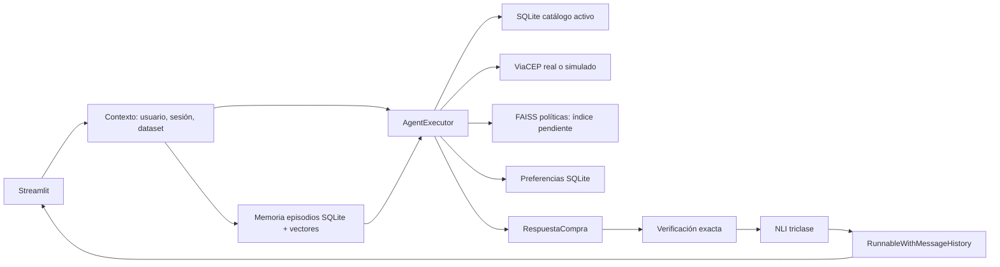

# Arquitectura ejecutada y pendiente

El [diagrama detallado de anatomía y arquitectura](pedro_asistente_de_compras.mmd) muestra el flujo del chat, las seis herramientas, las fuentes de datos y la verificación previa a la respuesta.

La memoria de episodios guarda el `dataset_id` del hecho. Su recuperación se ofrece al agente como historia; precios y stock vigentes siempre se leen del catálogo activo. El historial final se escribe una sola vez, después de la verificación. Las propuestas rechazadas quedan fuera del chat.
