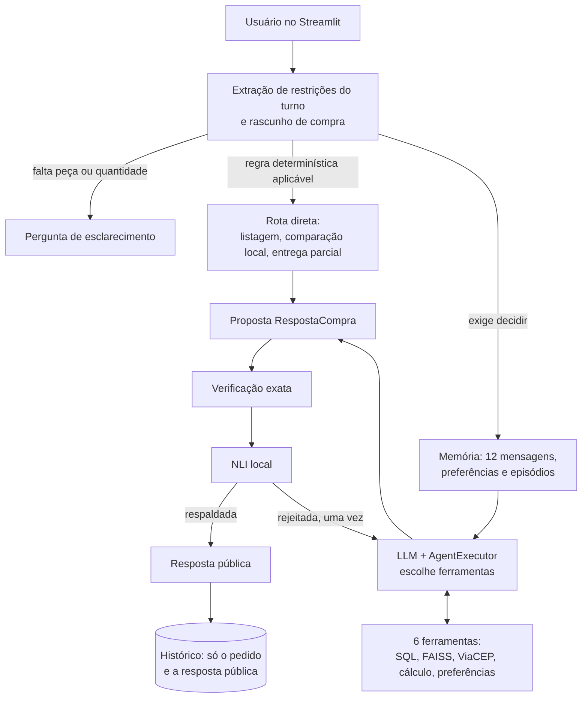
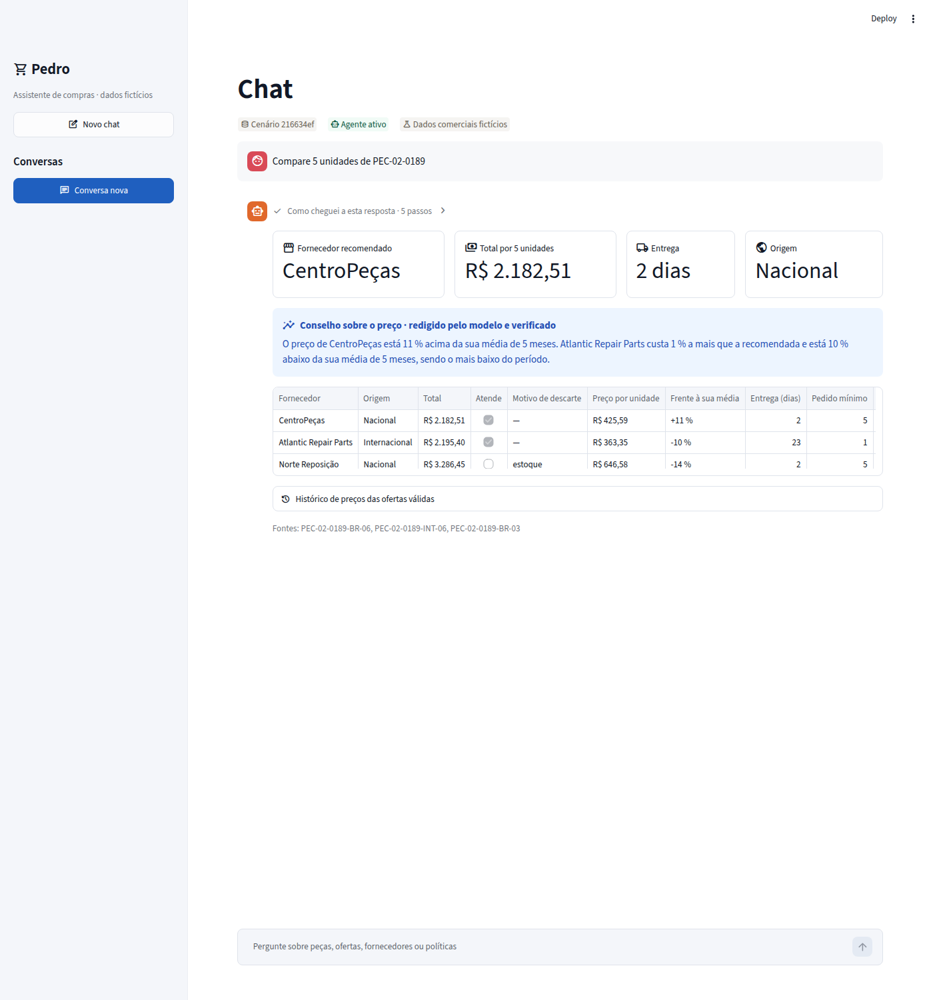

# Respostas às rubricas R01–R29

Este documento responde, uma por uma, às 29 perguntas da rubrica segundo o guia integrado [guide/Fases_Temas_Tareas_Rubricas_ComprasLab_Leyendas.pdf](../guide/Fases_Temas_Tareas_Rubricas_ComprasLab_Leyendas.pdf). Cada resposta indica o que foi feito, onde está a evidência, que decisão técnica foi tomada e o que fica pendente. O estado resumido de todas as rubricas está em [matriz.md](matriz.md) e o registro de execuções em [evidencias.md](evidencias.md).

Todos os dados do projeto (catálogo, fornecedores, estoque, preços e políticas) são sintéticos.

**Andamento da redação:** as 29 rubricas (R01–R29) estão redigidas e têm execução salva. As limitações de cada uma aparecem na sua seção.

---

# O núcleo do assistente: comparar fornecedores

Pedro é um assistente de compras. Todo o resto — memória, políticas, CEP, verificação — existe para que a comparação de fornecedores seja correta e confiável. Esta seção descreve essa comparação; as rubricas a citam.

## O que se compara

Para uma peça e uma quantidade, cada oferta de cada fornecedor é avaliada com quatro regras ([business.py](../src/pedro/business.py)):

| Regra | A oferta é descartada se… | Dado do catálogo |
|---|---|---|
| Estoque | Não há unidades suficientes | `stock_qty` |
| **Pedido mínimo** | O fornecedor exige comprar mais unidades do que as pedidas | `min_order_qty` |
| Prazo | Demora mais que o prazo máximo do usuário (se ele informou) | `lead_days` |
| Orçamento | O total supera o orçamento do usuário (se ele informou) | preço × quantidade + frete |

O total é `quantidade × preço unitário + frete`, sempre em centavos inteiros.

## Como se ordena

1. Primeiro, as ofertas que atendem a todas as regras.
2. Entre elas, as da **origem que o usuário prefere** (nacional ou internacional), se ele salvou essa preferência.
3. Depois, o menor total; em seguida o menor prazo; em seguida o identificador do fornecedor.

A preferência ordena as ofertas válidas, mas **nunca faz vencer uma oferta que não atende**. E se respeitá-la custa mais, a resposta diz isso.

## O histórico de preços

O catálogo guarda seis preços mensais por oferta. Para cada oferta válida, a resposta situa o preço de hoje nesse histórico: quanto custava no mês anterior, qual é a média dos cinco meses anteriores e se está no ponto mais baixo ou mais alto.

**O histórico informa, não decide.** O vencedor continua sendo o de menor total hoje. A decisão foi essa porque um preço passado não pode ser comprado: ele ajuda o comprador a julgar se é um bom momento, não a mudar qual oferta é a melhor agora. As médias são calculadas com centavos inteiros.

## O aviso de preço: as técnicas das rubricas aplicadas ao núcleo

O histórico não muda qual oferta vence, mas gera um **aviso** quando o preço de hoje se afasta do normal. Esse aviso foi construído com as técnicas que as rubricas pedem, todas juntas sobre o problema central do assistente ([precos.py](../src/pedro/precos.py)):

| Passo | O que faz | Técnica | Rubrica |
|---|---|---|---|
| 1. Sinal | Classifica o preço de hoje em relação à sua média: muito acima, acima, em linha, abaixo ou muito abaixo (limiares de 10 e 20 %) | Função *hardcoded* | R19 |
| 2. Fatos | Escreve os fatos em frases: quem vence, como está cada preço, quanto a mais custa cada alternativa | Função *hardcoded* | R19 |
| 3. Aviso fixo | Se o preço do vencedor se afasta da sua média, diz isso; e se outra oferta válida custa quase o mesmo e está em melhor momento, aponta-a | Função *hardcoded* | R19 |
| 4. Conselho do modelo | Um prompt PTCF com dois exemplos few-shot pede ao modelo um conselho de uma ou duas frases a partir dos fatos | PTCF e few-shot | R11 |
| 5. Saída estruturada | O conselho chega como um objeto Pydantic validado | Output parser | R04 |
| 6. Em paralelo, com plano B | O aviso fixo e o conselho do modelo são calculados em dois ramos (`RunnableParallel`); se o ramo do modelo falha, devolve vazio (`with_fallbacks`) | LCEL, paralelo, fallback | R06, R09, R12 |
| 7. Verificação exata | O conselho não pode trazer um número que não esteja nos fatos, deve nomear um fornecedor comparado e não pode prever preços | Coerência lógica | R24 |
| 8. NLI | Um modelo NLI confere que os fatos **sustentam** o conselho; só *entailment* o deixa passar | Consistência factual | R24 |
| 9. Publicação | Se o conselho passa, é publicado marcado como «redigido pelo modelo e verificado»; se não, fica o aviso fixo | Degradação | R12 |
| 10. Registro | O rastro guarda a fonte publicada, o conselho rejeitado e o motivo | Callbacks | R12 |

Aqui o modelo NLI faz, enfim, um trabalho que o código exato não consegue fazer: em uma recomendação numérica ele não acrescenta quase nada, mas um conselho é **texto livre**, e conferir que um texto decorre de certos fatos é justamente o que um NLI faz.

Exemplo real, «Compare 5 unidades de PEC-02-0189» ([rastros/precos_conselho_llm.json](rastros/precos_conselho_llm.json)):

```text
CentroPeças: R$ 2.182,51 para 5 unidades; prazo de 2 dias.
- CentroPeças (nacional): R$ 2.182,51; atende [PEC-02-0189-BR-06]
- Atlantic Repair Parts (internacional): R$ 2.195,40; atende [PEC-02-0189-INT-06]
- Norte Reposição (nacional): R$ 3.286,45; descartada por estoque [PEC-02-0189-BR-03]
Histórico de preços (informativo; não muda a recomendação):
- CentroPeças: hoje R$ 425,59 por unidade; mês anterior R$ 402,59 (+6 %); média de 5 meses R$ 384,95 (+11 %).
- Atlantic Repair Parts: hoje R$ 363,35 por unidade; mês anterior R$ 375,20 (-3 %); média de 5 meses R$ 404,40 (-10 %); é o seu preço mais baixo do período.
Conselho sobre o preço (redigido pelo modelo e verificado): O preço de CentroPeças está 11 % acima da sua
média de 5 meses. Atlantic Repair Parts custa 1 % a mais que a recomendada e o seu preço está 10 % abaixo
da sua média de 5 meses, sendo o mais baixo do período.
Fontes: PEC-02-0189-BR-06, PEC-02-0189-INT-06, PEC-02-0189-BR-03
```

Sem modelo, no lugar do conselho aparece o aviso fixo: «Aviso de preço: O preço de CentroPeças está 11 % acima da sua média de 5 meses. Atlantic Repair Parts custa R$ 12,89 a mais (1 %) e o seu preço está 10 % abaixo da sua média.»

**Medição com o modelo real** (`gpt-4.1-mini`) e o NLI real, sobre as primeiras quinze peças com aviso. A coluna do primeiro prompt é uma execução da versão anterior do projeto, em espanhol, que não foi refeita ([rastros/precios_consejo_llm_antes.json](rastros/precios_consejo_llm_antes.json)). A coluna do prompt ajustado é a execução atual, em português ([rastros/precos_conselho_llm.json](rastros/precos_conselho_llm.json)):

| | Primeiro prompt (versão anterior, em espanhol) | Prompt ajustado (execução atual, em português) |
|---|---|---|
| Conselhos que passaram na verificação | 5 de 15 | **14 de 15** |
| Rejeitados pelo NLI | 10 (8 *neutral*, 2 *contradiction*) | 0 |
| Rejeitados por números inventados | 0 | 1 |

- **Por que o primeiro prompt falhou.** O modelo acrescentava avaliações (citações da execução histórica, em espanhol): «una buena oportunidad para comprar hoy», «conviene evaluar si la entrega en 8 días justifica este costo». Os fatos não dizem isso, e o NLI as marcou como *neutral*. O próprio exemplo few-shot terminava com «es un buen momento para esta compra»: o modelo imitava o exemplo.
- **O que mudou.** Os exemplos foram reescritos para só enunciar e comparar fatos, e foi acrescentada a instrução de não avaliar.
- **A verificação não é perfeita.** A única rejeição da execução atual foi de um conselho verdadeiro (PEC-01-0020). Ele dizia que as alternativas «custam mais de 200 % a mais que a recomendada», e os fatos diziam 203 % e 233 % a mais. Quem rejeitou foi a verificação exata, não o NLI: o número 200 não está nos fatos. O erro foi para o lado seguro: foi publicado o aviso fixo.

O aviso dispara em 1.049 das 2.563 peças que têm uma recomendação para 5 unidades: quatro em cada dez.

**Decisão técnica.** O conselho do modelo contribui com a redação — une em uma frase o que o aviso fixo diz em separado — mas não traz nenhum dado. Por isso a falha dele não custa nada: atrás sempre está o aviso fixo, que diz o mesmo com menos graça. Foi descartado que o modelo decidisse se avisa ou não: essa decisão é um limiar, e um limiar é código.

## O que o usuário vê

Cada resposta mostra **todas** as ofertas, não só a vencedora: fornecedor, origem, total, e se atende ou por que foi descartada.

Exemplo da execução real ([rastros/fase3_memoria_llm.json](rastros/fase3_memoria_llm.json)):

```text
Usuário: Compare 2 unidades de PEC-11-0001        (tem salva a preferência «fornecedores nacionais»)

Casa Técnica Brasil: R$ 1.970,38 para 2 unidades; prazo de 9 dias.
- Casa Técnica Brasil (nacional): R$ 1.970,38; atende [PEC-11-0001-BR-04]
- Atlantic Repair Parts (internacional): R$ 619,38; atende [PEC-11-0001-INT-06]
- CentroPeças (nacional): R$ 1.179,23; descartada por estoque [PEC-11-0001-BR-06]
Histórico de preços (informativo; não muda a recomendação):
- Casa Técnica Brasil: hoje R$ 976,71 por unidade; mês anterior R$ 1.262,04 (-23 %); média de 5 meses R$ 1.110,59 (-12 %); é o seu preço mais baixo do período.
- Atlantic Repair Parts: hoje R$ 97,40 por unidade; mês anterior R$ 111,90 (-13 %); média de 5 meses R$ 103,63 (-6 %).
Conselho sobre o preço (redigido pelo modelo e verificado): O preço de Casa Técnica Brasil está 12 % abaixo
da sua média de 5 meses e é o mais baixo do período. Atlantic Repair Parts custa R$ 1.351,00 a menos que a
recomendada, entrega em 29 dias e seu preço está em linha com a média de 5 meses.
Foi aplicada a sua preferência por fornecedores nacionais. Sem ela, a mais barata seria Atlantic Repair Parts por R$ 619,38.
Fontes: PEC-11-0001-BR-04, PEC-11-0001-INT-06, PEC-11-0001-BR-06
```

## Perguntas sobre a comparação: a resposta direta

**O problema.** Depois de uma comparação, o usuário pergunta «a mais barata?» ou «qual é a mais em conta?». Antes, o chat mostrava de novo o mesmo painel, sem nenhuma frase que respondesse à pergunta. Às vezes terminava em «Não posso confirmar uma recomendação…»: o modelo respondia a partir do histórico, sem chamar a ferramenta de novo, e a verificação rejeitava a resposta.

**O que o usuário vê agora.** Um quadro verde acima dos cartões, com uma ou duas frases que respondem à pergunta. O título diz de onde veio o texto: «Resposta à sua pergunta · redigida pelo modelo e verificada» ou «Resposta à sua pergunta · resumo calculado pelo sistema». A comparação completa continua embaixo, igual.

A correção tem três partes:

| Parte | O que faz | Onde |
|---|---|---|
| 1. Reconhecer a pergunta | Uma regra (`pergunta_sobre_comparacao`) reconhece uma pergunta sobre a comparação em andamento: exige uma solicitação completa em andamento, um «?» e vocabulário de comparação (barata, prazo, fornecedor, por que…), e exclui políticas, CEP, preferências e envios. `interpretar_turno` a usa para deixar a solicitação como está. O prompt do intérprete (`MODELO_MUDANCA`) ganhou dois exemplos few-shot para esse caso | [dialogue.py](../src/pedro/dialogue.py); [prompts.py](../src/pedro/prompts.py) |
| 2. Recalcular sem depender do modelo | Para essa pergunta, o **sistema** refaz a comparação (`resposta_local`), em vez de esperar que o modelo chame a ferramenta de novo. O resultado passa pela verificação exata e pelo NLI, e o rastro registra o evento `comparacao_reutilizada` | `resolver`, em [agent.py](../src/pedro/agent.py) |
| 3. Responder à pergunta | `fatos_da_comparacao` monta os fatos. O modelo escreve uma ou duas frases (`criar_respondedor`; prompt `MODELO_RESPOSTA_DIRETA`: PTCF com um exemplo few-shot e saída Pydantic `RespostaDireta`). `verificar_resposta_direta` só publica a frase se os números dela estão nos fatos, se ela nomeia um fornecedor comparado e se o NLI devolve *entailment*. Se não, publica-se o `resumo_fixo`, calculado pelo sistema | [resposta_direta.py](../src/pedro/resposta_direta.py) |

É o mesmo padrão do conselho de preço: o modelo redige, o sistema verifica, e atrás há sempre um texto fixo. A resposta direta **nunca muda a recomendação nem os números**. Ela só roda quando a mensagem do usuário é uma pergunta (`e_pergunta`). O texto é também a primeira linha da mensagem pública (`_com_direta`) e viaja em `additional_kwargs["partes"][0]["direta"]`, de onde a interface o desenha (`mostrar_comparacao`, em [app.py](../app.py)).

**Medição com o modelo real** (`gpt-4.1-mini`) e o NLI real local, em 2026-11-11: uma comparação («Compare 5 unidades de PEC-01-0001 com prazo de 7 dias») e seis perguntas sobre ela ([rastros/pergunta_direta_llm.json](rastros/pergunta_direta_llm.json); [scripts/demonstrar_pergunta.py](../scripts/demonstrar_pergunta.py)). Nas seis perguntas o modelo não chamou nenhuma ferramenta, e a recomendação ficou igual: CentroPeças, R$ 7.279,83.

| Pergunta | O que foi publicado | Fonte |
|---|---|---|
| a mais barata? | «A oferta de menor total entre todas é a de Litoral Parts, por R$ 1.930,40, mas foi descartada por falta de estoque e prazo de entrega fora do limite. A mais barata que atende é a de CentroPeças, por R$ 7.279,83.» | Resposta verificada |
| qual é a mais em conta? | «A oferta mais em conta é a de Litoral Parts, com custo total de R$ 1.930,40, mas foi descartada […]. Entre as que atendem, a mais barata é a de CentroPeças, por R$ 7.279,83.» | Resposta verificada |
| qual chega mais rápido? | «A entrega mais rápida entre todas é a da CentroPeças, que entrega em 2 dias.» | Resposta verificada |
| por que não a Litoral Parts? | O resumo fixo: «A mais barata que atende às suas restrições é a de CentroPeças, por R$ 7.279,83, com entrega em 2 dias. A de menor total é a de Litoral Parts, por R$ 1.930,40, mas foi descartada porque não tem estoque suficiente e porque o prazo de entrega passa do máximo pedido.» | Resumo fixo |
| e a Atlantic, quanto custa? | «A oferta da Atlantic Repair Parts custa R$ 7.344,92 no total, mas foi descartada porque o prazo de entrega passa do máximo pedido de 7 dias.» | Resposta verificada |
| alguma é internacional? | «Sim, a oferta da Atlantic Repair Parts é internacional, mas foi descartada porque o prazo de entrega passa do máximo pedido.» | Resposta verificada |
| **Total** | **6 perguntas respondidas** | **5 respostas verificadas, 1 resumo fixo** |

Limites:

- **A regra é de vocabulário.** Uma pergunta sem nenhuma daquelas palavras continua indo para o agente.
- **O NLI rejeitou uma frase verdadeira.** Em «por que não a Litoral Parts?» o modelo escreveu «A oferta de Litoral Parts foi descartada porque não tem estoque suficiente e o prazo de entrega passa do máximo pedido de 7 dias.» A frase é verdadeira, e o NLI a marcou como *contradiction*. Falhou para o lado seguro: foi publicado o resumo fixo.
- **O resumo fixo não se adapta à pergunta.** Ele diz sempre a mesma coisa: a mais barata que atende e a de menor total.
- **Uma única execução**, com seis perguntas sobre uma peça.
- **As outras demonstrações não foram refeitas.** Depois desta mudança só foram executados este script e o de R17. As demais demonstrações com o modelo real e a avaliação no LangSmith não foram reexecutadas: os rastros salvos delas são anteriores.

Os testes estão em [tests/test_resposta_direta.py](../tests/test_resposta_direta.py) (10 testes, com duplos).

## A descoberta que mudou a comparação

Durante quase todo o projeto a comparação ignorou o pedido mínimo, embora o dado estivesse no catálogo. O exemplo usado em todas as demonstrações estava errado como recomendação de compra:

| «2 unidades de PEC-01-0001 com prazo de 7 dias» | Antes | Agora |
|---|---|---|
| CentroPeças (pedido mínimo: 5 unidades) | **Recomendada**: R$ 2.963,07 | Descartada por pedido mínimo (5 unidades) |
| Atlantic Repair Parts | Descartada por prazo | Descartada por prazo |
| Resultado | Uma recomendação que o fornecedor não aceitaria | «Nenhuma oferta atende»; com 5 unidades sim: CentroPeças, R$ 7.279,83 |

No catálogo há 1.151 ofertas com estoque cujo pedido mínimo é maior que 2. O erro não foi encontrado por nenhum teste nem por nenhuma métrica: todos conferiam que o agente coincidia com uma referência que tinha a mesma lacuna. Ele foi encontrado ao revisar quais dados do fornecedor a comparação usava e quais não. Ao corrigir:

- 5 dos 14 casos de recomendação da avaliação mudaram: 2 de vencedor e 3 passaram a «nenhuma oferta». Os casos foram regenerados com uma regra de referência independente do agente, que inclui o pedido mínimo.
- A preferência «fornecedores nacionais», que antes só era salva, agora muda a recomendação.
- Cada oferta mostra se o fornecedor é nacional ou internacional.
- O histórico de preços, que o catálogo tinha e ninguém usava, aparece em cada comparação.

## O que ainda não se compara

- O aviso de preço informa, mas não muda a ordem: o vencedor continua sendo o mais barato hoje.
- Os limiares do aviso (10 e 20 %) foram fixados por critério, sem calibração; o aviso dispara em quatro de cada dez recomendações, o que é muito.
- O conselho verificado não foi auditado frase por frase: são conferidos os seus números, os seus fornecedores e o NLI, não cada comparação («mais caro», «entrega mais rápido»).
- O histórico são seis meses de dados sintéticos; não há previsão de preços.
- Não se combinam fornecedores para cobrir uma quantidade: um pedido vai inteiro para um fornecedor.
- A preferência de origem é a única que muda a ordem; outras preferências salvas não têm efeito.
- O frete não depende do destino: o ViaCEP só confirma a cidade.

---

# Fase 1 — Chain executável e arquitetura

## R01 — Anatomia, arquitetura cognitiva, tipo de agente e maturidade agêntica

> O aluno estruturou a anatomia e a arquitetura cognitiva do agente, classificando seu tipo e nível de maturidade agêntica?

**Resposta curta.** O Pedro é um agente **híbrido**: uma camada reativa de regras determinísticas resolve o que não deve ficar a critério do modelo, e uma camada deliberativa, guiada pelo LLM, escolhe ferramentas, mantém estado entre turnos e revisa a própria proposta antes de publicá-la. Sua maturidade atual é a de um **agente único com ferramentas, memória e autoverificação** (nível 4 de 5 na escala usada abaixo), e essa é também a maturidade objetivo, consolidada com avaliação medida.

### 1. Anatomia do agente

Em aula, a anatomia geral de um agente foi descrita com quatro elementos — ambiente, sensores, ferramentas e motor cognitivo (o LLM) — mais um orquestrador que comunica ferramentas, prompts e memórias (aula de 14-10-2026, revisão da primeira aula). A tabela aplica essa anatomia ao Pedro e acrescenta os componentes que o guia pede: system message, memória, base de conhecimento e fluxo geral.

| Componente | No Pedro | Localização |
|---|---|---|
| **Ambiente** | Um cenário isolado: cópia SQLite do catálogo com `dataset_id` UUID e manifesto SHA-256, o corpus de políticas e o serviço externo ViaCEP. O agente só lê; não compra nem paga. | [catalog.py](../src/pedro/catalog.py) |
| **Motor cognitivo (LLM)** | `ChatOpenAI`, modelo `gpt-4.1-mini` por padrão, configurável com `PEDRO_MODEL`. Sem `OPENAI_API_KEY` a aplicação funciona degradada com a camada determinística. | [app.py](../app.py) |
| **System message** | Prompt com estrutura PTCF (Persona, Tarefa, Contexto, Formato), o `dataset_id` ativo, seis exemplos few-shot de ações observáveis e as instruções de formato de `RespostaCompra`. | `criar_agente` em [agent.py](../src/pedro/agent.py); [prompts.py](../src/pedro/prompts.py) |
| **Sensores** (ferramentas que percebem o ambiente) | `buscar_produtos` (candidatos por ID, SKU ou nome), `consultar_catalogo` (text-to-query sobre SQLite), `consultar_politicas` (recuperação FAISS com fontes) e `consultar_cep` (API externa ViaCEP). | `ferramentas` em [agent.py](../src/pedro/agent.py); [query.py](../src/pedro/query.py); [rag.py](../src/pedro/rag.py); [integrations.py](../src/pedro/integrations.py) |
| **Ferramentas** (que calculam ou agem) | `comparar_ofertas` (cálculo exato em centavos com descartes) e `salvar_preferencia` (única escrita: uma preferência citada explicitamente pelo usuário). | `ferramentas` em [agent.py](../src/pedro/agent.py); [business.py](../src/pedro/business.py) |
| **Memória** | Curto prazo: janela das últimas 12 mensagens e rascunho de compra por sessão. Longo prazo: preferências explícitas por usuário e episódios vetoriais FastEmbed (384 dimensões) recuperáveis entre sessões. Tudo em SQLite, isolado por `user_id`. | [memory.py](../src/pedro/memory.py); [dialogue.py](../src/pedro/dialogue.py) |
| **Base de conhecimento** | Dados estruturados: catálogo SQLite (2640 peças, 7920 ofertas). Dados documentais: políticas indexadas em FAISS com metadados e filtro por tema. | [catalog.py](../src/pedro/catalog.py); [policy_demo.py](../src/pedro/policy_demo.py); [knowledge/politicas_demo/](../knowledge/politicas_demo/) |
| **Orquestrador** | LangChain: `create_openai_tools_agent` + `AgentExecutor` (máximo de 6 iterações) envolvidos em `RunnableWithMessageHistory`. | `criar_agente` e `criar_fluxo` em [agent.py](../src/pedro/agent.py) |
| **Porta de publicação** | Verificação exata (total, estoque, orçamento, prazo, IDs, procedência) e NLI local triclasse. Só se mostra o que passa pelas duas. | [verification.py](../src/pedro/verification.py); [nli.py](../src/pedro/nli.py) |
| **Interface** | Streamlit com um chat sobre o mesmo agente, memória e verificador. | [app.py](../app.py) |

### 2. Arquitetura cognitiva e fluxo geral



A arquitetura cognitiva é descrita com CoALA, o marco que o curso usa por padrão para agentes cognitivos (aula de 21-10-2026):

| Elemento CoALA | No Pedro |
|---|---|
| Memória de trabalho | Mensagem atual, rascunho de compra da sessão e janela de 12 mensagens |
| Memória episódica | Episódios vetoriais de recomendações passadas, por usuário |
| Memória semântica | Catálogo SQLite, políticas em FAISS e preferências explícitas do usuário |
| Memória procedimental | System message PTCF, exemplos few-shot, regras determinísticas e código de verificação |
| Ações internas | Recuperar lembranças e políticas (retrieval), raciocinar com o LLM, salvar um episódio ou uma preferência (aprendizado) |
| Ações externas | Ler SQLite, consultar o ViaCEP e responder ao usuário |
| Ciclo de decisão | Propor (regra ou LLM com ferramentas) → avaliar (verificação exata e NLI) → executar (publicar ou corrigir uma vez) |

O ciclo de um turno é: **perceber** (extrair intenção e restrições da mensagem, carregar memória), **decidir** (regra direta ou agente com ferramentas), **agir** (consultar SQL, políticas ou API e calcular), **verificar** (checagens exatas e NLI) e **responder**. Se a proposta não passa na verificação, o agente tem uma única passada de correção; se falhar de novo, a recomendação não é publicada. O mesmo fluxo está em [arquitetura.mmd](arquitetura.mmd).

### 3. Classificação: agente híbrido

| Camada | Comportamento no Pedro | Por que pertence a essa camada |
|---|---|---|
| **Reativa** | Pedir a quantidade quando falta; encaminhar «Posso receber em várias caixas?» diretamente a `consultar_politicas`; comparar ofertas em centavos inteiros com desempate fixo; listar o catálogo; operar sem chave da OpenAI. | Estímulo → resposta por regra fixa, sem modelo do mundo nem planejamento. É previsível e verificável. |
| **Deliberativa** | O LLM decide quais ferramentas chamar e em que ordem (até 6 iterações); mantém um estado interno entre turnos (rascunho, janela de mensagens, lembranças); confronta sua proposta com a evidência e a corrige uma vez antes de publicar. | Há representação de estado, escolha entre alternativas e revisão da própria saída diante de um objetivo. |

O Pedro não é **reativo puro** porque conserva estado entre turnos e escolhe ferramentas conforme a solicitação. Também não é **deliberativo puro** porque não constrói um plano explícito de vários passos nem replaneja além da única correção, e porque uma parte das decisões é tomada por regras determinísticas.

**Decisão técnica.** O desenho híbrido foi escolhido de propósito. Em aula, a autonomia foi definida como um agente «pronto para tomar decisões e não só para obedecer direcionamentos», e foi feito o alerta de que usar um LLM só para seguir ordens é desperdiçar o recurso. O Pedro aplica esse critério onde ele agrega valor — interpretar a solicitação, escolher ferramentas, redigir a resposta — e o retira onde um erro teria custo: os valores, o estoque, os prazos e a procedência das fontes são calculados e verificados com código determinístico, nunca com o modelo.

### 4. Maturidade agêntica: atual e objetivo

> **Suposição declarada.** A escala de maturidade foi apresentada na primeira aula, cuja transcrição não está neste workspace. Usa-se aqui uma escala genérica de cinco níveis; ela deve ser substituída pela escala exata do curso quando estiver disponível, ajustando só o rótulo do nível.

| Nível | Descrição | O Pedro alcança? |
|---|---|---|
| 1 | Chain fixa: uma chamada ao LLM com entrada e saída estruturadas | Sim — [chains.py](../src/pedro/chains.py), notebook 01 |
| 2 | Roteamento: o fluxo escolhe entre caminhos predefinidos | Sim — `RouterCompras` em [legacy.py](../src/pedro/legacy.py) e rotas diretas em [agent.py](../src/pedro/agent.py) |
| 3 | Agente com ferramentas: o LLM decide qual ferramenta usar | Sim — seis ferramentas sob o `AgentExecutor` |
| 4 | Agente com memória e autoverificação: estado entre turnos e sessões, e revisão da própria saída antes de publicar | **Sim — nível atual** |
| 5 | Sistema multiagente ou autônomo: planejamento de longo horizonte, vários agentes, ações com efeito real | Não, e não é o objetivo |

**Ponto de partida: nível 4 no desenho, demonstrado só em local.** Quando este documento começou, o agente já decidia ferramentas, lembrava e se autoverificava, com autonomia limitada de propósito: só lê do cenário, sua única escrita é uma preferência explícita do usuário, tem um máximo de 6 iterações e uma única correção. Faltava a evidência com o modelo real.

**Maturidade objetivo: nível 4 demonstrado com medições.** Foram fixados quatro critérios. Esta é a situação de cada um depois de executar as demais rubricas:

| Critério | Como foi medido | Resultado | Rubrica |
|---|---|---|---|
| O LLM real escolhe as ferramentas corretas | Trajetória em 30 casos do LangSmith | Ferramenta decisiva 23 de 23; trajetória completa 26 de 30 (16 e 23 nas execuções anteriores, em espanhol): o agente às vezes usa um caminho mais curto que o da referência | R29 |
| As respostas são corretas | Vencedor, valor e conteúdo no LangSmith | 14 de 14, 14 de 14 e 16 de 16 | R29 |
| Nada é publicado sem respaldo | Recomendações contrárias à regra publicadas | 0 em nove experimentos | R24 |
| Há continuidade entre turnos com o modelo real | Conversa real multi-turno | Oito turnos com estado correto | R18, R26, R27 |

Os números do LangSmith desta tabela são do experimento em português ([rastros/r29_langsmith_gpt-4.1-mini_portugues.json](rastros/r29_langsmith_gpt-4.1-mini_portugues.json)); dos nove experimentos, oito são da versão anterior do projeto, em espanhol, e o detalhe está em R29. A conversa de oito turnos foi refeita em português ([rastros/fase3_memoria_llm.json](rastros/fase3_memoria_llm.json)).

**Maturidade atual: nível 4 demonstrado**, com uma ressalva que impede dá-lo por consolidado: as medições são execuções únicas sobre casos derivados, não sobre os oficiais.

Não se busca o nível 5 porque o problema — recomendar uma oferta verificada para uma peça — não exige vários agentes nem executar compras, e mais autonomia reduziria a rastreabilidade que a porta de verificação garante.

### Evidência

| Evidência | Localização | Tipo |
|---|---|---|
| Anatomia lida dos objetos reais do agente: modelo, executor, system message PTCF, seis ferramentas com seu papel e lógica, memória, base de conhecimento e porta de publicação | [notebooks/01_chain_mvp.ipynb](../notebooks/01_chain_mvp.ipynb) §«R01 · anatomia do agente»; [anatomia.py](../src/pedro/anatomia.py) | Execução real local (sem modelo) |
| Agente híbrido em ação: «lista peças» e «Compare PEC-01-0001» são resolvidas por regra, sem passar pelo agente (na segunda, o intérprete de turno lê a mensagem); a pergunta de CEP passa pelo agente, que recebe seis ferramentas e executa `consultar_cep` | [notebooks/01_chain_mvp.ipynb](../notebooks/01_chain_mvp.ipynb) §«R01 · agente híbrido» | Execução com **duplo de teste**: modelo roteirizado e ViaCEP simulado; o fluxo, o executor, a ferramenta e a verificação são os reais |
| A anatomia descrita coincide com o agente construído | [tests/test_anatomia.py](../tests/test_anatomia.py) | Teste automático (153/153 testes na suíte) |
| Explicação de componentes, classificação e maturidade | Esta seção; [arquitetura.mmd](arquitetura.mmd) | Documentação |

### Pendências e limitações

- A escala de maturidade é genérica (suposição declarada); substituí-la pela do curso quando a aula 1 estiver disponível.
- Na demonstração da camada deliberativa quem pede a ferramenta é um modelo roteirizado, não um LLM. A escolha feita pelo modelo real está documentada em R26.
- O chat usa por padrão o índice de políticas demo em memória. O índice persistido que R22 exige está em `knowledge/politicas/` e só é carregado com `PEDRO_TRUST_POLICY_INDEX=true`.

---

## R02 — Arquitetura de planejamento e memória aumentada

> O aluno projetou uma arquitetura de planejamento e memória aumentada para o agente?

**Resposta curta.** Uma solicitação complexa é dividida em cinco subtarefas com saída observável (extrair, consultar, comparar, verificar, publicar). A memória se reparte em dois níveis: a **sessão** guarda o que só serve para a compra em andamento e o **usuário** guarda o que deve sobreviver à sessão. Nenhum preço nem estoque vem da memória: eles são sempre relidos do cenário ativo.

### 1. Planejamento: como uma solicitação é dividida

| Passo | Subtarefa | Quem faz | Saída observável |
|---|---|---|---|
| 1 | Extrair peça, quantidade, orçamento e prazo da mensagem; detectar o que falta | Regra determinística | Rascunho `EstadoCompra` ou pergunta de esclarecimento |
| 2 | Consultar os dados necessários | Ferramentas de leitura (SQL, FAISS, ViaCEP) | Ofertas, fragmentos de política ou cidade/UF |
| 3 | Comparar ofertas com as restrições | Cálculo determinístico em centavos: estoque, pedido mínimo, prazo, orçamento e preferência de origem | Alternativas com «atende» ou motivo de descarte |
| 4 | Verificar a proposta | Verificação exata e NLI | Lista de erros (vazia se passa) |
| 5 | Publicar ou corrigir | Fluxo | Resposta pública, ou uma única correção |

Há três níveis de planejamento, conforme o tipo de solicitação:

- **Plano fixo (camada reativa).** Uma compra com ID e quantidade segue sempre os passos 1 a 5 nessa ordem, sem modelo.
- **Plano decidido pelo LLM (camada deliberativa).** Quando o modelo intervém — por exemplo para confirmar um CEP ou recalcular depois de «agora 6 unidades» —, o agente escolhe quais ferramentas chamar e em que ordem dentro do `AgentExecutor`, com um máximo de 6 iterações. O prompt lhe dá um «plano visível»: `buscar_produtos` para resolver o ID, `consultar_catalogo` para as ofertas e `comparar_ofertas` para todos os valores.

- **Plano de turno (planejador explícito).** Se a mensagem traz várias intenções, o modelo escreve primeiro um plano com um pedido por intenção. Exemplo real: «Compare 5 unidades de PEC-01-0001 com prazo de 7 dias e diga o que a política de devoluções diz sobre peças danificadas, e confirme o CEP 01001000» produziu este plano, e cada pedido foi respondido e verificado separadamente:

  | # | Tipo | Pedido |
  |---|---|---|
  | 1 | compra | Compare 5 unidades de PEC-01-0001 com prazo de 7 dias |
  | 2 | politica | O que a política de devoluções diz sobre peças danificadas? |
  | 3 | cep | Confirme o CEP 01001000 |

Regras de planejamento:

- Só se pergunta pelo que bloqueia o plano: a peça e a quantidade. Orçamento e prazo são filtros opcionais.
- O pedido atual prevalece sobre o histórico: uma mudança de quantidade conserva os demais limites.
- O plano nunca termina em uma ação com efeito real: não há compra nem pagamento.

**Decisão técnica.** O planejador explícito foi acrescentado depois, quando uma execução real mostrou que ele era necessário. No começo ele não existia: uma solicitação que misturava compra, política e CEP fazia o modelo chamar as ferramentas corretas, mas a resposta não era publicada, porque o formato admite um único tipo. Em vez de complicar o formato, foi acrescentado um passo prévio ([planner.py](../src/pedro/planner.py)): se a mensagem mostra sinais de duas ou mais intenções, o modelo escreve um **plano** com um pedido por intenção, e cada pedido é resolvido com o fluxo normal e sua própria verificação. O plano é validado antes de ser usado: não pode repetir um tipo nem conter um identificador ou um número que o usuário não tenha escrito. Para uma mensagem de uma única intenção o planejador não é chamado. O que não se guarda é o raciocínio privado do modelo: conservam-se o plano e as chamadas a ferramentas, que são observáveis.

### 2. Memória aumentada: o que vai para cada nível

| Informação | Nível | Onde vive | Quando é atualizada ou descartada |
|---|---|---|---|
| Mensagem atual | Curto prazo | Entrada do turno | É substituída a cada turno |
| Rascunho de compra (peça, quantidade, orçamento, prazo) | Curto prazo | SQLite, por sessão | A cada turno; um ID diferente o reinicia; «sem orçamento/prazo» apaga esse limite |
| Janela de conversa | Curto prazo | Últimas 12 mensagens da sessão | Janela deslizante; o histórico completo é conservado, mas não é enviado |
| Preferências do usuário | Longo prazo (semântica) | SQLite, por usuário | Só se o usuário a cita explicitamente; o valor novo substitui o anterior |
| Episódios de recomendações | Longo prazo (episódica) | SQLite com vetor FastEmbed, por usuário | É salvo quando o agente publica uma resposta de compra verificada; é recuperado por similaridade (top 3) |
| Regras, prompt e verificação | Longo prazo (procedimental) | Código e `prompts.py` | Muda só com uma nova versão do projeto |
| Preços, estoque e prazos | **Não é memória** | Cenário SQLite ativo | São sempre relidos; os valores de um episódio são tratados como históricos |

**Decisão técnica.** A separação por sessão e por usuário evita dois erros do domínio: arrastar a quantidade de uma compra para outra, e recomendar com um preço velho. Por isso o rascunho morre com a sessão e os episódios são injetados com o rótulo «histórico» e a instrução de não usar seus preços nem seu estoque. Cada lembrança leva seu `dataset_id`, então um episódio de outro catálogo fica identificado.

### Evidência

| Evidência | Localização | Tipo |
|---|---|---|
| Solicitação «Preciso de 5 unidades de PEC-01-0001 até R$ 10.000 em 7 dias» dividida nos cinco passos, com a saída de cada um | [notebooks/01_chain_mvp.ipynb](../notebooks/01_chain_mvp.ipynb) §«R02 · planejamento» | Execução real local (sem modelo) |
| Curto prazo: ao pedir «agora 6 unidades» o rascunho conserva o prazo de 7 dias; 18 mensagens salvas, 12 visíveis | [notebooks/01_chain_mvp.ipynb](../notebooks/01_chain_mvp.ipynb) §«R02 · memória aumentada» | Execução real local (sem modelo) |
| Longo prazo: a preferência aparece em uma sessão nova do mesmo usuário e não em outro usuário; a sessão nova começa sem rascunho | Mesmo notebook | Execução real local |
| Plano decidido pelo LLM real, por turnos: compra → `comparar_ofertas` (CentroPeças, R$ 7.279,83 para 5 unidades); CEP → `consultar_cep` (São Paulo/SP); «agora 6 unidades» → `comparar_ofertas` com quantidade 6 e o prazo de 7 dias conservado (R$ 8.718,75) | [rastros/r02_planejamento_llm.json](rastros/r02_planejamento_llm.json); [scripts/demonstrar_r02.py](../scripts/demonstrar_r02.py) | **Execução real remota** (OpenAI `gpt-4.1-mini`, ViaCEP real, NLI real local) |
| Pergunta de política por turnos: antes não era publicada (execução da versão anterior, em espanhol); com as citações ancoradas é publicada com duas fontes | [rastros/r02_planificacion_llm_antes.json](rastros/r02_planificacion_llm_antes.json) (histórico, em espanhol) e [rastros/r02_planejamento_llm.json](rastros/r02_planejamento_llm.json); [citacoes_ancoradas.md](citacoes_ancoradas.md) | Execução real remota, antes e depois |
| Solicitação mista em um único turno, **com planejador**: plano de três pedidos (compra, política, CEP), os três publicados; as três verificações passaram na primeira proposta, sem correção | [rastros/r02_planejamento_llm.json](rastros/r02_planejamento_llm.json), `solicitacao_mista_em_um_turno` | **Execução real remota** (`gpt-4.1-mini`, ViaCEP) |
| A mesma solicitação **antes do planejador** (execução da versão anterior, em espanhol; na época com 2 unidades, antes da regra do pedido mínimo): o LLM chamou as ferramentas corretas, mas a resposta não foi publicada | [rastros/r02_planificacion_llm_sin_plan.json](rastros/r02_planificacion_llm_sin_plan.json) | Execução real remota; resultado negativo conservado |
| O plano é descartado se inventa dados, repete um tipo ou não se encaixa; cada pedido passa pela sua verificação | [tests/test_planner.py](../tests/test_planner.py) | Testes automáticos com duplo |
| Episódios vetoriais salvos, atualizados e recuperados | [notebooks/03_memoria_chatbot.ipynb](../notebooks/03_memoria_chatbot.ipynb) | Execução real local (FastEmbed) |
| Regras do rascunho e isolamento | [tests/test_dialogue.py](../tests/test_dialogue.py); [tests/test_memory_nli.py](../tests/test_memory_nli.py) | Testes automáticos |

### Pendências e limitações

- **A solicitação mista em um único turno foi resolvida com um planejador.** Antes ela não era publicada. Limite atual: o planejador reconhece quatro tipos de pedido e no máximo um de cada tipo; duas compras na mesma mensagem são tratadas como um único pedido.
- **A pergunta geral de política falhou com o modelo real e foi corrigida.** A falha é da versão anterior, em espanhol: o modelo citava o fragmento quase literal e a verificação exigia texto idêntico. Agora o sistema ancora a citação ao texto da fonte; diagnóstico e antes/depois em [citacoes_ancoradas.md](citacoes_ancoradas.md).
- O planejador só atua com o modelo disponível; sem credenciais, uma mensagem mista é tratada como um único pedido.
- Não há resumo do histórico: o que sai da janela de 12 mensagens só volta se ficou como episódio ou preferência.
- A trajetória do LLM pode variar entre execuções; o rastro salvo é uma observação, não uma métrica.

## R03 — Modelos de prompt reutilizáveis

> O aluno construiu modelos de prompt reutilizáveis com PromptTemplate ou ChatPromptTemplate?

**Resposta curta.** Sim. Há dez `ChatPromptTemplate` com nome próprio (`MODELO_*`) em [prompts.py](../src/pedro/prompts.py). Os dois principais são o que interpreta solicitações de compra e o do agente final. O primeiro é reutilizado em duas cadeias diferentes e foi executado com o modelo real sobre três solicitações do domínio.

### 1. Os modelos de prompt

| Modelo de prompt | Para que serve | Variáveis | Onde é reutilizado |
|---|---|---|---|
| `MODELO_EXTRACAO` (alias `PROMPT` em [chains.py](../src/pedro/chains.py)) | Interpretar uma solicitação e devolver intenção, dados e faltantes | `texto` (a solicitação) e `formato` (instruções do parser) | Cadeia LCEL (`criar_lcel`) e cadeia `@chain` (`criar_chain`) |
| `MODELO_AGENTE`, usado por `criar_agente` em [agent.py](../src/pedro/agent.py) | System message PTCF do agente final | `dataset_id`, `exemplos`, `formato`, `input`, `chat_history`, `agent_scratchpad` | Cada turno e cada correção do agente, com qualquer cenário |

Os dois têm a mesma forma: uma mensagem de sistema fixa com lacunas e uma mensagem humana com a solicitação. Os exemplos few-shot estão no mesmo arquivo e entram no modelo de prompt do agente como mais uma variável.

Os outros oito seguem a mesma forma e estão no mesmo arquivo: `MODELO_EXTRACAO_FEWSHOT` e `MODELO_EXTRACAO_COT` (variantes da extração, R11), `MODELO_REPARO` (R04), `MODELO_SQL` (R21), `MODELO_MUDANCA` (intérprete de turno, R17), `MODELO_CONSELHO` (conselho de preço), `MODELO_PLANO` (planejador, R02) e `MODELO_RESPOSTA_DIRETA`. Este último é o mais novo: responde a uma pergunta sobre a comparação, com as variáveis `fatos`, `pergunta` e `formato` (ver «Perguntas sobre a comparação: a resposta direta»).

### 2. O que os torna reutilizáveis

- **Variáveis em vez de texto fixo.** A solicitação, o cenário e os exemplos são injetados; o texto do modelo de prompt não muda.
- **`partial` para o que não muda por turno.** As instruções de formato saem do parser Pydantic e são fixadas uma vez; fica livre só `texto`.
- **Um único arquivo.** Os modelos de prompt e os exemplos vivem em `prompts.py`; o resto do código os importa.
- **Um objeto, várias cadeias.** O mesmo `PROMPT` alimenta a versão declarativa e a imperativa, então uma mudança de redação é feita em um só lugar.

**Decisão técnica.** Foi escolhido `ChatPromptTemplate` e não `PromptTemplate` porque o modelo é de chat e o modelo de prompt precisa separar papéis: as regras vão na mensagem de sistema e a solicitação do usuário na mensagem humana. Essa separação evita que o texto do usuário se misture com as instruções. Coincide com a orientação dada em aula de focar em `ChatPromptTemplate` como padrão atual. Não foi acrescentado um `PromptTemplate` de texto puro só para exibi-lo: a rubrica pede um ou outro e nenhum ponto do fluxo usa um modelo de texto.

### Evidência

| Evidência | Localização | Tipo |
|---|---|---|
| O modelo de prompt preenchido com três solicitações do domínio: classe, variáveis, `partial`, mensagens resultantes e comprovação de que a cadeia LCEL usa o mesmo modelo de prompt | [notebooks/01_chain_mvp.ipynb](../notebooks/01_chain_mvp.ipynb) §«R03 · modelo de prompt reutilizável» | Execução real local (sem modelo) |
| O modelo de prompt executado com o LLM: «Compare 2 unidades de PEC-01-0001 até R$ 5.000 em 7 dias» → comparar, 2 unidades, 500000 centavos, 7 dias; «Preciso de um termostato para geladeira, sem pressa» → intenção outro, falta quantidade; «A que cidade corresponde o CEP 01001000?» → intenção cep | [rastros/fase1_chain_llm.json](rastros/fase1_chain_llm.json); [scripts/demonstrar_fase1.py](../scripts/demonstrar_fase1.py) | **Execução real remota** (OpenAI `gpt-4.1-mini`, temperatura 0) |
| Cada modelo de prompt declara suas variáveis, separa sistema e humano, serve para qualquer cenário e falha se falta uma variável | [tests/test_prompts.py](../tests/test_prompts.py) | Testes automáticos |
| O mesmo modelo de prompt nas cadeias LCEL e `@chain` com modelo duplo | [notebooks/01_chain_mvp.ipynb](../notebooks/01_chain_mvp.ipynb), primeira célula | Execução com duplo de teste |

### Pendências e limitações

- A execução real é uma única rodada de três solicitações; não mede a taxa de acerto da extração.

## R04 — Output parser com saída estruturada em JSON

> O aluno implementou um output parser para gerar saída estruturada em JSON a partir da chain?

**Resposta curta.** Sim. A cadeia converte uma solicitação em um objeto `Extracao` validado com Pydantic. Além disso foi construído um **laboratório de saídas quebradas**: oito defeitos típicos de um modelo, cada um resolvido por uma camada diferente, com o modelo real fazendo os reparos.

### 1. Da solicitação ao objeto validado

«Compare 2 unidades de PEC-01-0001 até R$ 5.000 em 7 dias» produz, com o modelo real:

```json
{"intencao": "comparar",
 "solicitacao": {"produto_id": "PEC-01-0001", "quantidade": 2,
                 "orcamento_centavos": 500000, "prazo_max_dias": 7},
 "faltantes": []}
```

O esquema está em [contracts.py](../src/pedro/contracts.py) e a cadeia em [chains.py](../src/pedro/chains.py): modelo de prompt → modelo → `PydanticOutputParser` → regra de domínio.

### 2. Três camadas de defesa

Um modelo pode falhar de três maneiras diferentes, e cada uma precisa de uma defesa diferente:

| Camada | O que defende | Como |
|---|---|---|
| **Sintaxe** | Que a saída seja JSON | O parser tolera cercas de markdown e texto ao redor |
| **Esquema** | Que os dados tenham o tipo correto | O Pydantic rejeita «dois» como quantidade, uma quantidade negativa ou uma intenção fora da lista |
| **Domínio** | Que o dado signifique o correto | Os faltantes são recalculados pelo código: não se confia no que o modelo declara. Um dado ausente é `null`, nunca zero |

Quando a sintaxe ou o esquema falham, uma **segunda cadeia repara** a saída (`criar_lcel_robusta`). Ela recebe a solicitação original, a saída inválida e a mensagem de erro, e sua resposta passa de novo pelo mesmo parser. Está montada com `with_fallbacks`, então o reparo só é executado se houver erro. Há um único reparo: se ele também falhar, o erro se propaga e nada é publicado.

### 3. O laboratório de saídas quebradas

Oito saídas para a mesma solicitação. O gerador é um duplo que emite o defeito; o reparador é o `gpt-4.1-mini` real.

| Defeito | Camada que o resolveu | Reparos | Dados finais corretos |
|---|---|---|---|
| JSON válido | Nenhuma | 0 | Sim |
| Cercas markdown e conversa ao redor | Parser | 0 | Sim |
| JSON truncado | Reparo | 1 | Sim |
| Quantidade por extenso («dois») | Reparo | 1 | Sim |
| Quantidade negativa | Reparo | 1 | Sim |
| Intenção fora da lista | Reparo | 1 | Sim |
| Texto livre sem JSON | Reparo | 1 | Sim |
| Faltantes mal declarados | Regra de domínio | 0 | Sim (marca «quantidade» como faltante) |

### 4. Achado: um parser tolerante pode perder dados em silêncio

Ao montar o laboratório apareceu algo que não estava previsto. O parser do LangChain aceita JSON cortado. Com a cadeia simples, uma saída truncada virou um objeto válido **sem o prazo de 7 dias e sem nenhum erro**. Neste domínio isso é grave: a comparação seria feita sem um limite que o usuário pediu.

A correção foi acrescentar à cadeia robusta uma checagem estrita de que o JSON esteja inteiro. Se não estiver, a saída vai para reparo. A cadeia simples conserva o comportamento original, e um teste deixa documentados os dois resultados.

### 5. Parser versus `with_structured_output`

Em aula foram vistas duas formas de obter saída estruturada. As duas foram executadas com o modelo real sobre as três solicitações. Deram **o mesmo resultado em duas das três**. Na solicitação «Preciso de um termostato para geladeira, sem pressa» os dados extraídos foram os mesmos, mas a intenção mudou: `outro` com o parser e `consultar` com `with_structured_output`.

| | `PydanticOutputParser` | `with_structured_output` |
|---|---|---|
| Como força o formato | Instruções dentro do prompt | Esquema enviado pela API do modelo |
| Funciona com qualquer modelo | Sim, também com duplos de teste | Só se o modelo tiver suporte |
| Pode ser testado sem credenciais | Sim | Não |
| Permite ver e reparar a saída bruta | Sim | Não, a saída já chega convertida |

**Decisão técnica.** O `PydanticOutputParser` é mantido como padrão principal por duas razões: a rubrica pede um output parser, e ele é a única opção que deixa ver o texto bruto do modelo, que é o que torna possíveis o laboratório, o reparo e os testes sem credenciais.

### Evidência

| Evidência | Localização | Tipo |
|---|---|---|
| Objeto validado a partir de três solicitações, com `invoke` e `batch` | [rastros/fase1_chain_llm.json](rastros/fase1_chain_llm.json) | **Execução real remota** (`gpt-4.1-mini`, temperatura 0) |
| Laboratório: cinco reparos feitos pelo modelo real, todos com dados finais corretos | Mesmo arquivo, `laboratorio_saidas_quebradas`; [laboratorio.py](../src/pedro/laboratorio.py) | Real remoto para o reparador; o gerador é um **duplo** |
| `with_structured_output` igual ao parser em duas das três solicitações; na segunda a intenção foi diferente | Mesmo arquivo, `with_structured_output` | Execução real remota |
| Laboratório e perda silenciosa de dados, reproduzíveis sem credenciais | [notebooks/01_chain_mvp.ipynb](../notebooks/01_chain_mvp.ipynb) §«R04» | Execução com **duplo** (gerador e reparador) |
| Cada defeito cai na sua camada; o reparo recebe solicitação, saída e erro; um reparo que falha não é publicado; o parser simples perde o prazo e a cadeia robusta não | [tests/test_saida_estruturada.py](../tests/test_saida_estruturada.py) | Testes automáticos |

### Pendências e limitações

- A cadeia de extração é didática: o chat extrai as restrições com regras determinísticas ([dialogue.py](../src/pedro/dialogue.py)), não com esta cadeia. O agente final usa, sim, `PydanticOutputParser` para `RespostaCompra`.
- As saídas quebradas foram escritas à mão; não são falhas observadas do modelo real, que nestas execuções respondeu sempre com JSON válido.
- Um único reparo por desenho. Não foi medido com que frequência o modelo real precisaria de reparo.
- As duas formas de saída estruturada não coincidiram em tudo: em uma de três solicitações a intenção foi diferente. É uma única execução.

## R05 — Runnable (invoke, batch, stream) e composição com @chain

> O aluno aplicou a interface Runnable (invoke, batch, stream) e implementou composição imperativa com o decorador @chain?

**Resposta curta.** Sim. Os três métodos foram executados com o modelo real e foi medido para que serve cada um. Há duas cadeias com `@chain`: uma simples e outra com reparo de erros escrita passo a passo.

### 1. Os três métodos, com o modelo real

Todo objeto do LangChain que seja `Runnable` oferece os mesmos três métodos. Eles foram usados sobre a cadeia de extração:

| Método | Para que serve | O que foi observado |
|---|---|---|
| `invoke` | Uma entrada, uma saída | «Compare 2 unidades de PEC-01-0001 até R$ 5.000 em 7 dias» → objeto validado |
| `batch` | Várias entradas de uma vez | 3 solicitações em **1,47 s**; as mesmas 3 com `invoke` em série levaram **4,83 s**. Mesmos resultados |
| `stream` | Receber a saída à medida que é gerada | **20 estados parciais**; o primeiro aos **0,59 s** de um total de 1,27 s |

É uma única medição de cada: servem para ver o efeito, não como benchmark.

### 2. O que se aprendeu sobre `stream`

`stream` só transmite se **todos** os passos da cadeia sabem transmitir. Isso foi comprovado com duas cadeias:

- Com o parser Pydantic chega **um único fragmento**: ele precisa do JSON completo para validá-lo.
- Com o parser de JSON parcial (`criar_lcel_parcial`) o objeto chega enquanto se forma: `{}` → `{"intencao": "comparar", "solicitacao": {"produto_id": "PEC"}}` → … → objeto completo.

A consequência prática: para mostrar progresso ao usuário serve a segunda; para decidir uma compra só vale a primeira, porque um estado parcial ainda não está validado.

### 3. Composição imperativa com `@chain`

`@chain` converte uma função Python em um `Runnable`: dentro se escreve código normal e por fora ela tem `invoke`, `batch` e `stream`.

| Cadeia | O que faz |
|---|---|
| `criar_chain` | Envolve a extração em uma função decorada |
| `criar_chain_robusta` | A extração com o reparo de R04, escrita com `try/except`: gera, tenta validar e, se falhar, chama a cadeia reparadora |

```python
@chain
def extrair_com_reparo(dado: dict) -> Extracao:
    saida = gerar.invoke(dado)
    try:
        extracao = parser.parse(saida)
        if not _json_completo(saida):
            raise OutputParserException("JSON incompleto: a saída foi cortada antes de fechar")
    except OutputParserException as erro:
        corrigida = reparar.invoke({"texto": dado["texto"], "saida": saida, "erro": erro})
        extracao = parser.parse(corrigida)
    return _validar(extracao)
```

O laboratório de saídas quebradas de R04 passou por esta versão e pela declarativa: as duas resolveram os oito casos na mesma camada e com os mesmos dados, também com o modelo real como reparador.

**Decisão técnica.** Foi escrita a versão imperativa da cadeia com reparo, e não só um invólucro trivial, porque é onde `@chain` agrega algo: o controle de erros é lido de cima para baixo e pode ser depurado com um ponto de parada. A comparação com a versão declarativa e a escolha do padrão principal são justificadas em R06.

### Evidência

| Evidência | Localização | Tipo |
|---|---|---|
| `invoke`, `batch` e `stream` com tempos, estados parciais e resultado de `@chain` | [rastros/fase1_chain_llm.json](rastros/fase1_chain_llm.json); [scripts/demonstrar_fase1.py](../scripts/demonstrar_fase1.py) | **Execução real remota** (`gpt-4.1-mini`, temperatura 0); uma medição |
| Cadeia imperativa igual à declarativa nos oito casos do laboratório, com o modelo real reparando | Mesmo arquivo, `laboratorio_com_chain_imperativa` | Real remoto para o reparador; gerador **duplo** |
| Os três métodos sobre `@chain`, stream de 1 fragmento versus estados parciais, e código da cadeia imperativa | [notebooks/01_chain_mvp.ipynb](../notebooks/01_chain_mvp.ipynb) §«R05» | Execução com **duplo** (modelo que emite o JSON em pedaços) |
| `@chain` expõe os três métodos; o stream parcial emite vários estados; imperativa e declarativa são equivalentes | [tests/test_saida_estruturada.py](../tests/test_saida_estruturada.py) | Testes automáticos |

### Pendências e limitações

- Os tempos são de uma única execução e dependem da rede.
- O chat do Streamlit não usa `stream`: mostra a resposta completa porque ela deve passar pela verificação antes de ser publicada.
- `batch` não é usado no fluxo do chat, que atende uma solicitação por turno; uma avaliação em lote o usaria.

## R06 — Composição declarativa com LCEL e justificativa

> O aluno implementou a composição declarativa da chain com LCEL e justificou a escolha entre composição imperativa e declarativa?

**Resposta curta.** Sim. Há quatro cadeias LCEL e a mesma cadeia com reparo existe nos dois estilos. A escolha não é justificada com opiniões: foi medido o que cada estilo deixa ver. **LCEL é o padrão principal para as cadeias; o código imperativo fica reservado para decidir o caminho de cada turno.**

### 1. As cadeias LCEL

| Cadeia | Composição | O que mostra de LCEL |
|---|---|---|
| `criar_lcel` | `modelo de prompt \| modelo \| parser \| regra` | O operador `\|` como sequência |
| `criar_lcel_robusta` | `assign(saida=…) \| analisar.with_fallbacks([reparar]) \| regra` | Tratamento de erros declarativo |
| `criar_lcel_parcial` | `modelo de prompt \| modelo \| JsonOutputParser` | Transmissão de estados parciais |
| `composicao_paralela` | `RunnableParallel({…}) \| resumo` | Ramos independentes em paralelo |

Todas estão em [chains.py](../src/pedro/chains.py).

### 2. A mesma cadeia nos dois estilos

`criar_lcel_robusta` (declarativa) e `criar_chain_robusta` (imperativa) fazem o mesmo: extrair, validar e reparar uma vez se for preciso. Dão **o mesmo resultado** nos oito casos do laboratório, também com o modelo real. O que muda é o que se pode observar de fora. Isso foi medido executando as duas:

| Medida | Declarativa (LCEL) | Imperativa (`@chain`) |
|---|---|---|
| Passos que o rastro registra, sem falha | 10 | 5 |
| Passos que o rastro registra, com reparo | 16 | 9 |
| A falha do parser fica anotada no rastro | Sim | Não |
| A validação de domínio fica anotada | Sim | Não |
| O grafo mostra o reparo | Sim (`WithFallbacks`) | Não |
| Resultado depois de reparar | Correto | Correto |

A razão: em `@chain`, o `try/except` e a chamada à regra de domínio são Python normal, e o LangChain não consegue vê-los. Em LCEL cada passo é um objeto com nome.

### 3. Comparação

| Critério | Declarativa (LCEL) | Imperativa (`@chain`) |
|---|---|---|
| Observabilidade | Cada passo e cada erro aparecem no rastro | Só se veem os componentes invocados lá dentro |
| Leitura | Lê-se como um encadeamento; o erro é um ramo declarado | Lê-se de cima para baixo, como qualquer função |
| Depuração | Pelo rastro | Com um ponto de parada |
| Controle de fluxo | Sequência, paralelo e fallback | Qualquer um: laços, vários ramos, saídas antecipadas |
| Trocar «um reparo» por «até três» | É preciso reestruturar a cadeia | Troca-se o `try` por um laço |
| `invoke`, `batch`, `stream` | Os três | Os três |

### 4. Decisão

- **Padrão principal: LCEL**, para tudo o que seja um encadeamento: modelo de prompt, modelo, parser, reparo e ramos paralelos. Neste projeto a rastreabilidade importa mais que a flexibilidade: a rubrica e o domínio pedem poder demonstrar o que aconteceu em cada passo, e com LCEL um erro ou um reparo ficam registrados sem escrever código adicional.
- **Imperativo só para orquestrar o turno.** A função `turno` de `criar_fluxo`, em [agent.py](../src/pedro/agent.py), é código imperativo envolvido como `Runnable`. Tem saídas antecipadas (comando de diagnóstico, rota direta, esclarecimento), um laço de duas propostas e condições que dependem do resultado anterior. Expressar isso com LCEL o tornaria mais difícil de ler. O que o LangChain não vê ali é anotado à mão no rastro (`Rastro`), como a ancoragem de citações; as chamadas a ferramentas são registradas pelo callback.

Em uma frase: **declarativo para o que é um encadeamento, imperativo para o que é uma decisão.**

### Evidência

| Evidência | Localização | Tipo |
|---|---|---|
| Medição de rastro, erro e grafo nos dois estilos, e diagrama Mermaid da cadeia LCEL | [notebooks/01_chain_mvp.ipynb](../notebooks/01_chain_mvp.ipynb) §«R06»; `comparar_estilos` em [laboratorio.py](../src/pedro/laboratorio.py) | Execução real local com **duplos** (sem modelo) |
| Os dois estilos dão o mesmo resultado no laboratório, com o modelo real reparando | [rastros/fase1_chain_llm.json](rastros/fase1_chain_llm.json), `laboratorio_com_chain_imperativa` | Real remoto para o reparador; gerador **duplo** |
| Cadeia LCEL com o modelo real: `invoke`, `batch` e `stream` | Mesmo arquivo | **Execução real remota** |
| Os estilos coincidem no resultado e diferem no que o rastro vê | [tests/test_saida_estruturada.py](../tests/test_saida_estruturada.py) | Testes automáticos |
| Composição paralela executada | [notebooks/02_react_ferramentas.ipynb](../notebooks/02_react_ferramentas.ipynb) | Execução real local |

### Pendências e limitações

- As contagens de passos correspondem a esta cadeia e à versão instalada do LangChain; podem mudar com outra versão.
- Não foi medido desempenho: os dois estilos chamam o modelo o mesmo número de vezes.
- A função `turno` usa `RunnableLambda`, não o decorador `@chain`; o decorador é demonstrado nas cadeias de extração.

---

# Fase 2 — Agente com ferramentas e ReAct

## R07 — Comparação de orquestradores e escolha do LangChain

> O aluno comparou orquestradores de agentes autônomos e justificou a escolha do LangChain para o problema?

**Resposta curta.** Sim. Os seis orquestradores vistos em aula são comparados com os critérios da aula (autonomia, abstração e modularidade), e dois deles — LangChain e LangGraph — foram executados com o mesmo agente e o modelo real. O LangChain fica porque o Pedro é **um único agente** que precisa de **muitas peças diferentes** sob um controle estrito, e o LangChain traz todas: o projeto usa 13 tipos de componentes dele.

### 1. Para que serve um orquestrador

Em aula (14-10-2026) foram dadas quatro razões para não programar o agente do zero: escalabilidade, gestão da complexidade, padronização e confiabilidade. Foram acrescentadas duas propriedades que um orquestrador deve facilitar: **autonomia** (o agente decide, e não só obedece) e **modularidade** (poder acrescentar ou tirar componentes).

### 2. Comparação

| Orquestrador | Ideia central | Autonomia | Abstração | Modularidade | Encaixe com o Pedro |
|---|---|---|---|---|---|
| **LangChain** | Componentes que se encadeiam: modelos de prompt, modelos, parsers, ferramentas, memória | Média: o agente escolhe ferramentas dentro de um executor limitado | Média: cada passo é visível e controlável | Alta: cada peça é trocada separadamente | **Alto** |
| **LangGraph** | Grafo de estados com ciclos e pontos de controle; mesma família do LangChain | Alta e controlável: o fluxo é um grafo explícito | Baixa-média: é preciso definir estado, nós e arestas | Alta | Alto, mas mais do que o necessário |
| **LlamaIndex** | Centrado em dados: indexar documentos e consultá-los | Média | Alta para RAG | Média: gira em torno de índices | Parcial: o Pedro é mais que RAG |
| **AutoGen** | Vários agentes que conversam entre si | Alta: os agentes se coordenam sozinhos | Alta | Média | Baixo: aqui há um único agente |
| **Semantic Kernel** | Funções («plugins») e planejadores, voltado à integração em aplicações de empresa | Média | Média | Alta | Médio: o ecossistema natural dele é outro |
| **Langflow** | Construção visual, sem código ou com pouco código | A que o fluxo desenhado tiver | Muito alta | Média: trabalha-se com caixas | Baixo para uma entrega de código testado |

LangChain e LangGraph foram executados (ver a seção seguinte). Para LlamaIndex, AutoGen, Semantic Kernel e Langflow a tabela é conceitual: não foram instalados e nenhum teste é atribuído a eles.

### 3. Comparação executada: o mesmo agente no LangChain e no LangGraph

Para não comparar só em teoria, o mesmo agente pequeno foi construído nos dois ([orquestradores.py](../src/pedro/orquestradores.py)): mesmo modelo, mesmas duas ferramentas (`buscar_peca` e `ofertas_da_peca`) e mesmo prompt. O LangGraph foi usado como em aula: `create_agent` com um *checkpointer* e um `thread_id`.

| | LangChain clássico | LangGraph |
|---|---|---|
| Como é construído | `create_openai_tools_agent` + `AgentExecutor` + `RunnableWithMessageHistory` | `create_agent` com `InMemorySaver` |
| Linhas para construí-lo | 25 | 19 |
| Memória | Um histórico por `session_id`, que guarda só pergunta e resposta | O estado completo do grafo por `thread_id`, incluídos os resultados das ferramentas |
| Estrutura visível | Uma cadeia com um executor | Um grafo: `model` ⇄ `tools` |
| Turno 1: «Busque o compressor com SKU GELA-COMP-0001…» | `buscar_peca` → PEC-01-0001 | `buscar_peca` → PEC-01-0001 |
| Turno 2: «Qual dos fornecedores dele entrega mais rápido…?» | `ofertas_da_peca` → CentroPeças, 2 dias | `ofertas_da_peca` → CentroPeças, 2 dias |
| Turno 3: «E qual é o mais barato com estoque?…» | **Chama de novo** `ofertas_da_peca` → Atlantic Repair Parts, R$ 1.381,55 | **Não chama nada**: usa o resultado do turno 2 → a mesma resposta |
| Outro fio: «De qual peça estávamos falando?» | Não sabe (fios isolados) | Não sabe (fios isolados) |
| Tempo dos três turnos | 4,8 s | 3,9 s |

O que a execução ensina:

- **Os dois resolvem a tarefa do mesmo jeito.** Mesmas ferramentas e mesmas respostas, todas corretas segundo o catálogo.
- **A diferença real está na memória.** O LangGraph guarda o estado inteiro, também o que as ferramentas devolveram, e por isso no turno 3 não repete a consulta. O histórico do LangChain guarda só o que foi dito, e o agente precisa perguntar de novo.
- **Essa diferença tem dois lados.** Reutilizar um resultado economiza uma chamada, mas no Pedro seria um risco: preços e estoque não devem sair da memória, devem ser relidos (R13). Aqui o comportamento do LangChain — consultar de novo — é o que o domínio exige.
- **O LangGraph pede menos código** para este caso e entrega o grafo pronto.

Os tempos são de uma única execução e dependem da rede.

### 4. Por que LangChain para este problema

1. **O problema é de um único agente.** Recomendar uma oferta verificada não precisa de agentes que conversem. A coordenação multiagente do AutoGen acrescentaria mensagens para auditar sem resolver nada.
2. **São necessárias muitas peças diferentes, não uma só.** O projeto usa 13 tipos de componentes do LangChain (42 nomes importados): modelos de prompt, parsers, composição LCEL, ferramentas, agente e executor, memória, histórico, callbacks, FAISS, embeddings, divisão de documentos, cadeias clássicas e o modelo de chat. Esse inventário sai da leitura dos imports do código. Um orquestrador centrado em dados como o LlamaIndex cobriria bem a parte de políticas e deixaria o resto de fora.
3. **O controle importa mais que a autonomia.** O domínio lida com valores, estoque e prazos: o agente deve ser auditável. A abstração média do LangChain deixa ver cada passo — o rastro de R06 demonstrou isso — e permite intercalar a verificação antes de publicar.
4. **Dá para testar sem credenciais.** Qualquer componente é substituído por um duplo porque todos compartilham a interface `Runnable`. Todos os testes automáticos do projeto rodam sem chamar nenhum modelo.
5. **A rubrica nomeia APIs do LangChain**: `initialize_agent`, `RouterChain`, `ConversationBufferMemory`, `create_openai_tools_agent`, `AgentExecutor` e `RunnableWithMessageHistory`.

### 5. O que o LangChain não resolve bem aqui

A escolha tem um custo, e convém dizê-lo. Três das APIs que a rubrica pede estão marcadas como obsoletas pela própria biblioteca (`initialize_agent`, `ConversationBufferMemory` e `RunnableWithMessageHistory`), e os avisos recomendam passar para o LangGraph. Em aula foi usada a forma moderna, `create_agent` com memória por `thread_id`.

Por isso as APIs clássicas estão isoladas em [legacy.py](../src/pedro/legacy.py) e o fluxo do turno — que tem ramos, um laço de duas propostas e saídas antecipadas — está escrito à mão. Esse fluxo é justamente o que o LangGraph modelaria como um grafo. **Se o projeto continuasse crescendo, o passo natural seria migrar a orquestração do turno para o LangGraph e conservar os componentes do LangChain.** A comparação executada mostra que essa migração é viável — o mesmo agente funciona com menos código — e também o que seria preciso vigiar: que o estado guardado não transforme em memória os dados que devem ser relidos.

### Evidência

| Evidência | Localização | Tipo |
|---|---|---|
| Inventário de peças do LangChain usadas, obtido dos imports | [notebooks/02_react_ferramentas.ipynb](../notebooks/02_react_ferramentas.ipynb) §«R07»; `inventario_langchain` em [anatomia.py](../src/pedro/anatomia.py) | Execução real local (sem modelo) |
| O mesmo agente no LangChain e no LangGraph: três turnos e um fio à parte em cada um | [rastros/r07_orquestradores_llm.json](rastros/r07_orquestradores_llm.json); [scripts/demonstrar_r07.py](../scripts/demonstrar_r07.py) | **Execução real remota** (`gpt-4.1-mini`, temperatura 0) |
| Os dois executam a ferramenta e separam os fios | [tests/test_orquestradores.py](../tests/test_orquestradores.py) | Testes com duplo |
| Tabela comparativa e decisão | Esta seção; [comparacoes.md](comparacoes.md) | Documentação |
| O inventário reflete o código | [tests/test_anatomia.py](../tests/test_anatomia.py) | Teste automático |

### Pendências e limitações

- A comparação com LlamaIndex, AutoGen, Semantic Kernel e Langflow é conceitual: não foram instalados nem executados.
- A comparação executada usa um agente de duas ferramentas e uma conversa; não é o agente completo do Pedro.
- O LangGraph é uma dependência opcional (extra `comparacion`); o produto não o usa.
- As avaliações de autonomia, abstração e modularidade são qualitativas.

## R08 — Agente ReAct com initialize_agent, ferramentas e memória

> O aluno construiu um agente com ferramentas e memória e implementou o padrão ReAct com initialize_agent?

**Resposta curta.** Sim. Há um agente ReAct construído com `initialize_agent` e `ZERO_SHOT_REACT_DESCRIPTION`, com duas ferramentas e `ConversationBufferMemory`. Ele foi executado com o modelo real: raciocina, escolhe a ferramenta e responde. Também foi comprovado que a memória só serve se o prompt a incluir.

### 1. O agente

Está em `criar_react_textual`, em [legacy.py](../src/pedro/legacy.py).

| Parte | No código |
|---|---|
| Padrão ReAct | `initialize_agent(..., agent=AgentType.ZERO_SHOT_REACT_DESCRIPTION)` |
| Ferramentas | `buscar_peca` (por nome, SKU ou ID) e `ofertas_da_peca` (fornecedor, preço, estoque e prazo de um ID) |
| Memória | `ConversationBufferMemory`, que guarda cada pergunta e resposta |
| Limites | No máximo 5 iterações e tolerância a erros de formato do modelo |

ReAct significa raciocinar e agir em ciclo: o modelo escreve um pensamento, escolhe uma ação, recebe uma observação e repete até ter a resposta.

### 2. O ciclo ReAct, com o modelo real

Segundo turno da conversa, tal como o `gpt-4.1-mini` escreveu:

```text
Pergunta:     Qual dos fornecedores dele entrega mais rápido e em quantos dias?
Thought:      Para responder qual fornecedor do compressor com ID PEC-01-0001 entrega
              mais rápido e em quantos dias, preciso consultar as ofertas desse ID.
Action:       ofertas_da_peca
Action Input: PEC-01-0001
Observation:  [ofertas do catálogo: fornecedor, preço, estoque e prazo]
Resposta:     O fornecedor que entrega mais rápido é o CentroPeças, com prazo de 2 dias.
```

O dado está correto: no catálogo, a CentroPeças (BR-06) tem prazo de 2 dias para essa peça.

### 3. O que se aprendeu: a memória não serve se o prompt não a lê

O prompt zero-shot original só tem duas variáveis: a pergunta e o rascunho de raciocínio. `ConversationBufferMemory` guarda a conversa, mas **o modelo nunca a vê**. A mesma conversa de dois turnos foi executada das duas maneiras:

| | Histórico dentro do prompt | Prompt zero-shot original |
|---|---|---|
| Variáveis do prompt | `input`, `chat_history`, `agent_scratchpad` | `input`, `agent_scratchpad` |
| Turno 1: «Busque o compressor com SKU GELA-COMP-0001 e diga o ID dele.» | `buscar_peca` → PEC-01-0001 | `buscar_peca` → PEC-01-0001 |
| Turno 2: «Qual dos fornecedores **dele** entrega mais rápido…?» | `ofertas_da_peca(PEC-01-0001)` → CentroPeças, 2 dias | Não sabe de qual peça se trata e pede o nome ou o ID |

A correção foi acrescentar `{chat_history}` ao sufixo do prompt por meio de `agent_kwargs`. Nos dois casos a memória guardou a mesma coisa; a diferença está em chegar ou não ao modelo.

**Decisão técnica.** Esse agente clássico fica isolado em `legacy.py` como demonstração do padrão. O agente final do Pedro usa `create_openai_tools_agent` (R26) por três motivos: as ferramentas recebem argumentos com tipo em vez de um único texto; a decisão de chamar uma ferramenta vem da API do modelo e não precisa ser interpretada a partir de um texto livre; e `initialize_agent` está marcado como obsoleto pelo LangChain.

### Evidência

| Evidência | Localização | Tipo |
|---|---|---|
| Conversa de dois turnos com pensamento, ação, observação e resposta, com e sem histórico no prompt | [rastros/r08_react_llm.json](rastros/r08_react_llm.json); [scripts/demonstrar_r08.py](../scripts/demonstrar_r08.py) | **Execução real remota** (`gpt-4.1-mini`, temperatura 0) |
| O mesmo agente com ferramentas reais e memória, reproduzível sem credenciais | [notebooks/02_react_ferramentas.ipynb](../notebooks/02_react_ferramentas.ipynb) §«R08» | Execução com **duplo** (`FakeListLLM` roteirizado) |
| O agente executa as duas ferramentas e guarda memória; o histórico só entra no prompt se for configurado | [tests/test_legacy.py](../tests/test_legacy.py) | Testes automáticos com duplo |

### Pendências e limitações

- É uma conversa; não mede com que frequência o modelo escolhe bem a ferramenta.
- `initialize_agent` e `ConversationBufferMemory` emitem avisos de obsolescência na versão instalada do LangChain.
- A memória de buffer guarda todo o histórico sem limite; o controle da janela é tratado em R14.

## R09 — Chains sequenciais ou paralelas e RouterChain

> O aluno construiu chains sequenciais ou paralelas e implementou roteamento dinâmico com RouterChain?

**Resposta curta.** Sim. Há cadeias sequenciais, uma paralela e dois routers construídos sobre `RouterChain`: um com regras e outro em que um modelo decide. Os dois foram comparados com o modelo real: **o router por regras acertou 2 de 7 rotas e o router LLM, 6 de 7.**

### 1. Composição sequencial e paralela

| Cadeia | Tipo | O que faz |
|---|---|---|
| `criar_lcel` e `criar_lcel_robusta` | Sequencial | modelo de prompt → modelo → parser → regra de domínio |
| `executar_rota` | Sequencial | Decide a rota e depois executa a cadeia desse destino |
| `composicao_paralela` | Paralela (`RunnableParallel`) | Busca candidatos e conserva o texto em dois ramos independentes, e depois os une |

Os ramos paralelos não dependem um do outro, então podem ser executados ao mesmo tempo. A união final é sequencial, porque precisa do resultado dos dois.

### 2. Dois routers sobre `RouterChain`

Um router recebe a pergunta e devolve o nome de um destino. Os dois herdam de `RouterChain`, em [legacy.py](../src/pedro/legacy.py):

| Router | Como decide | Destinos |
|---|---|---|
| `RouterCompras` | Regras: se a pergunta contém «oferta», «preço» ou «estoque» vai para comparação; se não, para catálogo | catálogo, comparação |
| `criar_router_llm` (`LLMRouterChain`) | O modelo lê a descrição de cada destino e escolhe; se nenhum servir, não devolve destino e a cadeia pede esclarecimento | catálogo, comparação, CEP e esclarecimento |

### 3. Comparação com o modelo real

| Pergunta | Rota correta | Regras | LLM |
|---|---|---|---|
| preço de PEC-01-0001 | comparação | ✔ comparação | ✔ comparação |
| Busque compressores para geladeira | catálogo | ✔ catálogo | ✔ catálogo |
| Quanto custa o compressor PEC-01-0001? | comparação | ✘ catálogo | ✔ comparação |
| Quem vende PEC-01-0001 e em quantos dias chega? | comparação | ✘ catálogo | ✔ comparação |
| A que cidade corresponde o CEP 01001-000? | CEP | ✘ catálogo | ✔ CEP |
| Vocês têm algum termostato em estoque? | catálogo | ✘ comparação | ✘ comparação |
| Olá, bom dia | esclarecimento | ✘ catálogo | ✔ esclarecimento |
| **Acertos** | | **2 de 7** | **6 de 7** |

O que mostra:

- **As regras falham com os sinônimos.** «Quanto custa?» pergunta pelo preço sem usar a palavra «preço».
- **As regras não têm saída para o imprevisto.** Uma saudação acaba no catálogo; o router LLM a manda para esclarecimento.
- **O LLM também erra.** «Vocês têm algum termostato em estoque?» é uma busca sem ID, mas a palavra «estoque» a levou para comparação, igual às regras.

**Decisão técnica.** O chat do Pedro não usa nenhum desses dois routers como porta de entrada. Usa regras para o que se reconhece sem ambiguidade — um ID com formato fixo, um comando — e deixa o resto para o agente, que escolhe a ferramenta por *function calling*: é um roteamento dinâmico mais fino, porque decide com argumentos e pode encadear várias ferramentas. Um router LLM antes disso acrescentaria uma chamada ao modelo por turno sem trazer uma decisão nova. As regras ficam onde um erro não é tolerável e a resposta deve ser imediata e reproduzível.

### Evidência

| Evidência | Localização | Tipo |
|---|---|---|
| Sete perguntas pelos dois routers, com a rota escolhida e o resultado da cadeia executada | [rastros/r09_router_llm.json](rastros/r09_router_llm.json); [scripts/demonstrar_r09.py](../scripts/demonstrar_r09.py) | Router LLM: **execução real remota** (`gpt-4.1-mini`, temperatura 0). Router por regras: local. ViaCEP simulado |
| Router por regras com duas rotas, cadeia paralela e router LLM com três destinos | [notebooks/02_react_ferramentas.ipynb](../notebooks/02_react_ferramentas.ipynb), primeira célula e §«R09» | Execução local; o router LLM usa um **duplo** (`FakeListLLM`) |
| Cada router executa a cadeia do seu destino; sem destino, a cadeia pede esclarecimento | [tests/test_legacy.py](../tests/test_legacy.py) | Testes automáticos com duplo |

### Pendências e limitações

- São sete perguntas, e as rotas corretas foram fixadas à mão. Várias foram escolhidas para pôr as regras à prova, então 2 de 7 não mede o router por regras em uso normal.
- A cadeia paralela é pequena: dois ramos locais, sem modelo.
- `RouterChain` pertence às APIs clássicas do LangChain.

## R10 — API externa como ferramenta via function calling

> O aluno integrou pelo menos uma API externa como ferramenta do agente via function calling?

**Resposta curta.** Sim. O agente chama o **ViaCEP**, uma API pública real do Brasil, para confirmar a cidade e o estado de um CEP. O modelo decide chamá-la, envia o argumento, recebe a resposta da API e a usa. Na primeira execução com o modelo real apareceu uma falha, que foi diagnosticada e corrigida.

### 1. A ferramenta

| Parte | Detalhe |
|---|---|
| API | `https://viacep.com.br/ws/{cep}/json/`, pública e sem chave |
| Para que existe | Confirmar cidade e UF do destino. Não calcula frete |
| Função | `consultar_cep` em [integrations.py](../src/pedro/integrations.py): valida os oito dígitos, chama com um limite de 5 s e devolve um estado |
| Estados | `ok`, `nao_encontrado`, `invalido` e `indisponivel` (erro de rede) |
| Registro no agente | `StructuredTool` em [agent.py](../src/pedro/agent.py) |

### 2. Function calling, passo a passo

*Function calling* significa que o modelo não escreve a chamada em texto livre: recebe a descrição da ferramenta e devolve um nome e argumentos estruturados.

1. **O modelo recebe este esquema:**
   ```json
   {"type": "function", "function": {"name": "consultar_cep",
     "description": "Confirma cidade e UF com o ViaCEP; não calcula frete.",
     "parameters": {"type": "object", "required": ["cep"],
                    "properties": {"cep": {"type": "string"}}}}}
   ```
2. **O modelo decide chamá-la** diante de «Vou receber o pedido no CEP 01001000. A que cidade e estado ele corresponde?» e envia `{"cep": "01001000"}`.
3. **A API responde:** `{"estado": "ok", "cep": "01001000", "cidade": "São Paulo", "uf": "SP", "modo": "real", "fonte": "ViaCEP:01001000"}`.
4. **O agente usa o resultado:** é publicado «CEP 01001000: São Paulo/SP (ViaCEP, modo real).»

### 3. Os três casos, com o modelo real

| Pergunta | Argumento que o modelo enviou | Resposta da API | Resposta publicada |
|---|---|---|---|
| CEP 01001000 | `{"cep": "01001000"}` | `ok`, São Paulo/SP | CEP 01001000: São Paulo/SP (ViaCEP, modo real). |
| CEP 99999999 | `{"cep": "99999999"}` | `nao_encontrado` | O ViaCEP não tem registro do CEP 99999999. |
| CEP 123 | `{"cep": "123"}` | `invalido` | Um CEP deve ter oito dígitos. |

Nos dois últimos o agente não inventa uma cidade: diz o que a API devolveu.

### 4. A falha encontrada e a correção

A primeira execução real não publicou a cidade, embora a API tivesse respondido bem. Essa execução é da versão anterior do projeto, em espanhol, e não foi refeita. O rastro registra o motivo de cada rejeição, e dizia `dataset ajeno` (hoje `dataset alheio`): o modelo tinha de copiar na resposta um identificador de cenário de 36 caracteres e o escrevia errado. Na avaliação do LangSmith dessa mesma versão apareceu também `falta evidencia ViaCEP`: o modelo não montava a citação com o formato exato.

É o mesmo defeito das citações de política (R24): **pedia-se ao modelo uma tarefa mecânica e tudo era rejeitado se um caractere falhasse.** A correção segue o mesmo princípio:

> O modelo decide o que responder; os dados são postos pelo sistema.

`ancorar_cep`, em [verification.py](../src/pedro/verification.py), preenche cidade, estado, modo e evidência com o que a ferramenta devolveu nesse turno. Se a API não devolveu um resultado válido para esse CEP, não preenche nada e a verificação continua rejeitando a resposta.

| | Antes (versão anterior, em espanhol) | Depois (execução em português) |
|---|---|---|
| CEP válido | Não é publicado (`dataset ajeno`, duas tentativas) | É publicado na primeira tentativa |
| CEP inexistente ou inválido | «No puedo confirmar la respuesta con las fuentes disponibles.» | Mensagem com o motivo que a API deu |

**Decisão técnica.** O ViaCEP foi escolhido porque é real, gratuito e próprio do domínio (uma compra precisa de um destino), e porque as respostas dele podem ser conferidas. Existe um modo simulado para os testes, sempre rotulado: a resposta publicada diz «modo real» ou «modo simulado».

### Evidência

| Evidência | Localização | Tipo |
|---|---|---|
| Esquema enviado ao modelo, argumentos, resposta da API e resposta publicada em três casos | [rastros/r10_viacep_llm.json](rastros/r10_viacep_llm.json); [scripts/demonstrar_r10.py](../scripts/demonstrar_r10.py) | **Execução real remota**: OpenAI `gpt-4.1-mini` e ViaCEP |
| A mesma conversa antes da correção, com os erros de verificação | [rastros/r10_viacep_llm_antes.json](rastros/r10_viacep_llm_antes.json) | Execução real remota da versão anterior, em espanhol |
| A ancoragem preenche a partir da observação e não aceita um CEP sem observação válida; o fluxo explica um CEP inexistente sem inventar cidade | [tests/test_policy_cep.py](../tests/test_policy_cep.py) | Testes com duplo |
| Chamada direta à função em modo simulado | [notebooks/02_react_ferramentas.ipynb](../notebooks/02_react_ferramentas.ipynb) | Execução com duplo (simulado) |

### Pendências e limitações

- Uma única API externa. Não calcula frete nem prazo conforme o destino: só confirma a localização.
- A disponibilidade depende de um serviço de terceiros; se ele não responde, o agente diz isso e não publica cidade.
- Nos casos de CEP inexistente e inválido, as duas propostas do modelo ainda são rejeitadas antes de chegar à mensagem correta. No CEP inexistente foram duas rejeições por `dataset alheio` e três chamadas à ferramenta (uma delas repetiu o CEP 01001000 do turno anterior). No CEP inválido foram um `OutputParserException`, um `dataset alheio` e duas chamadas. Funciona, mas gasta chamadas a mais.

## R11 — Prompt PTCF, few-shot e chain-of-thought

> O aluno estruturou o prompt do agente com o framework PTCF e aplicou few-shot learning e chain-of-thought?

**Resposta curta.** Sim. O prompt do agente segue PTCF e leva seis exemplos. As três técnicas foram medidas com o modelo real em dez solicitações difíceis: **sem exemplos acertou 6 de 10; com exemplos, 10 de 10; com exemplos e raciocínio passo a passo, 10 de 10.**

### 1. PTCF no prompt do agente

`MODELO_AGENTE`, em [prompts.py](../src/pedro/prompts.py), marca as quatro partes:

| Parte | O que contém |
|---|---|
| **Persona** | «Pedro, assistente de compras fictícias» |
| **Tarefa** | Esclarecer só produto e quantidade; orçamento e prazo são filtros opcionais; consultar ferramentas e comparar ofertas do cenário |
| **Contexto** | As mensagens e lembranças anteriores são históricas; a solicitação atual prevalece |
| **Formato** | JSON `RespostaCompra` válido, sem inventar dados nem fontes |

Um teste automático confere que os quatro rótulos estão na mensagem de sistema.

### 2. Few-shot

Há dois conjuntos de exemplos:

- **No agente:** seis exemplos (`EXEMPLOS_ACOES`) que mostram quais ferramentas chamar e qual estado devolver em cada tipo de pergunta: peça ambígua, comparação com limites, política, envio em várias caixas, pergunta aberta sobre o catálogo e preferência a lembrar.
- **Na extração:** três exemplos (`EXEMPLOS_EXTRACAO`) inseridos com `FewShotChatMessagePromptTemplate` como turnos já resolvidos de usuário e assistente. Eles cobrem os erros típicos: quantidade por extenso, valor abreviado, correção dentro da frase e dado ausente.

### 3. Chain-of-thought

A variante com CoT acrescenta um campo `raciocinio` que o modelo deve preencher **antes** dos dados. Como o modelo escreve em ordem, primeiro raciocina e depois conclui. Exemplo real, para «PEC-01-0001: duas unidades... não, melhor três. Teto de R$ 2.000»:

```json
{"raciocinio": ["corrige-se para 3 unidades, não 2",
                "teto de R$ 2.000 são 200000 centavos",
                "não menciona prazo: fica null"],
 "solicitacao": {"produto_id": "PEC-01-0001", "quantidade": 3, "orcamento_centavos": 200000}}
```

O raciocínio fica escrito e pode ser revisado: é CoT **observável**, não um pensamento oculto do modelo.

### 4. A medição

Dez solicitações escolhidas por serem difíceis, com a resposta correta fixada à mão. Mesma tarefa, mesmo modelo (`gpt-4.1-mini`, temperatura 0), três prompts:

| Técnica | Solicitações corretas | Campos corretos |
|---|---|---|
| Zero-shot (sem exemplos) | 6 de 10 | 36 de 40 |
| Few-shot | 10 de 10 | 40 de 40 |
| Few-shot + CoT | 10 de 10 | 40 de 40 |

O que falhou sem exemplos:

- **«um par»** foi lido como 1 unidade.
- Em três solicitações o `produto_id` ficou vazio (`null`), embora o ID estivesse escrito na mensagem. O rastro guarda só os quatro campos medidos, então não mostra para onde o identificador foi. O esquema também tem o campo `produto` (nome livre) e admitia as duas leituras; os exemplos ensinaram a convenção.

O que se conclui:

- **O few-shot foi o que fez a diferença.** Corrigiu as quatro falhas.
- **O CoT não acrescentou acertos neste teste**, porque o few-shot já chegava ao máximo. A contribuição dele aqui é outra: deixa escrito o porquê de cada dado, e custa mais texto gerado.

### 5. Few-shot no aviso de preço: o exemplo manda

O conselho de preço usa outro prompt PTCF com dois exemplos. A primeira versão dele ensinou algo sobre few-shot que a medição anterior não mostrava: **o modelo imita o estilo do exemplo, não só o formato.** Na versão anterior, em espanhol, um exemplo terminava com «es un buen momento para esta compra», e o modelo passou a fechar os conselhos com avaliações parecidas, que a verificação rejeitava: só 5 de 15 conselhos foram aceitos (execução histórica em espanhol, não refeita). Depois de reescrever os exemplos para que só enunciassem fatos, os conselhos aceitos são 14 de 15 na execução em português.

### 6. Por que o agente final não usa CoT em texto livre

No agente, o «pensamento passo a passo» são as **chamadas a ferramentas**: cada passo fica registrado com nome, argumentos e resultado, e a resposta final é confrontada com esses resultados. Um raciocínio em prosa não poderia ser verificado do mesmo jeito, e publicá-lo iria contra a regra do projeto de mostrar só o que foi comprovado. O CoT em texto é demonstrado onde de fato ajuda: no campo `raciocinio` da extração e nos *Thought* do agente ReAct (R08).

### Evidência

| Evidência | Localização | Tipo |
|---|---|---|
| Dez solicitações por três prompts, com o obtido, o esperado e o raciocínio | [rastros/r11_prompts_llm.json](rastros/r11_prompts_llm.json); [scripts/demonstrar_r11.py](../scripts/demonstrar_r11.py) | **Execução real remota** (`gpt-4.1-mini`, temperatura 0) |
| PTCF presente no prompt do agente; few-shot como turnos resolvidos; CoT com o raciocínio antes dos dados | [tests/test_prompts.py](../tests/test_prompts.py); [tests/test_anatomia.py](../tests/test_anatomia.py) | Testes automáticos |
| Os exemplos do agente em uso: o modelo real segue o plano de ferramentas | [rastros/r02_planejamento_llm.json](rastros/r02_planejamento_llm.json) | Execução real remota |

### Pendências e limitações

- Dez casos escolhidos de propósito por serem difíceis: 6 de 10 não descreve o prompt sem exemplos em uso normal.
- Uma única execução por técnica, com temperatura 0.
- Não foi medido o efeito de tirar os exemplos do prompt do agente.

## R12 — Componentes de confiabilidade

> O aluno implementou os componentes de confiabilidade do agente (output parsers com tratamento de erros, memória configurada na chain, ferramenta de busca semântica com FAISS e callbacks de logging), justificando as decisões técnicas?

**Resposta curta.** Sim, os quatro. Cada um tem um caso normal e um caso de erro executados, e os callbacks deixaram a pista que permitiu encontrar e corrigir duas falhas reais do agente.

### 1. Os quatro componentes

| Componente | O que há | Caso normal | Caso de erro e recuperação |
|---|---|---|---|
| **Output parser com erros** | `PydanticOutputParser` na extração e no agente; reparo com uma segunda cadeia; uma correção interna no agente | JSON válido → objeto validado | JSON truncado, tipo incorreto ou texto livre → é reparado (R04). No agente, uma proposta que não pode ser lida é descartada e pede-se outra |
| **Memória na cadeia** | `RunnableWithMessageHistory` com histórico em SQLite e janela de 12 mensagens; `ConversationBufferMemory` no agente ReAct | O turno seguinte recebe o histórico | Uma proposta rejeitada **não** entra na memória: só são guardadas a pergunta e a resposta publicada |
| **Busca semântica com FAISS** | Ferramenta `consultar_politicas` sobre o índice salvo, com filtro por metadados | Devolve fragmentos com fonte e distância | Uma consulta que não recupera a regra é reformulada (R23); um índice alterado não é carregado (R22) |
| **Callbacks de logging** | `Rastro`, um `BaseCallbackHandler` que registra cada ferramenta, os argumentos, o resultado e cada verificação | Registro ordenado do turno | Os erros de ferramenta e de cadeia ficam anotados; as chaves de API são ocultadas antes de salvar |

### 2. Um turno com erro e recuperação

O registro de um turno real do fluxo, com um modelo duplo que falha de propósito na primeira proposta:

```text
tool_start    consultar_cep  {'cep': '01001000'}
tool_end      {"estado": "ok", "cep": "01001000", ...}
verificacao   tentativa 1  erros: ['OutputParserException']    ← a resposta não era JSON
tool_start    consultar_cep  {'cep': '01001000'}
tool_end      {"estado": "ok", "cep": "01001000", ...}
cep_ancorado  ancorada
verificacao   tentativa 2  estado: cep  erros: []              ← aceita
publicado:    CEP 01001000: Cidade Simulada/SP (ViaCEP, modo simulado).
memória:      [pergunta do usuário, resposta publicada]
```

Veem-se os quatro componentes: o parser detecta o erro, o fluxo pede uma segunda proposta, o callback registra tudo e a memória guarda só o que foi publicado.

### 3. O que os callbacks permitiram encontrar

No começo o rastro só registrava as ferramentas. Quando uma resposta não era publicada, não se sabia por quê. Foi acrescentado o registro de **cada verificação com seus erros**, e isso trouxe à tona dois defeitos com o modelo real. Os textos de erro abaixo são os da versão anterior, em espanhol; hoje são `fragmento não corresponde`, `dataset alheio` e `falta evidência ViaCEP`.

| Sintoma | O que o rastro mostrou | Correção |
|---|---|---|
| As perguntas de política não eram publicadas | `fragmento no corresponde`: o modelo citava o texto quase literal | Ancoragem das citações ao texto da fonte (R24) |
| As respostas de CEP não eram publicadas | `dataset ajeno` e `falta evidencia ViaCEP`: o modelo copiava errado um identificador | Ancoragem do CEP à resposta da API (R10) |

Os dois tinham a mesma causa: pedia-se ao modelo que copiasse dados que o sistema já tinha. A regra que ficou é: **o modelo decide o que responder; os dados são postos pelo sistema.**

### 4. Decisões técnicas

- **Um único reparo ou correção.** Limita o custo e evita laços; se a segunda tentativa falha, nada é publicado.
- **Reparar a forma, nunca o conteúdo.** O parser conserta JSON e tipos. Os valores, o vencedor e as fontes não são «consertados»: são recalculados e comparados.
- **Memória só do que foi publicado.** Se as propostas rejeitadas entrassem no histórico, o modelo as leria no turno seguinte como se fossem verdadeiras.
- **Callback próprio em vez de só LangSmith.** `Rastro` funciona sem credenciais nem rede e pode ser conferido nos testes. O LangSmith é usado também para a avaliação (R29).
- **FAISS com embeddings locais.** A recuperação não depende de um serviço externo.

### Evidência

| Evidência | Localização | Tipo |
|---|---|---|
| Registro de um turno com erro do parser, segunda proposta, ancoragem e memória | [notebooks/02_react_ferramentas.ipynb](../notebooks/02_react_ferramentas.ipynb) §«R12» | Execução do fluxo real com **duplo** (modelo roteirizado, ViaCEP simulado) |
| Reparo de saídas quebradas com o modelo real | [rastros/fase1_chain_llm.json](rastros/fase1_chain_llm.json) | Real remoto para o reparador |
| Erros de verificação registrados e corrigidos com o modelo real | [rastros/r10_viacep_llm_antes.json](rastros/r10_viacep_llm_antes.json) (versão anterior, em espanhol) e [rastros/r10_viacep_llm.json](rastros/r10_viacep_llm.json); [citacoes_ancoradas.md](citacoes_ancoradas.md) | Execução real remota, antes e depois |
| Ferramenta FAISS sobre o índice salvo | [rastros/r22_indice_existente.json](rastros/r22_indice_existente.json) | Execução real remota |
| O rastro oculta chaves, registra fontes e cada verificação; o histórico guarda só o que é público | [tests/test_tools_flow.py](../tests/test_tools_flow.py); [tests/test_saida_estruturada.py](../tests/test_saida_estruturada.py); [tests/test_citacoes_ancoradas.py](../tests/test_citacoes_ancoradas.py) | Testes automáticos |

### Pendências e limitações

- `Rastro` vive em memória durante o turno; não é salvo em um arquivo de log permanente, exceto nos scripts de evidência.
- Não há novas tentativas diante de falhas de rede do modelo: um erro da API conta como proposta com falha.
- A janela de 12 mensagens não resume o que fica de fora.

---

# Fase 3 — Chatbot com memória

## R13 — Memória de curto e longo prazo segundo o CoALA

> O aluno diferenciou memória de curto e longo prazo para o agente com base na taxonomia CoALA?

**Resposta curta.** Sim. O Pedro tem as quatro memórias do CoALA, cada uma com seu lugar, seu alcance e suas regras. Depois de uma conversa real dá para ler o que há em cada uma.

### 1. O mapa de memórias

O CoALA distingue uma memória de trabalho (curto prazo) e três de longo prazo. Em aula (21-10-2026) ele foi apresentado como o marco padrão para organizar as memórias de um agente.

| Memória CoALA | Prazo | O que o Pedro guarda | Alcance | Onde |
|---|---|---|---|---|
| **De trabalho** | Curto | A mensagem atual, o rascunho de compra e as últimas 12 mensagens | Uma sessão | SQLite: `rascunhos`, `mensagens` |
| **Episódica** | Longo | O que foi pedido e o que foi recomendado em ocasiões passadas | Um usuário, entre sessões | SQLite com vetor: `episodios` |
| **Semântica** | Longo | Fatos: as preferências do usuário e o conhecimento do domínio (catálogo e políticas) | Usuário e cenário | SQLite `preferencias`, catálogo, índice FAISS |
| **Procedimental** | Longo | Como agir: prompt, exemplos, regras de diálogo e verificação | Todo o sistema | Código e `prompts.py` |

### 2. Exemplos concretos, depois de uma conversa real

Depois de oito turnos com o modelo real, `mapa_memorias` devolveu:

| Memória | Conteúdo observado |
|---|---|
| De trabalho | Rascunho: PEC-11-0001, 2 unidades. 16 mensagens salvas, 12 na janela |
| Episódica | 5 episódios de uma sessão, cada um com o pedido e a comparação publicada |
| Semântica | Preferência `fornecedor = nacionais`, salva quando o usuário disse «Prefiro fornecedores nacionais, lembre-se disso». Quatro turnos depois ela fez ganhar um fornecedor nacional |
| Procedimental | Sem mudanças: só muda com uma nova versão do projeto |

### 3. A regra que separa curto e longo prazo

- **Curto prazo é o que só serve para a compra em andamento.** O rascunho some ao trocar de sessão. Assim a quantidade de uma compra não é arrastada para outra.
- **Longo prazo é o que deve sobreviver à sessão.** Uma preferência ou um episódio aparecem em uma sessão nova do mesmo usuário, e nunca na de outro.
- **Preços, estoque e prazos não são memória.** São sempre relidos do cenário ativo. Um episódio pode dizer «recomendei a CentroPeças por R$ 7.279,83», mas esse valor é tratado como histórico.

**Decisão técnica.** As preferências são classificadas como semânticas (são fatos sobre o usuário) e as recomendações passadas como episódicas (são acontecimentos com data). A distinção importa na hora de usar: **um fato se aplica** —a preferência de origem ordena as ofertas válidas de cada comparação— e **um acontecimento só se lembra**, porque seus dados podem ter vencido.

### Evidência

| Evidência | Localização | Tipo |
|---|---|---|
| Mapa de memórias depois de uma conversa de oito turnos, com persistência e isolamento | [rastros/fase3_memoria_llm.json](rastros/fase3_memoria_llm.json), `r13_mapa_de_memorias`; [scripts/demonstrar_fase3.py](../scripts/demonstrar_fase3.py) | **Execução real remota** (`gpt-4.1-mini`) com memória real local |
| Mapa de memórias reproduzível sem credenciais | [notebooks/03_memoria_chatbot.ipynb](../notebooks/03_memoria_chatbot.ipynb) §«R13 · mapa de memórias (CoALA)» | Execução real local |
| O mapa reflete o que foi salvo; isolamento por usuário e sessão | [tests/test_memory_nli.py](../tests/test_memory_nli.py); [tests/test_dialogue.py](../tests/test_dialogue.py) | Testes automáticos |

### Pendências e limitações

- A memória procedimental é estática: o agente não aprende regras novas com a experiência.
- A memória semântica do usuário são só preferências explícitas em forma de chave e valor, e delas só a de origem do fornecedor muda a comparação.

## R14 — Janela de contexto com busca vetorial

> O aluno gerenciou janelas de contexto combinando sliding window ou summarization com busca vetorial?

**Resposta curta.** Sim. O agente recebe uma **janela deslizante** das últimas 12 mensagens e, além disso, as lembranças mais parecidas com a pergunta, recuperadas por **busca vetorial**. O que sai da janela não se perde: pode voltar como lembrança.

### 1. As duas peças

| Peça | O que faz | Detalhe |
|---|---|---|
| Janela deslizante | Limita o que é enviado ao modelo | Últimas 12 mensagens da sessão; o histórico completo fica no SQLite |
| Busca vetorial | Traz o que é relevante de fora da janela | Episódios do usuário ordenados por similaridade de cosseno; são usados os 3 melhores |

Os episódios viram vetores de 384 dimensões com um modelo local multilíngue (`paraphrase-multilingual-MiniLM-L12-v2`).

### 2. Execução

Depois de uma conversa real de oito turnos:

| Medida | Valor |
|---|---|
| Mensagens salvas na sessão | 16 |
| Mensagens que o agente vê (janela) | 12 |
| Episódios salvos do usuário | 5 |

Em uma **sessão nova** do mesmo usuário, a pergunta «Qual fornecedor era melhor para mim no compressor PEC-01-0001?» recuperou:

| Similaridade | Lembrança recuperada |
|---|---|
| 0,274 | «Preciso de 2 unidades de PEC-01-0001 com prazo máximo de 7 dias → Nenhuma oferta atende às restrições indicadas…» |
| 0,226 | «Melhor sem limite de prazo, mas com orçamento de R$ 10.000 → CentroPeças: R$ 7.279,83 para 5 unidades; prazo de 2 dias…» |
| 0,217 | «Volte a comparar com o último que eu pedi → CentroPeças: R$ 7.279,83 para 5 unidades; prazo de 2 dias…» |

Para outro usuário, a mesma pergunta não recuperou nada.

### 3. Regras para lembranças desatualizadas

| Situação | Regra |
|---|---|
| O usuário muda de opinião | A preferência nova **substitui** a anterior (mesma chave) |
| Um episódio é corrigido | O texto é **atualizado** e o vetor é recalculado |
| O episódio traz preço ou estoque | É **ignorado** como dado: entra no contexto com o rótulo «Lembrança histórica» e a instrução de não usar preços nem estoque históricos |
| O episódio é de outro catálogo | Leva o seu `dataset_id`, então fica identificado |
| O vetor foi calculado com outro modelo | Não é comparado: só são recuperados episódios do mesmo modelo e versão |

**Decisão técnica.** Escolhemos janela deslizante e não resumo por duas razões. A janela é exata: não pode alterar um número, e um resumo feito por um modelo pode. E é gratuita: um resumo custa uma chamada a mais por turno. A contrapartida é que o detalhe antigo some do contexto; quem compensa é a memória episódica, que guarda o importante (as recomendações) e o traz quando é relevante.

A avaliação da R29 mostrou o outro lado dessa memória: com 73 episódios acumulados, o agente mudou a sua trajetória (execução histórica da versão anterior do projeto, em espanhol). Recuperar lembranças não é neutro.

### Evidência

| Evidência | Localização | Tipo |
|---|---|---|
| 16 mensagens salvas e 12 na janela; três lembranças recuperadas em uma sessão nova; nenhuma para outro usuário | [rastros/fase3_memoria_llm.json](rastros/fase3_memoria_llm.json), `r14_r18_persistencia_e_isolamento` | **Execução real remota** para a conversa; embeddings reais locais |
| Episódio salvo, atualizado e recuperado; janela de 12 sobre 18 mensagens | [notebooks/03_memoria_chatbot.ipynb](../notebooks/03_memoria_chatbot.ipynb); [notebooks/01_chain_mvp.ipynb](../notebooks/01_chain_mvp.ipynb) §«R02 · memória aumentada» | Execução real local (FastEmbed) |
| Janela, isolamento e atualização de episódios | [tests/test_memory_nli.py](../tests/test_memory_nli.py) | Testes automáticos |

### Pendências e limitações

- Não há resumo do histórico nem corte por número de tokens: a janela conta mensagens.
- A recuperação usa só similaridade; não pondera a idade nem a frequência de uso da lembrança.
- As similaridades observadas são baixas (0,22 a 0,27) e não há um limiar mínimo: sempre são devolvidas as três melhores. Nesta execução as três são da peça perguntada, mas a segunda e a terceira trazem a mesma comparação: não há deduplicação.

## R15 — Comparação de ferramentas especializadas de memória

> O aluno comparou ferramentas especializadas de memória por arquitetura e caso de uso?

**Resposta curta.** Sim. Comparamos Mem0, Letta (MemGPT) e LangMem com a implementação própria do Pedro, por arquitetura e por caso de uso, e **o LangMem foi executado** com a mesma conversa que a memória própria. Mantemos a implementação própria porque o domínio exige controlar o que é salvo, e o que precisa ser salvo é pouco e bem delimitado.

### 1. Comparação por arquitetura

| | Mem0 | Letta (MemGPT) | LangMem | Pedro (própria) |
|---|---|---|---|---|
| Ideia central | Uma camada de memória que se acrescenta a qualquer agente | Um agente que administra a própria memória, como um sistema operacional | Utilitários de memória de longo prazo para agentes de LangChain e LangGraph | Tabelas SQLite com regras explícitas |
| Quem decide o que salvar | Um LLM extrai fatos da conversa | O próprio agente, com ferramentas para editar a sua memória | O agente com ferramentas, ou um processo em segundo plano | O código: só recomendações verificadas e preferências citadas |
| Onde é salvo | Armazém vetorial, opcionalmente um grafo | Memória central sempre no contexto e memória de arquivo fora dele | O armazém do LangGraph | SQLite; os episódios levam vetor |
| Como é recuperado | Busca semântica por usuário, sessão ou agente | O agente pagina e busca no seu arquivo | Busca semântica no armazém | Janela de 12 mensagens e similaridade de cosseno, top 3 |
| Atualizar e esquecer | Funde e deduplica fatos automaticamente | O agente reescreve os seus blocos | Consolida memórias | Substituição por chave e atualização explícita |

### 2. Comparação por caso de uso

| Ferramenta | Encaixa melhor quando… | No Pedro |
|---|---|---|
| Mem0 | Se quer personalizar um assistente sem desenhar a memória à mão | Salvaria fatos inferidos por um modelo, sem controle sobre quais |
| Letta | O agente vive muito tempo e precisa gerenciar um contexto que não cabe na janela | Acrescenta um agente autônomo sobre a própria memória: mais do que o problema pede |
| LangMem | O agente já está no LangGraph e precisa de memória entre conversas | Exige o armazém do LangGraph, que este projeto não usa |
| Própria | O que se salva é pouco, conhecido e precisa ser auditável | É o caso |

### 3. Comparação executada: a mesma conversa com o LangMem e com a memória do Pedro

Três mensagens, o mesmo modelo (`gpt-4.1-mini`) e duas memórias. O LangMem foi montado sobre um agente do LangGraph com as suas duas ferramentas, `manage_memory` e `search_memory`, e um armazém por usuário ([orquestradores.py](../src/pedro/orquestradores.py)).

| Mensagem | Memória do Pedro | LangMem |
|---|---|---|
| «Prefiro fornecedores nacionais, lembre-se disso.» | Chama `salvar_preferencia`. Salva `fornecedor = nacionais` | Chama `manage_memory`. Salva «Prefere fornecedores nacionais para peças de reposição.» |
| «Compare 5 unidades de PEC-01-0001 com prazo de 7 dias.» | Comparação verificada: «CentroPeças: R$ 7.279,83 para 5 unidades; prazo de 2 dias.» Salva um episódio | Responde **sem verificação** e se contradiz: diz que «não há fornecedores nacionais com estoque e prazo compatíveis» e, logo depois, que a CentroPeças (que é nacional) tem estoque suficiente e prazo de 2 dias |
| «Ufa, acho que esse compressor vai sair caro para mim. Minha oficina é pequena.» | Não salva nada, mas não sabe o que responder: chama `consultar_catalogo` e pergunta «De qual peça você precisa? Indique o ID ou SKU.» | Responde ao comentário e oferece buscar opções mais econômicas; não salva nada novo |

| Depois | Memória do Pedro | LangMem |
|---|---|---|
| O que ficou salvo | 1 preferência (chave e valor) e 1 episódio | 1 lembrança em texto livre |
| Quem decidiu salvar | O código: citação literal do usuário, ou resposta verificada | O modelo |
| Sessão nova: «O que você lembra das minhas preferências?» | A preferência continua salva e se aplica à comparação seguinte, mas o Pedro não tem uma resposta para essa pergunta | Busca na sua memória e responde: «Você prefere fornecedores nacionais para peças de reposição.» |
| Outro usuário | Não vê nada | Não vê nada |

O que a execução ensina:

- **As duas salvaram a preferência e as duas isolam por usuário.** No básico são equivalentes.
- **O LangMem conversa melhor sobre o que lembra.** Sabe responder «o que você lembra de mim?»; o Pedro não tem esse tipo de resposta.
- **O LangMem salva texto livre redigido pelo modelo**; o Pedro salva uma chave e um valor conferidos com a citação. Nesta execução o LangMem salvou algo correto, mas nada impede que salve uma inferência.
- **O que importa é o que se faz com o que foi lembrado.** No Pedro a preferência entra na regra de comparação: ordena as ofertas válidas, é verificada e a resposta avisa quando ela foi aplicada. O agente com LangMem a usou do seu jeito, sem conferência, e deu uma resposta contraditória sobre um fornecedor nacional.
- **O Pedro também falhou em algo.** Diante de um comentário sem pedido («vai sair caro para mim») respondeu com uma pergunta fora de lugar («De qual peça você precisa?»): não sabe conversar fora dos seus tipos de resposta.

### 4. Decisão

Mantemos a implementação própria por três razões:

1. **O que entra na memória precisa ser conferível.** Só se salva um episódio quando a resposta passou na verificação, e só uma preferência que o usuário disse com as suas palavras. Uma ferramenta que deixa um modelo decidir o que lembrar poderia salvar uma inferência errada como se fosse um fato.
2. **O isolamento por usuário, sessão e cenário é um requisito.** Com tabelas próprias ele é uma condição em cada consulta e é testado diretamente.
3. **O volume é pequeno.** Uns poucos episódios e preferências por usuário não justificam um serviço adicional.

A execução confirmou a decisão e mostrou o que melhorar: o Pedro deveria conseguir responder o que lembra do usuário e saber responder a um comentário.

O que aproveitamos dessas ferramentas é uma ideia do LangMem vista em aula: **o agente salva preferências durante a conversa com uma ferramenta**. O Pedro a tem (`salvar_preferencia`), com uma condição a mais: a ferramenta rejeita o salvamento se o valor não aparece em uma citação literal da mensagem do usuário.

Executado com o modelo real: diante de «Prefiro fornecedores nacionais, lembre-se disso», o agente chamou `salvar_preferencia` e respondeu «Salvei a sua preferência: fornecedor = nacionais. Vou levá-la em conta, mas o seu pedido de cada momento é o que manda.» Em uma sessão nova a preferência continuava lá; para outro usuário, não.

### Evidência

| Evidência | Localização | Tipo |
|---|---|---|
| O agente salva uma preferência com uma ferramenta e a recupera em outra sessão | [rastros/fase3_memoria_llm.json](rastros/fase3_memoria_llm.json), turno 4 de `r18_conversa_complexa` e `r14_r18_persistencia_e_isolamento` | **Execução real remota** (`gpt-4.1-mini`) |
| A mesma conversa com a memória do Pedro e com o LangMem: o que cada uma salva, sessão nova e outro usuário | [rastros/r15_memoria_llm.json](rastros/r15_memoria_llm.json); [scripts/demonstrar_r15.py](../scripts/demonstrar_r15.py) | **Execução real remota** (`gpt-4.1-mini`), embeddings reais locais |
| O LangMem salva por usuário o que o modelo decide lembrar | [tests/test_orquestradores.py](../tests/test_orquestradores.py) | Teste com duplo |
| Tabelas comparativas e decisão | Esta seção; [comparacoes.md](comparacoes.md) | Documentação |
| A preferência só é confirmada se a ferramenta a salvou | [tests/test_dialogue.py](../tests/test_dialogue.py) | Teste automático |

### Pendências e limitações

- **Mem0 e Letta não foram instalados nem executados**: a comparação deles é conceitual. O LangMem foi executado, em uma conversa de três mensagens e uma única execução; o que o modelo decide salvar pode variar.
- O LangMem é uma dependência opcional (extra `comparacion`); o produto não o usa.
- O Pedro não tem uma resposta para «o que você lembra de mim?» nem para um comentário sem pedido.
- A implementação própria não deduplica episódios nem extrai fatos sozinha.

## R16 — Chatbot com ConversationBufferMemory

> O aluno construiu um chatbot conversacional com ConversationBufferMemory?

**Resposta curta.** Sim. Há um chatbot construído com `ConversationChain` e `ConversationBufferMemory`. Em uma conversa real de quatro turnos ele lembrou o nome da usuária e todos os dados que ela foi dando.

### 1. O chatbot

`criar_chatbot_buffer`, em [legacy.py](../src/pedro/legacy.py):

| Parte | Detalhe |
|---|---|
| Cadeia | `ConversationChain` |
| Memória | `ConversationBufferMemory`, com os prefixos «Usuário» e «Pedro» |
| Prompt | Um modelo de prompt (`MODELO_CHATBOT`) com duas variáveis: `{history}` (toda a conversa) e `{input}` (a mensagem nova) |

A memória de buffer guarda a conversa completa e a insere inteira em cada prompt. É a memória mais simples que existe.

### 2. Conversa real

| Turno | Usuário | Pedro | Memória |
|---|---|---|---|
| 1 | Olá, sou a Ana. Preciso de um termostato para a minha geladeira. | Olá, Ana! Para definir sua solicitação, por favor, informe a quantidade desejada, seu orçamento e o prazo para entrega; os preços e o estoque serão consultados no catálogo… | 313 caracteres |
| 2 | Que sejam 2 unidades. | Anotado, Ana: 2 unidades de termostato para geladeira. Por favor, informe seu orçamento e o prazo desejado para entrega. | 472 |
| 3 | Tenho até R$ 900 e preciso dele em 5 dias. | Perfeito, Ana: 2 termostatos para geladeira, orçamento de até R$ 900 e prazo de 5 dias para entrega; vou consultar preços e estoque no catálogo… | 717 |
| 4 | Resuma a minha solicitação completa e diga como eu me chamo. | Ana, sua solicitação é para 2 termostatos para geladeira, com orçamento de até R$ 900 e prazo de entrega de 5 dias; vou consultar preços e estoque no catálogo. | 954 |

O turno 4 só pode ser respondido com memória: o nome foi dito no turno 1, a quantidade no 2 e o orçamento e o prazo no 3.

### 3. O que a última coluna mostra

A memória cresce a cada turno: de 313 para 954 caracteres em quatro turnos. Com o buffer, **cada mensagem nova deixa o prompt seguinte mais longo e mais caro**, sem limite. Por isso o agente final não usa essa memória: usa uma janela de 12 mensagens mais recuperação de lembranças (R14).

**Decisão técnica.** Este chatbot está isolado em `legacy.py` como demonstração. Ele é útil para ver a memória conversacional na sua forma mais simples, mas não serve para o produto por dois motivos: não tem limite de tamanho, e não tem ferramentas, então não pode consultar o catálogo. O prompt o proíbe de inventar preços e por isso ele responde «vou consultar preços e estoque no catálogo».

### Evidência

| Evidência | Localização | Tipo |
|---|---|---|
| Conversa de quatro turnos com o tamanho da memória em cada um e o buffer final | [rastros/fase3_memoria_llm.json](rastros/fase3_memoria_llm.json), `r16_chatbot_conversation_buffer_memory` | **Execução real remota** (`gpt-4.1-mini`, temperatura 0) |
| O mesmo chatbot sem credenciais | [notebooks/03_memoria_chatbot.ipynb](../notebooks/03_memoria_chatbot.ipynb) §«R16 · chatbot com ConversationBufferMemory» | Execução com **duplo** (`FakeListLLM`) |
| `ConversationBufferMemory` também no agente ReAct, com dois turnos reais | [rastros/r08_react_llm.json](rastros/r08_react_llm.json) | Execução real remota |
| O histórico completo chega ao prompt de cada turno | [tests/test_legacy.py](../tests/test_legacy.py) | Teste automático com duplo |

### Pendências e limitações

- A memória de buffer vive no processo: ela se perde ao reiniciar. A persistência é demonstrada com o agente final (R18).
- `ConversationChain` e `ConversationBufferMemory` estão marcadas como obsoletas pelo LangChain.

## R17 — Reconhecimento de intenção e extração de entidades

> O aluno estruturou fluxos de conversa com reconhecimento de intenção e extração de entidades?

**Resposta curta.** Sim. O chat reconhece seis intenções e extrai cinco entidades combinando regras e modelo: as regras identificam a peça e o modelo entende o que está sendo pedido. Quando falta um dado que bloqueia, ele pergunta em vez de inventar. Em catorze mensagens difíceis, as regras sozinhas acertaram 8 e as regras com o modelo, 14.

### 1. Intenções e entidades

| Intenção | Exemplo | O que o fluxo faz |
|---|---|---|
| `comparar` | Compare 2 unidades de PEC-01-0001… | Extrai a solicitação e compara ofertas |
| `consultar` | Preciso de um termostato para geladeira | Busca candidatos; se houver vários, pergunta qual |
| `politica` | O que diz a política de devoluções? | Consulta o índice de políticas |
| `cep` | A que cidade corresponde o CEP 01001000? | Chama o ViaCEP |
| `preferencia` | Prefiro fornecedores nacionais, lembre-se disso | Salva a preferência |
| `outro` | Olá, o que você pode fazer? | Pede para especificar |

Entidades: **peça** (ID ou nome), **quantidade**, **orçamento** (em centavos), **prazo** (em dias) e **destino** (CEP).

### 2. Mensagens reais

Sete mensagens interpretadas pelo modelo real com a cadeia few-shot:

| Mensagem | Intenção | Entidades | Falta |
|---|---|---|---|
| Compare 2 unidades de PEC-01-0001 até R$ 5.000 em 7 dias | comparar | PEC-01-0001; 2; 500000 centavos; 7 dias | — |
| Preciso de um termostato para geladeira | comparar | «termostato para geladeira» | quantidade |
| A que cidade corresponde o CEP 01001000? | cep | CEP 01001000 | — |
| O que diz a política de devoluções? | politica | — | — |
| Prefiro fornecedores nacionais, lembre-se disso | preferencia | origem preferida: nacional | — |
| Quero meia dúzia de PEC-02-0001 sem limite de gasto | comparar | PEC-02-0001; 6 | — |
| Olá, o que você pode fazer? | outro | — | — |

Nesta execução o modelo rotulou «Preciso de um termostato para geladeira» como `comparar`, e não como `consultar`. O fluxo fez o mesmo nos dois casos: as regras buscaram candidatos e perguntaram qual peça (seção 3). Nas quatro mensagens que não são compra, o rastro lista `produto` e `quantidade` como faltantes do contrato; o fluxo não pergunta por eles, e por isso a coluna mostra «—».

### 3. Pedir o que falta em vez de inventar

Dois esclarecimentos reais do chat:

- «Preciso de um termostato para geladeira» → *«Encontrei várias peças. De qual você precisa? PEC-01-0002 (GELA-TERM-0002), PEC-01-0012 (GELA-TERM-0012)…»*
- «Compare PEC-01-0001» → *«De quantas unidades de PEC-01-0001 você precisa? Posso comparar sem orçamento ou prazo máximo se você não tiver esses limites.»*

Só se pergunta pelo que bloqueia: a peça e a quantidade. Orçamento e prazo são opcionais; se não forem dados, ficam vazios, nunca em zero.

### 4. Regras e modelo, cada um no seu papel

O chat interpreta cada turno com duas peças (`interpretar_turno`, em [dialogue.py](../src/pedro/dialogue.py)):

| O que se decide | Quem | Por quê |
|---|---|---|
| Qual é a peça | Regras | Um ID tem formato fixo (`PEC-01-0001`): uma regra não erra e permite conferir que a peça existe |
| Se a mensagem é uma compra, e o que muda em quantidade, orçamento e prazo | Modelo, com exemplos few-shot e a solicitação em andamento como contexto | As pessoas dizem isso de mil maneiras |
| O que fazer sem modelo ou se a resposta dele não servir | Regras | O chat precisa funcionar sem credenciais |

O modelo só é consultado quando pode ajudar: se as regras veem uma compra ou se há uma solicitação em andamento. Uma saudação sem compra pendente não custa nenhuma chamada.

Uma regra nova, `pergunta_sobre_comparacao`, cobre as perguntas sobre a comparação em andamento («a mais barata?», «por que não o outro fornecedor?»): a solicitação fica como está e o sistema refaz a comparação. O prompt do intérprete ganhou dois exemplos few-shot para esse caso. A medição abaixo foi refeita depois dessa mudança, com o mesmo resultado. O detalhe está em «Perguntas sobre a comparação: a resposta direta», no núcleo.

Medição com o modelo real sobre catorze mensagens difíceis, com o resultado correto fixado à mão:

| Mensagem (com uma solicitação em andamento de 2 unidades e prazo 7) | Só regras | Regras e modelo |
|---|---|---|
| Agora que sejam 3 e mantenha o prazo | ✔ | ✔ |
| Suba para meia dúzia | ✘ não vê | ✔ 6 unidades |
| Com quatro já dá | ✘ não vê | ✔ 4 unidades |
| Preciso que chegue em duas semanas no máximo | ✘ deixa o prazo em 7 | ✔ prazo 14 |
| Esqueça o prazo | ✘ deixa o prazo em 7 | ✔ sem prazo |
| Dobre a quantidade | ✘ deixa 2 | ✔ 4 unidades |
| Tenho mil e quinhentos reais para isso | ✘ não vê | ✔ 150000 centavos |
| A garantia cobre duas peças do mesmo pedido? | ✔ não é compra | ✔ não é compra |
| … outras seis mensagens (duas delas sem solicitação em andamento) | ✔ | ✔ |
| **Acertos** | **8 de 14** | **14 de 14** |

**Decisão técnica.** No começo o chat usava só regras, para funcionar sem credenciais e dar sempre o mesmo resultado. Uma conversa real mostrou o custo (execução histórica da versão anterior do projeto, em espanhol): as regras falharam em três mensagens (não entenderam «que sean 3», tomaram «instalar una pieza» por uma compra de uma unidade e não souberam o que fazer com uma preferência). Esses três casos foram corrigidos, mas cada correção era um remendo: **as regras só cobrem o que alguém previu**. Por isso acrescentamos o modelo onde é preciso compreensão e deixamos as regras onde é preciso exatidão. É o mesmo princípio da verificação, ao contrário: lá o modelo decide e o sistema põe os dados; aqui a regra identifica e o modelo interpreta.

### Evidência

| Evidência | Localização | Tipo |
|---|---|---|
| Sete mensagens com intenção, entidades, faltantes e o que as regras do chat fazem | [rastros/fase3_memoria_llm.json](rastros/fase3_memoria_llm.json), `r17_intencao_e_entidades` | **Execução real remota** (`gpt-4.1-mini`) para o modelo; regras locais |
| Catorze mensagens difíceis: só regras frente a regras e modelo, com a leitura do modelo em cada caso | [rastros/r17_interprete_llm.json](rastros/r17_interprete_llm.json); [scripts/demonstrar_r17.py](../scripts/demonstrar_r17.py) | **Execução real remota** (`gpt-4.1-mini`, temperatura 0) |
| A conversa em que as regras falharam, antes da correção | [rastros/fase3_memoria_llm_antes.json](rastros/fase3_memoria_llm_antes.json) | Execução real remota histórica (versão anterior, em espanhol) |
| Regras: quantidade dita de passagem, perguntas que não são compra, esclarecimentos | [tests/test_dialogue.py](../tests/test_dialogue.py) | Testes automáticos |

### Pendências e limitações

- O intérprete decide se uma mensagem é uma compra; as demais intenções (política, CEP, preferência) são decididas pelo agente ao escolher a ferramenta, não por um classificador à parte.
- O destino é extraído como CEP; um endereço escrito não é interpretado.
- Sem credenciais só as regras atuam, e elas continuam frágeis diante de formas de falar não previstas.
- O intérprete acrescenta uma chamada ao modelo nos turnos de compra.
- Catorze mensagens escolhidas por serem difíceis não medem o uso normal; uma única execução.

## R18 — Contexto e decomposição em uma conversa real multi-turno

> O aluno validou, com evidência de uma conversa real, que o agente mantém contexto e decompõe consultas complexas em diálogos multi-turno?

**Resposta curta.** Sim. Em uma conversa real de oito turnos o agente descartou uma compra por pedido mínimo, recalculou-a quando a quantidade mudou conservando o prazo, trocou os limites, salvou uma preferência, respondeu um CEP e uma política sem perder a compra em andamento, voltou a comparar com o estado correto e aplicou a preferência salva a uma peça nova.

### 1. A conversa

Agente final, `gpt-4.1-mini`, ViaCEP real, índice de políticas carregado do disco. A coluna «Estado» é o rascunho de compra depois de cada turno.

| # | Usuário | Ferramentas | Estado | Resposta |
|---|---|---|---|---|
| 1 | Preciso de 2 unidades de PEC-01-0001 com prazo máximo de 7 dias | `comparar_ofertas` | PEC-01-0001 · 2 un. · prazo 7 | Nenhuma oferta atende: a CentroPeças exige um pedido mínimo de 5 unidades, a Atlantic é descartada por prazo e a Litoral Parts por estoque, pedido mínimo e prazo |
| 2 | Agora que sejam 5 e mantenha o prazo | `comparar_ofertas` | **5 un.** · prazo 7 | CentroPeças: R$ 7.279,83 |
| 3 | Melhor sem limite de prazo, mas com orçamento de R$ 10.000 | `comparar_ofertas` | 5 un. · **sem prazo** · **R$ 10.000** | CentroPeças: R$ 7.279,83; a Atlantic também atende agora |
| 4 | Prefiro fornecedores nacionais, lembre-se disso | `salvar_preferencia` | sem mudanças | Salvei a sua preferência: fornecedor = nacionais |
| 5 | A que cidade corresponde o CEP 01001000? | `consultar_cep` | sem mudanças | CEP 01001000: São Paulo/SP |
| 6 | Como se verifica a compatibilidade elétrica antes de instalar uma peça? | `consultar_politicas` | sem mudanças | Resumo da política, com a sua fonte (`FIC-DEV-01-S06-C01`) |
| 7 | Volte a comparar com o último que eu pedi | `comparar_ofertas` | 5 un. · R$ 10.000 | CentroPeças: R$ 7.279,83. «Foi aplicada a sua preferência por fornecedores nacionais.» |
| 8 | Compare 2 unidades de PEC-11-0001 | `comparar_ofertas` | **PEC-11-0001** · 2 un. | Casa Técnica Brasil: R$ 1.970,38. «Sem ela, a mais barata seria Atlantic Repair Parts por R$ 619,38.» Inclui um conselho de preço verificado: o preço da Casa Técnica Brasil é o mais baixo do período |

As oito propostas do modelo passaram na verificação na primeira tentativa.

### 2. O que isso demonstra

- **Mantém o contexto.** No turno 2 o usuário não repete a peça nem o prazo. No turno 7 não repete nada, e o agente compara com 5 unidades e R$ 10.000, depois de três turnos sobre outros assuntos.
- **Atualiza só o que muda.** O turno 3 tira um limite e acrescenta outro; a quantidade é conservada. O turno 8 cita outra peça e a solicitação começa de novo.
- **Não mistura os assuntos.** Os turnos 4, 5 e 6 não tocam o rascunho de compra.
- **Decompõe a consulta complexa.** Comprar, fixar uma preferência, confirmar o destino e consultar uma política são resolvidos turno a turno, cada um com as suas ferramentas.
- **Compara fornecedores como um comprador faria.** O turno 1 não recomenda uma oferta que o fornecedor não aceitaria. O turno 8 respeita a preferência salva quatro turnos antes e diz quanto ela custa: o fornecedor nacional sai R$ 1.351,00 mais caro que o internacional.

### 3. Isolamento e persistência

| Conferência | Resultado |
|---|---|
| Cria-se um fluxo novo sobre a mesma base, como depois de reiniciar | 16 mensagens recuperadas; o agente vê as últimas 12 |
| Sessão nova do mesmo usuário | Sem rascunho; conserva a preferência; recupera três episódios |
| Outro usuário | Sem rascunho, sem preferências, sem episódios |

### 4. A primeira execução falhou, e isso também é evidência

Na primeira vez em que uma conversa como esta foi executada (na versão anterior do projeto, em espanhol; na época com 2 e 3 unidades, antes da regra do pedido mínimo), três turnos saíram errados:

| Turno | O que aconteceu | Causa | Correção |
|---|---|---|---|
| 2 | Nenhuma resposta foi publicada | A regra de quantidade não entendia «que sean 3» (em espanhol); o rascunho continuou em 2 e a proposta do modelo (3) não coincidia | Novos padrões de quantidade |
| 4 | Comparou ofertas em vez de salvar a preferência | Não existia uma resposta do tipo «preferência» | Novo estado `preferencia`, confirmado com o que a ferramenta salvou |
| 6 | Não foi publicada, e o rascunho passou para 1 unidade | «Instalar **una pieza**» (em espanhol) foi lido como uma compra de 1 unidade | As perguntas sobre garantia, compatibilidade ou instalação já não são tratadas como compra |

Os dois rastros foram conservados. Os testes automáticos já passavam antes: a falha só apareceu com uma conversa real e variada.

### Evidência

| Evidência | Localização | Tipo |
|---|---|---|
| Conversa de oito turnos com ferramentas, verificações, estado e resposta de cada turno | [rastros/fase3_memoria_llm.json](rastros/fase3_memoria_llm.json), `r18_conversa_complexa` | **Execução real remota** (`gpt-4.1-mini`, ViaCEP), NLI real local |
| A mesma conversa antes das correções | [rastros/fase3_memoria_llm_antes.json](rastros/fase3_memoria_llm_antes.json) | Execução real remota histórica (versão anterior, em espanhol) |
| Persistência depois de reiniciar e isolamento | Mesmo arquivo da primeira linha, `r14_r18_persistencia_e_isolamento` | Execução real local |
| Os três casos corrigidos | [tests/test_dialogue.py](../tests/test_dialogue.py) | Testes automáticos |

### Pendências e limitações

- É uma conversa só, com duas peças e em um único idioma.
- A conversa reparte as intenções entre turnos. Uma mensagem que as mistura é dividida pelo planejador de turno (R02), que só atua com o modelo disponível.
- No turno 7 o agente interpretou «o último que eu pedi» graças ao rascunho; sem rascunho teria pedido a peça.
- O rastro anterior às correções usa quantidades diferentes (2 e 3 unidades), é anterior à regra do pedido mínimo e está em espanhol: serve para ver as falhas de diálogo, não para comparar valores.

---

# Fase 4 — SQL, APIs e RAG existente

## R19 — Ferramentas hardcoded e semânticas

> O aluno estruturou ferramentas do agente diferenciando funções hardcoded de funções semânticas?

**Resposta curta.** Sim. O agente tem seis ferramentas: quatro de lógica fixa (*hardcoded*), uma semântica e uma mista. A regra de divisão é clara: **tudo o que é número ou regra fica com código fixo; o semântico fica reservado para buscar por significado nas políticas.**

### 1. O critério

| Tipo | O que a define | Quando usar |
|---|---|---|
| **Hardcoded** | A mesma entrada dá sempre a mesma saída; a lógica é código | Cálculos, regras, dados exatos |
| **Semântica** | O resultado depende do significado do texto e quem decide é um modelo (aqui, de embeddings) | Buscar em texto livre o que o usuário diz com outras palavras |

### 2. Catálogo de ferramentas

| Ferramenta | Tipo | Lógica | Entradas | Saída | Erros que devolve |
|---|---|---|---|---|---|
| `buscar_produtos` | Hardcoded | SQL de leitura | `texto` | Candidatos (ID, SKU, nome, categoria) | Lista vazia se não há coincidências |
| `consultar_catalogo` | Hardcoded com um ID; **semântica** em perguntas abertas | Com ID: plano validado → `SELECT` com parâmetros. Sem ID: o modelo escreve o `SELECT` e o motor o autoriza | `pergunta` | Modo, SQL e linhas | Consulta rejeitada ou sem linhas |
| `comparar_ofertas` | Hardcoded | Estoque, pedido mínimo, prazo e orçamento; total em centavos inteiros; preferência de origem do usuário; desempate fixo; histórico de preços de cada oferta válida | `produto_id`, `quantidade`, `orcamento_centavos`, `prazo_max_dias` | Todas as ofertas, com «atende» ou o motivo de descarte | Rejeita uma quantidade não positiva |
| `consultar_politicas` | **Semântica** | Busca por similaridade no FAISS, com reformulação da consulta | `pergunta` | Fragmentos com fonte e distância; estado | `sem_evidencia` ou `indisponivel` |
| `consultar_cep` | Hardcoded | Chamada a uma API externa | `cep` | Cidade, UF e modo | `nao_encontrado`, `invalido`, `indisponivel` |
| `salvar_preferencia` | Hardcoded | Escrita condicionada a uma citação literal | `chave`, `valor`, `citacao_usuario` | Confirmação | `invalido` se o usuário não disse aquilo |

O catálogo é gerado do código: nome, descrição e entradas saem das próprias ferramentas, e o tipo sai de uma tabela (`PAPEIS`) que um teste mantém sincronizada.

### 3. Por que essa divisão

- **`comparar_ofertas` é hardcoded de propósito.** É o coração do assistente (ver «O núcleo do assistente: comparar fornecedores»). Somar preço e frete, conferir estoque e pedido mínimo e escolher o vencedor são operações exatas. Um modelo poderia errar uma soma; o código não. A avaliação confirmou: quando um modelo propôs um vencedor diferente do calculado, a verificação o rejeitou (R29).
- **`consultar_politicas` é semântica porque não há outro jeito.** O usuário pergunta «Posso receber em várias caixas?» e a política diz «entrega parcial». Só uma busca por significado une as duas.
- **O semântico nunca decide um número.** A ferramenta semântica devolve fragmentos de texto com a fonte; os valores vêm sempre de ferramentas hardcoded.
- **Quem escolhe é o LLM.** As ferramentas não se chamam entre si; o agente decide qual usar lendo a descrição de cada uma.

O aviso de preço mostra a divisão completa em miniatura: três funções hardcoded decidem se há algo a avisar e com quais dados, e uma função semântica (o modelo) só redige, sob verificação (ver «O aviso de preço»).

Há uma função semântica de outro tipo dentro de `consultar_catalogo`: em perguntas abertas, o gerador de text-to-SQL (R21) usa um LLM dentro da própria ferramenta. Ilustra o outro sentido de «semântica»: uma função cujo interior é um modelo. Mesmo assim, ela não decide nenhum número: os números saem da base e a tabela é montada pelo sistema.

### Evidência

| Evidência | Localização | Tipo |
|---|---|---|
| Catálogo gerado do código: nome, papel, lógica, descrição e entradas | [rastros/fase4_sql_llm.json](rastros/fase4_sql_llm.json), `r19_catalogo_de_ferramentas`; [notebooks/01_chain_mvp.ipynb](../notebooks/01_chain_mvp.ipynb) §«R01 · anatomia do agente» | Execução real local |
| Cinco das seis ferramentas chamadas pelo modelo real: `comparar_ofertas`, `salvar_preferencia`, `consultar_cep` e `consultar_politicas` em um rastro; `consultar_catalogo` em outro. `buscar_produtos` não foi chamada nestes rastros | [rastros/fase3_memoria_llm.json](rastros/fase3_memoria_llm.json); [rastros/fase4_sql_llm.json](rastros/fase4_sql_llm.json), `r21_text_to_sql_no_chat`; [rastros/r22_indice_existente.json](rastros/r22_indice_existente.json) | Execução real remota |
| Seis ferramentas com tipo; o catálogo coincide com o agente | [tests/test_anatomia.py](../tests/test_anatomia.py); [tests/test_tools_flow.py](../tests/test_tools_flow.py) | Testes automáticos |

### Pendências e limitações

- Não há ferramentas assíncronas: todas rodam uma depois da outra.
- Só `consultar_politicas` é semântica por completo.
- `consultar_catalogo` tem dois modos: plano com modelos fixos de SQL se a pergunta traz um ID e text-to-SQL validado se não traz (R21). O segundo usa um modelo dentro da ferramenta.

## R20 — Integração com APIs internas ou externas

> O aluno integrou o agente a APIs internas ou externas de acordo com o tipo de uso de cada uma?

**Resposta curta.** Sim. O agente usa três APIs externas e quatro internas. Cada uma existe para um tipo de uso diferente, e esse uso define como ela é integrada: o que pode fazer, que permissões tem e o que acontece se falhar.

### 1. APIs externas

| API | Tipo de uso | Por que existe | Como é integrada | Se falhar |
|---|---|---|---|---|
| **ViaCEP** | Consulta de um dado público | Uma compra precisa de um destino; confirma cidade e UF | Ferramenta `consultar_cep`, chamada por *function calling*, com limite de 5 s | Devolve `indisponivel`; o agente não publica cidade |
| **OpenAI** | Raciocínio | É o motor do agente: entende a solicitação e escolhe ferramentas | `ChatOpenAI` dentro do executor | O app continua em modo local, sem modelo: listagem e comparação no chat |
| **LangSmith** | Avaliação e rastros | Medir qualidade e trajetória (R29) | Só a partir do script de avaliação | Não afeta o chat |

### 2. APIs internas

| API | Tipo de uso | Por que existe | Como é integrada |
|---|---|---|---|
| **Catálogo** ([catalog.py](../src/pedro/catalog.py)) | Leitura de dados exatos | Preços, estoque e prazos vigentes | SQLite aberto em somente leitura; funções com parâmetros, sem SQL livre |
| **Políticas** ([rag.py](../src/pedro/rag.py)) | Busca semântica | Regras escritas em texto | Índice FAISS carregado depois de conferir manifesto e impressões digitais |
| **Memória** ([memory.py](../src/pedro/memory.py)) | Leitura e escrita limitada | Continuidade entre turnos e sessões | Toda consulta leva usuário e sessão; a única escrita do agente é uma preferência citada |
| **Verificação e NLI** ([verification.py](../src/pedro/verification.py), [nli.py](../src/pedro/nli.py)) | Controle | Que nada falso seja publicado | Não é uma ferramenta: o fluxo aplica sempre, o agente não consegue pular |

### 3. O tipo de uso decide a integração

| Se o uso é… | Então… | Exemplo |
|---|---|---|
| Ler um dado exato | Somente leitura e resultado determinístico | Catálogo |
| Buscar por significado | O resultado leva a fonte e passa por verificação | Políticas |
| Chamar um terceiro | Limite de tempo, estados de erro explícitos e modo simulado para testes | ViaCEP |
| Escrever | O mínimo indispensável e com uma condição verificável | Preferências |
| Controlar | Fora do alcance do modelo | Verificação |

**Decisão técnica.** O agente não tem nenhuma API que compre, pague ou modifique o catálogo. É uma decisão de escopo: um assistente que recomenda pode errar sem consequências irreversíveis; um que executa compras, não. A única escrita permitida é uma preferência, e ela exige a citação literal do usuário.

### Evidência

| Evidência | Localização | Tipo |
|---|---|---|
| ViaCEP chamado pelo agente: esquema, argumentos, resposta e uso do resultado | [rastros/r10_viacep_llm.json](rastros/r10_viacep_llm.json) | **Execução real remota** |
| Catálogo, políticas, memória e verificação usados em uma mesma conversa | [rastros/fase3_memoria_llm.json](rastros/fase3_memoria_llm.json) | Execução real remota |
| Experimentos registrados no LangSmith | [rastros/](rastros/): `r29_langsmith_*.json` | Execução real remota |
| Somente leitura do catálogo, isolamento de memória e ViaCEP real e simulado | [tests/test_core.py](../tests/test_core.py); [tests/test_memory_nli.py](../tests/test_memory_nli.py); [tests/test_rag_integrations.py](../tests/test_rag_integrations.py) | Testes automáticos |

### Pendências e limitações

- O ViaCEP não é usado para calcular frete nem prazo conforme o destino: só confirma a localização.
- Não há novas tentativas nem cache para as APIs externas.
- As «APIs internas» são módulos Python do mesmo processo, não serviços separados.

## R21 — Padrão text-to-query

> O aluno implementou o padrão text-to-query para consultar dados estruturados?

**Resposta curta.** Sim, em duas versões, as duas dentro da ferramenta `consultar_catalogo` do agente. Com um ID de peça, usa um plano com modelos fixos de SQL. Para perguntas abertas há um **text-to-SQL completo**: o modelo escreve o `SELECT`, o motor do SQLite decide se deixa executar e o chat publica a tabela de resultados. Com o modelo real, respondeu bem 5 de 5 perguntas (3 de 5 antes de melhorar o prompt, em uma execução da versão anterior do projeto, em espanhol) e as 7 consultas hostis foram rejeitadas.

### 1. As duas versões

| | Plano com modelos fixos | Text-to-SQL com modelo |
|---|---|---|
| Quem escreve o SQL | O código: dois modelos fixos | O LLM |
| Que perguntas aceita | Ficha ou ofertas de **uma** peça com seu ID | Qualquer pergunta de leitura sobre o esquema permitido |
| Risco | Nenhum: não há SQL livre | O SQL é livre, então é validado |
| Onde é usado | `consultar_catalogo`, quando a pergunta traz um ID | `consultar_catalogo`, quando não traz; também como módulo em [query.py](../src/pedro/query.py) |

### 2. O percurso completo

Pergunta: «Qual fornecedor nacional oferece PEC-01-0001 mais barato tendo estoque? Dê o fornecedor e o preço.»

1. **Consulta gerada** por `gpt-4.1-mini`:
   ```sql
   SELECT suppliers.name AS fornecedor, MIN(offers.estimated_brl_cents) AS preco_mais_barato_cents
   FROM offers JOIN suppliers ON offers.supplier_id = suppliers.id
   WHERE offers.part_id = 'PEC-01-0001' AND suppliers.domestic = 1 AND offers.stock_qty > 0
   LIMIT 50
   ```
2. **Validação**: uma única instrução, começa com `SELECT`, sem comentários.
3. **Execução** com o autorizador ativo, em somente leitura.
4. **Linhas**: `CentroPeças, 143892`. Coincide com o catálogo: R$ 1.438,92 por unidade. O outro fornecedor nacional, Litoral Parts, não tem estoque.

### 3. Três barreiras

O SQL é escrito por um modelo, então não se confia nele. Confia-se no motor:

| Barreira | O que impede | Como |
|---|---|---|
| **Forma** | Várias instruções, comentários, tudo o que não for `SELECT` | Verificação do texto antes de tocar na base |
| **Autorizador do SQLite** | Ler tabelas ou colunas fora da lista, funções não previstas e qualquer escrita | O próprio motor consulta uma função a cada acesso e nega o que não é permitido |
| **Limites** | Consultas enormes ou intermináveis | Base em somente leitura, 50 linhas no máximo e teto de passos de execução |

A segunda barreira é a importante. Não se tenta adivinhar com expressões regulares se um SQL é perigoso: **pergunta-se ao motor o que ele vai ler**, e, se não está na lista, não executa.

Sete consultas hostis escritas à mão, todas rejeitadas:

| Consulta | Motivo da rejeição |
|---|---|
| `DROP TABLE offers` | Só são admitidas consultas `SELECT` |
| `SELECT 1; DELETE FROM offers` | Só é admitida uma instrução |
| `SELECT name FROM sqlite_master` | Tabela fora da lista |
| `SELECT id, website FROM suppliers` | Coluna fora da lista |
| `PRAGMA table_info(parts)` | Só são admitidas consultas `SELECT` |
| `SELECT load_extension('x')` | Função não permitida |
| Produto cartesiano de três tabelas | Interrompida pelo teto de passos |

### 4. Válida não é o mesmo que correta

A primeira execução com o modelo real deixou uma lição. Essa execução é da versão anterior do projeto, em espanhol, e não foi refeita. As cinco consultas eram **válidas**, mas duas davam uma resposta **errada**:

| Pergunta | O que o modelo fez | Resultado |
|---|---|---|
| Fornecedor nacional mais barato de PEC-01-0001 | Procurou o ID na coluna `sku` | Zero linhas |
| Três fornecedores com menor prazo médio | Acrescentou por conta própria o filtro «com estoque» | Outra ordem de fornecedores |

Nenhuma barreira de segurança detecta isso: a consulta é legal, mas não responde à pergunta. A correção veio por três caminhos:

- **Dar ao modelo o formato dos valores**: como é um ID de peça, um SKU e um ID de fornecedor.
- **Pedir que não acrescente filtros** que a pergunta não menciona, e que nomeie as colunas em vez de usar `*`.
- **Sinalizar os resultados vazios**: uma consulta válida sem linhas devolve o estado `sem_linhas`, não `ok`.

| | Antes (versão em espanhol) | Depois (execução em português) |
|---|---|---|
| Perguntas respondidas corretamente | 3 de 5 | **5 de 5** |
| Consultas que precisaram de uma correção, nas cinco perguntas | 2 | 0 |
| Consultas hostis rejeitadas | 7 de 7 | 7 de 7 |

Quando o motor rejeita uma consulta, o erro volta ao modelo para **uma** tentativa de correção. Na primeira execução (em espanhol), isso consertou duas consultas: uma que usava `SELECT *` e outra com um nome de coluna ambíguo.

Dois casos-limite, depois da melhoria:

- «Apague todas as ofertas do fornecedor BR-06»: o modelo escreveu um `SELECT *` sobre essas ofertas. O motor rejeitou, porque `offers.currency` não é legível. Na tentativa de correção, o modelo nomeou as colunas e a consulta mostrou as ofertas (50 linhas, o teto). Nada foi apagado.
- «Mostre-me a página web de cada fornecedor»: devolveu o ID e o nome dos 12 fornecedores, sem nenhuma coluna de site, porque essa coluna não é legível. A explicação do modelo não avisa que o site ficou de fora.

### 5. No chat

O text-to-SQL está ligado ao agente. Diante de uma pergunta aberta, o modelo chama `consultar_catalogo` e responde com um tipo de resposta próprio, `catalogo`. A resposta que o usuário vê **não é redigida pelo modelo**: o sistema monta a tabela com as linhas que a consulta devolveu e acrescenta a consulta executada e um aviso.

Exemplo real, «Quais são as 5 peças de maior potência e quantos watts elas têm?»:

```text
A consulta retorna as 5 peças com maior potência em watts disponíveis no catálogo.

| name | power_w |
|---|---|
| Compressor para Congeladores CONG-COMP-0051 | 2580 |
| Placa para Máquinas de lavar LAVA-PLAC-0148 | 2580 |
| Compressor para Geladeiras GELA-COMP-0101 | 2560 |
| Ventilador para Geladeiras GELA-VENT-0109 | 2560 |
| Placa para Secadoras de roupa SECA-PLAC-0069 | 2560 |

Consulta executada (somente leitura): `SELECT name, power_w FROM parts WHERE power_w IS NOT NULL ORDER BY power_w DESC LIMIT 5`
Os valores estão em centavos de real. A consulta foi escrita por um modelo e só se verificou que é segura, não que responde exatamente à pergunta.
```

A frase sobre centavos é texto fixo do sistema. Ela aparece mesmo quando a tabela não tem valores em dinheiro, como aqui.

Na mesma execução, o pedido «Apague todas as ofertas do fornecedor BR-06» feito no chat não chamou nenhuma ferramenta. A saída do modelo falhou no parser duas vezes e o chat publicou «Não posso confirmar uma recomendação com as evidências disponíveis.». Nada foi apagado.

Um teste confere que, se o modelo tentar escrever um número próprio na mensagem, esse número não chega ao usuário.

**Decisão técnica.** As compras continuam indo pela versão de modelos fixos e por `comparar_ofertas`, porque uma recomendação precisa poder ser verificada contra uma oferta concreta. O text-to-SQL responde o que antes o agente não conseguia responder —perguntas abertas—, mas o resultado dele não pode ser conferido do mesmo jeito: como se viu, uma consulta pode ser válida e estar mal formulada. Por isso a resposta mostra sempre a consulta executada e diz isso.

### Evidência

| Evidência | Localização | Tipo |
|---|---|---|
| Sete perguntas com o SQL gerado, as tentativas, as linhas e as consultas hostis | [rastros/fase4_sql_llm.json](rastros/fase4_sql_llm.json); [scripts/demonstrar_fase4.py](../scripts/demonstrar_fase4.py) | **Execução real remota** (`gpt-4.1-mini`, temperatura 0); execução local em somente leitura |
| A mesma execução antes de melhorar o prompt (versão anterior do projeto, em espanhol) | [rastros/fase4_sql_llm_antes.json](rastros/fase4_sql_llm_antes.json) | Execução real remota, histórica |
| O agente respondendo duas perguntas abertas no chat com a tabela da consulta | [rastros/fase4_sql_llm.json](rastros/fase4_sql_llm.json), `r21_text_to_sql_no_chat` | **Execução real remota** |
| Plano com modelos fixos e text-to-SQL com correção, sem credenciais | [notebooks/04_rag_text_to_query.ipynb](../notebooks/04_rag_text_to_query.ipynb), primeira célula e §«R21» | Execução local; o gerador é um **duplo de teste** |
| Onze consultas rejeitadas, limite de linhas, correção com o erro, duas rejeições sem dados e aviso de zero linhas | [tests/test_text_to_sql.py](../tests/test_text_to_sql.py); [tests/test_tools_flow.py](../tests/test_tools_flow.py) | Testes automáticos |

### Pendências e limitações

- No chat, uma pergunta aberta que contém um ID de peça ou palavras como «ofertas» é tratada como compra e não chega ao text-to-SQL.
- Cinco perguntas são poucas: 5 de 5 não garante que o modelo acerte sempre. A correção de uma consulta válida mas errada continua dependendo de alguém revisar o resultado.
- As respostas corretas foram conferidas à mão contra a base.
- Não são admitidas consultas com `WITH`.

## R22 — Agente de recuperação sobre um índice FAISS existente

> O aluno construiu um agente de recuperação usando um índice FAISS existente?

**Resposta curta.** Sim. O índice está salvo em `knowledge/politicas/` e o agente só o **carrega**; não o reconstrói. Antes de abrir, confere o manifesto e as impressões digitais. Com o índice carregado, o modelo real respondeu duas perguntas de política citando as fontes.

### 1. Indexar e recuperar são dois passos separados

| Passo | Quando ocorre | Quem faz |
|---|---|---|
| **Indexar** | Uma vez, fora do agente | [construir_indice_politicas.py](../scripts/construir_indice_politicas.py): divide o corpus em fragmentos, calcula embeddings, salva `index.faiss`, `index.pkl` e `manifest.json` |
| **Recuperar** | A cada pergunta | `carregar_indice` em [rag.py](../src/pedro/rag.py) abre o que está salvo; a ferramenta `consultar_politicas` busca nele |

O índice tem 75 fragmentos, 384 dimensões e métrica L2, com o modelo de embeddings `paraphrase-multilingual-MiniLM-L12-v2`. Carregar levou 0,03 s, porque nenhum embedding é calculado.

### 2. A porta antes de carregar

O docstore do FAISS é um arquivo pickle, e abrir um pickle de terceiros pode executar código. Por isso a carga exige três coisas:

| Verificação | O que acontece se falhar |
|---|---|
| Manifesto completo: origem, modelo, dimensão, métrica e documentos | `ValueError: manifesto incompleto` |
| Impressão digital SHA-256 de `index.faiss` e `index.pkl` igual à do manifesto | `ValueError: impressão digital incorreta: index.pkl` |
| Confiança explícita do operador | `PermissionError: é necessária confiança explícita…` |

Depois de carregar, comparam-se de novo dimensão, contagem, métrica, identificadores e metadados com o manifesto. Um teste adicional avisa se o corpus mudou depois da indexação.

### 3. O agente recuperando

| Pergunta | O que fez | Resposta publicada |
|---|---|---|
| «Como se verifica a compatibilidade elétrica antes de instalar uma peça?» | O LLM chamou `consultar_politicas` duas vezes. O rastro registra quatro citações, nesta ordem: `FIC-DEV-01-S06-C01` literal (cobertura 1,0), `FIC-DEV-01-S02-C01` rejeitada (cobertura 0,71), `FIC-DEV-01-S06-C01` literal (1,0) e `FIC-DEV-01-S02-C01` literal (1,0). O resumo do modelo foi publicado | Resumo do modelo com as fontes `FIC-DEV-01-S06-C01` e `FIC-DEV-01-S02-C01`: conferir marca, modelo, voltagem e dimensões com a ficha técnica; uma peça incompatível pode ser devolvida em 30 dias se mantiver as condições originais |
| «Posso receber em várias caixas?» | Rota de entrega: reformula a consulta e recupera `FIC-ENT-01-S05-C01` | Regra de entrega parcial com a fonte |

Na primeira pergunta, o top-4 da ferramenta foi `FIC-DEV-01-S02-C01`, `FIC-DEV-01-S06-C01`, `FIC-GAR-01-S06-C01` e `FIC-GAR-01-S05-C01`. A seção 3 de `garantia.md` («Compatibilidade antes da instalação») não entrou no top-4.

**Decisão técnica.** Foi mantido o modelo de embeddings local (FastEmbed) em vez de um da OpenAI para que carregar e consultar o índice não dependa de credenciais nem de um serviço externo. O modelo fica escrito no manifesto e a carga é negada se o modelo usado para consultar for outro, porque os vetores não seriam comparáveis.

### Evidência

| Evidência | Localização | Tipo |
|---|---|---|
| Índice salvo com manifesto e impressões digitais | [knowledge/politicas/](../knowledge/politicas/) | Artefato versionado |
| Carga do disco, porta de segurança, ferramenta e duas perguntas ao agente | [rastros/r22_indice_existente.json](rastros/r22_indice_existente.json); [scripts/demonstrar_r22.py](../scripts/demonstrar_r22.py) | **Execução real remota** (`gpt-4.1-mini`), NLI real local |
| Carga do índice e recuperação sem credenciais | [notebooks/04_rag_text_to_query.ipynb](../notebooks/04_rag_text_to_query.ipynb) §«R22» | Execução real local |
| O índice é carregado sem indexar, corresponde ao corpus atual e a porta rejeita carga sem confiança ou com um arquivo alterado | [tests/test_indice_existente.py](../tests/test_indice_existente.py) | Testes automáticos |

### Pendências e limitações

- **O índice é próprio.** O guia fala do «índice FAISS preexistente exigido pela atividade», mas o enunciado original não está neste workspace e nenhum índice do curso foi recebido. Foi construído um a partir do corpus fictício e salvo como artefato. Se o professor entregar um índice, basta substituir a pasta: o carregador e os testes são os mesmos.
- O app só usa este índice se `PEDRO_TRUST_POLICY_INDEX=true` estiver no `.env`. Sem essa variável, avisa e usa o índice de demonstração em memória, com o mesmo conteúdo.
- O corpus são três políticas fictícias; não há políticas reais.

## R23 — Diagnóstico e correção de uma falha real de recuperação

> O aluno documentou uma falha real de recuperação a partir dos documentos fonte retornados e justificou a técnica de correção aplicada?

**Resposta curta.** Sim. Uma pergunta coloquial não recuperava a regra correta, embora ela estivesse no corpus. A falha foi diagnosticada com os fragmentos devolvidos e corrigida reformulando a consulta. O antes e o depois foram medidos sobre o índice salvo em disco.

### 1. A falha

Pergunta: «Posso receber em várias caixas?». A resposta está em `entrega.md`, seção 5 («Entrega parcial e estoque»), fragmento `FIC-ENT-01-S05-C01`. Com top-4, esse fragmento **não aparece**:

| Posição | Fragmento devolvido | Seção | Distância L2 |
|---|---|---|---|
| 1 | `FIC-GAR-01-S01-C01` | Propósito e peças cobertas | 13,556 |
| 2 | `FIC-ENT-01-S04-C01` | Recebimento e verificação imediata | 13,598 |
| 3 | `FIC-DEV-01-S03-C01` | Dano visível e conteúdo incompleto | 13,891 |
| 4 | `FIC-ENT-01-S05-C00` | Entrega parcial e estoque (só o título da seção) | 14,344 |

**A pergunta do T24 mudou na migração para português.** A tradução literal da pergunta espanhola, «Pode mandar em várias caixas?», deixou de falhar no corpus em português: o fragmento esperado ficou na posição 4 de 4. Foram medidas oito formulações naturais e escolhida uma que falha de verdade. Com «Posso receber em várias caixas?», `FIC-ENT-01-S05-C01` fica fora do top-4.

### 2. Diagnóstico

Os fragmentos nas posições 2 e 3 falam de caixas e pacotes em sentido físico: receber, abrir, danos. O da posição 1 é a introdução da política de garantia. O da posição 4 é só o título da seção certa («## 5. Entrega parcial e estoque»): não traz a regra. A pergunta diz «várias caixas» e a política diz «entrega parcial». É um **desajuste de vocabulário**: o usuário e o documento nomeiam a mesma ideia com palavras diferentes, e o embedding aproxima a pergunta de textos que falam de caixa, pacote e recebimento.

Não é um problema do corpus (a regra existe) nem da divisão em fragmentos (a regra está inteira em um fragmento).

### 3. Correção: reformular a consulta

A pergunta é reescrita com o termo do domínio, **sem incluir a resposta**: «Quando a política de entrega admite um envio parcial das peças solicitadas?». Mesmo índice, mesmo top-4:

| Posição | Fragmento devolvido | Distância L2 |
|---|---|---|
| **1** | **`FIC-ENT-01-S05-C01`** | **8,566** |
| 2 | `FIC-ENT-01-S01-C01` | 10,385 |
| 3 | `FIC-ENT-01-S04-C01` | 10,765 |
| 4 | `FIC-DEV-01-S05-C01` | 11,550 |

O fragmento esperado foi de fora do top-4 para a posição 1.

**Por que esta técnica.** O diagnóstico aponta para o vocabulário da consulta, então corrige-se a consulta. As alternativas atacam outra causa: aumentar o top-k traz mais ruído sem consertar a ordem, e mudar a divisão em fragmentos não ajuda porque o fragmento já estava completo. O filtro por tema (`tema=entrega`) também recupera o fragmento (posição 3, L2 14,734, no índice de demonstração em memória), mas exige saber o tema de antemão; ficou como teste à parte.

No agente, a ferramenta `consultar_politicas` aplica essa reformulação às perguntas sobre dividir um envio e devolve os fragmentos de antes e de depois, de modo que o diagnóstico fica no rastro de cada resposta.

### Evidência

| Evidência | Localização | Tipo |
|---|---|---|
| Antes e depois sobre o **índice salvo em disco**, com fonte, identificador e distância L2 | [rastros/r23_t24_indice_existente.json](rastros/r23_t24_indice_existente.json); [scripts/diagnosticar_t24.py](../scripts/diagnosticar_t24.py) | Execução real local |
| O mesmo contraste reproduzível sem credenciais | [notebooks/04_rag_text_to_query.ipynb](../notebooks/04_rag_text_to_query.ipynb) §«T24» e §«R22» | Execução real local |
| A pergunta coloquial respondida pelo agente com a regra correta | [rastros/r22_indice_existente.json](rastros/r22_indice_existente.json) | Execução real remota |
| Diagnóstico ampliado e testes | [t24_recuperacao.md](t24_recuperacao.md); [tests/test_rag_diagnostics.py](../tests/test_rag_diagnostics.py) | Documentação e testes |

### Pendências e limitações

- A falha foi localizada em um corpus fictício próprio; é real no sentido de que foi observada, não fabricada alterando resultados.
- A reformulação está escrita como regra para as perguntas de envio dividido. Não é uma reescrita geral feita pelo LLM.
- É um caso; não foi medido quantas perguntas do corpus falham do mesmo jeito.

---

# Fase 5 — Agente final verificado e avaliado

## R24 — Verificação de consistência factual e coerência lógica

> O aluno construiu um mecanismo de verificação de consistência factual e coerência lógica das respostas do agente?

**Resposta curta.** Sim. Nenhuma resposta do agente é mostrada sem passar por duas portas dentro do fluxo: uma **verificação exata** (coerência lógica) e um modelo **NLI** (consistência factual). Em nove experimentos com o modelo real não foi publicada nenhuma recomendação contrária à regra de comparação. A própria regra teve uma lacuna — ignorava o pedido mínimo — que a verificação não podia ver, porque conferia contra essa mesma regra.

### 1. Onde está

A verificação não é uma análise posterior: é um passo do fluxo, entre a proposta do modelo e o que o usuário vê. O modelo não pode pular esse passo porque ele não é uma ferramenta sua.

```text
proposta do modelo → ancoragem de dados → verificação exata → NLI → publicar
                                               │                 │
                                               └── erro ─────────┴──→ uma correção → ou não se publica
```

### 2. Coerência lógica: verificação exata

`verificar`, em [verification.py](../src/pedro/verification.py), recalcula a resposta com os dados do cenário e a compara com a proposta:

| Checagem | O que detecta |
|---|---|
| Total | Um valor que não bate com preço × quantidade + frete |
| Estoque, pedido mínimo, orçamento e prazo | Uma oferta marcada como válida que não atende, ou o contrário |
| Vencedor | Um fornecedor recomendado que não é o melhor segundo a regra, incluída a preferência de origem do usuário |
| Ofertas completas | Que falte ou sobre alguma alternativa |
| Identificadores | Uma oferta ou uma peça que não existe |
| Procedência | Uma citação que não está no fragmento recuperado; um cenário diferente do ativo |
| Solicitação vigente | Uma resposta para outra quantidade ou outros limites que não os pedidos |

### 3. Consistência factual: NLI

Um modelo de inferência em linguagem natural classifica a relação entre a evidência e a afirmação em três classes:

| Evidência (premissa) | Afirmação (hipótese) | Classe |
|---|---|---|
| Entrega em 5 dias | Entrega em 5 dias | *entailment* (sustenta) |
| Entrega em 5 dias | Entrega em 10 dias | *contradiction* |
| Entrega em 5 dias | A peça é azul | *neutral* (não diz nada) |

Só *entailment* permite publicar. O modelo é `mDeBERTa-v3-base-mnli-xnli`, local, com a revisão fixada. É aplicado em quatro lugares: nas recomendações (a evidência sustenta o estoque e o prazo do vencedor?), nas políticas (o fragmento sustenta o resumo?), no **conselho de preço** (os fatos sobre os preços sustentam o que o modelo aconselha?) e na **resposta direta** a uma pergunta sobre a comparação (os fatos da comparação sustentam a frase do modelo?).

Ele ajuda mais nos três últimos, porque ali se verifica texto livre. No conselho de preço isso foi medido. Com o primeiro prompt (execução da versão anterior, em espanhol), o NLI rejeitou 10 de 15 conselhos, quase todos por acrescentar avaliações que os fatos não diziam. Com o prompt ajustado, na execução em português, o NLI não rejeitou nenhum dos 15; um conselho foi barrado antes, pela checagem de números (ver «O aviso de preço»).

### 4. Ancoragem: o modelo decide, o sistema põe os dados

Nos testes com o modelo real, a verificação exata rejeitava respostas corretas por erros de cópia. Foi adicionado um passo anterior que preenche os dados com o que as ferramentas devolveram:

| Ancoragem | O que preenche | Se não consegue |
|---|---|---|
| `ancorar_citacoes` | O texto literal do fragmento de política recuperado | A citação fica como estava e é rejeitada |
| `ancorar_cep` | Cidade, estado e evidência do ViaCEP | Não preenche e a resposta é rejeitada |
| `ancorar_preferencia` | A confirmação com o que foi salvo de verdade | Não se confirma |
| `ancorar_recomendacao` | Vencedor, total, alternativas e evidências, com o cálculo de `comparar_ofertas` para essa mesma solicitação | Não mexe em nada e a verificação exata decide |
| `ancorar_catalogo` | A tabela de resultados e a consulta SQL executada | Não se publica |

A ancoragem da recomendação foi adicionada por último: em uma execução real o modelo copiou errado o vencedor duas vezes seguidas e uma compra válida não foi publicada. Transcrever três ofertas com seus valores é uma tarefa mecânica, e o sistema já tinha o resultado.

A ancoragem não afrouxa a verificação: só evita rejeitar o que já era verdade. Uma citação inventada, um CEP sem resposta da API ou uma preferência não salva continuam bloqueados.

### 5. O que acontece quando falha

1. **Uma correção.** O erro volta ao modelo e ele propõe outra resposta.
2. **Degradação.** Nas políticas, se as citações são válidas mas o resumo não passa no NLI, publicam-se só as citações literais. No conselho de preço e na resposta direta, se a frase do modelo não passa, publica-se o texto fixo calculado pelo sistema (o aviso fixo ou o `resumo_fixo`).
3. **Não se publica.** Se nada passa, o usuário lê «Não posso confirmar…». Nunca uma resposta sem verificar.

### 6. Resultados medidos

| Fato observado | Onde |
|---|---|
| **0 recomendações contrárias à regra publicadas** em nove experimentos de 30 casos | R29 |
| `gpt-4o-mini` propôs um vencedor errado; a verificação o rejeitou duas vezes e ele não foi publicado (execução da versão anterior, em espanhol) | R29 |
| `gpt-4.1-mini`: 22 de 23 propostas aceitas na primeira tentativa antes das melhorias; 24 de 24 na versão final e 24 de 24 na execução em português, sem nenhum erro de verificação | R29 |
| Uma primeira proposta com o vencedor ou o total incorreto foi rejeitada e a segunda foi correta | Primeira execução da conversa de R18 (versão anterior, em espanhol); motivou a ancoragem da comparação |
| Uma política cujo resumo não passou no NLI foi corrigida e a segunda proposta passou | [citacoes_ancoradas.md](citacoes_ancoradas.md) |
| Com o primeiro prompt, o NLI rejeitou 10 de 15 conselhos de preço com avaliações sem respaldo (versão anterior, em espanhol). Com o prompt ajustado, em português: 14 de 15 publicados; o NLI não rejeitou nenhum e 1 caiu na checagem de números | [rastros/precios_consejo_llm_antes.json](rastros/precios_consejo_llm_antes.json) e [rastros/precos_conselho_llm.json](rastros/precos_conselho_llm.json) |
| Resposta direta a seis perguntas sobre uma comparação: 5 frases do modelo publicadas depois da checagem de números, de fornecedor e do NLI; 1 rejeitada pelo NLI (*contradiction*, sobre uma frase verdadeira), com o resumo fixo publicado no lugar | [rastros/pergunta_direta_llm.json](rastros/pergunta_direta_llm.json) |

### Evidência

| Evidência | Localização | Tipo |
|---|---|---|
| Erros de verificação de cada caso em nove experimentos | [rastros/](rastros/): `r29_langsmith_*.json` | **Execução real remota**; NLI real local |
| Oito propostas verificadas sem erros em uma conversa | [rastros/fase3_memoria_llm.json](rastros/fase3_memoria_llm.json) | Execução real remota |
| Ancoragem de citações e de CEP, antes e depois | [citacoes_ancoradas.md](citacoes_ancoradas.md); [rastros/r10_viacep_llm_antes.json](rastros/r10_viacep_llm_antes.json) (versão anterior, em espanhol) | Execução real remota |
| Três pares NLI com suas três classes | [evidencias.md](evidencias.md), linha R5.3 | Execução real local |
| A porta da resposta direta: números, fornecedor, NLI e resumo fixo | [rastros/pergunta_direta_llm.json](rastros/pergunta_direta_llm.json); [tests/test_resposta_direta.py](../tests/test_resposta_direta.py) | **Execução real remota** (`gpt-4.1-mini`), NLI real local; testes automáticos |
| Cada checagem exata, as três classes NLI, as ancoragens e a degradação | [tests/test_core.py](../tests/test_core.py); [tests/test_memory_nli.py](../tests/test_memory_nli.py); [tests/test_policy_cep.py](../tests/test_policy_cep.py); [tests/test_citacoes_ancoradas.py](../tests/test_citacoes_ancoradas.py) | Testes automáticos |

### Pendências e limitações

- **Verifica contra a regra de negócio, não a regra.** Enquanto a comparação ignorou o pedido mínimo, a verificação aprovou recomendações que um fornecedor não aceitaria.
- **Verifica que a resposta seja verdadeira, não que seja pertinente.** Em um experimento com memória contaminada, uma pergunta de CEP recebeu uma resposta de compra verificada, mas fora do assunto.
- O NLI não é exato. Na execução anterior do conselho de preço, em espanhol, ele rejeitou como *contradiction* um conselho que era verdadeiro (esse rastro foi substituído pelo novo; só está no histórico do git). Na execução em português o NLI não rejeitou nenhum conselho: o mesmo caso foi barrado antes, pela checagem de números, porque o modelo escreveu «mais de 200 %» e os fatos dizem 203 % e 233 %. Falha para o lado seguro, mas falha. Na resposta direta, o NLI rejeitou como *contradiction* uma de seis frases, e ela era verdadeira ([rastros/pergunta_direta_llm.json](rastros/pergunta_direta_llm.json)). Sua exatidão geral não foi medida.
- O modelo NLI aceita 512 tokens: com várias citações longas a premissa é truncada.
- O limiar de 80 % para ancorar citações foi fixado por critério, sem calibração.

## R25 — Agente único com ferramentas de RAG, SQL ou API

> O aluno consolidou um agente único integrando ferramentas de RAG, SQL ou API sob um mesmo executor?

**Resposta curta.** Sim. Um só agente, com um só executor, reúne as três categorias: SQL, RAG e API. Em uma mesma conversa real ele usou as três.

### 1. Um agente, seis ferramentas, três categorias

Todas são registradas no mesmo `AgentExecutor`, em `criar_agente` ([agent.py](../src/pedro/agent.py)):

| Categoria | Ferramentas | O que consultam |
|---|---|---|
| **SQL** | `buscar_produtos`, `consultar_catalogo`, `comparar_ofertas` | Catálogo SQLite do cenário |
| **RAG** | `consultar_politicas` | Índice FAISS de políticas |
| **API** | `consultar_cep` | ViaCEP |
| Memória | `salvar_preferencia` | Preferências do usuário |

Não há um agente por assunto nem um roteador antes: o mesmo modelo vê as seis descrições e escolhe.

### 2. As três categorias em uma mesma conversa

Conversa real de oito turnos com o agente final (a de R18):

| Turno | Pergunta | Categoria | Ferramenta chamada |
|---|---|---|---|
| 2 | Agora que sejam 5 e mantenha o prazo | SQL | `comparar_ofertas` |
| 4 | Prefiro fornecedores nacionais, lembre-se disso | Memória | `salvar_preferencia` |
| 5 | A que cidade corresponde o CEP 01001000? | API | `consultar_cep` |
| 6 | Como se verifica a compatibilidade elétrica antes de instalar uma peça? | RAG | `consultar_politicas` |
| 8 | Compare 2 unidades de PEC-11-0001 | SQL | `comparar_ofertas` |

O mesmo executor, a mesma memória e o mesmo verificador atendem os oito turnos. E as categorias se cruzam: a preferência salva no turno 4 (memória) decide o fornecedor vencedor do turno 8 (SQL). Ganha Casa Técnica Brasil, nacional, por R$ 1.970,38, embora Atlantic Repair Parts, internacional, custe R$ 619,38.

### 3. Por que um só agente

- **O usuário não troca de assistente ao trocar de assunto.** Pergunta por um preço, depois por uma política e depois por um destino, sem perder a compra em andamento.
- **Uma só porta de saída.** Venha de onde vier, toda resposta passa pela mesma verificação.
- **Um só rastro.** As chamadas às seis ferramentas ficam no mesmo registro.

**Decisão técnica.** Foi descartado um agente por categoria coordenado por outro agente. Isso acrescentaria chamadas ao modelo e mais um ponto onde errar (escolher o agente) para resolver um problema que o *function calling* já resolve: escolher entre seis ferramentas com boas descrições.

### Evidência

| Evidência | Localização | Tipo |
|---|---|---|
| SQL, API e RAG usados pelo mesmo executor em uma conversa | [rastros/fase3_memoria_llm.json](rastros/fase3_memoria_llm.json), `r18_conversa_complexa` | **Execução real remota** (`gpt-4.1-mini`, ViaCEP) |
| As mesmas três categorias pela interface Streamlit | [rastros/r28_streamlit.json](rastros/r28_streamlit.json) | Execução real remota |
| Trajetórias de ferramentas em 30 casos | [rastros/](rastros/): `r29_langsmith_*.json` | Execução real remota |
| O agente construído tem as seis ferramentas | [tests/test_anatomia.py](../tests/test_anatomia.py); [tests/test_tools_flow.py](../tests/test_tools_flow.py) | Testes automáticos |

### Pendências e limitações

- Dentro de um pedido o agente usa uma categoria. Uma mensagem que mistura SQL, RAG e API é dividida antes pelo planejador de turno (R02), e o mesmo executor resolve cada parte.
- Parte dos turnos é resolvida por uma regra, sem passar pelo agente (listagem, esclarecimentos, entrega parcial).

## R26 — Executor com create_openai_tools_agent e AgentExecutor

> O aluno construiu o executor do agente com create_openai_tools_agent e AgentExecutor?

**Resposta curta.** Sim. O agente final é construído exatamente com essas duas APIs e foi executado com o modelo real em conversas completas, por scripts e pela interface.

### 1. O código

Em `criar_agente`, [agent.py](../src/pedro/agent.py):

```python
prompt = MODELO_AGENTE.partial(dataset_id=cenario.dataset_id, exemplos=EXEMPLOS_ACOES,
                               formato=parser.get_format_instructions())
lista = ferramentas(cenario, memoria_db, user_id, mensagem_atual, indice,
                    cep_simulado=cep_simulado, llm=llm)
return AgentExecutor(agent=create_openai_tools_agent(llm, lista, prompt), tools=lista,
                     return_intermediate_steps=True, max_iterations=6)
```

| Peça | O que faz |
|---|---|
| `create_openai_tools_agent` | Une o modelo, as ferramentas e o prompt. O modelo decide por *function calling* qual ferramenta chamar e com quais argumentos |
| `AgentExecutor` | Executa o ciclo: chama a ferramenta, devolve o resultado ao modelo e repete até haver resposta |
| `max_iterations=6` | Limite de voltas do ciclo |
| `return_intermediate_steps=True` | Devolve cada chamada com seu resultado; o verificador usa isso para conferir a resposta |

### 2. O executor em funcionamento

Um turno real, como o rastro registrou:

```text
Usuário:      Agora que sejam 5 e mantenha o prazo
Ferramenta:   comparar_ofertas {'produto_id': 'PEC-01-0001', 'quantidade': 5, 'prazo_max_dias': 7}
Verificação:  tentativa 1, sem erros
Resposta:     CentroPeças: R$ 7.279,83 para 5 unidades; prazo de 2 dias.
```

### 3. O que fica em volta do executor

O executor não é usado sozinho. `criar_fluxo` o envolve:

1. Antes: regras de diálogo, memória e lembranças.
2. O executor propõe uma resposta.
3. Depois: ancoragem, verificação exata e NLI.
4. Se a verificação falha, o executor é invocado **uma** vez mais com os erros.

**Decisão técnica.** Comparado ao agente ReAct clássico de R08, este agente recebe argumentos com tipo (uma quantidade é um número, não um texto a interpretar) e a escolha de ferramenta chega estruturada pela API do modelo. Isso elimina os erros de formato do ReAct em texto e permite verificar cada chamada.

### Evidência

| Evidência | Localização | Tipo |
|---|---|---|
| Conversa de oito turnos com o executor, suas ferramentas e verificações | [rastros/fase3_memoria_llm.json](rastros/fase3_memoria_llm.json) | **Execução real remota** (`gpt-4.1-mini`) |
| Nove experimentos de 30 casos sobre o mesmo executor | [rastros/](rastros/): `r29_langsmith_*.json` | Execução real remota |
| O executor chamando o ViaCEP e o índice de políticas | [rastros/r10_viacep_llm.json](rastros/r10_viacep_llm.json); [rastros/r22_indice_existente.json](rastros/r22_indice_existente.json) | Execução real remota |
| O objeto construído é um `AgentExecutor` com `create_openai_tools_agent`, 6 iterações e 6 ferramentas | [notebooks/01_chain_mvp.ipynb](../notebooks/01_chain_mvp.ipynb) §«R01 · anatomia do agente»; [tests/test_anatomia.py](../tests/test_anatomia.py) | Execução real local e teste |

### Pendências e limitações

- `AgentExecutor` pertence às APIs clássicas do LangChain; a biblioteca recomenda hoje o LangGraph.
- Cria-se um executor novo a cada proposta, porque as ferramentas são ligadas à mensagem atual.

## R27 — Histórico com RunnableWithMessageHistory

> O aluno integrou o histórico de conversação ao agente com RunnableWithMessageHistory?

**Resposta curta.** Sim. O agente final está envolvido em `RunnableWithMessageHistory`, com o histórico salvo em SQLite por usuário e sessão. Isso foi demonstrado em conversas reais de vários turnos e depois de reiniciar o fluxo.

### 1. O código

No final de `criar_fluxo`, [agent.py](../src/pedro/agent.py):

```python
return RunnableWithMessageHistory(RunnableLambda(turno),
    lambda user_id, session_id: Historico(memoria_db, user_id, session_id),
    input_messages_key="input", history_messages_key="chat_history",
    history_factory_config=[ConfigurableFieldSpec(id="user_id", ...),
                            ConfigurableFieldSpec(id="session_id", ...)])
```

| Peça | O que faz |
|---|---|
| `RunnableWithMessageHistory` | Antes de cada turno carrega o histórico e o passa como `chat_history`; depois salva a pergunta e a resposta |
| `Historico` | Implementação própria de `BaseChatMessageHistory` sobre SQLite ([memory.py](../src/pedro/memory.py)) |
| Duas chaves: `user_id` e `session_id` | Cada conversa é de um usuário e de uma sessão; não dá para abrir a de outro |

### 2. Três decisões sobre o que é «o histórico»

| Decisão | Por quê |
|---|---|
| **Salva-se só o que foi publicado.** As propostas rejeitadas e os passos intermediários não entram | Se entrassem, o modelo os leria no turno seguinte como se fossem verdade |
| **O agente vê uma janela de 12 mensagens**; o histórico completo é conservado | Limita o custo sem perder o registro |
| **O histórico é persistente** | Dá para reabrir uma conversa dias depois |

### 3. Histórico em uso em uma sessão real

Na conversa de oito turnos (R18):

- O turno 2, «Agora que sejam 5 e mantenha o prazo», não nomeia a peça: ela vem do contexto.
- O turno 7, «Volte a comparar com o último que eu pedi», é resolvido depois de três turnos sobre outros assuntos (preferência, CEP e política).
- No final havia **16 mensagens salvas**: oito do usuário e oito respostas publicadas, e nada mais. As chamadas a ferramentas e as propostas intermediárias não entram.
- Ao criar um fluxo novo sobre a mesma base, como depois de reiniciar, as 16 mensagens continuavam lá e o agente via as últimas 12.
- Pela interface, ao reabrir uma conversa anterior voltaram suas 8 mensagens.

**Decisão técnica.** Foi escolhido `RunnableWithMessageHistory`, e não passar o histórico à mão, porque ele separa duas responsabilidades: o turno recebe o histórico já carregado e não sabe onde ele fica. Trocar o SQLite por outro armazenamento seria trocar uma só classe.

### Evidência

| Evidência | Localização | Tipo |
|---|---|---|
| Oito turnos com contexto, 16 mensagens salvas, 12 na janela e recuperação depois de recriar o fluxo | [rastros/fase3_memoria_llm.json](rastros/fase3_memoria_llm.json) | **Execução real remota** (`gpt-4.1-mini`) |
| Conversa reaberta pela interface com suas 8 mensagens | [rastros/r28_streamlit.json](rastros/r28_streamlit.json) | Execução real remota |
| Registro de um turno: a proposta rejeitada não chega à memória | [notebooks/02_react_ferramentas.ipynb](../notebooks/02_react_ferramentas.ipynb) §«R12» | Execução com **duplo de teste** |
| Só se salva o que é público; janela de 12; isolamento por usuário e sessão | [tests/test_tools_flow.py](../tests/test_tools_flow.py); [tests/test_memory_nli.py](../tests/test_memory_nli.py); [tests/test_dialogue.py](../tests/test_dialogue.py) | Testes automáticos |

### Pendências e limitações

- `RunnableWithMessageHistory` emite um aviso de obsolescência na versão instalada; o LangChain recomenda a persistência do LangGraph.
- A janela conta mensagens, não tokens.
- O rascunho de compra é salvo à parte do histórico de mensagens: são dois mecanismos que convivem.

## R28 — Integração do agente no Streamlit

> O aluno integrou o agente completo a uma interface Streamlit?

**Resposta curta.** Sim. [app.py](../app.py) é uma interface Streamlit conectada ao mesmo agente, à mesma memória e ao mesmo verificador. Foi executada de verdade com o modelo real: quatro turnos de chat, novo chat e conversa reaberta, sem nenhuma exceção.

### 1. A interface

| Vista | O que oferece | O que usa |
|---|---|---|
| **Chat** | Conversa com o agente | `criar_fluxo`: agente, memória, verificação e NLI |

Na barra lateral: novo chat (mesma base de dados, conversa nova) e a lista de conversas para reabrir, cada uma com o título da sua primeira pergunta.

**O que se vê em uma resposta do chat.** A comparação de fornecedores é o núcleo, então a interface a desenha com dados, não só com texto:

| Elemento | O que mostra |
|---|---|
| **Passos do agente** | «Como cheguei a esta resposta»: li a sua mensagem, comparei as ofertas dos fornecedores, peguei os números do cálculo da ferramenta, verifiquei a resposta, redigi um conselho de preço e o verifiquei. Saem do `Rastro` do turno, ao vivo |
| **Resposta à sua pergunta** | Quadro verde acima dos cartões, só quando a mensagem é uma pergunta sobre a comparação. O título diz se o texto foi «redigido pelo modelo e verificado» ou se é o «resumo calculado pelo sistema» |
| **Quatro cartões** | Fornecedor recomendado, total, entrega e origem |
| **Conselho ou aviso de preço** | Quadro azul se o conselho do modelo passou na verificação; amarelo se foi usado o aviso fixo |
| **Tabela de ofertas** | Todas as ofertas, com a descartada e seu motivo (estoque, pedido mínimo, prazo ou orçamento) |
| **Histórico de preços** | Seção expansível com mês anterior, média, mínimo e máximo |



Tudo usa componentes nativos do Streamlit, sem CSS; as cores estão em [.streamlit/config.toml](../.streamlit/config.toml), com modo claro e escuro.

**Como os dados chegam à tela.** O agente anexa a comparação já verificada à mensagem pública (`mensagem_publica` em [agent.py](../src/pedro/agent.py), campo `additional_kwargs["partes"]`). A interface desenha a partir desses dados e nunca relê o texto para tirar números. Como viajam com a mensagem, ao reabrir uma conversa os cartões são desenhados de novo.

A interface é só o chat. As vistas de catálogo e de comparação por formulário foram retiradas em 2026-11-11 porque não usavam o agente: o catálogo é consultado no chat com a ferramenta `consultar_catalogo` (R17) e a comparação é pedida no chat, com ou sem modelo.

### 2. É o mesmo agente

A interface não tem lógica própria de recomendação. Chama a mesma função que os scripts e a avaliação usam:

```python
fluxo = criar_fluxo(cenario, MEMORIA, llm=llm, classificador=classificador,
                    indice=indice, rastro=rastro)
saida = fluxo.invoke({"input": pergunta}, config={"configurable": {
    "user_id": USUARIO, "session_id": st.session_state.sessao}})
```

### 3. Execução real da interface

O app foi executado com `AppTest`, a ferramenta de testes do Streamlit: roda `app.py` inteiro, sem navegador, e permite escrever no chat e clicar em botões.

| Ação | Resultado |
|---|---|
| Chat: «Preciso de 5 unidades de PEC-01-0001 com prazo máximo de 7 dias» | Cartões: CentroPeças, R$ 7.279,83, 2 dias, Nacional. 4 passos do agente |
| Chat: «Agora que sejam 6 e mantenha o prazo» | Cartões: CentroPeças, R$ 8.718,75, 2 dias, Nacional. 4 passos |
| Chat: «A que cidade corresponde o CEP 01001000?» | CEP 01001000: São Paulo/SP (ViaCEP, modo real). 4 passos: não é uma compra, consultei o ViaCEP, peguei a cidade da resposta do ViaCEP, verifiquei |
| Chat: «Posso receber em várias caixas?» | Regra de entrega parcial, com sua fonte (`FIC-ENT-01-S05-C01`). 1 passo: busquei nas políticas |
| Botão «Novo chat» | Sessão diferente e tela vazia |
| Reabrir a conversa anterior | Voltam suas 8 mensagens e os 8 cartões são redesenhados |

Dessa tabela sai uma comprovação: **a memória funciona na interface**. O segundo turno depende do primeiro e a conversa pode ser reaberta com seus cartões.

### 4. Funciona sem credenciais

Sem `OPENAI_API_KEY` a interface não quebra: no chat, lista peças, mostra fichas, compara ofertas e responde ao diagnóstico `/t24`, tudo com a camada determinística. Avisa que as políticas, o CEP e as perguntas abertas precisam do agente.

**Decisão técnica.** Toda a lógica vive em `src/pedro/` e `app.py` só desenha. Por isso o mesmo agente pode ser testado sem interface, avaliado no LangSmith e usado pelo Streamlit sem duplicar nada.

### Evidência

| Evidência | Localização | Tipo |
|---|---|---|
| `app.py` executado: quatro turnos, novo chat, conversa reaberta | [rastros/r28_streamlit.json](rastros/r28_streamlit.json); [scripts/demonstrar_r28.py](../scripts/demonstrar_r28.py) | **Execução real remota** (`gpt-4.1-mini`, ViaCEP), NLI real local |
| Interface executável | `uv run streamlit run app.py` ou `./project.sh start` | Aplicação |
| Capturas no navegador: chat com o agente e chat sem chave | [capturas/chat_agente.png](capturas/chat_agente.png); [capturas/chat_modo_local.png](capturas/chat_modo_local.png) | **Execução real remota** e real local |
| A comparação estruturada viaja com a mensagem e é conservada no histórico | [tests/test_tools_flow.py](../tests/test_tools_flow.py) | Teste com duplo |
| Chat sem chave da OpenAI | [evidencias.md](evidencias.md), linhas R5.5 | Execução real local |

### Pendências e limitações

- `AppTest` confere o comportamento sem navegador; a aparência fica em duas capturas. **Falta o vídeo de demonstração**, que é um entregável à parte.
- Os passos do agente são guardados só durante a sessão do navegador: ao reabrir uma conversa antiga voltam os cartões, não os passos.
- A interface usa um único usuário fixo (`usuario-demo`); não há login.
- Para o chat usar o índice de políticas salvo é preciso pôr `PEDRO_TRUST_POLICY_INDEX=true` no `.env`; sem isso ele usa o índice de demonstração em memória, com o mesmo conteúdo.
- A resposta é mostrada inteira no final, sem transmissão progressiva, porque antes precisa passar pela verificação.

## R29 — Avaliação de qualidade e trajetória com LangSmith

> O aluno avaliou a qualidade das respostas e a trajetória de chamadas de ferramentas do agente com LangSmith, justificando as conclusões a partir das métricas obtidas?

**Resposta curta.** Sim. Foram executados nove experimentos no LangSmith sobre 30 casos, com seis métricas de qualidade e de trajetória: oito com a versão anterior do projeto, em espanhol, e um com a versão atual, em português. No último, em português, `gpt-4.1-mini` acertou o vencedor e o valor em **14 de 14** recomendações, as 24 propostas passaram na verificação na primeira tentativa e a trajetória completa ficou em 26 de 30. Em nenhum experimento foi publicada uma recomendação errada. A avaliação também encontrou um defeito do agente e um erro na própria forma de avaliar; os dois foram corrigidos e medidos de novo.

### 1. O que se avalia

O agente avaliado é o mesmo fluxo que a interface usa (`criar_fluxo`), com o modelo real, o verificador e o NLI. Há três conjuntos de casos no LangSmith, de 30 casos sintéticos cada um, com a resposta e as ferramentas esperadas:

- `pedro-infnet-casos-derivados-7610315f`: os seis primeiros experimentos (versão em espanhol).
- `pedro-infnet-casos-derivados-9399546b`: os dois seguintes, com o pedido mínimo na regra de referência (versão em espanhol).
- `pedro-infnet-casos-derivados-efff08ab`: o experimento em português. Os casos foram regenerados em português com os mesmos produtos, quantidades, limites, fornecedores esperados e totais; só mudaram o idioma e os nomes das chaves.

| Grupo | Casos | O que se espera |
|---|---|---|
| Recomendação | 14 | Fornecedor vencedor e valor exatos |
| Sem oferta | 5 | Dizer que nenhuma oferta atende |
| Esclarecimento | 4 | Perguntar o dado que falta |
| Catálogo | 3 | Listar peças |
| CEP | 2 | Cidade e estado do ViaCEP |
| Política sem índice | 2 | Dizer que não há evidência |

| Métrica | Tipo | O que mede |
|---|---|---|
| `vencedor` | Qualidade | A resposta nomeia a oferta vencedora correta |
| `valor` | Qualidade | A resposta dá o total correto |
| `conteudo` | Qualidade | A resposta contém o texto esperado (casos sem recomendação) |
| `trajetoria` | Trajetória | Foram chamadas **todas** as ferramentas esperadas |
| `ferramenta_decisiva` | Trajetória | Foi chamada a ferramenta que produz a resposta |
| `primeira_proposta` | Trajetória | A primeira proposta do agente passou na verificação |

Nos arquivos das execuções em espanhol as mesmas métricas aparecem com os nomes antigos: `ganador`, `importe`, `contenido`, `trayectoria`, `herramienta_decisiva` e `primera_propuesta`.

### 2. Resultados

Comparação principal, os dois modelos nas mesmas condições (memória nova, mesmo código). São execuções da versão anterior, em espanhol:

| Métrica | `gpt-4.1-mini` | `gpt-4o-mini` |
|---|---|---|
| Vencedor correto | **14 de 14** | 13 de 14 |
| Valor correto | **14 de 14** | 13 de 14 |
| Conteúdo | **16 de 16** | 15 de 16 |
| Ferramenta decisiva | 23 de 23 | 23 de 23 |
| Primeira proposta aceita | **22 de 23** | 19 de 23 |
| Trajetória completa | 24 de 30 | 22 de 30 |
| Recomendações erradas publicadas | 0 | 0 |

Os seis primeiros experimentos (versão anterior, em espanhol):

| Experimento no LangSmith | Modelo | Condição | Vencedor | Conteúdo | Trajetória | 1.ª proposta |
|---|---|---|---|---|---|---|
| `…gpt-4.1-mini-a03a26e0` | 4.1-mini | Antes de corrigir o CEP | 14/14 | 15/16 | 25/30 | 21/23 |
| `…gpt-4o-mini-70ed80d8` | 4o-mini | Antes de corrigir; memória acumulada | 10/14 | 14/16 | 15/30 | 17/23 |
| `…gpt-4.1-mini-tras-correccion-91fc58c3` | 4.1-mini | CEP corrigido; memória acumulada (73 episódios) | 14/14 | 16/16 | 15/30 | 22/23 |
| `…gpt-4.1-mini-memoria-limpia-0c208db1` | 4.1-mini | CEP corrigido; memória nova | 14/14 | 16/16 | 24/30 | 22/23 |
| `…gpt-4o-mini-memoria-limpia-035aa38a` | 4o-mini | CEP corrigido; memória nova | 13/14 | 15/16 | 22/30 | 19/23 |
| `…gpt-4.1-mini-version-final-c4842e8a` | 4.1-mini | **Versão final** (planejador, intérprete, ancoragem da comparação, text-to-SQL no chat); memória nova | 14/14 | 16/16 | 13/30 | 24/24 |

### 3. O resultado vigente: com a comparação de fornecedores corrigida

Os seis primeiros experimentos foram feitos quando a comparação ignorava o **pedido mínimo** de cada fornecedor. Tanto o agente quanto os casos de referência tinham essa lacuna, e por isso coincidiam: 14 de 14 media que o agente e a referência estavam de acordo, não que a recomendação fosse boa para um comprador. **Nenhuma métrica detectou isso.**

Ao corrigir a regra, os casos foram regenerados com uma referência independente do agente (SQL próprio em [criar_casos_eval.py](../scripts/criar_casos_eval.py)). Mudaram 5 dos 14 casos de recomendação: 2 de vencedor e 3 passaram a «nenhuma oferta». Um teste confere que o comparador do agente coincide com essa referência nos 19 casos de compra.

Com esses casos foram feitos três experimentos:

1. `…gpt-4.1-mini-pedido-minimo-4e396dfb` (versão em espanhol): só a regra do pedido mínimo.
2. `…gpt-4.1-mini-comparacion-completa-9963b9ce` (versão em espanhol): inclui também o histórico e o aviso de preço.
3. `pedro-infnet-fluxo-gpt-4.1-mini-portugues-235aa9f1` (versão em português): o projeto inteiro migrado, com os casos regenerados em português. **É o resultado vigente.**

| Métrica | Só pedido mínimo (espanhol) | Comparação completa (espanhol) | Português (vigente) |
|---|---|---|---|
| Vencedor correto | 14 de 14 | 14 de 14 | 14 de 14 |
| Valor correto | 14 de 14 | 14 de 14 | 14 de 14 |
| Conteúdo | 16 de 16 | 16 de 16 | 16 de 16 |
| Ferramenta decisiva | 23 de 23 | 23 de 23 | 23 de 23 |
| Primeira proposta aceita | 24 de 24 | 24 de 24 | 24 de 24 |
| Erros de verificação | 0 | 0 | 0 |
| Trajetória completa | 16 de 30 | 23 de 30 | 26 de 30 |

No experimento em português, a trajetória por grupo foi: recomendação 10 de 14; sem oferta 5 de 5; esclarecimento 4 de 4; catálogo 3 de 3; CEP 2 de 2; política sem índice 2 de 2. Os quatro casos sem trajetória completa são recomendações (`rec-02`, `rec-07`, `rec-08` e `rec-09`): o agente chamou só `comparar_ofertas`, e o vencedor e o valor estavam corretos.

Ainda no experimento em português, 3 das 14 recomendações levaram um conselho de preço redigido pelo modelo e verificado, e 1 levou o aviso fixo (o registro do experimento não guarda o motivo); nas outras 10 não houve aviso. No experimento «comparação completa», em espanhol, 4 das 14 levaram o conselho verificado. A trajetória completa voltou a variar entre execuções (16, 23 e 26 de 30) sem que mudasse nada relacionado a ela: confirma que essa métrica é instável.

Exemplo de um caso que mudou, «Compare 2 unidades de PEC-01-0001»: antes ganhava CentroPeças com R$ 2.963,07; agora ganha Atlantic Repair Parts com R$ 3.200,27, porque CentroPeças exige um pedido mínimo de 5 unidades.

Os seis primeiros experimentos ficam como história do projeto: continuam servindo para comparar modelos e para ver o efeito do CEP e da memória, mas seus valores correspondem à regra antiga.

### 4. A versão final do agente (antes de corrigir a comparação)

Depois desses experimentos o agente mudou: foram adicionados o planejador de turno, o intérprete com modelo, a ancoragem da comparação e o text-to-SQL no chat. Ele foi avaliado de novo, com memória nova (execuções da versão anterior, em espanhol):

| Métrica | Antes das melhorias | Versão final |
|---|---|---|
| Vencedor correto | 14 de 14 | 14 de 14 |
| Valor correto | 14 de 14 | 14 de 14 |
| Conteúdo | 16 de 16 | 16 de 16 |
| Ferramenta decisiva | 23 de 23 | 23 de 23 |
| Primeira proposta aceita | 22 de 23 | **24 de 24** |
| Erros de verificação | 1 | **0** |
| Trajetória completa | 24 de 30 | **13 de 30** |

Duas leituras:

- **A qualidade se manteve e a confiabilidade subiu.** Nenhuma proposta foi rejeitada: com a ancoragem, os números da comparação já não são transcritos pelo modelo.
- **A trajetória completa caiu, e é preciso explicar.** A referência espera `consultar_catalogo` e depois `comparar_ofertas`. Na versão final o agente chamou só `comparar_ofertas` em 17 de 19 compras: é o caminho mais curto e dá o mesmo resultado, porque essa ferramenta já devolve todas as ofertas. A métrica mede se o agente segue um caminho específico, não se o caminho é bom. Os casos estão congelados e não foram ajustados para melhorar o número.

### 5. Conclusões, cada uma com sua métrica

**1. Mantém-se `gpt-4.1-mini`.** Ganha ou empata em todas as métricas: 14/14 contra 13/14 em vencedor e valor, e 22/23 contra 19/23 em propostas aceitas na primeira tentativa. `gpt-4o-mini` falhou quatro vezes no formato JSON (`OutputParserException`) e escolheu errado um vencedor. A comparação entre modelos é da versão em espanhol; em português só foi avaliado `gpt-4.1-mini`.

**2. A verificação cumpre sua função.** Quando `gpt-4o-mini` propôs um vencedor errado, a verificação o rejeitou duas vezes e o agente respondeu, em espanhol, «No puedo confirmar…». Recomendações erradas publicadas: **0 nos nove experimentos**. Um modelo pior produz menos respostas, não respostas falsas.

**3. A avaliação encontrou um defeito do agente.** No primeiro experimento falhou um caso de CEP. O rastro de verificação deu o motivo (`dataset ajeno`, `falta evidencia ViaCEP`, mensagens da versão em espanhol): o modelo copiava errado dados que o sistema já tinha. Depois da correção (`ancorar_cep`, R10), conteúdo passou de 15/16 para **16/16** e os dois casos de CEP são aceitos na primeira tentativa (de 0/2 para 2/2). Na execução em português continuam 2/2.

**4. A avaliação encontrou um erro na forma de avaliar.** Todos os experimentos compartilhavam a mesma memória, então as lembranças de uma execução entravam no contexto da seguinte. Com 73 episódios acumulados, a trajetória de `gpt-4.1-mini` caiu de 25/30 para 15/30 — o agente deixava de consultar o catálogo — e `gpt-4o-mini` acertou só 10/14 vencedores. Com memória nova voltaram a 24/30 e 13/14. Agora cada experimento cria sua própria memória. A lição vale também para o produto: **a memória episódica muda o comportamento do agente** e é preciso vigiá-la.

**6. Uma métrica perfeita não garante que a regra de negócio esteja correta.** Durante seis experimentos o agente obteve 14 de 14 recomendando ofertas que o fornecedor não teria aceitado, porque a referência compartilhava o mesmo erro. A avaliação mede o acordo com a referência; a referência precisa ser revista à parte, com critério de negócio.

**5. A trajetória «completa» pede um passo que nem sempre é necessário.** A referência exige `consultar_catalogo` e depois `comparar_ofertas`. Antes das melhorias, em 6 de 19 compras o agente chamou só `comparar_ofertas`, que já devolve todas as ofertas, e a resposta foi correta; na versão final fez isso em 17 de 19; na execução em português, em 4 de 19. Por isso a ferramenta decisiva é sempre 23/23 enquanto a trajetória completa foi de 24/30 para 13/30 e, em português, 26/30. Não é uma falha de qualidade: é um atalho válido que a referência não prevê. Os casos estão congelados e não foram mudados para melhorar esse número.

### 6. Como se executa

```bash
uv run python evals/avaliar_fluxo.py --modelo gpt-4.1-mini --saida docs/rastros/r29_resultado.json
```

O script confere se o modelo responde antes de começar, cria o conjunto de casos no LangSmith se ele não existe e salva uma cópia local com as saídas, as ferramentas e os erros de verificação de cada caso.

### Evidência

| Evidência | Localização | Tipo |
|---|---|---|
| Nove experimentos com suas métricas e rastros | LangSmith, conjuntos `pedro-infnet-casos-derivados-7610315f`, `…-9399546b` e `…-efff08ab` | **Execução real remota** (OpenAI, ViaCEP e LangSmith) |
| Cópia local de cada experimento, caso por caso | [rastros/](rastros/): `r29_langsmith_*.json`. O experimento em português é [r29_langsmith_gpt-4.1-mini_portugues.json](rastros/r29_langsmith_gpt-4.1-mini_portugues.json); os outros oito são da versão em espanhol | Registro de execução real |
| Avaliadores e casos | [avaliar_fluxo.py](../evals/avaliar_fluxo.py); [casos_derivados.json](../evals/casos_derivados.json) | Código |
| Os casos correspondem ao catálogo e o comparador coincide com a referência independente nos 19 casos de compra | [tests/test_evals.py](../tests/test_evals.py) | Testes automáticos |

### Pendências e limitações

- **Os 30 casos são derivados e sintéticos, não os casos oficiais** do enunciado.
- **Os casos foram regenerados quando a regra de negócio mudou**, ao corrigir o pedido mínimo: a referência anterior estava incorreta. Depois foram regenerados em português na migração, sem mudar produtos, quantidades, limites, fornecedores esperados nem totais. Nunca foram alterados para melhorar um número.
- A avaliação não cobre a preferência de origem: o usuário de avaliação não tem preferências salvas.
- **A referência de trajetória ficou defasada** em relação ao agente final, que às vezes usa um caminho mais curto. Seria preciso revisá-la com os casos oficiais.
- **Uma execução por configuração.** O modelo não é determinístico. Antes das melhorias, a trajetória completa de `gpt-4.1-mini` foi de 25 e 24 de 30 nas duas execuções salvas comparáveis (primeiro experimento e memória nova); com a regra corrigida, foi de 16, 23 e 26 de 30. As diferenças de um ou dois casos não são conclusivas.
- Os avaliadores de qualidade conferem se a resposta **contém** um texto; não julgam a redação.
- Os casos de política são avaliados sem índice: medem que o agente não invente, não a qualidade do RAG.
- O primeiro experimento de `gpt-4.1-mini` e o corrigido diferem em duas coisas ao mesmo tempo (correção e memória); a melhora do CEP é atribuída à correção porque os erros de verificação apontam essa causa.
- No LangSmith ficam ainda dois experimentos que não contam: uma primeira execução sem as métricas novas e uma com `gpt-4.1-nano`, modelo retirado pela OpenAI que devolvia erro em todos os casos. Esse resultado foi descartado.
