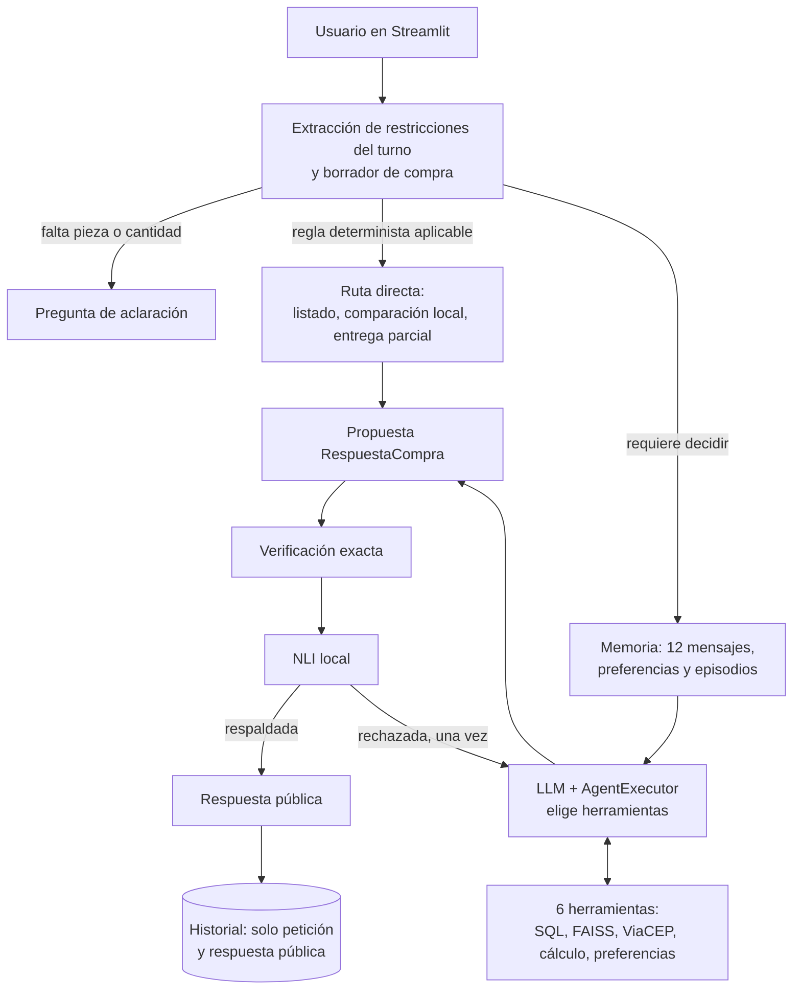

# Respuestas a las rúbricas R01–R29

Este documento responde, una por una, a las 29 preguntas de la rúbrica según la guía integrada [guide/Fases_Temas_Tareas_Rubricas_ComprasLab_Leyendas.pdf](../guide/Fases_Temas_Tareas_Rubricas_ComprasLab_Leyendas.pdf). Cada respuesta indica qué se hizo, dónde está la evidencia, qué decisión técnica se tomó y qué queda pendiente. El estado resumido de todas las rúbricas vive en [matriz.md](matriz.md) y el registro de ejecuciones en [evidencias.md](evidencias.md).

Todos los datos del proyecto (catálogo, proveedores, stock, precios y políticas) son sintéticos.

**Avance de redacción:** R01 redactada y con ejecución guardada. R02–R29 pendientes de redactar, en orden.

---

# Fase 1 — Chain ejecutable y arquitectura

## R01 — Anatomía, arquitectura cognitiva, tipo de agente y madurez agéntica

> ¿El alumno estructuró la anatomía y la arquitectura cognitiva del agente, clasificando su tipo y nivel de madurez agéntica?

**Respuesta corta.** Pedro es un agente **híbrido**: una capa reactiva de reglas deterministas resuelve lo que no debe quedar a criterio del modelo, y una capa deliberativa, guiada por el LLM, elige herramientas, mantiene estado entre turnos y revisa su propia propuesta antes de publicarla. Su madurez actual es la de un **agente único con herramientas, memoria y autoverificación** (nivel 4 de 5 en la escala usada abajo), y esa es también su madurez objetivo, consolidada con evaluación medida.

### 1. Anatomía del agente

En clase, la anatomía general de un agente se describió con cuatro elementos — ambiente, sensores, herramientas y motor cognitivo (el LLM) — más un orquestrador que comunica herramientas, prompts y memorias (clase del 14-10-2026, repaso de la primera clase). La tabla aplica esa anatomía a Pedro y añade los componentes que pide la guía: system message, memoria, base de conocimiento y flujo general.

| Componente | En Pedro | Ubicación |
|---|---|---|
| **Ambiente** | Un escenario aislado: copia SQLite del catálogo con `dataset_id` UUID y manifiesto SHA-256, el corpus de políticas y el servicio externo ViaCEP. El agente solo lee; no compra ni paga. | [catalog.py](../src/pedro/catalog.py) |
| **Motor cognitivo (LLM)** | `ChatOpenAI`, modelo `gpt-4.1-mini` por defecto, configurable con `PEDRO_MODEL`. Sin `OPENAI_API_KEY` la aplicación funciona degradada con la capa determinista. | [app.py](../app.py) |
| **System message** | Prompt con estructura PTCF (Persona, Tarea, Contexto, Formato), el `dataset_id` activo, cuatro ejemplos few-shot de acciones observables y las instrucciones de formato de `RespuestaCompra`. | `crear_agente` en [agent.py](../src/pedro/agent.py); [prompts.py](../src/pedro/prompts.py) |
| **Sensores** (herramientas que perciben el ambiente) | `buscar_productos` (candidatos por ID, SKU o nombre), `consultar_catalogo` (text-to-query sobre SQLite), `consultar_politicas` (recuperación FAISS con fuentes) y `consultar_cep` (API externa ViaCEP). | `herramientas` en [agent.py](../src/pedro/agent.py); [query.py](../src/pedro/query.py); [rag.py](../src/pedro/rag.py); [integrations.py](../src/pedro/integrations.py) |
| **Herramientas** (que calculan o actúan) | `comparar_ofertas` (cálculo exacto en centavos con descartes) y `guardar_preferencia` (única escritura: una preferencia citada explícitamente por el usuario). | `herramientas` en [agent.py](../src/pedro/agent.py); [business.py](../src/pedro/business.py) |
| **Memoria** | Corto plazo: ventana de los últimos 12 mensajes y borrador de compra por sesión. Largo plazo: preferencias explícitas por usuario y episodios vectoriales FastEmbed (384 dimensiones) recuperables entre sesiones. Todo en SQLite, aislado por `user_id`. | [memory.py](../src/pedro/memory.py); [dialogue.py](../src/pedro/dialogue.py) |
| **Base de conocimiento** | Datos estructurados: catálogo SQLite (2640 piezas, 7920 ofertas). Datos documentales: políticas indexadas en FAISS con metadatos y filtro por tema. | [catalog.py](../src/pedro/catalog.py); [policy_demo.py](../src/pedro/policy_demo.py); [knowledge/politicas_demo/](../knowledge/politicas_demo/) |
| **Orquestrador** | LangChain: `create_openai_tools_agent` + `AgentExecutor` (máximo 6 iteraciones) envueltos en `RunnableWithMessageHistory`. | `crear_agente` y `crear_flujo` en [agent.py](../src/pedro/agent.py) |
| **Puerta de publicación** | Verificación exacta (total, stock, presupuesto, plazo, IDs, procedencia) y NLI local triclase. Solo se muestra lo que pasa ambas. | [verification.py](../src/pedro/verification.py); [nli.py](../src/pedro/nli.py) |
| **Interfaz** | Streamlit con vistas de Chat, Catálogo y Comparación sobre el mismo agente, memoria y verificador. | [app.py](../app.py) |

### 2. Arquitectura cognitiva y flujo general

La arquitectura cognitiva se describe con CoALA, el marco que el curso usa por defecto para agentes cognitivos (clase del 21-10-2026):

| Elemento CoALA | En Pedro |
|---|---|
| Memoria de trabajo | Mensaje actual, borrador de compra de la sesión y ventana de 12 mensajes |
| Memoria episódica | Episodios vectoriales de recomendaciones pasadas, por usuario |
| Memoria semántica | Catálogo SQLite, políticas en FAISS y preferencias explícitas del usuario |
| Memoria procedimental | System message PTCF, ejemplos few-shot, reglas deterministas y código de verificación |
| Acciones internas | Recuperar recuerdos y políticas (retrieval), razonar con el LLM, guardar un episodio o una preferencia (aprendizaje) |
| Acciones externas | Leer SQLite, consultar ViaCEP y responder al usuario |
| Ciclo de decisión | Proponer (regla o LLM con herramientas) → evaluar (verificación exacta y NLI) → ejecutar (publicar o corregir una vez) |

El ciclo de un turno es: **percibir** (extraer intención y restricciones del mensaje, cargar memoria), **decidir** (regla directa o agente con herramientas), **actuar** (consultar SQL, políticas o API y calcular), **verificar** (comprobaciones exactas y NLI) y **responder**. Si la propuesta no pasa la verificación, el agente dispone de una única pasada de corrección; si vuelve a fallar, no se publica la recomendación. El mismo flujo está en [arquitectura.mmd](arquitectura.mmd).

### 3. Clasificación: agente híbrido

| Capa | Comportamiento en Pedro | Por qué pertenece a esa capa |
|---|---|---|
| **Reactiva** | Pedir la cantidad cuando falta; enrutar «¿se puede mandar en varias cajas?» directamente a `consultar_politicas`; comparar ofertas en centavos enteros con desempate fijo; listar el catálogo; operar sin clave de OpenAI. | Estímulo → respuesta por regla fija, sin modelo del mundo ni planificación. Es predecible y verificable. |
| **Deliberativa** | El LLM decide qué herramientas llamar y en qué orden (hasta 6 iteraciones); mantiene un estado interno entre turnos (borrador, ventana de mensajes, recuerdos); contrasta su propuesta con la evidencia y la corrige una vez antes de publicar. | Hay representación de estado, elección entre alternativas y revisión de la propia salida frente a un objetivo. |

Pedro no es **reactivo puro** porque conserva estado entre turnos y elige herramientas según la solicitud. Tampoco es **deliberativo puro** porque no construye un plan explícito de varios pasos ni replanifica más allá de la única corrección, y porque una parte de las decisiones la toman reglas deterministas.

**Decisión técnica.** Se eligió el diseño híbrido de forma deliberada. En clase se definió la autonomía como un agente «pronto para tomar decisões e não só para obedecer direcionamentos», y se advirtió que usar un LLM solo para seguir órdenes es desperdiciar el recurso. Pedro aplica ese criterio donde aporta valor — interpretar la solicitud, elegir herramientas, redactar la respuesta — y lo retira donde un error tendría coste: los importes, el stock, los plazos y la procedencia de las fuentes se calculan y verifican con código determinista, nunca con el modelo.

### 4. Madurez agéntica: actual y objetivo

> **Supuesto declarado.** La escala de madurez se presentó en la primera clase, cuya transcripción no está en este workspace. Se usa aquí una escala genérica de cinco niveles; debe sustituirse por la escala exacta del curso cuando esté disponible, ajustando solo la etiqueta del nivel.

| Nivel | Descripción | ¿Pedro lo alcanza? |
|---|---|---|
| 1 | Chain fija: una llamada al LLM con entrada y salida estructuradas | Sí — [chains.py](../src/pedro/chains.py), notebook 01 |
| 2 | Enrutamiento: el flujo elige entre caminos predefinidos | Sí — `RouterCompras` en [legacy.py](../src/pedro/legacy.py) y rutas directas en [agent.py](../src/pedro/agent.py) |
| 3 | Agente con herramientas: el LLM decide qué herramienta usar | Sí — seis herramientas bajo `AgentExecutor` |
| 4 | Agente con memoria y autoverificación: estado entre turnos y sesiones, y revisión de la propia salida antes de publicar | **Sí — nivel actual** |
| 5 | Sistema multiagente o autónomo: planificación de largo horizonte, varios agentes, acciones con efecto real | No, y no es el objetivo |

**Madurez actual: nivel 4 en diseño, demostrado solo en local.** El agente decide herramientas, recuerda y se autoverifica, con autonomía acotada a propósito: solo lee del escenario, su única escritura es una preferencia explícita del usuario, tiene un máximo de 6 iteraciones y una sola corrección. Lo que falta para darlo por demostrado es evidencia con el modelo real: no hay todavía una sesión remota completa documentada ni métricas.

**Madurez objetivo: nivel 4 demostrado con mediciones.** Se considera alcanzado cuando se cumplan estos criterios:

| Criterio | Cómo se mide | Rúbrica |
|---|---|---|
| El LLM real elige las herramientas correctas | Trayectoria esperada frente a observada en los 30 casos de LangSmith | R29 |
| Las respuestas son correctas | Métricas de contenido, ganador e importe en LangSmith | R29 |
| Nada se publica sin respaldo | Cero recomendaciones publicadas que no pasen verificación exacta y NLI | R24 |
| Hay continuidad entre turnos con el modelo real | Sesión remota multi-turno documentada | R18, R26, R27 |

No se persigue el nivel 5 porque el problema — recomendar una oferta verificada para una pieza — no requiere varios agentes ni ejecutar compras, y más autonomía reduciría la trazabilidad que la puerta de verificación garantiza.

### Evidencia

| Evidencia | Ubicación | Tipo |
|---|---|---|
| Anatomía leída de los objetos reales del agente: modelo, executor, system message PTCF, seis herramientas con su papel y lógica, memoria, base de conocimiento y puerta de publicación | [notebooks/01_chain_mvp.ipynb](../notebooks/01_chain_mvp.ipynb) §«R01 · anatomía del agente»; [anatomia.py](../src/pedro/anatomia.py) | Ejecución real local (sin modelo) |
| Agente híbrido en acción: «lista piezas» y «Compara PEC-01-0001» se resuelven por regla con 0 llamadas al modelo; la pregunta de CEP pasa por el modelo, que recibe seis herramientas y ejecuta `consultar_cep` | [notebooks/01_chain_mvp.ipynb](../notebooks/01_chain_mvp.ipynb) §«R01 · agente híbrido» | Ejecución con **doble de prueba**: modelo guionado y ViaCEP simulado; el flujo, el executor, la herramienta y la verificación son los reales |
| La anatomía descrita coincide con el agente construido | [tests/test_anatomia.py](../tests/test_anatomia.py) | Prueba automática (32/32 pruebas) |
| Explicación de componentes, clasificación y madurez | Esta sección; [arquitectura.mmd](arquitectura.mmd) | Documentación |

### Pendientes y limitaciones

- La escala de madurez es genérica (supuesto declarado); sustituirla por la del curso cuando esté disponible la clase 1.
- En la demostración de la capa deliberativa la herramienta la pide un modelo guionado, no un LLM. La elección hecha por el modelo real se documenta en R26.
- El chat usa el índice de políticas demo en memoria; el índice preexistente que exige R22 aún no existe.

---

## R02 — Arquitectura de planificación y memoria aumentada

*Pendiente de redactar.*

## R03 — Plantillas de prompt reutilizables

*Pendiente de redactar.*

## R04 — Output parser con salida estructurada en JSON

*Pendiente de redactar.*

## R05 — Runnable (invoke, batch, stream) y composición con @chain

*Pendiente de redactar.*

## R06 — Composición declarativa con LCEL y justificación

*Pendiente de redactar.*

---

# Fase 2 — Agente con herramientas y ReAct

## R07 — Comparación de orquestadores y elección de LangChain

*Pendiente de redactar.*

## R08 — Agente ReAct con initialize_agent, herramientas y memoria

*Pendiente de redactar.*

## R09 — Chains secuenciales o paralelas y RouterChain

*Pendiente de redactar.*

## R10 — API externa como herramienta vía function calling

*Pendiente de redactar.*

## R11 — Prompt PTCF, few-shot y chain-of-thought

*Pendiente de redactar.*

## R12 — Componentes de confiabilidad

*Pendiente de redactar.*

---

# Fase 3 — Chatbot con memoria

## R13 — Memoria de corto y largo plazo según CoALA

*Pendiente de redactar.*

## R14 — Ventana de contexto con búsqueda vectorial

*Pendiente de redactar.*

## R15 — Comparación de herramientas especializadas de memoria

*Pendiente de redactar.*

## R16 — Chatbot con ConversationBufferMemory

*Pendiente de redactar.*

## R17 — Reconocimiento de intención y extracción de entidades

*Pendiente de redactar.*

## R18 — Contexto y descomposición en una conversación real multi-turno

*Pendiente de redactar.*

---

# Fase 4 — SQL, APIs y RAG existente

## R19 — Herramientas hardcoded y semánticas

*Pendiente de redactar.*

## R20 — Integración con APIs internas o externas

*Pendiente de redactar.*

## R21 — Patrón text-to-query

*Pendiente de redactar.*

## R22 — Agente de recuperación sobre un índice FAISS existente

*Pendiente de redactar.*

## R23 — Diagnóstico y corrección de un fallo real de recuperación

*Pendiente de redactar.*

---

# Fase 5 — Agente final verificado y evaluado

## R24 — Verificación de consistencia factual y coherencia lógica

*Pendiente de redactar.*

## R25 — Agente único con herramientas de RAG, SQL o API

*Pendiente de redactar.*

## R26 — Executor con create_openai_tools_agent y AgentExecutor

*Pendiente de redactar.*

## R27 — Historial con RunnableWithMessageHistory

*Pendiente de redactar.*

## R28 — Integración del agente en Streamlit

*Pendiente de redactar.*

## R29 — Evaluación de calidad y trayectoria con LangSmith

*Pendiente de redactar.*
