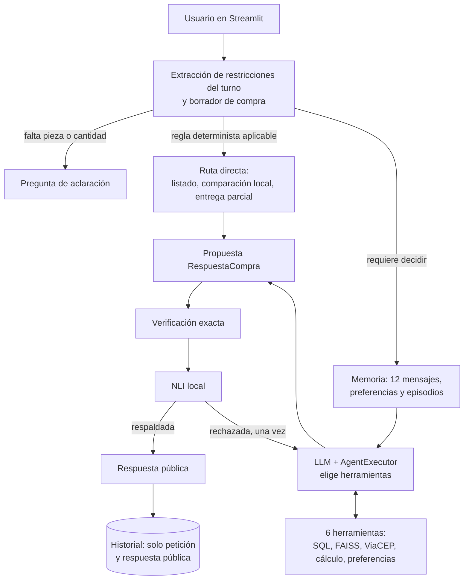

# Respuestas a las rúbricas R01–R29

Este documento responde, una por una, a las 29 preguntas de la rúbrica según la guía integrada [guide/Fases_Temas_Tareas_Rubricas_ComprasLab_Leyendas.pdf](../guide/Fases_Temas_Tareas_Rubricas_ComprasLab_Leyendas.pdf). Cada respuesta indica qué se hizo, dónde está la evidencia, qué decisión técnica se tomó y qué queda pendiente. El estado resumido de todas las rúbricas vive en [matriz.md](matriz.md) y el registro de ejecuciones en [evidencias.md](evidencias.md).

Todos los datos del proyecto (catálogo, proveedores, stock, precios y políticas) son sintéticos.

**Avance de redacción:** las 29 rúbricas (R01–R29) están redactadas y tienen ejecución guardada. Las limitaciones de cada una figuran en su sección.

---

# Fase 1 — Chain ejecutable y arquitectura

## R01 — Anatomía, arquitectura cognitiva, tipo de agente y madurez agéntica

> ¿El alumno estructuró la anatomía y la arquitectura cognitiva del agente, clasificando su tipo y nivel de madurez agéntica?

**Respuesta corta.** Pedro es un agente **híbrido**: una capa reactiva de reglas deterministas resuelve lo que no debe quedar a criterio del modelo, y una capa deliberativa, guiada por el LLM, elige herramientas, mantiene estado entre turnos y revisa su propia propuesta antes de publicarla. Su madurez actual es la de un **agente único con herramientas, memoria y autoverificación** (nivel 4 de 5 en la escala usada abajo), y esa es también su madurez objetivo, consolidada con evaluación medida.

### 1. Anatomía del agente

En clase, la anatomía general de un agente se describió con cuatro elementos — ambiente, sensores, herramientas y motor cognitivo (el LLM) — más un orquestrador que comunica herramientas, prompts y memorias (clase del 14-10-2026, repaso de la primera clase). La tabla aplica esa anatomía a Pedro y añade los componentes que pide la guía: system message, memoria, base de conocimiento y flujo general.

| Componente | En Pedro | Ubicación |
|---|---|---|
| **Ambiente** | Un escenario aislado: copia SQLite del catálogo con `dataset_id` UUID y manifiesto SHA-256, el corpus de políticas y el servicio externo ViaCEP. El agente solo lee; no compra ni paga. | [catalog.py](../src/pedro/catalog.py) |
| **Motor cognitivo (LLM)** | `ChatOpenAI`, modelo `gpt-4.1-mini` por defecto, configurable con `PEDRO_MODEL`. Sin `OPENAI_API_KEY` la aplicación funciona degradada con la capa determinista. | [app.py](../app.py) |
| **System message** | Prompt con estructura PTCF (Persona, Tarea, Contexto, Formato), el `dataset_id` activo, cuatro ejemplos few-shot de acciones observables y las instrucciones de formato de `RespuestaCompra`. | `crear_agente` en [agent.py](../src/pedro/agent.py); [prompts.py](../src/pedro/prompts.py) |
| **Sensores** (herramientas que perciben el ambiente) | `buscar_productos` (candidatos por ID, SKU o nombre), `consultar_catalogo` (text-to-query sobre SQLite), `consultar_politicas` (recuperación FAISS con fuentes) y `consultar_cep` (API externa ViaCEP). | `herramientas` en [agent.py](../src/pedro/agent.py); [query.py](../src/pedro/query.py); [rag.py](../src/pedro/rag.py); [integrations.py](../src/pedro/integrations.py) |
| **Herramientas** (que calculan o actúan) | `comparar_ofertas` (cálculo exacto en centavos con descartes) y `guardar_preferencia` (única escritura: una preferencia citada explícitamente por el usuario). | `herramientas` en [agent.py](../src/pedro/agent.py); [business.py](../src/pedro/business.py) |
| **Memoria** | Corto plazo: ventana de los últimos 12 mensajes y borrador de compra por sesión. Largo plazo: preferencias explícitas por usuario y episodios vectoriales FastEmbed (384 dimensiones) recuperables entre sesiones. Todo en SQLite, aislado por `user_id`. | [memory.py](../src/pedro/memory.py); [dialogue.py](../src/pedro/dialogue.py) |
| **Base de conocimiento** | Datos estructurados: catálogo SQLite (2640 piezas, 7920 ofertas). Datos documentales: políticas indexadas en FAISS con metadatos y filtro por tema. | [catalog.py](../src/pedro/catalog.py); [policy_demo.py](../src/pedro/policy_demo.py); [knowledge/politicas_demo/](../knowledge/politicas_demo/) |
| **Orquestrador** | LangChain: `create_openai_tools_agent` + `AgentExecutor` (máximo 6 iteraciones) envueltos en `RunnableWithMessageHistory`. | `crear_agente` y `crear_flujo` en [agent.py](../src/pedro/agent.py) |
| **Puerta de publicación** | Verificación exacta (total, stock, presupuesto, plazo, IDs, procedencia) y NLI local triclase. Solo se muestra lo que pasa ambas. | [verification.py](../src/pedro/verification.py); [nli.py](../src/pedro/nli.py) |
| **Interfaz** | Streamlit con vistas de Chat, Catálogo y Comparación sobre el mismo agente, memoria y verificador. | [app.py](../app.py) |

### 2. Arquitectura cognitiva y flujo general



La arquitectura cognitiva se describe con CoALA, el marco que el curso usa por defecto para agentes cognitivos (clase del 21-10-2026):

| Elemento CoALA | En Pedro |
|---|---|
| Memoria de trabajo | Mensaje actual, borrador de compra de la sesión y ventana de 12 mensajes |
| Memoria episódica | Episodios vectoriales de recomendaciones pasadas, por usuario |
| Memoria semántica | Catálogo SQLite, políticas en FAISS y preferencias explícitas del usuario |
| Memoria procedimental | System message PTCF, ejemplos few-shot, reglas deterministas y código de verificación |
| Acciones internas | Recuperar recuerdos y políticas (retrieval), razonar con el LLM, guardar un episodio o una preferencia (aprendizaje) |
| Acciones externas | Leer SQLite, consultar ViaCEP y responder al usuario |
| Ciclo de decisión | Proponer (regla o LLM con herramientas) → evaluar (verificación exacta y NLI) → ejecutar (publicar o corregir una vez) |

El ciclo de un turno es: **percibir** (extraer intención y restricciones del mensaje, cargar memoria), **decidir** (regla directa o agente con herramientas), **actuar** (consultar SQL, políticas o API y calcular), **verificar** (comprobaciones exactas y NLI) y **responder**. Si la propuesta no pasa la verificación, el agente dispone de una única pasada de corrección; si vuelve a fallar, no se publica la recomendación. El mismo flujo está en [arquitectura.mmd](arquitectura.mmd).

### 3. Clasificación: agente híbrido

| Capa | Comportamiento en Pedro | Por qué pertenece a esa capa |
|---|---|---|
| **Reactiva** | Pedir la cantidad cuando falta; enrutar «¿se puede mandar en varias cajas?» directamente a `consultar_politicas`; comparar ofertas en centavos enteros con desempate fijo; listar el catálogo; operar sin clave de OpenAI. | Estímulo → respuesta por regla fija, sin modelo del mundo ni planificación. Es predecible y verificable. |
| **Deliberativa** | El LLM decide qué herramientas llamar y en qué orden (hasta 6 iteraciones); mantiene un estado interno entre turnos (borrador, ventana de mensajes, recuerdos); contrasta su propuesta con la evidencia y la corrige una vez antes de publicar. | Hay representación de estado, elección entre alternativas y revisión de la propia salida frente a un objetivo. |

Pedro no es **reactivo puro** porque conserva estado entre turnos y elige herramientas según la solicitud. Tampoco es **deliberativo puro** porque no construye un plan explícito de varios pasos ni replanifica más allá de la única corrección, y porque una parte de las decisiones la toman reglas deterministas.

**Decisión técnica.** Se eligió el diseño híbrido de forma deliberada. En clase se definió la autonomía como un agente «pronto para tomar decisões e não só para obedecer direcionamentos», y se advirtió que usar un LLM solo para seguir órdenes es desperdiciar el recurso. Pedro aplica ese criterio donde aporta valor — interpretar la solicitud, elegir herramientas, redactar la respuesta — y lo retira donde un error tendría coste: los importes, el stock, los plazos y la procedencia de las fuentes se calculan y verifican con código determinista, nunca con el modelo.

### 4. Madurez agéntica: actual y objetivo

> **Supuesto declarado.** La escala de madurez se presentó en la primera clase, cuya transcripción no está en este workspace. Se usa aquí una escala genérica de cinco niveles; debe sustituirse por la escala exacta del curso cuando esté disponible, ajustando solo la etiqueta del nivel.

| Nivel | Descripción | ¿Pedro lo alcanza? |
|---|---|---|
| 1 | Chain fija: una llamada al LLM con entrada y salida estructuradas | Sí — [chains.py](../src/pedro/chains.py), notebook 01 |
| 2 | Enrutamiento: el flujo elige entre caminos predefinidos | Sí — `RouterCompras` en [legacy.py](../src/pedro/legacy.py) y rutas directas en [agent.py](../src/pedro/agent.py) |
| 3 | Agente con herramientas: el LLM decide qué herramienta usar | Sí — seis herramientas bajo `AgentExecutor` |
| 4 | Agente con memoria y autoverificación: estado entre turnos y sesiones, y revisión de la propia salida antes de publicar | **Sí — nivel actual** |
| 5 | Sistema multiagente o autónomo: planificación de largo horizonte, varios agentes, acciones con efecto real | No, y no es el objetivo |

**Punto de partida: nivel 4 en diseño, demostrado solo en local.** Al empezar este documento el agente ya decidía herramientas, recordaba y se autoverificaba, con autonomía acotada a propósito: solo lee del escenario, su única escritura es una preferencia explícita del usuario, tiene un máximo de 6 iteraciones y una sola corrección. Faltaba la evidencia con el modelo real.

**Madurez objetivo: nivel 4 demostrado con mediciones.** Se fijaron cuatro criterios. Esta es su situación tras ejecutar el resto de rúbricas:

| Criterio | Cómo se midió | Resultado | Rúbrica |
|---|---|---|---|
| El LLM real elige las herramientas correctas | Trayectoria en 30 casos de LangSmith | Herramienta decisiva 23 de 23; trayectoria completa 24 de 30 | R29 |
| Las respuestas son correctas | Ganador, importe y contenido en LangSmith | 14 de 14, 14 de 14 y 16 de 16 | R29 |
| Nada se publica sin respaldo | Recomendaciones erróneas publicadas | 0 en cinco experimentos | R24 |
| Hay continuidad entre turnos con el modelo real | Conversación real multi-turno | Siete turnos con estado correcto | R18, R26, R27 |

**Madurez actual: nivel 4 demostrado**, con una reserva que impide darlo por consolidado: las mediciones son corridas únicas sobre casos derivados, no sobre los oficiales.

No se persigue el nivel 5 porque el problema — recomendar una oferta verificada para una pieza — no requiere varios agentes ni ejecutar compras, y más autonomía reduciría la trazabilidad que la puerta de verificación garantiza.

### Evidencia

| Evidencia | Ubicación | Tipo |
|---|---|---|
| Anatomía leída de los objetos reales del agente: modelo, executor, system message PTCF, seis herramientas con su papel y lógica, memoria, base de conocimiento y puerta de publicación | [notebooks/01_chain_mvp.ipynb](../notebooks/01_chain_mvp.ipynb) §«R01 · anatomía del agente»; [anatomia.py](../src/pedro/anatomia.py) | Ejecución real local (sin modelo) |
| Agente híbrido en acción: «lista piezas» y «Compara PEC-01-0001» se resuelven por regla con 0 llamadas al modelo; la pregunta de CEP pasa por el modelo, que recibe seis herramientas y ejecuta `consultar_cep` | [notebooks/01_chain_mvp.ipynb](../notebooks/01_chain_mvp.ipynb) §«R01 · agente híbrido» | Ejecución con **doble de prueba**: modelo guionado y ViaCEP simulado; el flujo, el executor, la herramienta y la verificación son los reales |
| La anatomía descrita coincide con el agente construido | [tests/test_anatomia.py](../tests/test_anatomia.py) | Prueba automática (32/32 pruebas) |
| Explicación de componentes, clasificación y madurez | Esta sección; [arquitectura.mmd](arquitectura.mmd) | Documentación |

### Pendientes y limitaciones

- La escala de madurez es genérica (supuesto declarado); sustituirla por la del curso cuando esté disponible la clase 1.
- En la demostración de la capa deliberativa la herramienta la pide un modelo guionado, no un LLM. La elección hecha por el modelo real se documenta en R26.
- El chat usa el índice de políticas demo en memoria; el índice preexistente que exige R22 aún no existe.

---

## R02 — Arquitectura de planificación y memoria aumentada

> ¿El alumno proyectó una arquitectura de planificación y memoria aumentada para el agente?

**Respuesta corta.** Una solicitud compleja se divide en cinco subtareas con salida observable (extraer, consultar, comparar, verificar, publicar). La memoria se reparte en dos niveles: la **sesión** guarda lo que solo sirve para la compra en curso y el **usuario** guarda lo que debe sobrevivir a la sesión. Ningún precio ni stock se toma de la memoria: siempre se releen del escenario activo.

### 1. Planificación: cómo se divide una solicitud

| Paso | Subtarea | Quién la hace | Salida observable |
|---|---|---|---|
| 1 | Extraer pieza, cantidad, presupuesto y plazo del mensaje; detectar qué falta | Regla determinista | Borrador `EstadoCompra` o pregunta de aclaración |
| 2 | Consultar los datos necesarios | Herramientas de lectura (SQL, FAISS, ViaCEP) | Ofertas, fragmentos de política o ciudad/UF |
| 3 | Comparar ofertas con las restricciones | Cálculo determinista en centavos | Alternativas con «cumple» o motivo de descarte |
| 4 | Verificar la propuesta | Verificación exacta y NLI | Lista de errores (vacía si pasa) |
| 5 | Publicar o corregir | Flujo | Respuesta pública, o una única corrección |

Hay tres niveles de planificación, según el tipo de solicitud:

- **Plan fijo (capa reactiva).** Una compra con ID y cantidad sigue siempre los pasos 1 a 5 en ese orden, sin modelo.
- **Plan decidido por el LLM (capa deliberativa).** Cuando interviene el modelo — por ejemplo para confirmar un CEP o recalcular tras «ahora 3 unidades» —, el agente elige qué herramientas llamar y en qué orden dentro del `AgentExecutor`, con un máximo de 6 iteraciones. El prompt le da un «plan visible»: `buscar_productos` para resolver el ID, `consultar_catalogo` para las ofertas y `comparar_ofertas` para todos los importes.

- **Plan de turno (planificador explícito).** Si el mensaje trae varias intenciones, el modelo escribe primero un plan con una petición por intención. Ejemplo real: «Compara 2 unidades de PEC-01-0001 con plazo de 7 días y dime qué dice la política de devoluciones sobre piezas dañadas, y confirma el CEP 01001000» produjo este plan, y cada petición se respondió y verificó por separado:

  | # | Tipo | Petición |
  |---|---|---|
  | 1 | compra | Compara 2 unidades de PEC-01-0001 con plazo de 7 días |
  | 2 | politica | ¿Qué dice la política de devoluciones sobre piezas dañadas? |
  | 3 | cep | Confirma el CEP 01001000 |

Reglas de planificación:

- Solo se pregunta por lo que bloquea el plan: la pieza y la cantidad. Presupuesto y plazo son filtros opcionales.
- La petición actual prevalece sobre el historial: un cambio de cantidad conserva los demás límites.
- El plan nunca termina en una acción con efecto real: no hay compra ni pago.

**Decisión técnica.** El planificador explícito se añadió después, cuando una ejecución real mostró que hacía falta. Al principio no existía: una solicitud que mezclaba compra, política y CEP hacía que el modelo llamara a las herramientas correctas, pero la respuesta no se publicaba, porque el formato admite un solo tipo. En lugar de complicar el formato, se añadió un paso previo ([planner.py](../src/pedro/planner.py)): si el mensaje muestra señales de dos o más intenciones, el modelo escribe un **plan** con una petición por intención, y cada petición se resuelve con el flujo normal y su propia verificación. El plan se valida antes de usarse: no puede repetir un tipo ni contener un identificador o una cifra que el usuario no escribiera. Para un mensaje de una sola intención no se llama al planificador. Lo que no se guarda es el razonamiento privado del modelo: se conservan el plan y las llamadas a herramientas, que son observables.

### 2. Memoria aumentada: qué va a cada nivel

| Información | Nivel | Dónde vive | Cuándo se actualiza o descarta |
|---|---|---|---|
| Mensaje actual | Corto plazo | Entrada del turno | Se sustituye en cada turno |
| Borrador de compra (pieza, cantidad, presupuesto, plazo) | Corto plazo | SQLite, por sesión | Cada turno; un ID distinto lo reinicia; «sin presupuesto/plazo» borra ese límite |
| Ventana de conversación | Corto plazo | Últimos 12 mensajes de la sesión | Ventana deslizante; el historial completo se conserva pero no se envía |
| Preferencias del usuario | Largo plazo (semántica) | SQLite, por usuario | Solo si el usuario la cita explícitamente; el valor nuevo reemplaza al anterior |
| Episodios de recomendaciones | Largo plazo (episódica) | SQLite con vector FastEmbed, por usuario | Se guarda cuando el agente publica una respuesta de compra verificada; se recupera por similitud (top 3) |
| Reglas, prompt y verificación | Largo plazo (procedimental) | Código y `prompts.py` | Cambia solo con una nueva versión del proyecto |
| Precios, stock y plazos | **No es memoria** | Escenario SQLite activo | Siempre se releen; los valores de un episodio se tratan como históricos |

**Decisión técnica.** La separación por sesión y por usuario evita dos errores del dominio: arrastrar la cantidad de una compra a otra, y recomendar con un precio viejo. Por eso el borrador muere con la sesión y los episodios se inyectan con la etiqueta «histórico» y la instrucción de no usar sus precios ni su stock. Cada recuerdo lleva su `dataset_id`, así que un episodio de otro catálogo queda identificado.

### Evidencia

| Evidencia | Ubicación | Tipo |
|---|---|---|
| Solicitud «Necesito 2 unidades de PEC-01-0001 hasta R$ 5.000 en 7 días» dividida en los cinco pasos, con la salida de cada uno | [notebooks/01_chain_mvp.ipynb](../notebooks/01_chain_mvp.ipynb) §«R02 · planificación» | Ejecución real local (sin modelo) |
| Corto plazo: al pedir «ahora 3 unidades» el borrador conserva el plazo de 7 días; 18 mensajes guardados, 12 visibles | [notebooks/01_chain_mvp.ipynb](../notebooks/01_chain_mvp.ipynb) §«R02 · memoria aumentada» | Ejecución real local (sin modelo) |
| Largo plazo: la preferencia aparece en una sesión nueva del mismo usuario y no en otro usuario; la sesión nueva empieza sin borrador | Mismo notebook | Ejecución real local |
| Plan decidido por el LLM real, por turnos: compra → `consultar_catalogo` y `comparar_ofertas`; CEP → `consultar_cep` (São Paulo/SP); «ahora 3 unidades» → `comparar_ofertas` con cantidad 3 y el plazo de 7 días conservado (R$ 4.401,99) | [trazas/r02_planificacion_llm.json](trazas/r02_planificacion_llm.json); [scripts/demostrar_r02.py](../scripts/demostrar_r02.py) | **Ejecución real remota** (OpenAI `gpt-4.1-mini`, ViaCEP real, NLI real local) |
| Pregunta de política por turnos: antes no se publicaba; tras anclar las citas se publica con dos fuentes | [trazas/r02_planificacion_llm_antes.json](trazas/r02_planificacion_llm_antes.json) y [trazas/r02_planificacion_llm.json](trazas/r02_planificacion_llm.json); [citas_ancladas.md](citas_ancladas.md) | Ejecución real remota, antes y después |
| Solicitud mixta en un solo turno, **con planificador**: plan de tres peticiones (compra, política, CEP), cada una verificada sin errores y publicada | [trazas/r02_planificacion_llm.json](trazas/r02_planificacion_llm.json), `solicitud_mixta_en_un_turno` | **Ejecución real remota** (`gpt-4.1-mini`, ViaCEP) |
| La misma solicitud **antes del planificador**: el LLM llamó a las herramientas correctas, pero la respuesta no se publicó | [trazas/r02_planificacion_llm_sin_plan.json](trazas/r02_planificacion_llm_sin_plan.json) | Ejecución real remota; resultado negativo conservado |
| El plan se descarta si inventa datos, repite un tipo o no encaja; cada petición pasa por su verificación | [tests/test_planner.py](../tests/test_planner.py) | Pruebas automáticas con doble |
| Episodios vectoriales guardados, actualizados y recuperados | [notebooks/03_memoria_chatbot.ipynb](../notebooks/03_memoria_chatbot.ipynb) | Ejecución real local (FastEmbed) |
| Reglas del borrador y aislamiento | [tests/test_dialogue.py](../tests/test_dialogue.py); [tests/test_memory_nli.py](../tests/test_memory_nli.py) | Pruebas automáticas |

### Pendientes y limitaciones

- **La solicitud mixta en un solo turno se resolvió con un planificador.** Antes no se publicaba. Límite actual: el planificador reconoce cuatro tipos de petición y como mucho uno de cada tipo; dos compras en el mismo mensaje se tratan como una sola petición.
- **La pregunta general de política falló con el modelo real y se corrigió.** El modelo citaba el fragmento casi literal y la verificación exigía texto idéntico. Ahora el sistema ancla la cita al texto de la fuente; diagnóstico y antes/después en [citas_ancladas.md](citas_ancladas.md).
- El planificador solo actúa con el modelo disponible; sin credenciales un mensaje mixto se trata como una sola petición.
- No hay resumen del historial: lo que sale de la ventana de 12 mensajes solo vuelve si quedó como episodio o preferencia.
- La trayectoria del LLM puede variar entre ejecuciones; la traza guardada es una observación, no una métrica.

## R03 — Plantillas de prompt reutilizables

> ¿El alumno construyó plantillas de prompt reutilizables con PromptTemplate o ChatPromptTemplate?

**Respuesta corta.** Sí. Hay dos `ChatPromptTemplate` con nombre propio en [prompts.py](../src/pedro/prompts.py): una para interpretar solicitudes de compra y otra para el agente final. La primera se reutiliza en dos cadenas distintas y se ejecutó con el modelo real sobre tres solicitudes del dominio.

### 1. Las plantillas

| Plantilla | Para qué sirve | Variables | Dónde se reutiliza |
|---|---|---|---|
| `PLANTILLA_EXTRACCION` (alias `PROMPT` en [chains.py](../src/pedro/chains.py)) | Interpretar una solicitud y devolver intención, datos y faltantes | `texto` (la solicitud) y `formato` (instrucciones del parser) | Cadena LCEL (`crear_lcel`) y cadena `@chain` (`crear_chain`) |
| `PLANTILLA_AGENTE`, usada por `crear_agente` en [agent.py](../src/pedro/agent.py) | System message PTCF del agente final | `dataset_id`, `ejemplos`, `formato`, `input`, `chat_history`, `agent_scratchpad` | Cada turno y cada corrección del agente, con cualquier escenario |

Las dos tienen la misma forma: un mensaje de sistema fijo con huecos y un mensaje humano con la solicitud. Los ejemplos few-shot están en el mismo archivo y entran a la plantilla del agente como una variable más.

### 2. Qué las hace reutilizables

- **Variables en lugar de texto fijo.** La solicitud, el escenario y los ejemplos se inyectan; el texto de la plantilla no cambia.
- **`partial` para lo que no cambia por turno.** Las instrucciones de formato salen del parser Pydantic y se fijan una vez; queda libre solo `texto`.
- **Un solo archivo.** Las dos plantillas y los ejemplos viven en `prompts.py`; el resto del código las importa.
- **Un objeto, varias cadenas.** La misma `PROMPT` alimenta la versión declarativa y la imperativa, así que un cambio de redacción se hace en un solo sitio.

**Decisión técnica.** Se eligió `ChatPromptTemplate` y no `PromptTemplate` porque el modelo es de chat y la plantilla necesita separar papeles: las reglas van en el mensaje de sistema y la solicitud del usuario en el mensaje humano. Esa separación evita que el texto del usuario se mezcle con las instrucciones. Coincide con la indicación de clase de centrarse en `ChatPromptTemplate` como patrón actual. No se añadió un `PromptTemplate` de texto plano solo para exhibirlo: la rúbrica pide una u otra y ningún punto del flujo usa un modelo de texto.

### Evidencia

| Evidencia | Ubicación | Tipo |
|---|---|---|
| La plantilla rellenada con tres solicitudes del dominio: clase, variables, `partial`, mensajes resultantes y comprobación de que la cadena LCEL usa la misma plantilla | [notebooks/01_chain_mvp.ipynb](../notebooks/01_chain_mvp.ipynb) §«R03 · plantilla reutilizable» | Ejecución real local (sin modelo) |
| La plantilla ejecutada con el modelo: «Compara 2 unidades de PEC-01-0001 hasta R$ 5.000 en 7 días» → comparar, 2 unidades, 500000 centavos, 7 días; «Necesito un termostato para nevera, sin prisa» → falta cantidad; «¿A qué ciudad corresponde el CEP 01001000?» → intención cep | [trazas/fase1_chain_llm.json](trazas/fase1_chain_llm.json); [scripts/demostrar_fase1.py](../scripts/demostrar_fase1.py) | **Ejecución real remota** (OpenAI `gpt-4.1-mini`, temperatura 0) |
| Cada plantilla declara sus variables, separa sistema y humano, sirve para cualquier escenario y falla si falta una variable | [tests/test_prompts.py](../tests/test_prompts.py) | Pruebas automáticas |
| La misma plantilla en las cadenas LCEL y `@chain` con modelo doble | [notebooks/01_chain_mvp.ipynb](../notebooks/01_chain_mvp.ipynb), primera celda | Ejecución con doble de prueba |

### Pendientes y limitaciones

- La ejecución real es una sola corrida de tres solicitudes; no mide la tasa de acierto de la extracción.

## R04 — Output parser con salida estructurada en JSON

> ¿El alumno implementó un output parser para generar salida estructurada en JSON a partir de la chain?

**Respuesta corta.** Sí. La cadena convierte una solicitud en un objeto `Extraccion` validado con Pydantic. Además se construyó un **laboratorio de salidas rotas**: ocho defectos típicos de un modelo, cada uno resuelto por una capa distinta, con el modelo real haciendo las reparaciones.

### 1. De la solicitud al objeto validado

«Compara 2 unidades de PEC-01-0001 hasta R$ 5.000 en 7 días» produce, con el modelo real:

```json
{"intencion": "comparar",
 "solicitud": {"producto_id": "PEC-01-0001", "cantidad": 2,
               "presupuesto_centavos": 500000, "plazo_max_dias": 7},
 "faltantes": []}
```

El esquema está en [contracts.py](../src/pedro/contracts.py) y la cadena en [chains.py](../src/pedro/chains.py): plantilla → modelo → `PydanticOutputParser` → regla de dominio.

### 2. Tres capas de defensa

Un modelo puede fallar de tres maneras distintas, y cada una necesita una defensa diferente:

| Capa | Qué defiende | Cómo |
|---|---|---|
| **Sintaxis** | Que la salida sea JSON | El parser tolera cercas de markdown y texto alrededor |
| **Esquema** | Que los datos tengan el tipo correcto | Pydantic rechaza «dos» como cantidad, una cantidad negativa o una intención fuera de la lista |
| **Dominio** | Que el dato signifique lo correcto | Los faltantes los recalcula el código: no se confía en lo que el modelo declare. Un dato ausente es `null`, nunca cero |

Cuando la sintaxis o el esquema fallan, una **segunda cadena repara** la salida (`crear_lcel_robusta`). Recibe la solicitud original, la salida inválida y el mensaje de error, y su respuesta vuelve a pasar por el mismo parser. Está montada con `with_fallbacks`, así que la reparación solo se ejecuta si hay error. Hay una sola reparación: si también falla, el error se propaga y no se publica nada.

### 3. El laboratorio de salidas rotas

Ocho salidas para la misma solicitud. El generador es un doble que emite el defecto; el reparador es `gpt-4.1-mini` real.

| Defecto | Capa que lo resolvió | Reparaciones | Datos finales correctos |
|---|---|---|---|
| JSON válido | Ninguna | 0 | Sí |
| Cercas markdown y charla alrededor | Parser | 0 | Sí |
| JSON truncado | Reparación | 1 | Sí |
| Cantidad en letras («dos») | Reparación | 1 | Sí |
| Cantidad negativa | Reparación | 1 | Sí |
| Intención fuera de la lista | Reparación | 1 | Sí |
| Texto libre sin JSON | Reparación | 1 | Sí |
| Faltantes mal declarados | Regla de dominio | 0 | Sí (marca «cantidad» como faltante) |

### 4. Hallazgo: un parser tolerante puede perder datos en silencio

Al montar el laboratorio apareció algo que no estaba previsto. El parser de LangChain acepta JSON cortado. Con la cadena simple, una salida truncada se convirtió en un objeto válido **sin el plazo de 7 días y sin ningún error**. En este dominio eso es grave: la comparación se haría sin un límite que el usuario sí pidió.

La corrección fue añadir a la cadena robusta una comprobación estricta de que el JSON esté entero. Si no lo está, la salida va a reparación. La cadena simple conserva el comportamiento original, y una prueba deja documentados los dos resultados.

### 5. Parser frente a `with_structured_output`

En clase se vieron dos formas de obtener salida estructurada. Se ejecutaron las dos con el modelo real sobre las tres solicitudes y dieron **el mismo resultado**.

| | `PydanticOutputParser` | `with_structured_output` |
|---|---|---|
| Cómo fuerza el formato | Instrucciones dentro del prompt | Esquema enviado por la API del modelo |
| Funciona con cualquier modelo | Sí, también con dobles de prueba | Solo si el modelo lo soporta |
| Se puede probar sin credenciales | Sí | No |
| Permite ver y reparar la salida cruda | Sí | No, la salida ya llega convertida |

**Decisión técnica.** Se mantiene `PydanticOutputParser` como patrón principal por dos razones: la rúbrica pide un output parser, y es la única opción que deja ver el texto crudo del modelo, que es lo que hace posible el laboratorio, la reparación y las pruebas sin credenciales.

### Evidencia

| Evidencia | Ubicación | Tipo |
|---|---|---|
| Objeto validado desde tres solicitudes, con `invoke` y `batch` | [trazas/fase1_chain_llm.json](trazas/fase1_chain_llm.json) | **Ejecución real remota** (`gpt-4.1-mini`, temperatura 0) |
| Laboratorio: cinco reparaciones hechas por el modelo real, todas con datos finales correctos | Mismo archivo, `laboratorio_salidas_rotas`; [laboratorio.py](../src/pedro/laboratorio.py) | Real remoto para el reparador; el generador es un **doble** |
| `with_structured_output` igual que el parser en las tres solicitudes | Mismo archivo, `with_structured_output` | Ejecución real remota |
| Laboratorio y pérdida silenciosa de datos, reproducibles sin credenciales | [notebooks/01_chain_mvp.ipynb](../notebooks/01_chain_mvp.ipynb) §«R04» | Ejecución con **doble** (generador y reparador) |
| Cada defecto cae en su capa; la reparación recibe solicitud, salida y error; una reparación fallida no se publica; el parser simple pierde el plazo y la cadena robusta no | [tests/test_salida_estructurada.py](../tests/test_salida_estructurada.py) | Pruebas automáticas |

### Pendientes y limitaciones

- La cadena de extracción es didáctica: el chat extrae las restricciones con reglas deterministas ([dialogue.py](../src/pedro/dialogue.py)), no con esta cadena. El agente final sí usa `PydanticOutputParser` para `RespuestaCompra`.
- Las salidas rotas se escribieron a mano; no son fallos observados del modelo real, que en estas ejecuciones respondió siempre con JSON válido.
- Una sola reparación por diseño. No se midió con qué frecuencia el modelo real necesitaría reparación.

## R05 — Runnable (invoke, batch, stream) y composición con @chain

> ¿El alumno aplicó la interfaz Runnable (invoke, batch, stream) e implementó composición imperativa con el decorador @chain?

**Respuesta corta.** Sí. Los tres métodos se ejecutaron con el modelo real y se midió para qué sirve cada uno. Hay dos cadenas con `@chain`: una simple y otra con reparación de errores escrita paso a paso.

### 1. Los tres métodos, con el modelo real

Todo objeto de LangChain que sea `Runnable` ofrece los mismos tres métodos. Se usaron sobre la cadena de extracción:

| Método | Para qué sirve | Qué se observó |
|---|---|---|
| `invoke` | Una entrada, una salida | «Compara 2 unidades de PEC-01-0001 hasta R$ 5.000 en 7 días» → objeto validado |
| `batch` | Varias entradas a la vez | 3 solicitudes en **1,43 s**; las mismas 3 con `invoke` en serie tardaron **4,55 s**. Mismos resultados |
| `stream` | Recibir la salida a medida que se genera | **19 estados parciales**; el primero a los **0,45 s** de un total de 1,07 s |

Son una sola medición cada una: sirven para ver el efecto, no como benchmark.

### 2. Lo aprendido sobre `stream`

`stream` solo transmite si **todos** los pasos de la cadena saben transmitir. Se comprobó con dos cadenas:

- Con el parser Pydantic llega **un único fragmento**: necesita el JSON completo para validarlo.
- Con el parser de JSON parcial (`crear_lcel_parcial`) llega el objeto mientras se forma: `{}` → `{"intencion": "comparar", "solicitud": {"producto_id": "PEC"}}` → … → objeto completo.

La consecuencia práctica: para mostrar progreso al usuario sirve la segunda; para decidir una compra solo vale la primera, porque un estado parcial todavía no está validado.

### 3. Composición imperativa con `@chain`

`@chain` convierte una función de Python en un `Runnable`: dentro se escribe código normal y por fuera tiene `invoke`, `batch` y `stream`.

| Cadena | Qué hace |
|---|---|
| `crear_chain` | Envuelve la extracción en una función decorada |
| `crear_chain_robusta` | La extracción con reparación de R04, escrita con `try/except`: genera, intenta validar y, si falla, llama a la cadena reparadora |

```python
@chain
def extraer_con_reparacion(dato: dict) -> Extraccion:
    salida = generar.invoke(dato)
    try:
        extraccion = parser.parse(salida)
        if not _json_completo(salida):
            raise OutputParserException("JSON incompleto: la salida se cortó antes de cerrar")
    except OutputParserException as error:
        corregida = reparar.invoke({"texto": dato["texto"], "salida": salida, "error": error})
        extraccion = parser.parse(corregida)
    return _validar(extraccion)
```

Se pasó el laboratorio de salidas rotas de R04 por esta versión y por la declarativa: las dos resolvieron los ocho casos en la misma capa y con los mismos datos, también con el modelo real como reparador.

**Decisión técnica.** Se escribió la versión imperativa de la cadena con reparación, y no solo un envoltorio trivial, porque es donde `@chain` aporta algo: el control de errores se lee de arriba abajo y se puede depurar con un punto de parada. La comparación con la versión declarativa y la elección del patrón principal se justifican en R06.

### Evidencia

| Evidencia | Ubicación | Tipo |
|---|---|---|
| `invoke`, `batch` y `stream` con tiempos, estados parciales y resultado de `@chain` | [trazas/fase1_chain_llm.json](trazas/fase1_chain_llm.json); [scripts/demostrar_fase1.py](../scripts/demostrar_fase1.py) | **Ejecución real remota** (`gpt-4.1-mini`, temperatura 0); una medición |
| Cadena imperativa igual a la declarativa en los ocho casos del laboratorio, con el modelo real reparando | Mismo archivo, `laboratorio_con_chain_imperativa` | Real remoto para el reparador; generador **doble** |
| Los tres métodos sobre `@chain`, stream de 1 fragmento frente a estados parciales, y código de la cadena imperativa | [notebooks/01_chain_mvp.ipynb](../notebooks/01_chain_mvp.ipynb) §«R05» | Ejecución con **doble** (modelo que emite el JSON en trozos) |
| `@chain` expone los tres métodos; el stream parcial emite varios estados; imperativa y declarativa son equivalentes | [tests/test_salida_estructurada.py](../tests/test_salida_estructurada.py) | Pruebas automáticas |

### Pendientes y limitaciones

- Los tiempos son de una sola ejecución y dependen de la red.
- El chat de Streamlit no usa `stream`: muestra la respuesta completa porque debe pasar la verificación antes de publicarse.
- `batch` no se usa en el flujo del chat, que atiende una solicitud por turno; sí lo usaría una evaluación por lotes.

## R06 — Composición declarativa con LCEL y justificación

> ¿El alumno implementó la composición declarativa de la chain con LCEL y justificó la elección entre composición imperativa y declarativa?

**Respuesta corta.** Sí. Hay cuatro cadenas LCEL y la misma cadena con reparación existe en los dos estilos. La elección no se justifica con opiniones: se midió qué deja ver cada estilo. **LCEL es el patrón principal para las cadenas; el código imperativo se reserva para decidir el camino de cada turno.**

### 1. Las cadenas LCEL

| Cadena | Composición | Qué muestra de LCEL |
|---|---|---|
| `crear_lcel` | `plantilla \| modelo \| parser \| regla` | El operador `\|` como secuencia |
| `crear_lcel_robusta` | `assign(salida=…) \| analizar.with_fallbacks([reparar]) \| regla` | Tratamiento de errores declarativo |
| `crear_lcel_parcial` | `plantilla \| modelo \| JsonOutputParser` | Transmisión de estados parciales |
| `composicion_paralela` | `RunnableParallel({…}) \| resumen` | Ramas independientes en paralelo |

Todas están en [chains.py](../src/pedro/chains.py).

### 2. La misma cadena en los dos estilos

`crear_lcel_robusta` (declarativa) y `crear_chain_robusta` (imperativa) hacen lo mismo: extraer, validar y reparar una vez si hace falta. Dan **el mismo resultado** en los ocho casos del laboratorio, también con el modelo real. Lo que cambia es lo que se puede observar desde fuera. Esto se midió ejecutando las dos:

| Medida | Declarativa (LCEL) | Imperativa (`@chain`) |
|---|---|---|
| Pasos que registra la traza, sin fallo | 10 | 5 |
| Pasos que registra la traza, con reparación | 16 | 9 |
| El fallo del parser queda anotado en la traza | Sí | No |
| La validación de dominio queda anotada | Sí | No |
| El grafo muestra la reparación | Sí (`WithFallbacks`) | No |
| Resultado tras reparar | Correcto | Correcto |

La razón: en `@chain`, el `try/except` y la llamada a la regla de dominio son Python normal, y LangChain no puede verlos. En LCEL cada paso es un objeto con nombre.

### 3. Comparación

| Criterio | Declarativa (LCEL) | Imperativa (`@chain`) |
|---|---|---|
| Observabilidad | Cada paso y cada error aparecen en la traza | Solo se ven los componentes que se invocan dentro |
| Lectura | Se lee como una tubería; el error es una rama declarada | Se lee de arriba abajo, como cualquier función |
| Depuración | Por la traza | Con un punto de parada |
| Control de flujo | Secuencia, paralelo y fallback | Cualquiera: bucles, varias ramas, salidas anticipadas |
| Cambiar «una reparación» por «hasta tres» | Hay que reestructurar la cadena | Se cambia el `try` por un bucle |
| `invoke`, `batch`, `stream` | Los tres | Los tres |

### 4. Decisión

- **Patrón principal: LCEL**, para todo lo que sea una tubería: plantilla, modelo, parser, reparación y ramas paralelas. En este proyecto la trazabilidad importa más que la flexibilidad: la rúbrica y el dominio piden poder demostrar qué pasó en cada paso, y con LCEL un error o una reparación quedan registrados sin escribir código adicional.
- **Imperativo solo para orquestar el turno.** La función `turno` de `crear_flujo`, en [agent.py](../src/pedro/agent.py), es código imperativo envuelto como `Runnable`. Tiene salidas anticipadas (comando de diagnóstico, ruta directa, aclaración), un bucle de dos propuestas y condiciones que dependen del resultado anterior. Expresar eso con LCEL lo haría más difícil de leer. Lo que LangChain no ve ahí se anota a mano en la traza (`Traza`), como el anclaje de citas; las llamadas a herramientas las registra el callback.

En una frase: **declarativo para lo que es una tubería, imperativo para lo que es una decisión.**

### Evidencia

| Evidencia | Ubicación | Tipo |
|---|---|---|
| Medición de traza, error y grafo en los dos estilos, y diagrama Mermaid de la cadena LCEL | [notebooks/01_chain_mvp.ipynb](../notebooks/01_chain_mvp.ipynb) §«R06»; `comparar_estilos` en [laboratorio.py](../src/pedro/laboratorio.py) | Ejecución real local con **dobles** (sin modelo) |
| Los dos estilos dan el mismo resultado en el laboratorio, con el modelo real reparando | [trazas/fase1_chain_llm.json](trazas/fase1_chain_llm.json), `laboratorio_con_chain_imperativa` | Real remoto para el reparador; generador **doble** |
| Cadena LCEL con el modelo real: `invoke`, `batch` y `stream` | Mismo archivo | **Ejecución real remota** |
| Los estilos coinciden en resultado y difieren en lo que ve la traza | [tests/test_salida_estructurada.py](../tests/test_salida_estructurada.py) | Pruebas automáticas |
| Composición paralela ejecutada | [notebooks/02_react_herramientas.ipynb](../notebooks/02_react_herramientas.ipynb) | Ejecución real local |

### Pendientes y limitaciones

- Los recuentos de pasos corresponden a esta cadena y a la versión instalada de LangChain; pueden cambiar con otra versión.
- No se midió rendimiento: los dos estilos llaman al modelo las mismas veces.
- La función `turno` usa `RunnableLambda`, no el decorador `@chain`; el decorador se demuestra en las cadenas de extracción.

---

# Fase 2 — Agente con herramientas y ReAct

## R07 — Comparación de orquestadores y elección de LangChain

> ¿El alumno comparó orquestadores de agentes autónomos y justificó la elección de LangChain para el problema?

**Respuesta corta.** Sí. Se comparan los seis orquestadores vistos en clase con los criterios de clase (autonomía, abstracción y modularidad), y dos de ellos —LangChain y LangGraph— se ejecutaron con el mismo agente y el modelo real. LangChain se mantiene porque Pedro es **un solo agente** que necesita **muchas piezas distintas** bajo un control estricto, y LangChain las trae todas: el proyecto usa 13 tipos de componentes suyos.

### 1. Para qué sirve un orquestador

En clase (14-10-2026) se dieron cuatro razones para no programar el agente desde cero: escalabilidad, gestión de la complejidad, estandarización y confiabilidad. Se añadieron dos propiedades que un orquestador debe facilitar: **autonomía** (que el agente decida y no solo obedezca) y **modularidad** (poder añadir o quitar componentes).

### 2. Comparación

| Orquestador | Idea central | Autonomía | Abstracción | Modularidad | Encaje con Pedro |
|---|---|---|---|---|---|
| **LangChain** | Componentes que se encadenan: plantillas, modelos, parsers, herramientas, memoria | Media: el agente elige herramientas dentro de un ejecutor acotado | Media: se ve y se controla cada paso | Alta: cada pieza se cambia por separado | **Alto** |
| **LangGraph** | Grafo de estados con ciclos y puntos de control; misma familia que LangChain | Alta y controlable: el flujo es un grafo explícito | Baja-media: hay que definir estado, nodos y aristas | Alta | Alto, pero más de lo necesario |
| **LlamaIndex** | Centrado en datos: indexar documentos y consultarlos | Media | Alta para RAG | Media: gira en torno a índices | Parcial: Pedro es más que RAG |
| **AutoGen** | Varios agentes que conversan entre sí | Alta: los agentes se coordinan solos | Alta | Media | Bajo: aquí hay un solo agente |
| **Semantic Kernel** | Funciones («plugins») y planificadores, orientado a integrarse en aplicaciones de empresa | Media | Media | Alta | Medio: su ecosistema natural es otro |
| **Langflow** | Construcción visual, sin código o con poco código | La que tenga el flujo dibujado | Muy alta | Media: se trabaja con cajas | Bajo para un entregable de código probado |

LangChain y LangGraph se ejecutaron (ver el apartado siguiente). Para LlamaIndex, AutoGen, Semantic Kernel y Langflow la tabla es conceptual: no se instalaron y no se les atribuye ninguna prueba.

### 3. Comparación ejecutada: el mismo agente en LangChain y en LangGraph

Para no comparar solo en teoría, se construyó el mismo agente pequeño en los dos ([orquestadores.py](../src/pedro/orquestadores.py)): mismo modelo, mismas dos herramientas (`buscar_pieza` y `ofertas_de_pieza`) y mismo prompt. LangGraph se usó como en clase: `create_agent` con un *checkpointer* y un `thread_id`.

| | LangChain clásico | LangGraph |
|---|---|---|
| Cómo se construye | `create_openai_tools_agent` + `AgentExecutor` + `RunnableWithMessageHistory` | `create_agent` con `InMemorySaver` |
| Líneas para construirlo | 25 | 19 |
| Memoria | Un historial por `session_id`, que guarda solo pregunta y respuesta | El estado completo del grafo por `thread_id`, incluidos los resultados de las herramientas |
| Estructura visible | Una cadena con un ejecutor | Un grafo: `model` ⇄ `tools` |
| Turno 1: «Busca el compresor con SKU NEVE-COMP-0001…» | `buscar_pieza` → PEC-01-0001 | `buscar_pieza` → PEC-01-0001 |
| Turno 2: «¿Cuál de sus proveedores entrega más rápido…?» | `ofertas_de_pieza` → CentroPeças, 2 días | `ofertas_de_pieza` → CentroPeças, 2 días |
| Turno 3: «¿Y cuál es el más barato con stock?» | **Vuelve a llamar** a `ofertas_de_pieza` → Atlantic Repair Parts, R$ 1.381,55 | **No llama a nada**: usa el resultado del turno 2 → la misma respuesta |
| Otro hilo: «¿De qué pieza estábamos hablando?» | No lo sabe (hilos aislados) | No lo sabe (hilos aislados) |
| Tiempo de los tres turnos | 5,0 s | 3,6 s |

Lo que enseña la ejecución:

- **Los dos resuelven la tarea igual.** Mismas herramientas y mismas respuestas, todas correctas según el catálogo.
- **La diferencia real está en la memoria.** LangGraph guarda el estado entero, también lo que devolvieron las herramientas, y por eso en el turno 3 no repite la consulta. El historial de LangChain guarda solo lo que se dijo, y el agente tiene que volver a preguntar.
- **Esa diferencia tiene dos caras.** Reutilizar un resultado ahorra una llamada, pero en Pedro sería un riesgo: los precios y el stock no deben salir de la memoria, sino releerse (R13). Aquí el comportamiento de LangChain —volver a consultar— es el que el dominio exige.
- **LangGraph pide menos código** para este caso y da el grafo hecho.

Los tiempos son de una sola ejecución y dependen de la red.

### 4. Por qué LangChain para este problema

1. **El problema es de un solo agente.** Recomendar una oferta verificada no necesita agentes que conversen. La coordinación multiagente de AutoGen añadiría mensajes que auditar sin resolver nada.
2. **Hacen falta muchas piezas distintas, no una sola.** El proyecto usa 13 tipos de componentes de LangChain (34 nombres importados): plantillas, parsers, composición LCEL, herramientas, agente y ejecutor, memoria, historial, callbacks, FAISS, embeddings, troceado, cadenas clásicas y el modelo de chat. Este inventario sale de leer los imports del código. Un orquestador centrado en datos como LlamaIndex cubriría bien la parte de políticas y dejaría fuera el resto.
3. **El control importa más que la autonomía.** El dominio maneja importes, stock y plazos: el agente debe ser auditable. La abstracción media de LangChain deja ver cada paso —la traza de R06 lo demostró— y permite intercalar la verificación antes de publicar.
4. **Se puede probar sin credenciales.** Cualquier componente se sustituye por un doble porque todos comparten la interfaz `Runnable`. Todas las pruebas automáticas del proyecto corren sin llamar a ningún modelo.
5. **La rúbrica nombra APIs de LangChain**: `initialize_agent`, `RouterChain`, `ConversationBufferMemory`, `create_openai_tools_agent`, `AgentExecutor` y `RunnableWithMessageHistory`.

### 5. Lo que LangChain no resuelve bien aquí

La elección tiene un coste, y conviene decirlo. Tres de las APIs que pide la rúbrica están marcadas como obsoletas por la propia biblioteca (`initialize_agent`, `ConversationBufferMemory` y `RunnableWithMessageHistory`), y sus avisos recomiendan pasar a LangGraph. En clase se usó la forma moderna, `create_agent` con memoria por `thread_id`.

Por eso las APIs clásicas están aisladas en [legacy.py](../src/pedro/legacy.py) y el flujo del turno —que tiene ramas, un bucle de dos propuestas y salidas anticipadas— está escrito a mano. Ese flujo es justamente lo que LangGraph modelaría como un grafo. **Si el proyecto siguiera creciendo, el paso natural sería migrar la orquestación del turno a LangGraph y conservar los componentes de LangChain.** La comparación ejecutada muestra que esa migración es viable —el mismo agente funciona con menos código— y también qué habría que vigilar: que el estado guardado no convierta en memoria los datos que deben releerse.

### Evidencia

| Evidencia | Ubicación | Tipo |
|---|---|---|
| Inventario de piezas de LangChain usadas, obtenido de los imports | [notebooks/02_react_herramientas.ipynb](../notebooks/02_react_herramientas.ipynb) §«R07»; `inventario_langchain` en [anatomia.py](../src/pedro/anatomia.py) | Ejecución real local (sin modelo) |
| El mismo agente en LangChain y en LangGraph: tres turnos y un hilo aparte en cada uno | [trazas/r07_orquestadores_llm.json](trazas/r07_orquestadores_llm.json); [scripts/demostrar_r07.py](../scripts/demostrar_r07.py) | **Ejecución real remota** (`gpt-4.1-mini`, temperatura 0) |
| Los dos ejecutan la herramienta y separan los hilos | [tests/test_orquestadores.py](../tests/test_orquestadores.py) | Pruebas con doble |
| Tabla comparativa y decisión | Esta sección; [comparaciones.md](comparaciones.md) | Documentación |
| El inventario refleja el código | [tests/test_anatomia.py](../tests/test_anatomia.py) | Prueba automática |

### Pendientes y limitaciones

- La comparación con LlamaIndex, AutoGen, Semantic Kernel y Langflow es conceptual: no se instalaron ni se ejecutaron.
- La comparación ejecutada usa un agente de dos herramientas y una conversación; no es el agente completo de Pedro.
- LangGraph es una dependencia opcional (extra `comparacion`); el producto no lo usa.
- Las valoraciones de autonomía, abstracción y modularidad son cualitativas.

## R08 — Agente ReAct con initialize_agent, herramientas y memoria

> ¿El alumno construyó un agente con herramientas y memoria e implementó el patrón ReAct con initialize_agent?

**Respuesta corta.** Sí. Hay un agente ReAct construido con `initialize_agent` y `ZERO_SHOT_REACT_DESCRIPTION`, con dos herramientas y `ConversationBufferMemory`. Se ejecutó con el modelo real: razona, elige la herramienta y responde. Además se comprobó que la memoria solo sirve si el prompt la incluye.

### 1. El agente

Está en `crear_react_textual`, en [legacy.py](../src/pedro/legacy.py).

| Parte | En el código |
|---|---|
| Patrón ReAct | `initialize_agent(..., agent=AgentType.ZERO_SHOT_REACT_DESCRIPTION)` |
| Herramientas | `buscar_pieza` (por nombre, SKU o ID) y `ofertas_de_pieza` (proveedor, precio, stock y plazo de un ID) |
| Memoria | `ConversationBufferMemory`, que guarda cada pregunta y respuesta |
| Límites | 5 iteraciones como máximo y tolerancia a errores de formato del modelo |

ReAct significa razonar y actuar en ciclo: el modelo escribe un pensamiento, elige una acción, recibe una observación y repite hasta tener la respuesta.

### 2. El ciclo ReAct, con el modelo real

Segundo turno de la conversación, tal como lo escribió `gpt-4.1-mini`:

```text
Pregunta:     ¿Cuál de sus proveedores entrega más rápido y en cuántos días?
Thought:      Para responder a esta pregunta, necesito obtener las ofertas de la pieza
              con ID PEC-01-0001 para ver los proveedores, precios, stock y plazos de entrega.
Action:       ofertas_de_pieza
Action Input: PEC-01-0001
Observation:  [ofertas del catálogo: proveedor, precio, stock y plazo]
Respuesta:    El proveedor que entrega más rápido es CentroPeças, con un plazo de entrega de 2 días.
```

El dato es correcto: en el catálogo, CentroPeças (BR-06) tiene plazo de 2 días para esa pieza.

### 3. Lo aprendido: la memoria no sirve si el prompt no la lee

El prompt zero-shot original solo tiene dos variables: la pregunta y el borrador de razonamiento. `ConversationBufferMemory` guarda la conversación, pero **el modelo nunca la ve**. Se ejecutó la misma conversación de dos turnos de las dos maneras:

| | Historial dentro del prompt | Prompt zero-shot original |
|---|---|---|
| Variables del prompt | `input`, `chat_history`, `agent_scratchpad` | `input`, `agent_scratchpad` |
| Turno 1: «Busca el compresor con SKU NEVE-COMP-0001 y dime su ID» | `buscar_pieza` → PEC-01-0001 | `buscar_pieza` → PEC-01-0001 |
| Turno 2: «¿Cuál de **sus** proveedores entrega más rápido…?» | `ofertas_de_pieza(PEC-01-0001)` → CentroPeças, 2 días | No sabe a qué pieza se refiere y pide el ID |

La corrección fue añadir `{chat_history}` al sufijo del prompt mediante `agent_kwargs`. En los dos casos la memoria guardó lo mismo; la diferencia está en si llega al modelo.

**Decisión técnica.** Este agente clásico se conserva aislado en `legacy.py` como demostración del patrón. El agente final de Pedro usa `create_openai_tools_agent` (R26) por tres motivos: las herramientas reciben argumentos con tipo en vez de un único texto; la decisión de llamar a una herramienta la devuelve la API del modelo y no hay que interpretarla de un texto libre; y `initialize_agent` está marcado como obsoleto por LangChain.

### Evidencia

| Evidencia | Ubicación | Tipo |
|---|---|---|
| Conversación de dos turnos con pensamiento, acción, observación y respuesta, con y sin historial en el prompt | [trazas/r08_react_llm.json](trazas/r08_react_llm.json); [scripts/demostrar_r08.py](../scripts/demostrar_r08.py) | **Ejecución real remota** (`gpt-4.1-mini`, temperatura 0) |
| El mismo agente con herramientas reales y memoria, reproducible sin credenciales | [notebooks/02_react_herramientas.ipynb](../notebooks/02_react_herramientas.ipynb) §«R08» | Ejecución con **doble** (`FakeListLLM` guionado) |
| El agente ejecuta las dos herramientas y guarda memoria; el historial solo entra al prompt si se configura | [tests/test_legacy.py](../tests/test_legacy.py) | Pruebas automáticas con doble |

### Pendientes y limitaciones

- Es una conversación; no mide con qué frecuencia el modelo elige bien la herramienta.
- `initialize_agent` y `ConversationBufferMemory` emiten avisos de obsolescencia en la versión instalada de LangChain.
- La memoria de buffer guarda todo el historial sin límite; el control de la ventana se trata en R14.

## R09 — Chains secuenciales o paralelas y RouterChain

> ¿El alumno construyó chains secuenciales o paralelas e implementó enrutamiento dinámico con RouterChain?

**Respuesta corta.** Sí. Hay cadenas secuenciales, una paralela y dos routers construidos sobre `RouterChain`: uno con reglas y otro que decide un modelo. Se compararon los dos con el modelo real: **el router por reglas acertó 2 de 7 rutas y el router LLM, 6 de 7.**

### 1. Composición secuencial y paralela

| Cadena | Tipo | Qué hace |
|---|---|---|
| `crear_lcel` y `crear_lcel_robusta` | Secuencial | plantilla → modelo → parser → regla de dominio |
| `ejecutar_ruta` | Secuencial | Decide la ruta y después ejecuta la cadena de ese destino |
| `composicion_paralela` | Paralela (`RunnableParallel`) | Busca candidatos y conserva el texto en dos ramas independientes, y luego las une |

Las ramas paralelas no dependen una de otra, así que se pueden ejecutar a la vez. La unión final sí es secuencial, porque necesita el resultado de las dos.

### 2. Dos routers sobre `RouterChain`

Un router recibe la pregunta y devuelve el nombre de un destino. Los dos heredan de `RouterChain`, en [legacy.py](../src/pedro/legacy.py):

| Router | Cómo decide | Destinos |
|---|---|---|
| `RouterCompras` | Reglas: si la pregunta contiene «oferta», «precio» o «stock» va a comparación; si no, a catálogo | catálogo, comparación |
| `crear_router_llm` (`LLMRouterChain`) | El modelo lee la descripción de cada destino y elige; si ninguno encaja, devuelve «ninguno» | catálogo, comparación, CEP y aclaración |

### 3. Comparación con el modelo real

| Pregunta | Ruta correcta | Reglas | LLM |
|---|---|---|---|
| precio de PEC-01-0001 | comparación | ✔ comparación | ✔ comparación |
| Busca compresores para nevera | catálogo | ✔ catálogo | ✔ catálogo |
| ¿Cuánto cuesta el compresor PEC-01-0001? | comparación | ✘ catálogo | ✔ comparación |
| ¿Quién vende PEC-01-0001 y en cuántos días llega? | comparación | ✘ catálogo | ✔ comparación |
| ¿A qué ciudad corresponde el CEP 01001-000? | CEP | ✘ catálogo | ✔ CEP |
| ¿Tienen en stock algún termostato? | catálogo | ✘ comparación | ✘ comparación |
| Hola, buenos días | aclaración | ✘ catálogo | ✔ aclaración |
| **Aciertos** | | **2 de 7** | **6 de 7** |

Qué muestra:

- **Las reglas fallan con los sinónimos.** «¿Cuánto cuesta?» pregunta por el precio sin usar la palabra «precio».
- **Las reglas no tienen salida para lo imprevisto.** Un saludo acaba en el catálogo; el router LLM lo manda a aclaración.
- **El LLM también se equivoca.** «¿Tienen en stock algún termostato?» es una búsqueda sin ID, pero la palabra «stock» lo llevó a comparación, igual que a las reglas.

**Decisión técnica.** El chat de Pedro no usa ninguno de estos dos routers como puerta de entrada. Usa reglas para lo que se reconoce sin ambigüedad —un ID con formato fijo, un comando— y deja el resto al agente, que elige herramienta por *function calling*: es un enrutamiento dinámico más fino, porque decide con argumentos y puede encadenar varias herramientas. Un router LLM previo añadiría una llamada al modelo por turno sin aportar una decisión nueva. Las reglas se conservan donde un error no es tolerable y la respuesta debe ser inmediata y reproducible.

### Evidencia

| Evidencia | Ubicación | Tipo |
|---|---|---|
| Siete preguntas por los dos routers, con la ruta elegida y el resultado de la cadena ejecutada | [trazas/r09_router_llm.json](trazas/r09_router_llm.json); [scripts/demostrar_r09.py](../scripts/demostrar_r09.py) | Router LLM: **ejecución real remota** (`gpt-4.1-mini`, temperatura 0). Router por reglas: local. ViaCEP simulado |
| Router por reglas con dos rutas, cadena paralela y router LLM con tres destinos | [notebooks/02_react_herramientas.ipynb](../notebooks/02_react_herramientas.ipynb), primera celda y §«R09» | Ejecución local; el router LLM usa un **doble** (`FakeListLLM`) |
| Cada router ejecuta la cadena de su destino; el destino «ninguno» pide aclaración | [tests/test_legacy.py](../tests/test_legacy.py) | Pruebas automáticas con doble |

### Pendientes y limitaciones

- Son siete preguntas, y las rutas correctas se fijaron a mano. Varias se eligieron para poner a prueba las reglas, así que 2 de 7 no mide el router por reglas en uso normal.
- La cadena paralela es pequeña: dos ramas locales, sin modelo.
- `RouterChain` pertenece a las APIs clásicas de LangChain.

## R10 — API externa como herramienta vía function calling

> ¿El alumno integró por lo menos una API externa como herramienta del agente vía function calling?

**Respuesta corta.** Sí. El agente llama a **ViaCEP**, una API pública real de Brasil, para confirmar la ciudad y el estado de un código postal. El modelo decide llamarla, envía el argumento, recibe la respuesta de la API y la usa. Al ejecutarlo con el modelo real apareció un fallo, que se diagnosticó y se corrigió.

### 1. La herramienta

| Parte | Detalle |
|---|---|
| API | `https://viacep.com.br/ws/{cep}/json/`, pública y sin clave |
| Para qué existe | Confirmar ciudad y UF del destino. No calcula flete |
| Función | `consultar_cep` en [integrations.py](../src/pedro/integrations.py): valida los ocho dígitos, llama con un límite de 5 s y devuelve un estado |
| Estados | `ok`, `no_encontrado`, `invalido` e `indisponible` (error de red) |
| Registro en el agente | `StructuredTool` en [agent.py](../src/pedro/agent.py) |

### 2. Function calling, paso a paso

*Function calling* significa que el modelo no escribe la llamada en texto libre: recibe la descripción de la herramienta y devuelve un nombre y unos argumentos estructurados.

1. **El modelo recibe este esquema:**
   ```json
   {"type": "function", "function": {"name": "consultar_cep",
     "description": "Confirma ciudad y UF con ViaCEP; no calcula flete.",
     "parameters": {"type": "object", "required": ["cep"],
                    "properties": {"cep": {"type": "string"}}}}}
   ```
2. **El modelo decide llamarla** ante «Voy a recibir el pedido en el CEP 01001000. ¿A qué ciudad y estado corresponde?» y envía `{"cep": "01001000"}`.
3. **La API responde:** `{"estado": "ok", "cep": "01001000", "cidade": "São Paulo", "uf": "SP", "modo": "real"}`.
4. **El agente usa el resultado:** se publica «CEP 01001000: São Paulo/SP (ViaCEP, modo real)».

### 3. Los tres casos, con el modelo real

| Pregunta | Argumento que envió el modelo | Respuesta de la API | Respuesta publicada |
|---|---|---|---|
| CEP 01001000 | `{"cep": "01001000"}` | `ok`, São Paulo/SP | CEP 01001000: São Paulo/SP (ViaCEP, modo real) |
| CEP 99999999 | `{"cep": "99999999"}` | `no_encontrado` | ViaCEP no tiene registrado el CEP 99999999 |
| CEP 123 | `{"cep": "123"}` | `invalido` | Un CEP debe tener ocho dígitos |

En los dos últimos el agente no inventa una ciudad: dice lo que devolvió la API.

### 4. El fallo encontrado y su corrección

La primera ejecución real no publicó la ciudad, aunque la API había respondido bien. La traza registra el motivo de cada rechazo, y decía `dataset ajeno`: el modelo tenía que copiar en su respuesta un identificador de escenario de 36 caracteres y lo escribía mal. En la evaluación de LangSmith apareció además `falta evidencia ViaCEP`: el modelo no construía la cita con el formato exacto.

Es el mismo defecto que en las citas de política (R24): **se le pedía al modelo una tarea mecánica y se rechazaba todo si fallaba un carácter.** La corrección sigue el mismo principio:

> El modelo decide qué responder; los datos los pone el sistema.

`anclar_cep`, en [verification.py](../src/pedro/verification.py), rellena ciudad, estado, modo y evidencia con lo que devolvió la herramienta en ese turno. Si la API no devolvió un resultado válido para ese CEP, no rellena nada y la verificación sigue rechazando la respuesta.

| | Antes | Después |
|---|---|---|
| CEP válido | No se publica (`dataset ajeno`, dos intentos) | Se publica al primer intento |
| CEP inexistente o inválido | «No puedo confirmar la respuesta…» | Mensaje con el motivo que dio la API |

**Decisión técnica.** Se eligió ViaCEP porque es real, gratuita y propia del dominio (una compra necesita un destino), y porque sus respuestas se pueden comprobar. Existe un modo simulado para las pruebas, siempre etiquetado: la respuesta publicada dice «modo real» o «modo simulado».

### Evidencia

| Evidencia | Ubicación | Tipo |
|---|---|---|
| Esquema enviado al modelo, argumentos, respuesta de la API y respuesta publicada en tres casos | [trazas/r10_viacep_llm.json](trazas/r10_viacep_llm.json); [scripts/demostrar_r10.py](../scripts/demostrar_r10.py) | **Ejecución real remota**: OpenAI `gpt-4.1-mini` y ViaCEP |
| La misma conversación antes de la corrección, con los errores de verificación | [trazas/r10_viacep_llm_antes.json](trazas/r10_viacep_llm_antes.json) | Ejecución real remota |
| El anclaje rellena desde la observación y no acepta un CEP sin observación válida; el flujo explica un CEP inexistente sin inventar ciudad | [tests/test_policy_cep.py](../tests/test_policy_cep.py) | Pruebas con doble |
| Llamada directa a la función en modo simulado | [notebooks/02_react_herramientas.ipynb](../notebooks/02_react_herramientas.ipynb) | Ejecución con doble (simulado) |

### Pendientes y limitaciones

- Una sola API externa. No calcula flete ni plazo según el destino: solo confirma la ubicación.
- La disponibilidad depende de un servicio de terceros; si no responde, el agente lo dice y no publica ciudad.
- En los casos de CEP inexistente e inválido el modelo aún propone una respuesta que la verificación rechaza dos veces antes de llegar al mensaje correcto: funciona, pero gasta una llamada de más.

## R11 — Prompt PTCF, few-shot y chain-of-thought

> ¿El alumno estructuró el prompt del agente con el framework PTCF y aplicó few-shot learning y chain-of-thought?

**Respuesta corta.** Sí. El prompt del agente sigue PTCF y lleva cuatro ejemplos. Las tres técnicas se midieron con el modelo real sobre diez solicitudes difíciles: **sin ejemplos acertó 6 de 10; con ejemplos, 10 de 10; con ejemplos y razonamiento paso a paso, 10 de 10.**

### 1. PTCF en el prompt del agente

`PLANTILLA_AGENTE`, en [prompts.py](../src/pedro/prompts.py), marca las cuatro partes:

| Parte | Qué contiene |
|---|---|
| **Persona** | «Pedro, asistente de compras ficticias» |
| **Tarea** | Aclarar solo producto y cantidad; presupuesto y plazo son filtros opcionales; consultar herramientas y comparar ofertas del escenario |
| **Contexto** | Los mensajes y recuerdos anteriores son históricos; la solicitud actual prevalece |
| **Formato** | JSON `RespuestaCompra` válido, sin inventar datos ni fuentes |

Una prueba automática comprueba que las cuatro etiquetas están en el mensaje de sistema.

### 2. Few-shot

Hay dos juegos de ejemplos:

- **En el agente:** cuatro ejemplos (`EJEMPLOS_ACCIONES`) que muestran qué herramientas llamar y qué estado devolver en cada tipo de pregunta: pieza ambigua, comparación con límites, política y envío en varias cajas.
- **En la extracción:** tres ejemplos (`EJEMPLOS_EXTRACCION`) insertados con `FewShotChatMessagePromptTemplate` como turnos ya resueltos de usuario y asistente. Cada uno enseña un error típico: cantidad en palabras, importe abreviado, corrección dentro de la frase y dato ausente.

### 3. Chain-of-thought

La variante con CoT añade un campo `razonamiento` que el modelo debe rellenar **antes** de los datos. Como el modelo escribe en orden, primero razona y después concluye. Ejemplo real, para «PEC-01-0001: dos unidades... no, mejor tres. Tope R$ 2.000»:

```json
{"razonamiento": ["se corrige cantidad a 3 unidades",
                  "tope de R$ 2.000 son 200000 centavos",
                  "no menciona plazo: queda null"],
 "solicitud": {"producto_id": "PEC-01-0001", "cantidad": 3, "presupuesto_centavos": 200000}}
```

El razonamiento queda escrito y se puede revisar: es CoT **observable**, no un pensamiento oculto del modelo.

### 4. La medición

Diez solicitudes elegidas por difíciles, con la respuesta correcta fijada a mano. Misma tarea, mismo modelo (`gpt-4.1-mini`, temperatura 0), tres prompts:

| Técnica | Solicitudes correctas | Campos correctos |
|---|---|---|
| Zero-shot (sin ejemplos) | 6 de 10 | 36 de 40 |
| Few-shot | 10 de 10 | 40 de 40 |
| Few-shot + CoT | 10 de 10 | 40 de 40 |

Qué falló sin ejemplos:

- **«un par»** se leyó como 1 unidad.
- En tres solicitudes el modelo puso el identificador en el campo `producto` (nombre libre) en vez de en `producto_id`. El esquema admitía las dos lecturas; los ejemplos enseñaron la convención.

Qué se concluye:

- **Few-shot fue lo que marcó la diferencia.** Corrigió los cuatro fallos.
- **CoT no añadió aciertos en esta prueba**, porque few-shot ya llegaba al máximo. Su aporte aquí es otro: deja escrito el porqué de cada dato, y cuesta más texto generado.

### 5. Por qué el agente final no usa CoT en texto libre

En el agente, el «pensamiento paso a paso» son sus **llamadas a herramientas**: cada paso queda registrado con su nombre, sus argumentos y su resultado, y la respuesta final se contrasta con esos resultados. Un razonamiento en prosa no se podría verificar igual, y publicarlo iría contra la regla del proyecto de mostrar solo lo comprobado. El CoT en texto se demuestra donde sí aporta: en el campo `razonamiento` de la extracción y en los *Thought* del agente ReAct (R08).

### Evidencia

| Evidencia | Ubicación | Tipo |
|---|---|---|
| Diez solicitudes por tres prompts, con lo obtenido, lo esperado y el razonamiento | [trazas/r11_prompts_llm.json](trazas/r11_prompts_llm.json); [scripts/demostrar_r11.py](../scripts/demostrar_r11.py) | **Ejecución real remota** (`gpt-4.1-mini`, temperatura 0) |
| PTCF presente en el prompt del agente; few-shot como turnos resueltos; CoT con el razonamiento antes de los datos | [tests/test_prompts.py](../tests/test_prompts.py); [tests/test_anatomia.py](../tests/test_anatomia.py) | Pruebas automáticas |
| Los ejemplos del agente en uso: el modelo real sigue el plan de herramientas | [trazas/r02_planificacion_llm.json](trazas/r02_planificacion_llm.json) | Ejecución real remota |

### Pendientes y limitaciones

- Diez casos elegidos a propósito por difíciles: 6 de 10 no describe el prompt sin ejemplos en uso normal.
- Una sola ejecución por técnica, con temperatura 0.
- No se midió el efecto de quitar los ejemplos al prompt del agente.

## R12 — Componentes de confiabilidad

> ¿El alumno implementó los componentes de confiabilidad del agente (output parsers con tratamiento de errores, memoria configurada en la chain, herramienta de búsqueda semántica con FAISS y callbacks de logging), justificando las decisiones técnicas?

**Respuesta corta.** Sí, los cuatro. Cada uno tiene un caso normal y un caso de error ejecutados, y los callbacks dejaron la pista que permitió encontrar y corregir dos fallos reales del agente.

### 1. Los cuatro componentes

| Componente | Qué hay | Caso normal | Caso de error y recuperación |
|---|---|---|---|
| **Output parser con errores** | `PydanticOutputParser` en la extracción y en el agente; reparación con una segunda cadena; una corrección interna en el agente | JSON válido → objeto validado | JSON truncado, tipo incorrecto o texto libre → se repara (R04). En el agente, una propuesta que no se puede leer se descarta y se pide otra |
| **Memoria en la cadena** | `RunnableWithMessageHistory` con historial en SQLite y ventana de 12 mensajes; `ConversationBufferMemory` en el agente ReAct | El turno siguiente recibe el historial | Una propuesta rechazada **no** entra en la memoria: solo se guardan la pregunta y la respuesta publicada |
| **Búsqueda semántica con FAISS** | Herramienta `consultar_politicas` sobre el índice guardado, con filtro por metadatos | Devuelve fragmentos con fuente y distancia | Una consulta que no recupera la regla se reformula (R23); un índice alterado no se carga (R22) |
| **Callbacks de logging** | `Traza`, un `BaseCallbackHandler` que registra cada herramienta, sus argumentos, su resultado y cada verificación | Bitácora ordenada del turno | Los errores de herramienta y de cadena quedan anotados; las claves de API se ocultan antes de guardar |

### 2. Un turno con error y recuperación

La bitácora de un turno real del flujo, con un modelo doble que falla a propósito en su primera propuesta:

```text
tool_start    consultar_cep  {'cep': '01001000'}
tool_end      {"estado": "ok", "cep": "01001000", ...}
verificacion  intento 1  errores: ['OutputParserException']     ← la respuesta no era JSON
tool_start    consultar_cep  {'cep': '01001000'}
tool_end      {"estado": "ok", "cep": "01001000", ...}
cep_anclado   anclada
verificacion  intento 2  estado: cep  errores: []               ← aceptada
publicado:    CEP 01001000: Cidade Simulada/SP (ViaCEP, modo simulado).
memoria:      [pregunta del usuario, respuesta publicada]
```

Se ven los cuatro componentes: el parser detecta el error, el flujo pide una segunda propuesta, el callback lo registra todo y la memoria guarda solo lo publicado.

### 3. Lo que los callbacks permitieron encontrar

Al principio la traza solo registraba las herramientas. Cuando una respuesta no se publicaba, no se sabía por qué. Se añadió el registro de **cada verificación con sus errores**, y eso sacó a la luz dos defectos con el modelo real:

| Síntoma | Lo que mostró la traza | Corrección |
|---|---|---|
| Las preguntas de política no se publicaban | `fragmento no corresponde`: el modelo citaba el texto casi literal | Anclaje de citas al texto de la fuente (R24) |
| Las respuestas de CEP no se publicaban | `dataset ajeno` y `falta evidencia ViaCEP`: el modelo copiaba mal un identificador | Anclaje del CEP a la respuesta de la API (R10) |

Los dos tenían la misma causa: se pedía al modelo copiar datos que el sistema ya tenía. La regla que quedó es: **el modelo decide qué responder; los datos los pone el sistema.**

### 4. Decisiones técnicas

- **Una sola reparación o corrección.** Limita el coste y evita bucles; si el segundo intento falla, no se publica.
- **Reparar la forma, nunca el fondo.** El parser arregla JSON y tipos. Los importes, el ganador y las fuentes no se «arreglan»: se recalculan y se comparan.
- **Memoria solo de lo publicado.** Si las propuestas rechazadas entraran al historial, el modelo las leería en el turno siguiente como si fueran ciertas.
- **Callback propio en vez de solo LangSmith.** `Traza` funciona sin credenciales ni red y se puede comprobar en las pruebas. LangSmith se usa además para la evaluación (R29).
- **FAISS con embeddings locales.** La recuperación no depende de un servicio externo.

### Evidencia

| Evidencia | Ubicación | Tipo |
|---|---|---|
| Bitácora de un turno con error del parser, segunda propuesta, anclaje y memoria | [notebooks/02_react_herramientas.ipynb](../notebooks/02_react_herramientas.ipynb) §«R12» | Ejecución del flujo real con **doble** (modelo guionado, ViaCEP simulado) |
| Reparación de salidas rotas con el modelo real | [trazas/fase1_chain_llm.json](trazas/fase1_chain_llm.json) | Real remoto para el reparador |
| Errores de verificación registrados y corregidos con el modelo real | [trazas/r10_viacep_llm_antes.json](trazas/r10_viacep_llm_antes.json) y [trazas/r10_viacep_llm.json](trazas/r10_viacep_llm.json); [citas_ancladas.md](citas_ancladas.md) | Ejecución real remota, antes y después |
| Herramienta FAISS sobre el índice guardado | [trazas/r22_indice_existente.json](trazas/r22_indice_existente.json) | Ejecución real remota |
| La traza oculta claves, registra fuentes y cada verificación; el historial guarda solo lo público | [tests/test_tools_flow.py](../tests/test_tools_flow.py); [tests/test_salida_estructurada.py](../tests/test_salida_estructurada.py); [tests/test_citas_ancladas.py](../tests/test_citas_ancladas.py) | Pruebas automáticas |

### Pendientes y limitaciones

- `Traza` vive en memoria durante el turno; no se guarda en un archivo de log permanente salvo en los scripts de evidencia.
- No hay reintentos ante fallos de red del modelo: un error de la API cuenta como propuesta fallida.
- La ventana de 12 mensajes no resume lo que queda fuera.

---

# Fase 3 — Chatbot con memoria

## R13 — Memoria de corto y largo plazo según CoALA

> ¿El alumno diferenció memoria de corto y largo plazo para el agente con base en la taxonomía CoALA?

**Respuesta corta.** Sí. Pedro tiene las cuatro memorias de CoALA, cada una con su lugar, su alcance y sus reglas. Tras una conversación real se puede leer qué hay en cada una.

### 1. El mapa de memorias

CoALA distingue una memoria de trabajo (corto plazo) y tres de largo plazo. En clase (21-10-2026) se presentó como el marco estándar para ordenar las memorias de un agente.

| Memoria CoALA | Plazo | Qué guarda Pedro | Alcance | Dónde |
|---|---|---|---|---|
| **De trabajo** | Corto | El mensaje actual, el borrador de compra y los últimos 12 mensajes | Una sesión | SQLite: `borradores`, `mensajes` |
| **Episódica** | Largo | Qué se pidió y qué se recomendó en ocasiones pasadas | Un usuario, entre sesiones | SQLite con vector: `episodios` |
| **Semántica** | Largo | Hechos: las preferencias del usuario y el conocimiento del dominio (catálogo y políticas) | Usuario y escenario | SQLite `preferencias`, catálogo, índice FAISS |
| **Procedimental** | Largo | Cómo actuar: prompt, ejemplos, reglas de diálogo y verificación | Todo el sistema | Código y `prompts.py` |

### 2. Ejemplos concretos, tras una conversación real

Después de siete turnos con el modelo real, `mapa_memorias` devolvió:

| Memoria | Contenido observado |
|---|---|
| De trabajo | Borrador: PEC-01-0001, 3 unidades, presupuesto 500000 centavos. 14 mensajes guardados, 12 en la ventana |
| Episódica | 4 episodios de una sesión, cada uno con la petición y la recomendación publicada |
| Semántica | Preferencia `proveedor = nacionales`, guardada cuando el usuario dijo «Prefiero proveedores nacionales, recuérdalo» |
| Procedimental | Sin cambios: solo cambia con una nueva versión del proyecto |

### 3. La regla que separa corto y largo plazo

- **Corto plazo es lo que solo sirve para la compra en curso.** El borrador desaparece al cambiar de sesión. Así no se arrastra la cantidad de una compra a otra.
- **Largo plazo es lo que debe sobrevivir a la sesión.** Una preferencia o un episodio aparecen en una sesión nueva del mismo usuario, y nunca en la de otro.
- **Precios, stock y plazos no son memoria.** Se releen siempre del escenario activo. Un episodio puede decir «te recomendé CentroPeças por R$ 2.963,07», pero ese importe se trata como histórico.

**Decisión técnica.** Las preferencias se clasifican como semánticas (son hechos sobre el usuario) y las recomendaciones pasadas como episódicas (son sucesos con fecha). La distinción importa al usarlas: un hecho se aplica; un suceso solo se recuerda, porque sus datos pueden haber caducado.

### Evidencia

| Evidencia | Ubicación | Tipo |
|---|---|---|
| Mapa de memorias tras una conversación de siete turnos, con persistencia y aislamiento | [trazas/fase3_memoria_llm.json](trazas/fase3_memoria_llm.json), `r13_mapa_de_memorias`; [scripts/demostrar_fase3.py](../scripts/demostrar_fase3.py) | **Ejecución real remota** (`gpt-4.1-mini`) con memoria real local |
| Mapa de memorias reproducible sin credenciales | [notebooks/03_memoria_chatbot.ipynb](../notebooks/03_memoria_chatbot.ipynb) §«R13» | Ejecución real local |
| El mapa refleja lo guardado; aislamiento por usuario y sesión | [tests/test_memory_nli.py](../tests/test_memory_nli.py); [tests/test_dialogue.py](../tests/test_dialogue.py) | Pruebas automáticas |

### Pendientes y limitaciones

- La memoria procedimental es estática: el agente no aprende reglas nuevas de la experiencia.
- La memoria semántica del usuario son solo preferencias explícitas en forma de clave y valor.

## R14 — Ventana de contexto con búsqueda vectorial

> ¿El alumno gestionó ventanas de contexto combinando sliding window o summarization con búsqueda vectorial?

**Respuesta corta.** Sí. El agente recibe una **ventana deslizante** de los últimos 12 mensajes y, además, los recuerdos más parecidos a la pregunta, recuperados por **búsqueda vectorial**. Lo que sale de la ventana no se pierde: puede volver como recuerdo.

### 1. Las dos piezas

| Pieza | Qué hace | Detalle |
|---|---|---|
| Ventana deslizante | Limita lo que se envía al modelo | Últimos 12 mensajes de la sesión; el historial completo se conserva en SQLite |
| Búsqueda vectorial | Trae lo relevante de fuera de la ventana | Episodios del usuario ordenados por similitud coseno; se usan los 3 mejores |

Los episodios se convierten en vectores de 384 dimensiones con un modelo local multilingüe (`paraphrase-multilingual-MiniLM-L12-v2`).

### 2. Ejecución

Tras una conversación real de siete turnos:

| Medida | Valor |
|---|---|
| Mensajes guardados en la sesión | 14 |
| Mensajes que ve el agente (ventana) | 12 |
| Episodios guardados del usuario | 4 |

En una **sesión nueva** del mismo usuario, la pregunta «¿Qué proveedor me convenía para el compresor PEC-01-0001?» recuperó:

| Similitud | Recuerdo recuperado |
|---|---|
| 0,355 | «Necesito 2 unidades de PEC-01-0001 con plazo máximo de 7 días → CentroPeças: R$ 2.963,07…» |
| 0,317 | «Vuelve a comparar con lo último que te pedí → CentroPeças: R$ 4.401,99…» |
| 0,312 | «Mejor sin límite de plazo, pero con presupuesto de R$ 5.000 → CentroPeças: R$ 4.401,99…» |

Para otro usuario, la misma pregunta no recuperó nada.

### 3. Reglas para recuerdos obsoletos

| Situación | Regla |
|---|---|
| El usuario cambia de opinión | La preferencia nueva **reemplaza** a la anterior (misma clave) |
| Un episodio se corrige | Se **actualiza** el texto y se recalcula su vector |
| El episodio trae precio o stock | Se **ignora** como dato: entra al contexto con la etiqueta «histórico» y la instrucción de no usar sus precios ni su stock |
| El episodio es de otro catálogo | Lleva su `dataset_id`, así que queda identificado |
| El vector se calculó con otro modelo | No se compara: solo se recuperan episodios del mismo modelo y versión |

**Decisión técnica.** Se eligió ventana deslizante y no resumen por dos razones. La ventana es exacta: no puede alterar una cifra, y un resumen hecho por un modelo sí. Y es gratuita: un resumen cuesta una llamada más por turno. La contrapartida es que el detalle antiguo desaparece del contexto; lo compensa la memoria episódica, que guarda lo importante (las recomendaciones) y lo trae cuando es relevante.

La evaluación de R29 mostró el otro lado de esta memoria: con 73 episodios acumulados, el agente cambió su trayectoria. Recuperar recuerdos no es neutro.

### Evidencia

| Evidencia | Ubicación | Tipo |
|---|---|---|
| 14 mensajes guardados y 12 en ventana; tres recuerdos recuperados en una sesión nueva; ninguno para otro usuario | [trazas/fase3_memoria_llm.json](trazas/fase3_memoria_llm.json), `r14_r18_persistencia_y_aislamiento` | **Ejecución real remota** para la conversación; embeddings reales locales |
| Episodio guardado, actualizado y recuperado; ventana de 12 sobre 18 mensajes | [notebooks/03_memoria_chatbot.ipynb](../notebooks/03_memoria_chatbot.ipynb); [notebooks/01_chain_mvp.ipynb](../notebooks/01_chain_mvp.ipynb) §«R02 · memoria» | Ejecución real local (FastEmbed) |
| Ventana, aislamiento y actualización de episodios | [tests/test_memory_nli.py](../tests/test_memory_nli.py) | Pruebas automáticas |

### Pendientes y limitaciones

- No hay resumen del historial ni recorte por número de tokens: la ventana cuenta mensajes.
- La recuperación usa solo similitud; no pondera la antigüedad ni la frecuencia de uso del recuerdo.
- Las similitudes observadas son bajas (0,31 a 0,36) y no hay un umbral mínimo: siempre se devuelven los tres mejores.

## R15 — Comparación de herramientas especializadas de memoria

> ¿El alumno comparó herramientas especializadas de memoria por arquitectura y caso de uso?

**Respuesta corta.** Sí. Se comparan Mem0, Letta (MemGPT) y LangMem con la implementación propia de Pedro, por arquitectura y por caso de uso. Se mantiene la implementación propia porque el dominio exige controlar qué se guarda, y lo que hay que guardar es poco y está bien delimitado.

### 1. Comparación por arquitectura

| | Mem0 | Letta (MemGPT) | LangMem | Pedro (propia) |
|---|---|---|---|---|
| Idea central | Una capa de memoria que se añade a cualquier agente | Un agente que administra su propia memoria, como un sistema operativo | Utilidades de memoria de largo plazo para agentes de LangChain y LangGraph | Tablas SQLite con reglas explícitas |
| Quién decide qué guardar | Un LLM extrae hechos de la conversación | El propio agente, con herramientas para editar su memoria | El agente con herramientas, o un proceso en segundo plano | El código: solo recomendaciones verificadas y preferencias citadas |
| Dónde se guarda | Almacén vectorial, opcionalmente un grafo | Memoria central siempre en contexto y memoria de archivo fuera de él | El almacén de LangGraph | SQLite; los episodios llevan vector |
| Cómo se recupera | Búsqueda semántica por usuario, sesión o agente | El agente pagina y busca en su archivo | Búsqueda semántica en el almacén | Ventana de 12 mensajes y similitud coseno, top 3 |
| Actualizar y olvidar | Fusiona y deduplica hechos automáticamente | El agente reescribe sus bloques | Consolida memorias | Reemplazo por clave y actualización explícita |

### 2. Comparación por caso de uso

| Herramienta | Encaja mejor cuando… | En Pedro |
|---|---|---|
| Mem0 | Se quiere personalizar un asistente sin diseñar la memoria a mano | Guardaría hechos inferidos por un modelo, sin control sobre cuáles |
| Letta | El agente vive mucho tiempo y debe gestionar un contexto que no cabe en la ventana | Añade un agente autónomo sobre su propia memoria: más de lo que pide el problema |
| LangMem | El agente ya está en LangGraph y necesita memoria entre conversaciones | Requiere el almacén de LangGraph, que este proyecto no usa |
| Propia | Lo que se guarda es poco, conocido y debe poder auditarse | Es el caso |

### 3. Decisión

Se mantiene la implementación propia por tres razones:

1. **Qué entra en memoria debe ser comprobable.** Solo se guarda un episodio cuando la respuesta pasó la verificación, y solo una preferencia que el usuario dijo con sus palabras. Una herramienta que deja a un modelo decidir qué recordar podría guardar una inferencia errónea como si fuera un hecho.
2. **El aislamiento por usuario, sesión y escenario es un requisito.** Con tablas propias es una condición en cada consulta y se prueba directamente.
3. **El volumen es pequeño.** Unos pocos episodios y preferencias por usuario no justifican un servicio adicional.

Lo que sí se tomó de estas herramientas es una idea de LangMem vista en clase: **el agente guarda preferencias durante la conversación con una herramienta**. Pedro la tiene (`guardar_preferencia`), con una condición añadida: la herramienta rechaza el guardado si el valor no aparece en una cita literal del mensaje del usuario.

Ejecutado con el modelo real: ante «Prefiero proveedores nacionales, recuérdalo», el agente llamó a `guardar_preferencia` y respondió «Guardé tu preferencia: proveedor = nacionales». En una sesión nueva la preferencia seguía ahí; para otro usuario, no.

### Evidencia

| Evidencia | Ubicación | Tipo |
|---|---|---|
| El agente guarda una preferencia con una herramienta y la recupera en otra sesión | [trazas/fase3_memoria_llm.json](trazas/fase3_memoria_llm.json), turno 4 de `r18_conversacion_compleja` y `r14_r18_persistencia_y_aislamiento` | **Ejecución real remota** (`gpt-4.1-mini`) |
| Tablas comparativas y decisión | Esta sección; [comparaciones.md](comparaciones.md) | Documentación |
| La preferencia solo se confirma si la herramienta la guardó | [tests/test_dialogue.py](../tests/test_dialogue.py) | Prueba automática |

### Pendientes y limitaciones

- **Mem0, Letta y LangMem no se instalaron ni se ejecutaron.** La comparación es conceptual, a partir de su arquitectura; la única memoria medida es la de Pedro.
- La implementación propia no deduplica episodios ni extrae hechos por sí sola.

## R16 — Chatbot con ConversationBufferMemory

> ¿El alumno construyó un chatbot conversacional con ConversationBufferMemory?

**Respuesta corta.** Sí. Hay un chatbot construido con `ConversationChain` y `ConversationBufferMemory`. En una conversación real de cuatro turnos recordó el nombre de la usuaria y todos los datos que fue dando.

### 1. El chatbot

`crear_chatbot_buffer`, en [legacy.py](../src/pedro/legacy.py):

| Parte | Detalle |
|---|---|
| Cadena | `ConversationChain` |
| Memoria | `ConversationBufferMemory`, con los prefijos «Usuario» y «Pedro» |
| Prompt | Una plantilla con dos variables: `{history}` (toda la conversación) y `{input}` (el mensaje nuevo) |

La memoria de buffer guarda la conversación completa y la inserta entera en cada prompt. Es la memoria más simple que existe.

### 2. Conversación real

| Turno | Usuario | Pedro | Memoria |
|---|---|---|---|
| 1 | Hola, soy Ana. Necesito un termostato para mi nevera. | Hola Ana, ¿podrías indicarme la cantidad, tu presupuesto aproximado y el plazo?… | 260 caracteres |
| 2 | Que sean 2 unidades. | Perfecto, Ana, entonces necesito saber tu presupuesto y el plazo para las 2 unidades del termostato… | 436 |
| 3 | Tengo hasta R$ 900 y lo necesito en 5 días. | Gracias, Ana. Consultaré el catálogo para las 2 unidades del termostato dentro de tu presupuesto de R$ 900 y plazo de 5 días… | 679 |
| 4 | Resume mi solicitud completa y dime cómo me llamo. | Claro, Ana. Solicitas 2 unidades de termostato para nevera, con un presupuesto de R$ 900 y un plazo de entrega de 5 días… | 935 |

El turno 4 solo se puede responder con memoria: el nombre se dijo en el turno 1, la cantidad en el 2 y el presupuesto y el plazo en el 3.

### 3. Lo que muestra la última columna

La memoria crece en cada turno: de 260 a 935 caracteres en cuatro turnos. Con el buffer, **cada mensaje nuevo hace más largo y más caro el siguiente prompt**, sin límite. Por eso el agente final no usa esta memoria: usa una ventana de 12 mensajes más recuperación de recuerdos (R14).

**Decisión técnica.** Este chatbot está aislado en `legacy.py` como demostración. Es útil para ver la memoria conversacional en su forma más simple, pero no sirve para el producto por dos motivos: no tiene límite de tamaño, y no tiene herramientas, así que no puede consultar el catálogo. Su prompt le prohíbe inventar precios y por eso responde «consultaré el catálogo».

### Evidencia

| Evidencia | Ubicación | Tipo |
|---|---|---|
| Conversación de cuatro turnos con el tamaño de la memoria en cada uno y el buffer final | [trazas/fase3_memoria_llm.json](trazas/fase3_memoria_llm.json), `r16_chatbot_conversation_buffer_memory` | **Ejecución real remota** (`gpt-4.1-mini`, temperatura 0) |
| El mismo chatbot sin credenciales | [notebooks/03_memoria_chatbot.ipynb](../notebooks/03_memoria_chatbot.ipynb) §«R16» | Ejecución con **doble** (`FakeListLLM`) |
| `ConversationBufferMemory` también en el agente ReAct, con dos turnos reales | [trazas/r08_react_llm.json](trazas/r08_react_llm.json) | Ejecución real remota |
| El historial completo llega al prompt de cada turno | [tests/test_legacy.py](../tests/test_legacy.py) | Prueba automática con doble |

### Pendientes y limitaciones

- La memoria de buffer vive en el proceso: se pierde al reiniciar. La persistencia se demuestra con el agente final (R18).
- `ConversationChain` y `ConversationBufferMemory` están marcadas como obsoletas por LangChain.

## R17 — Reconocimiento de intención y extracción de entidades

> ¿El alumno estructuró flujos de conversación con reconocimiento de intención y extracción de entidades?

**Respuesta corta.** Sí. El chat reconoce seis intenciones y extrae cinco entidades combinando reglas y modelo: las reglas identifican la pieza y el modelo entiende qué se pide. Cuando falta un dato que bloquea, lo pregunta en vez de inventarlo. En catorce mensajes difíciles, las reglas solas acertaron 8 y las reglas con el modelo, 14.

### 1. Intenciones y entidades

| Intención | Ejemplo | Qué hace el flujo |
|---|---|---|
| `comparar` | Compara 2 unidades de PEC-01-0001… | Extrae la solicitud y compara ofertas |
| `consultar` | Necesito un termostato para nevera | Busca candidatos; si hay varios, pregunta cuál |
| `politica` | ¿Qué dice la política de devoluciones? | Consulta el índice de políticas |
| `cep` | ¿A qué ciudad corresponde el CEP 01001000? | Llama a ViaCEP |
| `preferencia` | Prefiero proveedores nacionales, recuérdalo | Guarda la preferencia |
| `otro` | Hola, ¿qué puedes hacer? | Pide concretar |

Entidades: **pieza** (ID o nombre), **cantidad**, **presupuesto** (en centavos), **plazo** (en días) y **destino** (CEP).

### 2. Mensajes reales

Siete mensajes interpretados por el modelo real con la cadena few-shot:

| Mensaje | Intención | Entidades | Falta |
|---|---|---|---|
| Compara 2 unidades de PEC-01-0001 hasta R$ 5.000 en 7 días | comparar | PEC-01-0001; 2; 500000 centavos; 7 días | — |
| Necesito un termostato para nevera | consultar | «termostato para nevera» | cantidad |
| ¿A qué ciudad corresponde el CEP 01001000? | cep | CEP 01001000 | — |
| ¿Qué dice la política de devoluciones? | politica | — | — |
| Prefiero proveedores nacionales, recuérdalo | preferencia | — | — |
| Quiero media docena de PEC-02-0001 sin límite de gasto | comparar | PEC-02-0001; 6 | — |
| Hola, ¿qué puedes hacer? | otro | — | — |

### 3. Pedir lo que falta en lugar de inventarlo

Dos aclaraciones reales del chat:

- «Necesito un termostato para nevera» → *«Encontré varias piezas. ¿Cuál necesitas? PEC-01-0002 (NEVE-TERM-0002), PEC-01-0012…»*
- «Compara PEC-01-0001» → *«¿Cuántas unidades de PEC-01-0001 necesitas? Puedo comparar sin presupuesto o plazo máximo si no tienes esos límites.»*

Solo se pregunta por lo que bloquea: la pieza y la cantidad. Presupuesto y plazo son opcionales; si no se dan, quedan vacíos, nunca en cero.

### 4. Reglas y modelo, cada uno en lo suyo

El chat interpreta cada turno con dos piezas (`interpretar_turno`, en [dialogue.py](../src/pedro/dialogue.py)):

| Qué se decide | Quién | Por qué |
|---|---|---|
| Qué pieza es | Reglas | Un ID tiene formato fijo (`PEC-01-0001`): una regla no se equivoca y permite comprobar que la pieza existe |
| Si el mensaje es una compra, y qué cambia en cantidad, presupuesto y plazo | Modelo, con ejemplos few-shot y la solicitud en curso como contexto | La gente lo dice de mil maneras |
| Qué hacer sin modelo o si su respuesta no sirve | Reglas | El chat debe funcionar sin credenciales |

El modelo solo se consulta cuando puede aportar: si las reglas ven una compra o si hay una solicitud en curso. Un saludo sin compra pendiente no cuesta ninguna llamada.

Medición con el modelo real sobre catorce mensajes difíciles, con el resultado correcto fijado a mano:

| Mensaje (con una solicitud en curso de 2 unidades y plazo 7) | Solo reglas | Reglas y modelo |
|---|---|---|
| Ahora que sean 3 y mantén el plazo | ✔ | ✔ |
| Súbelo a media docena | ✘ no lo ve | ✔ 6 unidades |
| Con cuatro me alcanza | ✘ no lo ve | ✔ 4 unidades |
| Necesito que llegue en dos semanas como mucho | ✘ deja el plazo en 7 | ✔ plazo 14 |
| Olvida el plazo | ✘ deja el plazo en 7 | ✔ sin plazo |
| Duplica la cantidad | ✘ deja 2 | ✔ 4 unidades |
| Tengo mil quinientos reales para esto | ✘ no lo ve | ✔ 150000 centavos |
| ¿La garantía cubre dos piezas del mismo pedido? | ✔ no es compra | ✔ no es compra |
| … otros seis mensajes | ✔ | ✔ |
| **Aciertos** | **8 de 14** | **14 de 14** |

**Decisión técnica.** Al principio el chat usaba solo reglas, para funcionar sin credenciales y dar siempre el mismo resultado. Una conversación real mostró el coste: las reglas fallaron en tres mensajes (no entendieron «que sean 3», tomaron «instalar una pieza» por una compra de una unidad y no supieron qué hacer con una preferencia). Se corrigieron esos tres casos, pero cada corrección era un parche: **las reglas solo cubren lo que alguien previó**. Por eso se añadió el modelo donde hace falta comprensión y se dejaron las reglas donde hace falta exactitud. El mismo principio que en la verificación, al revés: allí el modelo decide y el sistema pone los datos; aquí la regla identifica y el modelo interpreta.

### Evidencia

| Evidencia | Ubicación | Tipo |
|---|---|---|
| Siete mensajes con intención, entidades, faltantes y lo que hacen las reglas del chat | [trazas/fase3_memoria_llm.json](trazas/fase3_memoria_llm.json), `r17_intencion_y_entidades` | **Ejecución real remota** (`gpt-4.1-mini`) para el modelo; reglas locales |
| Catorce mensajes difíciles: solo reglas frente a reglas y modelo, con la lectura del modelo en cada caso | [trazas/r17_interprete_llm.json](trazas/r17_interprete_llm.json); [scripts/demostrar_r17.py](../scripts/demostrar_r17.py) | **Ejecución real remota** (`gpt-4.1-mini`, temperatura 0) |
| La conversación en la que fallaron las reglas, antes de la corrección | [trazas/fase3_memoria_llm_antes.json](trazas/fase3_memoria_llm_antes.json) | Ejecución real remota |
| Reglas: cantidad dicha de pasada, preguntas que no son compra, aclaraciones | [tests/test_dialogue.py](../tests/test_dialogue.py) | Pruebas automáticas |

### Pendientes y limitaciones

- El intérprete decide si un mensaje es una compra; las demás intenciones (política, CEP, preferencia) las decide el agente al elegir herramienta, no un clasificador aparte.
- El destino se extrae como CEP; no se interpreta una dirección escrita.
- Sin credenciales solo actúan las reglas, que siguen siendo frágiles ante formas de hablar no previstas.
- El intérprete añade una llamada al modelo en los turnos de compra.
- Catorce mensajes elegidos por difíciles no miden el uso normal; una sola corrida.

## R18 — Contexto y descomposición en una conversación real multi-turno

> ¿El alumno validó, con evidencia de una conversación real, que el agente mantiene contexto y descompone consultas complejas en diálogos multi-turno?

**Respuesta corta.** Sí. En una conversación real de siete turnos el agente cambió la cantidad conservando el plazo, quitó el plazo y añadió presupuesto, guardó una preferencia, respondió un CEP y una política sin perder la compra en curso, y al final volvió a comparar con el estado correcto.

### 1. La conversación

Agente final, `gpt-4.1-mini`, ViaCEP real, índice de políticas cargado de disco. La columna «Estado» es el borrador de compra después de cada turno.

| # | Usuario | Herramientas | Estado (pieza PEC-01-0001) | Respuesta |
|---|---|---|---|---|
| 1 | Necesito 2 unidades de PEC-01-0001 con plazo máximo de 7 días | `consultar_catalogo`, `comparar_ofertas` | 2 uds · plazo 7 | CentroPeças: R$ 2.963,07 |
| 2 | Ahora que sean 3 y mantén el plazo | `comparar_ofertas` | **3 uds** · plazo 7 | CentroPeças: R$ 4.401,99 |
| 3 | Mejor sin límite de plazo, pero con presupuesto de R$ 5.000 | `comparar_ofertas` | 3 uds · **sin plazo** · **R$ 5.000** | CentroPeças: R$ 4.401,99 |
| 4 | Prefiero proveedores nacionales, recuérdalo | `guardar_preferencia` | sin cambios | Guardé tu preferencia: proveedor = nacionales |
| 5 | ¿A qué ciudad corresponde el CEP 01001000? | `consultar_cep` | sin cambios | CEP 01001000: São Paulo/SP |
| 6 | ¿Cómo se comprueba la compatibilidad eléctrica antes de instalar una pieza? | `consultar_politicas` | sin cambios | Resumen de la política, con su fuente |
| 7 | Vuelve a comparar con lo último que te pedí | `consultar_catalogo`, `comparar_ofertas` | 3 uds · R$ 5.000 | CentroPeças: R$ 4.401,99 |

### 2. Qué demuestra

- **Mantiene el contexto.** En el turno 2 el usuario no repite la pieza ni el plazo. En el turno 7 no repite nada, y el agente compara con 3 unidades y R$ 5.000, después de tres turnos sobre otros temas.
- **Actualiza solo lo que cambia.** El turno 3 quita un límite y añade otro; la cantidad se conserva.
- **No mezcla los temas.** Los turnos 4, 5 y 6 no tocan el borrador de compra.
- **Descompone la consulta compleja.** Comprar, fijar una preferencia, confirmar el destino y consultar una política se resuelven turno a turno, cada uno con sus herramientas.
- **Se corrige sola.** En el turno 3 la primera propuesta del modelo tenía mal el ganador o el total; la verificación la rechazó y la segunda fue correcta.

### 3. Aislamiento y persistencia

| Comprobación | Resultado |
|---|---|
| Se crea un flujo nuevo sobre la misma base, como tras reiniciar | 14 mensajes recuperados; el agente ve los últimos 12 |
| Sesión nueva del mismo usuario | Sin borrador; conserva la preferencia; recupera tres episodios |
| Otro usuario | Sin borrador, sin preferencias, sin episodios |

### 4. La primera ejecución falló, y eso también es evidencia

La primera vez que se ejecutó esta conversación, tres turnos salieron mal:

| Turno | Qué pasó | Causa | Corrección |
|---|---|---|---|
| 2 | No se publicó respuesta | La regla de cantidad no entendía «que sean 3»; el borrador siguió en 2 y la propuesta del modelo (3) no coincidía | Nuevos patrones de cantidad |
| 4 | Comparó ofertas en vez de guardar la preferencia | No existía una respuesta de tipo «preferencia» | Nuevo estado `preferencia`, confirmado con lo que guardó la herramienta |
| 6 | No se publicó, y el borrador pasó a 1 unidad | «Instalar **una pieza**» se leyó como una compra de 1 unidad | Las preguntas sobre garantía, compatibilidad o instalación ya no se tratan como compra |

Las dos trazas se conservan. Las pruebas automáticas ya pasaban antes: el fallo solo apareció con una conversación real y variada.

### Evidencia

| Evidencia | Ubicación | Tipo |
|---|---|---|
| Conversación de siete turnos con herramientas, verificaciones, estado y respuesta de cada turno | [trazas/fase3_memoria_llm.json](trazas/fase3_memoria_llm.json), `r18_conversacion_compleja` | **Ejecución real remota** (`gpt-4.1-mini`, ViaCEP), NLI real local |
| La misma conversación antes de las correcciones | [trazas/fase3_memoria_llm_antes.json](trazas/fase3_memoria_llm_antes.json) | Ejecución real remota |
| Persistencia tras reinicio y aislamiento | Mismo archivo, `r14_r18_persistencia_y_aislamiento` | Ejecución real local |
| Los tres casos corregidos | [tests/test_dialogue.py](../tests/test_dialogue.py) | Pruebas automáticas |

### Pendientes y limitaciones

- Es una conversación, con una pieza y en un solo idioma.
- La conversación reparte las intenciones entre turnos. Un mensaje que las mezcla lo divide el planificador de turno (R02), que solo actúa con el modelo disponible.
- En el turno 7 el agente interpretó «lo último que te pedí» gracias al borrador; sin borrador habría pedido la pieza.

---

# Fase 4 — SQL, APIs y RAG existente

## R19 — Herramientas hardcoded y semánticas

> ¿El alumno estructuró herramientas del agente diferenciando funciones hardcoded de funciones semánticas?

**Respuesta corta.** Sí. El agente tiene seis herramientas: cuatro de lógica fija (*hardcoded*), una semántica y una mixta. La regla de reparto es clara: **todo lo que es un número o una regla lo hace código fijo; lo semántico se reserva para buscar por significado en las políticas.**

### 1. El criterio

| Tipo | Qué la define | Cuándo usarla |
|---|---|---|
| **Hardcoded** | La misma entrada da siempre la misma salida; la lógica es código | Cálculos, reglas, datos exactos |
| **Semántica** | El resultado depende del significado del texto y lo decide un modelo (aquí, de embeddings) | Buscar en texto libre lo que el usuario dice con otras palabras |

### 2. Catálogo de herramientas

| Herramienta | Tipo | Lógica | Entradas | Salida | Errores que devuelve |
|---|---|---|---|---|---|
| `buscar_productos` | Hardcoded | SQL de lectura | `texto` | Candidatos (ID, SKU, nombre, categoría) | Lista vacía si no hay coincidencias |
| `consultar_catalogo` | Hardcoded con un ID; **semántica** en preguntas abiertas | Con ID: plan validado → `SELECT` con parámetros. Sin ID: el modelo escribe el `SELECT` y el motor lo autoriza | `pregunta` | Modo, SQL y filas | Consulta rechazada o sin filas |
| `comparar_ofertas` | Hardcoded | Cálculo en centavos enteros con desempate fijo | `producto_id`, `cantidad`, `presupuesto_centavos`, `plazo_max_dias` | Todas las ofertas, con «cumple» o el motivo de descarte | Rechaza una cantidad no positiva |
| `consultar_politicas` | **Semántica** | Búsqueda por similitud en FAISS, con reformulación de la consulta | `pregunta` | Fragmentos con fuente y distancia; estado | `sin_evidencia` o `indisponible` |
| `consultar_cep` | Hardcoded | Llamada a una API externa | `cep` | Ciudad, UF y modo | `no_encontrado`, `invalido`, `indisponible` |
| `guardar_preferencia` | Hardcoded | Escritura condicionada a una cita literal | `clave`, `valor`, `cita_usuario` | Confirmación | `invalido` si el usuario no lo dijo |

El catálogo se genera del código: nombre, descripción y entradas salen de las propias herramientas, y el tipo, de una tabla (`PAPELES`) que una prueba mantiene sincronizada.

### 3. Por qué este reparto

- **`comparar_ofertas` es hardcoded a propósito.** Sumar precio y flete, comprobar stock y elegir al ganador son operaciones exactas. Un modelo podría equivocarse en una suma; el código no. La evaluación lo confirmó: cuando un modelo propuso un ganador distinto del calculado, la verificación lo rechazó (R29).
- **`consultar_politicas` es semántica porque no hay otra forma.** El usuario pregunta «¿se puede mandar en varias cajas?» y la política dice «entrega parcial». Solo una búsqueda por significado las une.
- **Lo semántico nunca decide un número.** La herramienta semántica devuelve fragmentos de texto con su fuente; los importes vienen siempre de herramientas hardcoded.
- **El LLM es el que elige.** Las herramientas no se llaman entre sí; el agente decide cuál usar leyendo su descripción.

Hay una función semántica de otro tipo dentro de `consultar_catalogo`: en preguntas abiertas, el generador de text-to-SQL (R21) usa un LLM dentro de la propia herramienta. Ilustra el otro sentido de «semántica»: una función cuyo interior es un modelo. Aun así no decide ningún número: las cifras salen de la base y la tabla la arma el sistema.

### Evidencia

| Evidencia | Ubicación | Tipo |
|---|---|---|
| Catálogo generado del código: nombre, tipo, lógica, descripción y entradas | [trazas/fase4_sql_llm.json](trazas/fase4_sql_llm.json), `r19_catalogo_de_herramientas`; [notebooks/01_chain_mvp.ipynb](../notebooks/01_chain_mvp.ipynb) §«R01 · anatomía» | Ejecución real local |
| Las seis herramientas usadas por el modelo real | [trazas/fase3_memoria_llm.json](trazas/fase3_memoria_llm.json); [trazas/r22_indice_existente.json](trazas/r22_indice_existente.json) | Ejecución real remota |
| Seis herramientas con tipo; el catálogo coincide con el agente | [tests/test_anatomia.py](../tests/test_anatomia.py); [tests/test_tools_flow.py](../tests/test_tools_flow.py) | Pruebas automáticas |

### Pendientes y limitaciones

- No hay herramientas asíncronas: todas se ejecutan una tras otra.
- Solo `consultar_politicas` es semántica por completo.
- `consultar_catalogo` tiene dos modos: plan con plantillas si la pregunta trae un ID y text-to-SQL validado si no lo trae (R21). El segundo usa un modelo dentro de la herramienta.

## R20 — Integración con APIs internas o externas

> ¿El alumno integró el agente a APIs internas o externas de acuerdo con el tipo de uso de cada una?

**Respuesta corta.** Sí. El agente usa tres APIs externas y cuatro internas. Cada una existe para un tipo de uso distinto, y ese uso fija cómo se integra: qué puede hacer, qué permisos tiene y qué ocurre si falla.

### 1. APIs externas

| API | Tipo de uso | Por qué existe | Cómo se integra | Si falla |
|---|---|---|---|---|
| **ViaCEP** | Consulta de un dato público | Una compra necesita un destino; confirma ciudad y UF | Herramienta `consultar_cep`, llamada por *function calling*, con límite de 5 s | Devuelve `indisponible`; el agente no publica ciudad |
| **OpenAI** | Razonamiento | Es el motor del agente: entiende la solicitud y elige herramientas | `ChatOpenAI` dentro del ejecutor | La app sigue en modo degradado: listado, ficha y comparación local |
| **LangSmith** | Evaluación y trazas | Medir calidad y trayectoria (R29) | Solo desde el script de evaluación | No afecta al chat |

### 2. APIs internas

| API | Tipo de uso | Por qué existe | Cómo se integra |
|---|---|---|---|
| **Catálogo** ([catalog.py](../src/pedro/catalog.py)) | Lectura de datos exactos | Precios, stock y plazos vigentes | SQLite abierto en solo lectura; funciones con parámetros, sin SQL libre |
| **Políticas** ([rag.py](../src/pedro/rag.py)) | Búsqueda semántica | Reglas escritas en texto | Índice FAISS cargado tras comprobar manifiesto y huellas |
| **Memoria** ([memory.py](../src/pedro/memory.py)) | Lectura y escritura acotada | Continuidad entre turnos y sesiones | Toda consulta lleva usuario y sesión; la única escritura del agente es una preferencia citada |
| **Verificación y NLI** ([verification.py](../src/pedro/verification.py), [nli.py](../src/pedro/nli.py)) | Control | Que nada falso se publique | No es una herramienta: el flujo la aplica siempre, el agente no puede saltársela |

### 3. El tipo de uso decide la integración

| Si el uso es… | Entonces… | Ejemplo |
|---|---|---|
| Leer un dato exacto | Solo lectura y resultado determinista | Catálogo |
| Buscar por significado | El resultado lleva su fuente y pasa por verificación | Políticas |
| Llamar a un tercero | Límite de tiempo, estados de error explícitos y modo simulado para pruebas | ViaCEP |
| Escribir | Mínimo imprescindible y con una condición comprobable | Preferencias |
| Controlar | Fuera del alcance del modelo | Verificación |

**Decisión técnica.** El agente no tiene ninguna API que compre, pague o modifique el catálogo. Es una decisión de alcance: un asistente que recomienda puede equivocarse sin consecuencias irreversibles, y uno que ejecuta compras no. La única escritura permitida es una preferencia, y exige la cita literal del usuario.

### Evidencia

| Evidencia | Ubicación | Tipo |
|---|---|---|
| ViaCEP llamado por el agente: esquema, argumentos, respuesta y uso del resultado | [trazas/r10_viacep_llm.json](trazas/r10_viacep_llm.json) | **Ejecución real remota** |
| Catálogo, políticas, memoria y verificación usados en una misma conversación | [trazas/fase3_memoria_llm.json](trazas/fase3_memoria_llm.json) | Ejecución real remota |
| Experimentos registrados en LangSmith | [trazas/](trazas/): `r29_langsmith_*.json` | Ejecución real remota |
| Solo lectura del catálogo, aislamiento de memoria y ViaCEP real y simulado | [tests/test_core.py](../tests/test_core.py); [tests/test_memory_nli.py](../tests/test_memory_nli.py); [tests/test_rag_integrations.py](../tests/test_rag_integrations.py) | Pruebas automáticas |

### Pendientes y limitaciones

- ViaCEP no se usa para calcular flete ni plazo según el destino: solo confirma la ubicación.
- No hay reintentos ni caché para las APIs externas.
- Las «APIs internas» son módulos de Python del mismo proceso, no servicios separados.

## R21 — Patrón text-to-query

> ¿El alumno implementó el patrón text-to-query para consultar datos estructurados?

**Respuesta corta.** Sí, en dos versiones, las dos dentro de la herramienta `consultar_catalogo` del agente. Con un ID de pieza usa un plan con plantillas fijas. Para preguntas abiertas hay un **text-to-SQL completo**: el modelo escribe el `SELECT`, el motor de SQLite decide si lo deja ejecutar y el chat publica la tabla de resultados. Con el modelo real respondió bien 5 de 5 preguntas (3 de 5 antes de mejorar el prompt) y las 7 consultas hostiles fueron rechazadas.

### 1. Las dos versiones

| | Plan con plantillas | Text-to-SQL con modelo |
|---|---|---|
| Quién escribe el SQL | El código: dos plantillas fijas | El LLM |
| Qué preguntas admite | Ficha u ofertas de **una** pieza con su ID | Cualquier pregunta de lectura sobre el esquema permitido |
| Riesgo | Ninguno: no hay SQL libre | El SQL es libre, así que se valida |
| Dónde se usa | `consultar_catalogo`, cuando la pregunta trae un ID | `consultar_catalogo`, cuando no lo trae; también como módulo en [query.py](../src/pedro/query.py) |

### 2. El recorrido completo

Pregunta: «¿Qué proveedor nacional ofrece PEC-01-0001 más barato teniendo stock? Dame proveedor y precio.»

1. **Consulta generada** por `gpt-4.1-mini`:
   ```sql
   SELECT suppliers.name AS proveedor,
          (offers.estimated_brl_cents + offers.shipping_brl_cents) / 100.0 AS precio_real
   FROM offers JOIN suppliers ON offers.supplier_id = suppliers.id
   WHERE offers.part_id = 'PEC-01-0001' AND suppliers.domestic = 1 AND offers.stock_qty > 0
   ORDER BY (offers.estimated_brl_cents + offers.shipping_brl_cents) ASC LIMIT 1
   ```
2. **Validación**: una sola sentencia, empieza por `SELECT`, sin comentarios.
3. **Ejecución** con el autorizador activo, en solo lectura.
4. **Filas**: `CentroPeças, 1524.15`. Coincide con el catálogo: 1.438,92 de precio más 85,23 de flete.

### 3. Tres barreras

El SQL lo escribe un modelo, así que no se confía en él. Se confía en el motor:

| Barrera | Qué impide | Cómo |
|---|---|---|
| **Forma** | Varias sentencias, comentarios, todo lo que no sea `SELECT` | Comprobación del texto antes de tocar la base |
| **Autorizador de SQLite** | Leer tablas o columnas fuera de la lista, funciones no previstas y cualquier escritura | El propio motor consulta una función por cada acceso y deniega lo no permitido |
| **Límites** | Consultas enormes o interminables | Base en solo lectura, 50 filas como máximo y tope de pasos de ejecución |

La segunda barrera es la importante. No se intenta adivinar con expresiones regulares si un SQL es peligroso: **se le pregunta al motor qué va a leer**, y si no está en la lista, no se ejecuta.

Siete consultas hostiles escritas a mano, todas rechazadas:

| Consulta | Motivo del rechazo |
|---|---|
| `DROP TABLE offers` | Solo se admiten consultas `SELECT` |
| `SELECT 1; DELETE FROM offers` | Solo se admite una sentencia |
| `SELECT name FROM sqlite_master` | Tabla fuera de la lista |
| `SELECT id, website FROM suppliers` | Columna fuera de la lista |
| `PRAGMA table_info(parts)` | Solo se admiten consultas `SELECT` |
| `SELECT load_extension('x')` | Función no permitida |
| Producto cartesiano de tres tablas | Interrumpida por el tope de pasos |

### 4. Válida no es lo mismo que correcta

La primera ejecución con el modelo real dejó una lección. Las cinco consultas eran **válidas**, pero dos daban una respuesta **equivocada**:

| Pregunta | Qué hizo el modelo | Resultado |
|---|---|---|
| Proveedor nacional más barato de PEC-01-0001 | Buscó el ID en la columna `sku` | Cero filas |
| Tres proveedores con menor plazo medio | Añadió por su cuenta el filtro «con stock» | Otro orden de proveedores |

Ninguna barrera de seguridad detecta esto: la consulta es legal, pero no responde a la pregunta. Se corrigió por tres vías:

- **Dar al modelo el formato de los valores**: cómo es un ID de pieza, un SKU y un ID de proveedor.
- **Pedirle que no añada filtros** que la pregunta no menciona, y que nombre las columnas en vez de usar `*`.
- **Señalar los resultados vacíos**: una consulta válida sin filas devuelve el estado `sin_filas`, no `ok`.

| | Antes | Después |
|---|---|---|
| Preguntas respondidas correctamente | 3 de 5 | **5 de 5** |
| Consultas que necesitaron una corrección | 2 | 0 |
| Consultas hostiles rechazadas | 7 de 7 | 7 de 7 |

Cuando el motor rechaza una consulta, el error vuelve al modelo para **un** intento de corrección. En la primera ejecución eso arregló dos consultas: una que usaba `SELECT *` y otra con un nombre de columna ambiguo.

Dos casos límite, tras la mejora: ante «Borra todas las ofertas del proveedor BR-06» el modelo escribió un `SELECT` que muestra esas ofertas, y no se borró nada; ante «Muéstrame la página web de cada proveedor» devolvió los nombres con la web vacía, porque esa columna no es legible.

### 5. En el chat

El text-to-SQL está conectado al agente. Ante una pregunta abierta, el modelo llama a `consultar_catalogo` y responde con un tipo de respuesta propio, `catalogo`. La respuesta que ve el usuario **no la redacta el modelo**: el sistema arma la tabla con las filas que devolvió la consulta, y añade la consulta ejecutada y un aviso.

Ejemplo real, «¿Cuáles son las 5 piezas de mayor potencia y cuántos vatios tienen?»:

```text
La consulta lista las 5 piezas con mayor potencia en vatios del catálogo.

| name                                         | power_w |
| Compresor para Congeladores CONG-COMP-0051   | 2580    |
| Placa para Máquinas de lavar LAVA-PLAC-0148  | 2580    |
| …                                            | …       |

Consulta ejecutada (solo lectura): SELECT name, power_w FROM parts WHERE power_w IS NOT NULL ORDER BY power_w DESC LIMIT 5
La consulta la escribió un modelo y solo se comprobó que es segura, no que responda exactamente a la pregunta.
```

Una prueba comprueba que, si el modelo intenta escribir una cifra propia en su mensaje, esa cifra no llega al usuario.

**Decisión técnica.** Las compras siguen yendo por la versión de plantillas y por `comparar_ofertas`, porque una recomendación debe poder verificarse contra una oferta concreta. El text-to-SQL responde lo que antes el agente no podía responder —preguntas abiertas—, pero su resultado no se puede comprobar del mismo modo: como se vio, una consulta puede ser válida y estar mal planteada. Por eso la respuesta muestra siempre la consulta ejecutada y lo dice.

### Evidencia

| Evidencia | Ubicación | Tipo |
|---|---|---|
| Siete preguntas con el SQL generado, los intentos, las filas y las consultas hostiles | [trazas/fase4_sql_llm.json](trazas/fase4_sql_llm.json); [scripts/demostrar_fase4.py](../scripts/demostrar_fase4.py) | **Ejecución real remota** (`gpt-4.1-mini`, temperatura 0); ejecución local en solo lectura |
| La misma ejecución antes de mejorar el prompt | [trazas/fase4_sql_llm_antes.json](trazas/fase4_sql_llm_antes.json) | Ejecución real remota |
| El agente respondiendo dos preguntas abiertas en el chat con la tabla de la consulta | [trazas/fase4_sql_llm.json](trazas/fase4_sql_llm.json), `r21_text_to_sql_en_el_chat` | **Ejecución real remota** |
| Plan con plantillas y text-to-SQL con corrección, sin credenciales | [notebooks/04_rag_text_to_query.ipynb](../notebooks/04_rag_text_to_query.ipynb), primera celda y §«R21» | Ejecución local; el generador es un **doble** |
| Once consultas rechazadas, límite de filas, corrección con el error, dos rechazos sin datos y aviso de cero filas | [tests/test_text_to_sql.py](../tests/test_text_to_sql.py); [tests/test_tools_flow.py](../tests/test_tools_flow.py) | Pruebas automáticas |

### Pendientes y limitaciones

- En el chat, una pregunta abierta que contiene un ID de pieza o palabras como «ofertas» se trata como una compra y no llega al text-to-SQL.
- Cinco preguntas son pocas: 5 de 5 no garantiza que el modelo acierte siempre. La corrección de una consulta válida pero equivocada sigue dependiendo de que alguien revise el resultado.
- Las respuestas correctas se comprobaron a mano contra la base.
- No se admiten consultas con `WITH`.

## R22 — Agente de recuperación sobre un índice FAISS existente

> ¿El alumno construyó un agente de recuperación usando un índice FAISS existente?

**Respuesta corta.** Sí. El índice está guardado en `knowledge/politicas/` y el agente solo lo **carga**; no lo reconstruye. Antes de abrirlo comprueba su manifiesto y sus huellas. Con el índice cargado, el modelo real respondió dos preguntas de política citando sus fuentes.

### 1. Indexar y recuperar son dos pasos separados

| Paso | Cuándo ocurre | Quién lo hace |
|---|---|---|
| **Indexar** | Una vez, fuera del agente | [construir_indice_politicas.py](../scripts/construir_indice_politicas.py): trocea el corpus, calcula embeddings, guarda `index.faiss`, `index.pkl` y `manifest.json` |
| **Recuperar** | En cada pregunta | `cargar_indice` en [rag.py](../src/pedro/rag.py) abre lo guardado; la herramienta `consultar_politicas` busca en él |

El índice tiene 75 fragmentos, 384 dimensiones y métrica L2, con el modelo de embeddings `paraphrase-multilingual-MiniLM-L12-v2`. Cargarlo tardó 0,03 s, porque no se calcula ningún embedding.

### 2. La puerta antes de cargar

El docstore de FAISS es un archivo pickle, y abrir un pickle ajeno puede ejecutar código. Por eso la carga exige tres cosas:

| Comprobación | Qué pasa si falla |
|---|---|
| Manifiesto completo: origen, modelo, dimensión, métrica y documentos | `ValueError: manifiesto incompleto` |
| Huella SHA-256 de `index.faiss` e `index.pkl` igual a la del manifiesto | `ValueError: huella incorrecta: index.pkl` |
| Confianza explícita del operador | `PermissionError: se requiere confianza explícita…` |

Tras cargar, se vuelve a comparar dimensión, recuento, métrica, identificadores y metadatos con el manifiesto. Una prueba adicional avisa si el corpus cambió después de indexar.

### 3. El agente recuperando

| Pregunta | Qué hizo | Respuesta publicada |
|---|---|---|
| «¿Cómo se comprueba la compatibilidad eléctrica antes de instalar una pieza?» | El LLM llamó a `consultar_politicas`; cita literal de `FIC-GAR-01-S03-C01`; pasó verificación y NLI | Resumen de la regla con su fuente |
| «¿Se puede mandar en varias cajas?» | Ruta de entrega: reformula la consulta y recupera `FIC-ENT-01-S05-C01` | Regla de entrega parcial con su fuente |

**Decisión técnica.** Se mantuvo el modelo de embeddings local (FastEmbed) en lugar de uno de OpenAI para que cargar y consultar el índice no dependa de credenciales ni de un servicio externo. El modelo queda escrito en el manifiesto y la carga se niega si el que se usa para consultar es otro, porque los vectores no serían comparables.

### Evidencia

| Evidencia | Ubicación | Tipo |
|---|---|---|
| Índice guardado con manifiesto y huellas | [knowledge/politicas/](../knowledge/politicas/) | Artefacto versionado |
| Carga desde disco, puerta de seguridad, herramienta y dos preguntas al agente | [trazas/r22_indice_existente.json](trazas/r22_indice_existente.json); [scripts/demostrar_r22.py](../scripts/demostrar_r22.py) | **Ejecución real remota** (`gpt-4.1-mini`), NLI real local |
| Carga del índice y recuperación sin credenciales | [notebooks/04_rag_text_to_query.ipynb](../notebooks/04_rag_text_to_query.ipynb) §«R22» | Ejecución real local |
| El índice se carga sin indexar, corresponde al corpus actual y la puerta rechaza carga sin confianza o con un archivo alterado | [tests/test_indice_existente.py](../tests/test_indice_existente.py) | Pruebas automáticas |

### Pendientes y limitaciones

- **El índice es propio.** La guía habla del «índice FAISS preexistente exigido por la actividad», pero el enunciado original no está en este workspace y no se recibió ningún índice del curso. Se construyó uno a partir del corpus ficticio y se guardó como artefacto. Si el profesor entrega un índice, basta con sustituir la carpeta: el cargador y las pruebas son los mismos.
- La app solo usa este índice si `PEDRO_TRUST_POLICY_INDEX=true` está en `.env`. Sin esa variable avisa y usa el índice de demostración en memoria, con el mismo contenido.
- El corpus son tres políticas ficticias; no hay políticas reales.

## R23 — Diagnóstico y corrección de un fallo real de recuperación

> ¿El alumno documentó una falla real de recuperación a partir de los documentos fuente retornados y justificó la técnica de corrección aplicada?

**Respuesta corta.** Sí. Una pregunta coloquial no recuperaba la regla correcta aunque estaba en el corpus. Se diagnosticó con los fragmentos devueltos y se corrigió reformulando la consulta. El antes y el después se midieron sobre el índice guardado en disco.

### 1. El fallo

Pregunta: «¿Se puede mandar en varias cajas?». La respuesta está en `entrega.md`, sección 5 («Entrega parcial y stock»), fragmento `FIC-ENT-01-S05-C01`. Con top-4, ese fragmento **no aparece**:

| Posición | Fragmento devuelto | Sección | Distancia L2 |
|---|---|---|---|
| 1 | `FIC-ENT-01-S04-C01` | Recepción y comprobación inmediata | 12,845 |
| 2 | `FIC-GAR-01-S06-C01` | Situaciones fuera de la cobertura | 13,336 |
| 3 | `FIC-DEV-01-S03-C01` | Daño visible y contenido incompleto | 13,389 |
| 4 | `FIC-GAR-01-S01-C01` | Propósito y piezas cubiertas | 14,045 |

### 2. Diagnóstico

Los cuatro fragmentos hablan de cajas y paquetes en sentido físico: recibirlos, abrirlos, daños. La pregunta dice «varias cajas» y la política dice «entrega parcial». Es un **desajuste de vocabulario**: el usuario y el documento nombran la misma idea con palabras distintas, y el embedding acerca la pregunta a los textos que comparten la palabra «caja».

No es un problema del corpus (la regla existe) ni del troceado (está entera en un fragmento).

### 3. Corrección: reformular la consulta

Se reescribe la pregunta con el término del dominio, **sin incluir la respuesta**: «¿Cuándo admite la política de entrega un envío parcial de las piezas solicitadas?». Mismo índice, mismo top-4:

| Posición | Fragmento devuelto | Distancia L2 |
|---|---|---|
| **1** | **`FIC-ENT-01-S05-C01`** | **10,216** |
| 2 | `FIC-ENT-01-S01-C01` | 11,819 |
| 3 | `FIC-ENT-01-S04-C01` | 12,317 |
| 4 | `FIC-DEV-01-S08-C02` | 12,437 |

**Por qué esta técnica.** El diagnóstico apunta al vocabulario de la consulta, así que se corrige la consulta. Las alternativas atacan otra causa: subir el top-k trae más ruido sin arreglar el orden, y cambiar el troceado no ayuda porque el fragmento ya estaba completo. El filtro por tema (`tema=entrega`) también recupera el fragmento, pero exige saber de antemano el tema; se dejó como prueba aparte.

En el agente, la herramienta `consultar_politicas` aplica esta reformulación a las preguntas sobre dividir un envío y devuelve los fragmentos de antes y de después, de modo que el diagnóstico queda en la traza de cada respuesta.

### Evidencia

| Evidencia | Ubicación | Tipo |
|---|---|---|
| Antes y después sobre el **índice guardado en disco**, con fuente, identificador y distancia L2 | [trazas/r23_t24_indice_existente.json](trazas/r23_t24_indice_existente.json); [scripts/diagnosticar_t24.py](../scripts/diagnosticar_t24.py) | Ejecución real local |
| El mismo contraste reproducible sin credenciales | [notebooks/04_rag_text_to_query.ipynb](../notebooks/04_rag_text_to_query.ipynb) §«T24» y §«R22» | Ejecución real local |
| La pregunta coloquial respondida por el agente con la regla correcta | [trazas/r22_indice_existente.json](trazas/r22_indice_existente.json) | Ejecución real remota |
| Diagnóstico ampliado y pruebas | [t24_recuperacion.md](t24_recuperacion.md); [tests/test_rag_diagnostics.py](../tests/test_rag_diagnostics.py) | Documentación y pruebas |

### Pendientes y limitaciones

- El fallo se localizó en un corpus ficticio propio; es real en el sentido de que se observó, no se fabricó alterando resultados.
- La reformulación está escrita como regla para las preguntas de envío dividido. No es una reescritura general hecha por el LLM.
- Es un caso; no se midió cuántas preguntas del corpus fallan del mismo modo.

---

# Fase 5 — Agente final verificado y evaluado

## R24 — Verificación de consistencia factual y coherencia lógica

> ¿El alumno construyó un mecanismo de verificación de consistencia factual y coherencia lógica de las respuestas del agente?

**Respuesta corta.** Sí. Ninguna respuesta del agente se muestra sin pasar por dos puertas dentro del flujo: una **verificación exacta** (coherencia lógica) y un modelo **NLI** (consistencia factual). En cinco experimentos con el modelo real no se publicó ninguna recomendación equivocada.

### 1. Dónde está

La verificación no es un análisis posterior: es un paso del flujo, entre la propuesta del modelo y lo que ve el usuario. El modelo no puede saltársela porque no es una herramienta suya.

```text
propuesta del modelo → anclaje de datos → verificación exacta → NLI → publicar
                                               │                 │
                                               └── error ────────┴──→ una corrección → o no se publica
```

### 2. Coherencia lógica: verificación exacta

`verificar`, en [verification.py](../src/pedro/verification.py), recalcula la respuesta con los datos del escenario y la compara con la propuesta:

| Comprobación | Qué detecta |
|---|---|
| Total | Un importe que no coincide con precio × cantidad + flete |
| Stock, presupuesto y plazo | Una oferta marcada como válida que no cumple, o al revés |
| Ganador | Un proveedor recomendado que no es el mejor según la regla |
| Ofertas completas | Que falte o sobre alguna alternativa |
| Identificadores | Una oferta o una pieza que no existe |
| Procedencia | Una cita que no está en el fragmento recuperado; un escenario distinto del activo |
| Petición vigente | Una respuesta para otra cantidad u otros límites que los pedidos |

### 3. Consistencia factual: NLI

Un modelo de inferencia en lenguaje natural clasifica la relación entre la evidencia y la afirmación en tres clases:

| Evidencia (premisa) | Afirmación (hipótesis) | Clase |
|---|---|---|
| Entrega en 5 días | Entrega en 5 días | *entailment* (la sustenta) |
| Entrega en 5 días | Entrega en 10 días | *contradiction* |
| Entrega en 5 días | La pieza es azul | *neutral* (no dice nada) |

Solo *entailment* permite publicar. El modelo es `mDeBERTa-v3-base-mnli-xnli`, local, con la revisión fijada. Se aplica a las recomendaciones (¿la evidencia sustenta el stock y el plazo del ganador?) y a las políticas (¿el fragmento sustenta el resumen?).

### 4. Anclaje: el modelo decide, el sistema pone los datos

Al probar con el modelo real, la verificación exacta rechazaba respuestas correctas por errores de copia. Se añadió un paso previo que rellena los datos con lo que devolvieron las herramientas:

| Anclaje | Qué rellena | Si no puede |
|---|---|---|
| `anclar_citas` | El texto literal del fragmento de política recuperado | La cita queda como estaba y se rechaza |
| `anclar_cep` | Ciudad, estado y evidencia de ViaCEP | No rellena y se rechaza |
| `anclar_preferencia` | La confirmación con lo que se guardó de verdad | No se confirma |
| `anclar_recomendacion` | Ganador, total, alternativas y evidencias, con el cálculo de `comparar_ofertas` para esa misma solicitud | No toca nada y la verificación exacta decide |
| `anclar_catalogo` | La tabla de resultados y la consulta SQL ejecutada | No se publica |

El anclaje de la recomendación se añadió al final: en una ejecución real el modelo copió mal el ganador dos veces seguidas y una compra válida no se publicó. Transcribir tres ofertas con sus importes es una tarea mecánica, y el sistema ya tenía el resultado.

El anclaje no relaja la verificación: solo evita rechazar lo que ya era cierto. Una cita inventada, un CEP sin respuesta de la API o una preferencia no guardada siguen bloqueados.

### 5. Qué pasa cuando falla

1. **Una corrección.** El error vuelve al modelo y propone otra respuesta.
2. **Degradación.** En políticas, si las citas son válidas pero el resumen no pasa el NLI, se publican solo las citas literales.
3. **No se publica.** Si nada pasa, el usuario lee «no puedo confirmar…». Nunca una respuesta sin verificar.

### 6. Resultados medidos

| Hecho observado | Dónde |
|---|---|
| **0 recomendaciones erróneas publicadas** en cinco experimentos de 30 casos | R29 |
| `gpt-4o-mini` propuso un ganador equivocado; la verificación lo rechazó dos veces y no se publicó | R29 |
| `gpt-4.1-mini`: 22 de 23 propuestas aceptadas a la primera; la otra, corregida | R29 |
| Una primera propuesta con el ganador o el total incorrecto fue rechazada y la segunda fue correcta | Turno 3 de la conversación de R18 |
| Una política cuyo resumen no pasó el NLI se corrigió y la segunda propuesta sí lo pasó | [citas_ancladas.md](citas_ancladas.md) |

### Evidencia

| Evidencia | Ubicación | Tipo |
|---|---|---|
| Errores de verificación de cada caso en cinco experimentos | [trazas/](trazas/): `r29_langsmith_*.json` | **Ejecución real remota**; NLI real local |
| Rechazo y corrección dentro de una conversación | [trazas/fase3_memoria_llm.json](trazas/fase3_memoria_llm.json), turno 3 | Ejecución real remota |
| Anclaje de citas y de CEP, antes y después | [citas_ancladas.md](citas_ancladas.md); [trazas/r10_viacep_llm_antes.json](trazas/r10_viacep_llm_antes.json) | Ejecución real remota |
| Tres pares NLI con sus tres clases | [evidencias.md](evidencias.md), fila R5.3 | Ejecución real local |
| Cada comprobación exacta, las tres clases NLI, los anclajes y la degradación | [tests/test_core.py](../tests/test_core.py); [tests/test_memory_nli.py](../tests/test_memory_nli.py); [tests/test_policy_cep.py](../tests/test_policy_cep.py); [tests/test_citas_ancladas.py](../tests/test_citas_ancladas.py) | Pruebas automáticas |

### Pendientes y limitaciones

- **Verifica que la respuesta sea cierta, no que sea pertinente.** En un experimento con memoria contaminada, una pregunta de CEP recibió una respuesta de compra verificada pero fuera de tema.
- El NLI se probó con tres pares ilustrativos; no se midió su exactitud general.
- El modelo NLI admite 512 tokens: con varias citas largas la premisa se trunca.
- El umbral del 80 % para anclar citas se fijó por criterio, sin calibrarlo.

## R25 — Agente único con herramientas de RAG, SQL o API

> ¿El alumno consolidó un agente único integrando herramientas de RAG, SQL o API bajo un mismo executor?

**Respuesta corta.** Sí. Un solo agente, con un solo ejecutor, reúne las tres categorías: SQL, RAG y API. En una misma conversación real usó las tres.

### 1. Un agente, seis herramientas, tres categorías

Todas se registran en el mismo `AgentExecutor`, en `crear_agente` ([agent.py](../src/pedro/agent.py)):

| Categoría | Herramientas | Qué consultan |
|---|---|---|
| **SQL** | `buscar_productos`, `consultar_catalogo`, `comparar_ofertas` | Catálogo SQLite del escenario |
| **RAG** | `consultar_politicas` | Índice FAISS de políticas |
| **API** | `consultar_cep` | ViaCEP |
| Memoria | `guardar_preferencia` | Preferencias del usuario |

No hay un agente por tema ni un router previo: el mismo modelo ve las seis descripciones y elige.

### 2. Las tres categorías en una misma conversación

Conversación real de siete turnos con el agente final (la de R18):

| Turno | Pregunta | Categoría | Herramienta llamada |
|---|---|---|---|
| 1 | Necesito 2 unidades de PEC-01-0001 con plazo máximo de 7 días | SQL | `consultar_catalogo`, `comparar_ofertas` |
| 4 | Prefiero proveedores nacionales, recuérdalo | Memoria | `guardar_preferencia` |
| 5 | ¿A qué ciudad corresponde el CEP 01001000? | API | `consultar_cep` |
| 6 | ¿Cómo se comprueba la compatibilidad eléctrica antes de instalar una pieza? | RAG | `consultar_politicas` |
| 7 | Vuelve a comparar con lo último que te pedí | SQL | `consultar_catalogo`, `comparar_ofertas` |

El mismo ejecutor, la misma memoria y el mismo verificador atienden los siete turnos.

### 3. Por qué un solo agente

- **El usuario no cambia de asistente al cambiar de tema.** Pregunta por un precio, luego por una política y luego por un destino, sin perder la compra en curso.
- **Una sola puerta de salida.** Venga de donde venga, toda respuesta pasa por la misma verificación.
- **Una sola traza.** Las llamadas a las seis herramientas quedan en el mismo registro.

**Decisión técnica.** Se descartó un agente por categoría coordinado por otro agente. Añadiría llamadas al modelo y un punto más donde equivocarse (elegir el agente) para resolver un problema que el *function calling* ya resuelve: elegir entre seis herramientas con buenas descripciones.

### Evidencia

| Evidencia | Ubicación | Tipo |
|---|---|---|
| SQL, API y RAG usados por el mismo ejecutor en una conversación | [trazas/fase3_memoria_llm.json](trazas/fase3_memoria_llm.json), `r18_conversacion_compleja` | **Ejecución real remota** (`gpt-4.1-mini`, ViaCEP) |
| Las mismas tres categorías desde la interfaz Streamlit | [trazas/r28_streamlit.json](trazas/r28_streamlit.json) | Ejecución real remota |
| Trayectorias de herramientas en 30 casos | [trazas/](trazas/): `r29_langsmith_*.json` | Ejecución real remota |
| El agente construido tiene las seis herramientas | [tests/test_anatomia.py](../tests/test_anatomia.py); [tests/test_tools_flow.py](../tests/test_tools_flow.py) | Pruebas automáticas |

### Pendientes y limitaciones

- Dentro de una petición el agente usa una categoría. Un mensaje que mezcla SQL, RAG y API lo divide antes el planificador de turno (R02), y el mismo ejecutor resuelve cada parte.
- Parte de los turnos los resuelve una regla sin pasar por el agente (listado, aclaraciones, entrega parcial).

## R26 — Executor con create_openai_tools_agent y AgentExecutor

> ¿El alumno construyó el executor del agente con create_openai_tools_agent y AgentExecutor?

**Respuesta corta.** Sí. El agente final se construye exactamente con esas dos APIs y se ejecutó con el modelo real en conversaciones completas, desde scripts y desde la interfaz.

### 1. El código

En `crear_agente`, [agent.py](../src/pedro/agent.py):

```python
prompt = PLANTILLA_AGENTE.partial(dataset_id=escenario.dataset_id, ejemplos=EJEMPLOS_ACCIONES,
                                  formato=parser.get_format_instructions())
lista = herramientas(escenario, memoria_db, user_id, mensaje_actual, indice, cep_simulado=cep_simulado)
return AgentExecutor(agent=create_openai_tools_agent(llm, lista, prompt), tools=lista,
                     return_intermediate_steps=True, max_iterations=6)
```

| Pieza | Qué hace |
|---|---|
| `create_openai_tools_agent` | Une el modelo, las herramientas y el prompt. El modelo decide por *function calling* qué herramienta llamar y con qué argumentos |
| `AgentExecutor` | Ejecuta el ciclo: llama a la herramienta, devuelve el resultado al modelo y repite hasta que haya respuesta |
| `max_iterations=6` | Tope de vueltas del ciclo |
| `return_intermediate_steps=True` | Devuelve cada llamada con su resultado; el verificador los usa para contrastar la respuesta |

### 2. El ejecutor en marcha

Un turno real, tal como lo registró la traza:

```text
Usuario:      Ahora que sean 3 y mantén el plazo
Herramienta:  comparar_ofertas {'producto_id': 'PEC-01-0001', 'cantidad': 3, 'plazo_max_dias': 7}
Verificación: intento 1, sin errores
Respuesta:    CentroPeças: R$ 4.401,99 para 3 unidades; plazo 2 días.
```

### 3. Lo que rodea al ejecutor

El ejecutor no se usa solo. `crear_flujo` lo envuelve:

1. Antes: reglas de diálogo, memoria y recuerdos.
2. El ejecutor propone una respuesta.
3. Después: anclaje, verificación exacta y NLI.
4. Si la verificación falla, el ejecutor se invoca **una** vez más con los errores.

**Decisión técnica.** Frente al agente ReAct clásico de R08, este agente recibe argumentos con tipo (una cantidad es un número, no un texto que interpretar) y la elección de herramienta llega estructurada desde la API del modelo. Eso elimina los errores de formato del ReAct en texto y permite verificar cada llamada.

### Evidencia

| Evidencia | Ubicación | Tipo |
|---|---|---|
| Conversación de siete turnos con el ejecutor, sus herramientas y verificaciones | [trazas/fase3_memoria_llm.json](trazas/fase3_memoria_llm.json) | **Ejecución real remota** (`gpt-4.1-mini`) |
| Cinco experimentos de 30 casos sobre el mismo ejecutor | [trazas/](trazas/): `r29_langsmith_*.json` | Ejecución real remota |
| El ejecutor llamando a ViaCEP y al índice de políticas | [trazas/r10_viacep_llm.json](trazas/r10_viacep_llm.json); [trazas/r22_indice_existente.json](trazas/r22_indice_existente.json) | Ejecución real remota |
| El objeto construido es un `AgentExecutor` con `create_openai_tools_agent`, 6 iteraciones y 6 herramientas | [notebooks/01_chain_mvp.ipynb](../notebooks/01_chain_mvp.ipynb) §«R01 · anatomía»; [tests/test_anatomia.py](../tests/test_anatomia.py) | Ejecución real local y prueba |

### Pendientes y limitaciones

- `AgentExecutor` pertenece a las APIs clásicas de LangChain; la biblioteca recomienda hoy LangGraph.
- Se crea un ejecutor nuevo en cada propuesta, porque las herramientas se ligan al mensaje actual.

## R27 — Historial con RunnableWithMessageHistory

> ¿El alumno integró el histórico de conversación al agente con RunnableWithMessageHistory?

**Respuesta corta.** Sí. El agente final está envuelto en `RunnableWithMessageHistory`, con el historial guardado en SQLite por usuario y sesión. Se demostró en conversaciones reales de varios turnos y tras reiniciar el flujo.

### 1. El código

Al final de `crear_flujo`, [agent.py](../src/pedro/agent.py):

```python
return RunnableWithMessageHistory(
    RunnableLambda(turno),
    lambda user_id, session_id: Historial(memoria_db, user_id, session_id),
    input_messages_key="input", history_messages_key="chat_history",
    history_factory_config=[ConfigurableFieldSpec(id="user_id", ...),
                            ConfigurableFieldSpec(id="session_id", ...)])
```

| Pieza | Qué hace |
|---|---|
| `RunnableWithMessageHistory` | Antes de cada turno carga el historial y lo pasa como `chat_history`; después guarda la pregunta y la respuesta |
| `Historial` | Implementación propia de `BaseChatMessageHistory` sobre SQLite ([memory.py](../src/pedro/memory.py)) |
| Dos claves: `user_id` y `session_id` | Cada conversación es de un usuario y de una sesión; no se puede abrir la de otro |

### 2. Tres decisiones sobre qué es «el historial»

| Decisión | Por qué |
|---|---|
| **Se guarda solo lo publicado.** Las propuestas rechazadas y los pasos intermedios no entran | Si entraran, el modelo los leería en el turno siguiente como si fueran ciertos |
| **El agente ve una ventana de 12 mensajes**; el historial completo se conserva | Limita el coste sin perder el registro |
| **El historial es persistente** | Se puede reabrir una conversación días después |

### 3. Historial operativo en una sesión real

En la conversación de siete turnos (R18):

- El turno 2, «Ahora que sean 3 y mantén el plazo», no nombra la pieza: viene del contexto.
- El turno 7, «Vuelve a comparar con lo último que te pedí», se resuelve tres turnos después de la última compra.
- Al terminar había **14 mensajes guardados**: siete del usuario y siete respuestas publicadas. El turno 3 tuvo una propuesta rechazada, y **no aparece** en el historial.
- Al crear un flujo nuevo sobre la misma base, como tras reiniciar, los 14 mensajes seguían ahí y el agente veía los últimos 12.
- Desde la interfaz, al reabrir una conversación anterior volvieron sus 8 mensajes.

**Decisión técnica.** Se eligió `RunnableWithMessageHistory`, y no pasar el historial a mano, porque separa dos responsabilidades: el turno recibe el historial ya cargado y no sabe dónde vive. Cambiar SQLite por otro almacén sería cambiar una sola clase.

### Evidencia

| Evidencia | Ubicación | Tipo |
|---|---|---|
| Siete turnos con contexto, 14 mensajes guardados, 12 en ventana y recuperación tras recrear el flujo | [trazas/fase3_memoria_llm.json](trazas/fase3_memoria_llm.json) | **Ejecución real remota** (`gpt-4.1-mini`) |
| Conversación reabierta desde la interfaz con sus 8 mensajes | [trazas/r28_streamlit.json](trazas/r28_streamlit.json) | Ejecución real remota |
| Bitácora de un turno: la propuesta rechazada no llega a la memoria | [notebooks/02_react_herramientas.ipynb](../notebooks/02_react_herramientas.ipynb) §«R12» | Ejecución con **doble** |
| Solo se guarda lo público; ventana de 12; aislamiento por usuario y sesión | [tests/test_tools_flow.py](../tests/test_tools_flow.py); [tests/test_memory_nli.py](../tests/test_memory_nli.py); [tests/test_dialogue.py](../tests/test_dialogue.py) | Pruebas automáticas |

### Pendientes y limitaciones

- `RunnableWithMessageHistory` emite un aviso de obsolescencia en la versión instalada; LangChain recomienda la persistencia de LangGraph.
- La ventana cuenta mensajes, no tokens.
- El borrador de compra se guarda aparte del historial de mensajes: son dos mecanismos que conviven.

## R28 — Integración del agente en Streamlit

> ¿El alumno integró el agente completo a una interfaz Streamlit?

**Respuesta corta.** Sí. [app.py](../app.py) es una interfaz Streamlit conectada al mismo agente, la misma memoria y el mismo verificador. Se ejecutó de verdad con el modelo real: cuatro turnos de chat, cambio de conversación y las otras dos vistas, sin ninguna excepción.

### 1. La interfaz

| Vista | Qué ofrece | Qué usa |
|---|---|---|
| **Chat** | Conversación con el agente | `crear_flujo`: agente, memoria, verificación y NLI |
| **Catálogo de piezas** | Búsqueda paginada y ficha técnica con ofertas | Consultas de solo lectura al escenario |
| **Comparación local** | Formulario: pieza, cantidad, presupuesto y plazo | El mismo cálculo y el mismo verificador que el agente |

En la barra lateral: nuevo chat (misma base de datos, conversación nueva), nuevo escenario (otra copia del catálogo) y la lista de conversaciones para reabrirlas.

### 2. Es el mismo agente

La interfaz no tiene lógica propia de recomendación. Llama a la misma función que usan los scripts y la evaluación:

```python
flujo = crear_flujo(escenario, MEMORIA, llm=llm, clasificador=clasificador, indice=indice)
salida = flujo.invoke({"input": pregunta}, config={"configurable": {
    "user_id": USUARIO, "session_id": st.session_state.sesion}})
```

### 3. Ejecución real de la interfaz

La app se ejecutó con `AppTest`, la herramienta de pruebas de Streamlit: corre `app.py` entero, sin navegador, y permite escribir en el chat y pulsar botones.

| Acción | Resultado |
|---|---|
| Chat: «Necesito 2 unidades de PEC-01-0001 con plazo máximo de 7 días» | CentroPeças: R$ 2.963,07 para 2 unidades; plazo 2 días |
| Chat: «Ahora que sean 3 y mantén el plazo» | CentroPeças: R$ 4.401,99 para 3 unidades; plazo 2 días |
| Chat: «¿A qué ciudad corresponde el CEP 01001000?» | CEP 01001000: São Paulo/SP (ViaCEP, modo real) |
| Chat: «¿Se puede mandar en varias cajas?» | Regla de entrega parcial, con su fuente |
| Botón «Nuevo chat» | Sesión distinta y pantalla vacía |
| Reabrir la conversación anterior | Vuelven sus 8 mensajes |
| Vista «Catálogo de piezas» | 2640 piezas, 20 por página |
| Vista «Comparación local»: PEC-01-0001, 3 unidades | BR-06: R$ 4.401,99, con las 3 ofertas |

Dos comprobaciones salen de esa tabla: **la memoria funciona en la interfaz** (el segundo turno depende del primero y la conversación se puede reabrir) y **el chat y el formulario dan el mismo importe** para la misma compra, R$ 4.401,99, porque comparten cálculo y verificador.

### 4. Funciona sin credenciales

Sin `OPENAI_API_KEY` la interfaz no se rompe: lista piezas, muestra fichas, compara ofertas y responde en el chat las compras y el diagnóstico `/t24`, todo con la capa determinista. Avisa de que las políticas y el CEP necesitan el agente.

**Decisión técnica.** Toda la lógica vive en `src/pedro/` y `app.py` solo dibuja. Por eso el mismo agente se puede probar sin interfaz, evaluar en LangSmith y usar desde Streamlit sin duplicar nada.

### Evidencia

| Evidencia | Ubicación | Tipo |
|---|---|---|
| `app.py` ejecutada: cuatro turnos, nuevo chat, conversación reabierta y las tres vistas | [trazas/r28_streamlit.json](trazas/r28_streamlit.json); [scripts/demostrar_r28.py](../scripts/demostrar_r28.py) | **Ejecución real remota** (`gpt-4.1-mini`, ViaCEP), NLI real local |
| Interfaz ejecutable | `uv run streamlit run app.py` o `./project.sh start` | Aplicación |
| Las tres vistas sin clave de OpenAI | [evidencias.md](evidencias.md), filas R5.5 | Ejecución real local |

### Pendientes y limitaciones

- La evidencia se obtuvo con `AppTest`, sin navegador: comprueba el comportamiento, no el aspecto. **Falta el vídeo de demostración**, que es un entregable aparte.
- La interfaz usa un único usuario fijo (`usuario-demo`); no hay inicio de sesión.
- Para que el chat use el índice de políticas guardado hay que poner `PEDRO_TRUST_POLICY_INDEX=true` en `.env`; sin eso usa el índice de demostración en memoria, con el mismo contenido.
- La respuesta se muestra entera al final, sin transmisión progresiva, porque antes debe pasar la verificación.

## R29 — Evaluación de calidad y trayectoria con LangSmith

> ¿El alumno evaluó la calidad de las respuestas y la trayectoria de llamadas de herramientas del agente con LangSmith, justificando las conclusiones a partir de las métricas obtenidas?

**Respuesta corta.** Sí. Se ejecutaron cinco experimentos en LangSmith sobre 30 casos, con seis métricas de calidad y de trayectoria. Con `gpt-4.1-mini` el agente acertó el ganador y el importe en **14 de 14** recomendaciones. En ningún experimento se publicó una recomendación equivocada. La evaluación además encontró un defecto del agente y un error en la propia forma de evaluar; los dos se corrigieron y se volvieron a medir.

### 1. Qué se evalúa

El agente evaluado es el mismo flujo que usa la interfaz (`crear_flujo`), con el modelo real, el verificador y el NLI. El conjunto de casos está en LangSmith como `pedro-infnet-casos-derivados-7610315f`: 30 casos sintéticos con la respuesta y las herramientas esperadas.

| Grupo | Casos | Qué se espera |
|---|---|---|
| Recomendación | 14 | Proveedor ganador e importe exactos |
| Sin oferta | 5 | Decir que ninguna oferta cumple |
| Aclaración | 4 | Preguntar el dato que falta |
| Catálogo | 3 | Listar piezas |
| CEP | 2 | Ciudad y estado de ViaCEP |
| Política sin índice | 2 | Decir que no hay evidencia |

| Métrica | Tipo | Qué mide |
|---|---|---|
| `ganador` | Calidad | La respuesta nombra la oferta ganadora correcta |
| `importe` | Calidad | La respuesta da el total correcto |
| `contenido` | Calidad | La respuesta contiene el texto esperado (casos sin recomendación) |
| `trayectoria` | Trayectoria | Se llamó a **todas** las herramientas esperadas |
| `herramienta_decisiva` | Trayectoria | Se llamó a la herramienta que produce la respuesta |
| `primera_propuesta` | Trayectoria | La primera propuesta del agente pasó la verificación |

### 2. Resultados

Comparación principal, los dos modelos en las mismas condiciones (memoria nueva, mismo código):

| Métrica | `gpt-4.1-mini` | `gpt-4o-mini` |
|---|---|---|
| Ganador correcto | **14 de 14** | 13 de 14 |
| Importe correcto | **14 de 14** | 13 de 14 |
| Contenido | **16 de 16** | 15 de 16 |
| Herramienta decisiva | 23 de 23 | 23 de 23 |
| Primera propuesta aceptada | **22 de 23** | 19 de 23 |
| Trayectoria completa | 24 de 30 | 22 de 30 |
| Recomendaciones erróneas publicadas | 0 | 0 |

Los cinco experimentos:

| Experimento en LangSmith | Modelo | Condición | Ganador | Contenido | Trayectoria | 1.ª propuesta |
|---|---|---|---|---|---|---|
| `…gpt-4.1-mini-a03a26e0` | 4.1-mini | Antes de corregir el CEP | 14/14 | 15/16 | 25/30 | 21/23 |
| `…gpt-4o-mini-70ed80d8` | 4o-mini | Antes de corregir; memoria acumulada | 10/14 | 14/16 | 15/30 | 17/23 |
| `…gpt-4.1-mini-tras-correccion-91fc58c3` | 4.1-mini | CEP corregido; memoria acumulada (73 episodios) | 14/14 | 16/16 | 15/30 | 22/23 |
| `…gpt-4.1-mini-memoria-limpia-0c208db1` | 4.1-mini | CEP corregido; memoria nueva | 14/14 | 16/16 | 24/30 | 22/23 |
| `…gpt-4o-mini-memoria-limpia-035aa38a` | 4o-mini | CEP corregido; memoria nueva | 13/14 | 15/16 | 22/30 | 19/23 |

### 3. Conclusiones, cada una con su métrica

**1. Se mantiene `gpt-4.1-mini`.** Gana o empata en todas las métricas: 14/14 frente a 13/14 en ganador e importe, y 22/23 frente a 19/23 en propuestas aceptadas a la primera. `gpt-4o-mini` falló cuatro veces el formato JSON (`OutputParserException`) y eligió mal un ganador.

**2. La verificación cumple su función.** Cuando `gpt-4o-mini` propuso un ganador equivocado, la verificación lo rechazó dos veces y el agente respondió «no puedo confirmar». Recomendaciones erróneas publicadas: **0 en los cinco experimentos**. Un modelo peor produce menos respuestas, no respuestas falsas.

**3. La evaluación encontró un defecto del agente.** En el primer experimento falló un caso de CEP. La traza de verificación dio el motivo (`dataset ajeno`, `falta evidencia ViaCEP`): el modelo copiaba mal datos que el sistema ya tenía. Tras la corrección (`anclar_cep`, R10), contenido pasó de 15/16 a **16/16** y los dos casos de CEP se aceptan a la primera (de 0/2 a 2/2).

**4. La evaluación encontró un error en la forma de evaluar.** Todos los experimentos compartían la misma memoria, así que los recuerdos de una corrida entraban al contexto de la siguiente. Con 73 episodios acumulados, la trayectoria de `gpt-4.1-mini` cayó de 25/30 a 15/30 —el agente dejaba de consultar el catálogo— y `gpt-4o-mini` acertó solo 10/14 ganadores. Con memoria nueva volvieron a 24/30 y 13/14. Ahora cada experimento crea su propia memoria. La lección vale también para el producto: **la memoria episódica cambia el comportamiento del agente** y hay que vigilarla.

**5. La trayectoria «completa» pide un paso que no siempre hace falta.** La referencia exige `consultar_catalogo` y después `comparar_ofertas`. En 6 de 19 compras el agente llamó solo a `comparar_ofertas`, que ya devuelve todas las ofertas, y la respuesta fue correcta. Por eso la herramienta decisiva es 23/23 mientras la trayectoria completa es 24/30. No es un fallo de calidad: es un atajo válido que la referencia no contempla. Los casos están congelados y no se cambiaron.

### 4. Cómo se ejecuta

```bash
uv run python evals/evaluar_flujo.py --modelo gpt-4.1-mini --salida docs/trazas/r29_resultado.json
```

El script comprueba que el modelo responde antes de empezar, crea el conjunto de casos en LangSmith si no existe y guarda una copia local con las salidas, las herramientas y los errores de verificación de cada caso.

### Evidencia

| Evidencia | Ubicación | Tipo |
|---|---|---|
| Cinco experimentos con sus métricas y trazas | LangSmith, conjunto `pedro-infnet-casos-derivados-7610315f` | **Ejecución real remota** (OpenAI, ViaCEP y LangSmith) |
| Copia local de cada experimento, caso por caso | [trazas/](trazas/): `r29_langsmith_*.json` | Registro de ejecución real |
| Evaluadores y casos | [evaluar_flujo.py](../evals/evaluar_flujo.py); [casos_derivados.json](../evals/casos_derivados.json) | Código |
| Los casos congelados corresponden al catálogo | [tests/test_evals.py](../tests/test_evals.py) | Prueba automática |

### Pendientes y limitaciones

- **Los 30 casos son derivados y sintéticos, no los casos oficiales** del enunciado.
- **Una corrida por configuración.** El modelo no es determinista: la trayectoria completa de `gpt-4.1-mini` varió entre 22 y 25 de 30 en corridas comparables. Las diferencias de uno o dos casos no son concluyentes.
- Los evaluadores de calidad comprueban que la respuesta **contenga** un texto; no juzgan la redacción.
- Los casos de política se evalúan sin índice: miden que el agente no invente, no la calidad del RAG.
- El primer experimento de `gpt-4.1-mini` y el corregido difieren en dos cosas a la vez (corrección y memoria); la mejora del CEP se atribuye a la corrección porque los errores de verificación señalan esa causa.
- En LangSmith quedan además dos experimentos que no cuentan: una primera corrida sin las métricas nuevas y una con `gpt-4.1-nano`, modelo retirado por OpenAI que devolvía error en todos los casos. Ese resultado se descartó.
