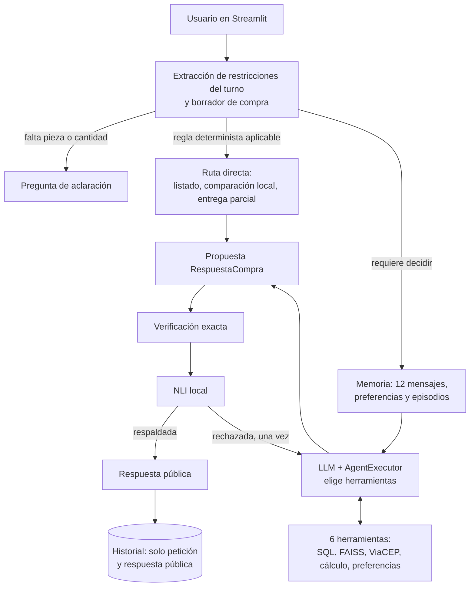

# Respuestas a las rúbricas R01–R29

Este documento responde, una por una, a las 29 preguntas de la rúbrica según la guía integrada [guide/Fases_Temas_Tareas_Rubricas_ComprasLab_Leyendas.pdf](../guide/Fases_Temas_Tareas_Rubricas_ComprasLab_Leyendas.pdf). Cada respuesta indica qué se hizo, dónde está la evidencia, qué decisión técnica se tomó y qué queda pendiente. El estado resumido de todas las rúbricas vive en [matriz.md](matriz.md) y el registro de ejecuciones en [evidencias.md](evidencias.md).

Todos los datos del proyecto (catálogo, proveedores, stock, precios y políticas) son sintéticos.

**Avance de redacción:** R01–R05 redactadas y con ejecución guardada. R06–R29 pendientes de redactar, en orden.

---

# Fase 1 — Chain ejecutable y arquitectura

## R01 — Anatomía, arquitectura cognitiva, tipo de agente y madurez agéntica

> ¿El alumno estructuró la anatomía y la arquitectura cognitiva del agente, clasificando su tipo y nivel de madurez agéntica?

**Respuesta corta.** Pedro es un agente **híbrido**: una capa reactiva de reglas deterministas resuelve lo que no debe quedar a criterio del modelo, y una capa deliberativa, guiada por el LLM, elige herramientas, mantiene estado entre turnos y revisa su propia propuesta antes de publicarla. Su madurez actual es la de un **agente único con herramientas, memoria y autoverificación** (nivel 4 de 5 en la escala usada abajo), y esa es también su madurez objetivo, consolidada con evaluación medida.

### 1. Anatomía del agente

En clase, la anatomía general de un agente se describió con cuatro elementos — ambiente, sensores, herramientas y motor cognitivo (el LLM) — más un orquestrador que comunica herramientas, prompts y memorias (clase del 14-10-2026, repaso de la primera clase). La tabla aplica esa anatomía a Pedro y añade los componentes que pide la guía: system message, memoria, base de conocimiento y flujo general.

| Componente | En Pedro | Ubicación |
|---|---|---|
| **Ambiente** | Un escenario aislado: copia SQLite del catálogo con `dataset_id` UUID y manifiesto SHA-256, el corpus de políticas y el servicio externo ViaCEP. El agente solo lee; no compra ni paga. | [catalog.py](../src/pedro/catalog.py) |
| **Motor cognitivo (LLM)** | `ChatOpenAI`, modelo `gpt-4.1-mini` por defecto, configurable con `PEDRO_MODEL`. Sin `OPENAI_API_KEY` la aplicación funciona degradada con la capa determinista. | [app.py](../app.py) |
| **System message** | Prompt con estructura PTCF (Persona, Tarea, Contexto, Formato), el `dataset_id` activo, cuatro ejemplos few-shot de acciones observables y las instrucciones de formato de `RespuestaCompra`. | `crear_agente` en [agent.py](../src/pedro/agent.py); [prompts.py](../src/pedro/prompts.py) |
| **Sensores** (herramientas que perciben el ambiente) | `buscar_productos` (candidatos por ID, SKU o nombre), `consultar_catalogo` (text-to-query sobre SQLite), `consultar_politicas` (recuperación FAISS con fuentes) y `consultar_cep` (API externa ViaCEP). | `herramientas` en [agent.py](../src/pedro/agent.py); [query.py](../src/pedro/query.py); [rag.py](../src/pedro/rag.py); [integrations.py](../src/pedro/integrations.py) |
| **Herramientas** (que calculan o actúan) | `comparar_ofertas` (cálculo exacto en centavos con descartes) y `guardar_preferencia` (única escritura: una preferencia citada explícitamente por el usuario). | `herramientas` en [agent.py](../src/pedro/agent.py); [business.py](../src/pedro/business.py) |
| **Memoria** | Corto plazo: ventana de los últimos 12 mensajes y borrador de compra por sesión. Largo plazo: preferencias explícitas por usuario y episodios vectoriales FastEmbed (384 dimensiones) recuperables entre sesiones. Todo en SQLite, aislado por `user_id`. | [memory.py](../src/pedro/memory.py); [dialogue.py](../src/pedro/dialogue.py) |
| **Base de conocimiento** | Datos estructurados: catálogo SQLite (2640 piezas, 7920 ofertas). Datos documentales: políticas indexadas en FAISS con metadatos y filtro por tema. | [catalog.py](../src/pedro/catalog.py); [policy_demo.py](../src/pedro/policy_demo.py); [knowledge/politicas_demo/](../knowledge/politicas_demo/) |
| **Orquestrador** | LangChain: `create_openai_tools_agent` + `AgentExecutor` (máximo 6 iteraciones) envueltos en `RunnableWithMessageHistory`. | `crear_agente` y `crear_flujo` en [agent.py](../src/pedro/agent.py) |
| **Puerta de publicación** | Verificación exacta (total, stock, presupuesto, plazo, IDs, procedencia) y NLI local triclase. Solo se muestra lo que pasa ambas. | [verification.py](../src/pedro/verification.py); [nli.py](../src/pedro/nli.py) |
| **Interfaz** | Streamlit con vistas de Chat, Catálogo y Comparación sobre el mismo agente, memoria y verificador. | [app.py](../app.py) |

### 2. Arquitectura cognitiva y flujo general



La arquitectura cognitiva se describe con CoALA, el marco que el curso usa por defecto para agentes cognitivos (clase del 21-10-2026):

| Elemento CoALA | En Pedro |
|---|---|
| Memoria de trabajo | Mensaje actual, borrador de compra de la sesión y ventana de 12 mensajes |
| Memoria episódica | Episodios vectoriales de recomendaciones pasadas, por usuario |
| Memoria semántica | Catálogo SQLite, políticas en FAISS y preferencias explícitas del usuario |
| Memoria procedimental | System message PTCF, ejemplos few-shot, reglas deterministas y código de verificación |
| Acciones internas | Recuperar recuerdos y políticas (retrieval), razonar con el LLM, guardar un episodio o una preferencia (aprendizaje) |
| Acciones externas | Leer SQLite, consultar ViaCEP y responder al usuario |
| Ciclo de decisión | Proponer (regla o LLM con herramientas) → evaluar (verificación exacta y NLI) → ejecutar (publicar o corregir una vez) |

El ciclo de un turno es: **percibir** (extraer intención y restricciones del mensaje, cargar memoria), **decidir** (regla directa o agente con herramientas), **actuar** (consultar SQL, políticas o API y calcular), **verificar** (comprobaciones exactas y NLI) y **responder**. Si la propuesta no pasa la verificación, el agente dispone de una única pasada de corrección; si vuelve a fallar, no se publica la recomendación. El mismo flujo está en [arquitectura.mmd](arquitectura.mmd).

### 3. Clasificación: agente híbrido

| Capa | Comportamiento en Pedro | Por qué pertenece a esa capa |
|---|---|---|
| **Reactiva** | Pedir la cantidad cuando falta; enrutar «¿se puede mandar en varias cajas?» directamente a `consultar_politicas`; comparar ofertas en centavos enteros con desempate fijo; listar el catálogo; operar sin clave de OpenAI. | Estímulo → respuesta por regla fija, sin modelo del mundo ni planificación. Es predecible y verificable. |
| **Deliberativa** | El LLM decide qué herramientas llamar y en qué orden (hasta 6 iteraciones); mantiene un estado interno entre turnos (borrador, ventana de mensajes, recuerdos); contrasta su propuesta con la evidencia y la corrige una vez antes de publicar. | Hay representación de estado, elección entre alternativas y revisión de la propia salida frente a un objetivo. |

Pedro no es **reactivo puro** porque conserva estado entre turnos y elige herramientas según la solicitud. Tampoco es **deliberativo puro** porque no construye un plan explícito de varios pasos ni replanifica más allá de la única corrección, y porque una parte de las decisiones la toman reglas deterministas.

**Decisión técnica.** Se eligió el diseño híbrido de forma deliberada. En clase se definió la autonomía como un agente «pronto para tomar decisões e não só para obedecer direcionamentos», y se advirtió que usar un LLM solo para seguir órdenes es desperdiciar el recurso. Pedro aplica ese criterio donde aporta valor — interpretar la solicitud, elegir herramientas, redactar la respuesta — y lo retira donde un error tendría coste: los importes, el stock, los plazos y la procedencia de las fuentes se calculan y verifican con código determinista, nunca con el modelo.

### 4. Madurez agéntica: actual y objetivo

> **Supuesto declarado.** La escala de madurez se presentó en la primera clase, cuya transcripción no está en este workspace. Se usa aquí una escala genérica de cinco niveles; debe sustituirse por la escala exacta del curso cuando esté disponible, ajustando solo la etiqueta del nivel.

| Nivel | Descripción | ¿Pedro lo alcanza? |
|---|---|---|
| 1 | Chain fija: una llamada al LLM con entrada y salida estructuradas | Sí — [chains.py](../src/pedro/chains.py), notebook 01 |
| 2 | Enrutamiento: el flujo elige entre caminos predefinidos | Sí — `RouterCompras` en [legacy.py](../src/pedro/legacy.py) y rutas directas en [agent.py](../src/pedro/agent.py) |
| 3 | Agente con herramientas: el LLM decide qué herramienta usar | Sí — seis herramientas bajo `AgentExecutor` |
| 4 | Agente con memoria y autoverificación: estado entre turnos y sesiones, y revisión de la propia salida antes de publicar | **Sí — nivel actual** |
| 5 | Sistema multiagente o autónomo: planificación de largo horizonte, varios agentes, acciones con efecto real | No, y no es el objetivo |

**Madurez actual: nivel 4 en diseño, demostrado solo en local.** El agente decide herramientas, recuerda y se autoverifica, con autonomía acotada a propósito: solo lee del escenario, su única escritura es una preferencia explícita del usuario, tiene un máximo de 6 iteraciones y una sola corrección. Lo que falta para darlo por demostrado es evidencia con el modelo real: no hay todavía una sesión remota completa documentada ni métricas.

**Madurez objetivo: nivel 4 demostrado con mediciones.** Se considera alcanzado cuando se cumplan estos criterios:

| Criterio | Cómo se mide | Rúbrica |
|---|---|---|
| El LLM real elige las herramientas correctas | Trayectoria esperada frente a observada en los 30 casos de LangSmith | R29 |
| Las respuestas son correctas | Métricas de contenido, ganador e importe en LangSmith | R29 |
| Nada se publica sin respaldo | Cero recomendaciones publicadas que no pasen verificación exacta y NLI | R24 |
| Hay continuidad entre turnos con el modelo real | Sesión remota multi-turno documentada | R18, R26, R27 |

No se persigue el nivel 5 porque el problema — recomendar una oferta verificada para una pieza — no requiere varios agentes ni ejecutar compras, y más autonomía reduciría la trazabilidad que la puerta de verificación garantiza.

### Evidencia

| Evidencia | Ubicación | Tipo |
|---|---|---|
| Anatomía leída de los objetos reales del agente: modelo, executor, system message PTCF, seis herramientas con su papel y lógica, memoria, base de conocimiento y puerta de publicación | [notebooks/01_chain_mvp.ipynb](../notebooks/01_chain_mvp.ipynb) §«R01 · anatomía del agente»; [anatomia.py](../src/pedro/anatomia.py) | Ejecución real local (sin modelo) |
| Agente híbrido en acción: «lista piezas» y «Compara PEC-01-0001» se resuelven por regla con 0 llamadas al modelo; la pregunta de CEP pasa por el modelo, que recibe seis herramientas y ejecuta `consultar_cep` | [notebooks/01_chain_mvp.ipynb](../notebooks/01_chain_mvp.ipynb) §«R01 · agente híbrido» | Ejecución con **doble de prueba**: modelo guionado y ViaCEP simulado; el flujo, el executor, la herramienta y la verificación son los reales |
| La anatomía descrita coincide con el agente construido | [tests/test_anatomia.py](../tests/test_anatomia.py) | Prueba automática (32/32 pruebas) |
| Explicación de componentes, clasificación y madurez | Esta sección; [arquitectura.mmd](arquitectura.mmd) | Documentación |

### Pendientes y limitaciones

- La escala de madurez es genérica (supuesto declarado); sustituirla por la del curso cuando esté disponible la clase 1.
- En la demostración de la capa deliberativa la herramienta la pide un modelo guionado, no un LLM. La elección hecha por el modelo real se documenta en R26.
- El chat usa el índice de políticas demo en memoria; el índice preexistente que exige R22 aún no existe.

---

## R02 — Arquitectura de planificación y memoria aumentada

> ¿El alumno proyectó una arquitectura de planificación y memoria aumentada para el agente?

**Respuesta corta.** Una solicitud compleja se divide en cinco subtareas con salida observable (extraer, consultar, comparar, verificar, publicar). La memoria se reparte en dos niveles: la **sesión** guarda lo que solo sirve para la compra en curso y el **usuario** guarda lo que debe sobrevivir a la sesión. Ningún precio ni stock se toma de la memoria: siempre se releen del escenario activo.

### 1. Planificación: cómo se divide una solicitud

| Paso | Subtarea | Quién la hace | Salida observable |
|---|---|---|---|
| 1 | Extraer pieza, cantidad, presupuesto y plazo del mensaje; detectar qué falta | Regla determinista | Borrador `EstadoCompra` o pregunta de aclaración |
| 2 | Consultar los datos necesarios | Herramientas de lectura (SQL, FAISS, ViaCEP) | Ofertas, fragmentos de política o ciudad/UF |
| 3 | Comparar ofertas con las restricciones | Cálculo determinista en centavos | Alternativas con «cumple» o motivo de descarte |
| 4 | Verificar la propuesta | Verificación exacta y NLI | Lista de errores (vacía si pasa) |
| 5 | Publicar o corregir | Flujo | Respuesta pública, o una única corrección |

Hay dos planificadores, según el tipo de solicitud:

- **Plan fijo (capa reactiva).** Una compra con ID y cantidad sigue siempre los pasos 1 a 5 en ese orden, sin modelo.
- **Plan decidido por el LLM (capa deliberativa).** Cuando interviene el modelo — por ejemplo para confirmar un CEP o recalcular tras «ahora 3 unidades» —, el agente elige qué herramientas llamar y en qué orden dentro del `AgentExecutor`, con un máximo de 6 iteraciones. El prompt le da un «plan visible»: `buscar_productos` para resolver el ID, `consultar_catalogo` para las ofertas y `comparar_ofertas` para todos los importes.

Reglas de planificación:

- Solo se pregunta por lo que bloquea el plan: la pieza y la cantidad. Presupuesto y plazo son filtros opcionales.
- La petición actual prevalece sobre el historial: un cambio de cantidad conserva los demás límites.
- El plan nunca termina en una acción con efecto real: no hay compra ni pago.

**Decisión técnica.** No se añadió un planificador explícito (un paso que escriba el plan antes de actuar). Para un dominio con cinco subtareas conocidas, el plan fijo es más predecible y verificable, y el bucle de herramientas cubre los casos mixtos. Se descartó además guardar el razonamiento privado del modelo: lo que se conserva son las llamadas a herramientas, que son observables.

### 2. Memoria aumentada: qué va a cada nivel

| Información | Nivel | Dónde vive | Cuándo se actualiza o descarta |
|---|---|---|---|
| Mensaje actual | Corto plazo | Entrada del turno | Se sustituye en cada turno |
| Borrador de compra (pieza, cantidad, presupuesto, plazo) | Corto plazo | SQLite, por sesión | Cada turno; un ID distinto lo reinicia; «sin presupuesto/plazo» borra ese límite |
| Ventana de conversación | Corto plazo | Últimos 12 mensajes de la sesión | Ventana deslizante; el historial completo se conserva pero no se envía |
| Preferencias del usuario | Largo plazo (semántica) | SQLite, por usuario | Solo si el usuario la cita explícitamente; el valor nuevo reemplaza al anterior |
| Episodios de recomendaciones | Largo plazo (episódica) | SQLite con vector FastEmbed, por usuario | Se guarda cuando el agente publica una respuesta de compra verificada; se recupera por similitud (top 3) |
| Reglas, prompt y verificación | Largo plazo (procedimental) | Código y `prompts.py` | Cambia solo con una nueva versión del proyecto |
| Precios, stock y plazos | **No es memoria** | Escenario SQLite activo | Siempre se releen; los valores de un episodio se tratan como históricos |

**Decisión técnica.** La separación por sesión y por usuario evita dos errores del dominio: arrastrar la cantidad de una compra a otra, y recomendar con un precio viejo. Por eso el borrador muere con la sesión y los episodios se inyectan con la etiqueta «histórico» y la instrucción de no usar sus precios ni su stock. Cada recuerdo lleva su `dataset_id`, así que un episodio de otro catálogo queda identificado.

### Evidencia

| Evidencia | Ubicación | Tipo |
|---|---|---|
| Solicitud «Necesito 2 unidades de PEC-01-0001 hasta R$ 5.000 en 7 días» dividida en los cinco pasos, con la salida de cada uno | [notebooks/01_chain_mvp.ipynb](../notebooks/01_chain_mvp.ipynb) §«R02 · planificación» | Ejecución real local (sin modelo) |
| Corto plazo: al pedir «ahora 3 unidades» el borrador conserva el plazo de 7 días; 18 mensajes guardados, 12 visibles | [notebooks/01_chain_mvp.ipynb](../notebooks/01_chain_mvp.ipynb) §«R02 · memoria aumentada» | Ejecución real local (sin modelo) |
| Largo plazo: la preferencia aparece en una sesión nueva del mismo usuario y no en otro usuario; la sesión nueva empieza sin borrador | Mismo notebook | Ejecución real local |
| Plan decidido por el LLM real, por turnos: compra → `consultar_catalogo` y `comparar_ofertas`; CEP → `consultar_cep` (São Paulo/SP); «ahora 3 unidades» → `comparar_ofertas` con cantidad 3 y el plazo de 7 días conservado (R$ 4.401,99) | [trazas/r02_planificacion_llm.json](trazas/r02_planificacion_llm.json); [scripts/demostrar_r02.py](../scripts/demostrar_r02.py) | **Ejecución real remota** (OpenAI `gpt-4.1-mini`, ViaCEP real, NLI real local) |
| Pregunta de política por turnos: antes no se publicaba; tras anclar las citas se publica con dos fuentes | [trazas/r02_planificacion_llm_antes.json](trazas/r02_planificacion_llm_antes.json) y [trazas/r02_planificacion_llm.json](trazas/r02_planificacion_llm.json); [citas_ancladas.md](citas_ancladas.md) | Ejecución real remota, antes y después |
| Solicitud mixta en un solo turno: el LLM la dividió en las cinco herramientas necesarias (catálogo, comparación, políticas, CEP, búsqueda), pero la respuesta **no se publicó** | Mismo archivo | Ejecución real remota; resultado negativo conservado |
| Episodios vectoriales guardados, actualizados y recuperados | [notebooks/03_memoria_chatbot.ipynb](../notebooks/03_memoria_chatbot.ipynb) | Ejecución real local (FastEmbed) |
| Reglas del borrador y aislamiento | [tests/test_dialogue.py](../tests/test_dialogue.py); [tests/test_memory_nli.py](../tests/test_memory_nli.py) | Pruebas automáticas |

### Pendientes y limitaciones

- **Una solicitud mixta en un solo turno no se publica.** El LLM planifica bien las herramientas, pero `RespuestaCompra` admite un solo estado (recomendación, política o CEP) y la verificación rechaza la mezcla. El diseño vigente es una intención por turno; la solicitud compleja se resuelve repartida en turnos, como muestra la evidencia.
- **La pregunta general de política falló con el modelo real y se corrigió.** El modelo citaba el fragmento casi literal y la verificación exigía texto idéntico. Ahora el sistema ancla la cita al texto de la fuente; diagnóstico y antes/después en [citas_ancladas.md](citas_ancladas.md).
- No hay planificador explícito: el plan mixto lo decide el LLM en el bucle de herramientas y no queda escrito antes de ejecutarse.
- No hay resumen del historial: lo que sale de la ventana de 12 mensajes solo vuelve si quedó como episodio o preferencia.
- La trayectoria del LLM puede variar entre ejecuciones; la traza guardada es una observación, no una métrica.

## R03 — Plantillas de prompt reutilizables

> ¿El alumno construyó plantillas de prompt reutilizables con PromptTemplate o ChatPromptTemplate?

**Respuesta corta.** Sí. Hay dos `ChatPromptTemplate` con nombre propio en [prompts.py](../src/pedro/prompts.py): una para interpretar solicitudes de compra y otra para el agente final. La primera se reutiliza en dos cadenas distintas y se ejecutó con el modelo real sobre tres solicitudes del dominio.

### 1. Las plantillas

| Plantilla | Para qué sirve | Variables | Dónde se reutiliza |
|---|---|---|---|
| `PLANTILLA_EXTRACCION` (alias `PROMPT` en [chains.py](../src/pedro/chains.py)) | Interpretar una solicitud y devolver intención, datos y faltantes | `texto` (la solicitud) y `formato` (instrucciones del parser) | Cadena LCEL (`crear_lcel`) y cadena `@chain` (`crear_chain`) |
| `PLANTILLA_AGENTE`, usada por `crear_agente` en [agent.py](../src/pedro/agent.py) | System message PTCF del agente final | `dataset_id`, `ejemplos`, `formato`, `input`, `chat_history`, `agent_scratchpad` | Cada turno y cada corrección del agente, con cualquier escenario |

Las dos tienen la misma forma: un mensaje de sistema fijo con huecos y un mensaje humano con la solicitud. Los ejemplos few-shot están en el mismo archivo y entran a la plantilla del agente como una variable más.

### 2. Qué las hace reutilizables

- **Variables en lugar de texto fijo.** La solicitud, el escenario y los ejemplos se inyectan; el texto de la plantilla no cambia.
- **`partial` para lo que no cambia por turno.** Las instrucciones de formato salen del parser Pydantic y se fijan una vez; queda libre solo `texto`.
- **Un solo archivo.** Las dos plantillas y los ejemplos viven en `prompts.py`; el resto del código las importa.
- **Un objeto, varias cadenas.** La misma `PROMPT` alimenta la versión declarativa y la imperativa, así que un cambio de redacción se hace en un solo sitio.

**Decisión técnica.** Se eligió `ChatPromptTemplate` y no `PromptTemplate` porque el modelo es de chat y la plantilla necesita separar papeles: las reglas van en el mensaje de sistema y la solicitud del usuario en el mensaje humano. Esa separación evita que el texto del usuario se mezcle con las instrucciones. Coincide con la indicación de clase de centrarse en `ChatPromptTemplate` como patrón actual. No se añadió un `PromptTemplate` de texto plano solo para exhibirlo: la rúbrica pide una u otra y ningún punto del flujo usa un modelo de texto.

### Evidencia

| Evidencia | Ubicación | Tipo |
|---|---|---|
| La plantilla rellenada con tres solicitudes del dominio: clase, variables, `partial`, mensajes resultantes y comprobación de que la cadena LCEL usa la misma plantilla | [notebooks/01_chain_mvp.ipynb](../notebooks/01_chain_mvp.ipynb) §«R03 · plantilla reutilizable» | Ejecución real local (sin modelo) |
| La plantilla ejecutada con el modelo: «Compara 2 unidades de PEC-01-0001 hasta R$ 5.000 en 7 días» → comparar, 2 unidades, 500000 centavos, 7 días; «Necesito un termostato para nevera, sin prisa» → falta cantidad; «¿A qué ciudad corresponde el CEP 01001000?» → intención cep | [trazas/fase1_chain_llm.json](trazas/fase1_chain_llm.json); [scripts/demostrar_fase1.py](../scripts/demostrar_fase1.py) | **Ejecución real remota** (OpenAI `gpt-4.1-mini`, temperatura 0) |
| Cada plantilla declara sus variables, separa sistema y humano, sirve para cualquier escenario y falla si falta una variable | [tests/test_prompts.py](../tests/test_prompts.py) | Pruebas automáticas |
| La misma plantilla en las cadenas LCEL y `@chain` con modelo doble | [notebooks/01_chain_mvp.ipynb](../notebooks/01_chain_mvp.ipynb), primera celda | Ejecución con doble de prueba |

### Pendientes y limitaciones

- La ejecución real es una sola corrida de tres solicitudes; no mide la tasa de acierto de la extracción.

## R04 — Output parser con salida estructurada en JSON

> ¿El alumno implementó un output parser para generar salida estructurada en JSON a partir de la chain?

**Respuesta corta.** Sí. La cadena convierte una solicitud en un objeto `Extraccion` validado con Pydantic. Además se construyó un **laboratorio de salidas rotas**: ocho defectos típicos de un modelo, cada uno resuelto por una capa distinta, con el modelo real haciendo las reparaciones.

### 1. De la solicitud al objeto validado

«Compara 2 unidades de PEC-01-0001 hasta R$ 5.000 en 7 días» produce, con el modelo real:

```json
{"intencion": "comparar",
 "solicitud": {"producto_id": "PEC-01-0001", "cantidad": 2,
               "presupuesto_centavos": 500000, "plazo_max_dias": 7},
 "faltantes": []}
```

El esquema está en [contracts.py](../src/pedro/contracts.py) y la cadena en [chains.py](../src/pedro/chains.py): plantilla → modelo → `PydanticOutputParser` → regla de dominio.

### 2. Tres capas de defensa

Un modelo puede fallar de tres maneras distintas, y cada una necesita una defensa diferente:

| Capa | Qué defiende | Cómo |
|---|---|---|
| **Sintaxis** | Que la salida sea JSON | El parser tolera cercas de markdown y texto alrededor |
| **Esquema** | Que los datos tengan el tipo correcto | Pydantic rechaza «dos» como cantidad, una cantidad negativa o una intención fuera de la lista |
| **Dominio** | Que el dato signifique lo correcto | Los faltantes los recalcula el código: no se confía en lo que el modelo declare. Un dato ausente es `null`, nunca cero |

Cuando la sintaxis o el esquema fallan, una **segunda cadena repara** la salida (`crear_lcel_robusta`). Recibe la solicitud original, la salida inválida y el mensaje de error, y su respuesta vuelve a pasar por el mismo parser. Está montada con `with_fallbacks`, así que la reparación solo se ejecuta si hay error. Hay una sola reparación: si también falla, el error se propaga y no se publica nada.

### 3. El laboratorio de salidas rotas

Ocho salidas para la misma solicitud. El generador es un doble que emite el defecto; el reparador es `gpt-4.1-mini` real.

| Defecto | Capa que lo resolvió | Reparaciones | Datos finales correctos |
|---|---|---|---|
| JSON válido | Ninguna | 0 | Sí |
| Cercas markdown y charla alrededor | Parser | 0 | Sí |
| JSON truncado | Reparación | 1 | Sí |
| Cantidad en letras («dos») | Reparación | 1 | Sí |
| Cantidad negativa | Reparación | 1 | Sí |
| Intención fuera de la lista | Reparación | 1 | Sí |
| Texto libre sin JSON | Reparación | 1 | Sí |
| Faltantes mal declarados | Regla de dominio | 0 | Sí (marca «cantidad» como faltante) |

### 4. Hallazgo: un parser tolerante puede perder datos en silencio

Al montar el laboratorio apareció algo que no estaba previsto. El parser de LangChain acepta JSON cortado. Con la cadena simple, una salida truncada se convirtió en un objeto válido **sin el plazo de 7 días y sin ningún error**. En este dominio eso es grave: la comparación se haría sin un límite que el usuario sí pidió.

La corrección fue añadir a la cadena robusta una comprobación estricta de que el JSON esté entero. Si no lo está, la salida va a reparación. La cadena simple conserva el comportamiento original, y una prueba deja documentados los dos resultados.

### 5. Parser frente a `with_structured_output`

En clase se vieron dos formas de obtener salida estructurada. Se ejecutaron las dos con el modelo real sobre las tres solicitudes y dieron **el mismo resultado**.

| | `PydanticOutputParser` | `with_structured_output` |
|---|---|---|
| Cómo fuerza el formato | Instrucciones dentro del prompt | Esquema enviado por la API del modelo |
| Funciona con cualquier modelo | Sí, también con dobles de prueba | Solo si el modelo lo soporta |
| Se puede probar sin credenciales | Sí | No |
| Permite ver y reparar la salida cruda | Sí | No, la salida ya llega convertida |

**Decisión técnica.** Se mantiene `PydanticOutputParser` como patrón principal por dos razones: la rúbrica pide un output parser, y es la única opción que deja ver el texto crudo del modelo, que es lo que hace posible el laboratorio, la reparación y las pruebas sin credenciales.

### Evidencia

| Evidencia | Ubicación | Tipo |
|---|---|---|
| Objeto validado desde tres solicitudes, con `invoke` y `batch` | [trazas/fase1_chain_llm.json](trazas/fase1_chain_llm.json) | **Ejecución real remota** (`gpt-4.1-mini`, temperatura 0) |
| Laboratorio: cinco reparaciones hechas por el modelo real, todas con datos finales correctos | Mismo archivo, `laboratorio_salidas_rotas`; [laboratorio.py](../src/pedro/laboratorio.py) | Real remoto para el reparador; el generador es un **doble** |
| `with_structured_output` igual que el parser en las tres solicitudes | Mismo archivo, `with_structured_output` | Ejecución real remota |
| Laboratorio y pérdida silenciosa de datos, reproducibles sin credenciales | [notebooks/01_chain_mvp.ipynb](../notebooks/01_chain_mvp.ipynb) §«R04» | Ejecución con **doble** (generador y reparador) |
| Cada defecto cae en su capa; la reparación recibe solicitud, salida y error; una reparación fallida no se publica; el parser simple pierde el plazo y la cadena robusta no | [tests/test_salida_estructurada.py](../tests/test_salida_estructurada.py) | Pruebas automáticas |

### Pendientes y limitaciones

- La cadena de extracción es didáctica: el chat extrae las restricciones con reglas deterministas ([dialogue.py](../src/pedro/dialogue.py)), no con esta cadena. El agente final sí usa `PydanticOutputParser` para `RespuestaCompra`.
- Las salidas rotas se escribieron a mano; no son fallos observados del modelo real, que en estas ejecuciones respondió siempre con JSON válido.
- Una sola reparación por diseño. No se midió con qué frecuencia el modelo real necesitaría reparación.

## R05 — Runnable (invoke, batch, stream) y composición con @chain

> ¿El alumno aplicó la interfaz Runnable (invoke, batch, stream) e implementó composición imperativa con el decorador @chain?

**Respuesta corta.** Sí. Los tres métodos se ejecutaron con el modelo real y se midió para qué sirve cada uno. Hay dos cadenas con `@chain`: una simple y otra con reparación de errores escrita paso a paso.

### 1. Los tres métodos, con el modelo real

Todo objeto de LangChain que sea `Runnable` ofrece los mismos tres métodos. Se usaron sobre la cadena de extracción:

| Método | Para qué sirve | Qué se observó |
|---|---|---|
| `invoke` | Una entrada, una salida | «Compara 2 unidades de PEC-01-0001 hasta R$ 5.000 en 7 días» → objeto validado |
| `batch` | Varias entradas a la vez | 3 solicitudes en **1,43 s**; las mismas 3 con `invoke` en serie tardaron **4,55 s**. Mismos resultados |
| `stream` | Recibir la salida a medida que se genera | **19 estados parciales**; el primero a los **0,45 s** de un total de 1,07 s |

Son una sola medición cada una: sirven para ver el efecto, no como benchmark.

### 2. Lo aprendido sobre `stream`

`stream` solo transmite si **todos** los pasos de la cadena saben transmitir. Se comprobó con dos cadenas:

- Con el parser Pydantic llega **un único fragmento**: necesita el JSON completo para validarlo.
- Con el parser de JSON parcial (`crear_lcel_parcial`) llega el objeto mientras se forma: `{}` → `{"intencion": "comparar", "solicitud": {"producto_id": "PEC"}}` → … → objeto completo.

La consecuencia práctica: para mostrar progreso al usuario sirve la segunda; para decidir una compra solo vale la primera, porque un estado parcial todavía no está validado.

### 3. Composición imperativa con `@chain`

`@chain` convierte una función de Python en un `Runnable`: dentro se escribe código normal y por fuera tiene `invoke`, `batch` y `stream`.

| Cadena | Qué hace |
|---|---|
| `crear_chain` | Envuelve la extracción en una función decorada |
| `crear_chain_robusta` | La extracción con reparación de R04, escrita con `try/except`: genera, intenta validar y, si falla, llama a la cadena reparadora |

```python
@chain
def extraer_con_reparacion(dato: dict) -> Extraccion:
    salida = generar.invoke(dato)
    try:
        extraccion = parser.parse(salida)
        if not _json_completo(salida):
            raise OutputParserException("JSON incompleto: la salida se cortó antes de cerrar")
    except OutputParserException as error:
        corregida = reparar.invoke({"texto": dato["texto"], "salida": salida, "error": error})
        extraccion = parser.parse(corregida)
    return _validar(extraccion)
```

Se pasó el laboratorio de salidas rotas de R04 por esta versión y por la declarativa: las dos resolvieron los ocho casos en la misma capa y con los mismos datos, también con el modelo real como reparador.

**Decisión técnica.** Se escribió la versión imperativa de la cadena con reparación, y no solo un envoltorio trivial, porque es donde `@chain` aporta algo: el control de errores se lee de arriba abajo y se puede depurar con un punto de parada. La comparación con la versión declarativa y la elección del patrón principal se justifican en R06.

### Evidencia

| Evidencia | Ubicación | Tipo |
|---|---|---|
| `invoke`, `batch` y `stream` con tiempos, estados parciales y resultado de `@chain` | [trazas/fase1_chain_llm.json](trazas/fase1_chain_llm.json); [scripts/demostrar_fase1.py](../scripts/demostrar_fase1.py) | **Ejecución real remota** (`gpt-4.1-mini`, temperatura 0); una medición |
| Cadena imperativa igual a la declarativa en los ocho casos del laboratorio, con el modelo real reparando | Mismo archivo, `laboratorio_con_chain_imperativa` | Real remoto para el reparador; generador **doble** |
| Los tres métodos sobre `@chain`, stream de 1 fragmento frente a estados parciales, y código de la cadena imperativa | [notebooks/01_chain_mvp.ipynb](../notebooks/01_chain_mvp.ipynb) §«R05» | Ejecución con **doble** (modelo que emite el JSON en trozos) |
| `@chain` expone los tres métodos; el stream parcial emite varios estados; imperativa y declarativa son equivalentes | [tests/test_salida_estructurada.py](../tests/test_salida_estructurada.py) | Pruebas automáticas |

### Pendientes y limitaciones

- Los tiempos son de una sola ejecución y dependen de la red.
- El chat de Streamlit no usa `stream`: muestra la respuesta completa porque debe pasar la verificación antes de publicarse.
- `batch` no se usa en el flujo del chat, que atiende una solicitud por turno; sí lo usaría una evaluación por lotes.

## R06 — Composición declarativa con LCEL y justificación

*Pendiente de redactar.*

---

# Fase 2 — Agente con herramientas y ReAct

## R07 — Comparación de orquestadores y elección de LangChain

*Pendiente de redactar.*

## R08 — Agente ReAct con initialize_agent, herramientas y memoria

*Pendiente de redactar.*

## R09 — Chains secuenciales o paralelas y RouterChain

*Pendiente de redactar.*

## R10 — API externa como herramienta vía function calling

*Pendiente de redactar.*

## R11 — Prompt PTCF, few-shot y chain-of-thought

*Pendiente de redactar.*

## R12 — Componentes de confiabilidad

*Pendiente de redactar.*

---

# Fase 3 — Chatbot con memoria

## R13 — Memoria de corto y largo plazo según CoALA

*Pendiente de redactar.*

## R14 — Ventana de contexto con búsqueda vectorial

*Pendiente de redactar.*

## R15 — Comparación de herramientas especializadas de memoria

*Pendiente de redactar.*

## R16 — Chatbot con ConversationBufferMemory

*Pendiente de redactar.*

## R17 — Reconocimiento de intención y extracción de entidades

*Pendiente de redactar.*

## R18 — Contexto y descomposición en una conversación real multi-turno

*Pendiente de redactar.*

---

# Fase 4 — SQL, APIs y RAG existente

## R19 — Herramientas hardcoded y semánticas

*Pendiente de redactar.*

## R20 — Integración con APIs internas o externas

*Pendiente de redactar.*

## R21 — Patrón text-to-query

*Pendiente de redactar.*

## R22 — Agente de recuperación sobre un índice FAISS existente

*Pendiente de redactar.*

## R23 — Diagnóstico y corrección de un fallo real de recuperación

*Pendiente de redactar.*

---

# Fase 5 — Agente final verificado y evaluado

## R24 — Verificación de consistencia factual y coherencia lógica

*Pendiente de redactar.*

## R25 — Agente único con herramientas de RAG, SQL o API

*Pendiente de redactar.*

## R26 — Executor con create_openai_tools_agent y AgentExecutor

*Pendiente de redactar.*

## R27 — Historial con RunnableWithMessageHistory

*Pendiente de redactar.*

## R28 — Integración del agente en Streamlit

*Pendiente de redactar.*

## R29 — Evaluación de calidad y trayectoria con LangSmith

*Pendiente de redactar.*
